

  

# One Poem Suffices: Agent Skills

`READ⏰: 50min`

!!! ambition "One Poem Suffices"

    ☁️ *"Don't Build Agents, Build Skills Instead"*

Agent Skills (referred to as Skills below) has undoubtedly been one of the hottest topics from late 2025 to the present. I actually wrote an early draft quite a while ago, but at the time I lacked hands-on experience, so the writing stayed at the level of surface explanation. Lately, the hotter topic in engineering circles has been Harness Engineering, and through that kind of engineering practice I have accumulated some practical insights into Skills, then went back and rewrote this piece several times in the hope of offering some different perspectives on understanding Agent Skills.

As a format standard, Skills are very simple: a folder, a `SKILL.md`, plus optional scripts and reference materials. It doesn't look like a new Agent Framework, nor does it standardize access to external capabilities the way MCP does; it is more like a lightweight packaging format that different Agent Harnesses can read. You can implement the Skills feature for most Agent Frameworks with very little code (see [agentskills/skills-ref](https://github.com/agentskills/agentskills/tree/main/skills-ref/src/skills_ref) and the [Agent Skills Specification](https://agentskills.io/specification)). Yet discussion around it has kept building: for a stretch of time, Skills / agent-guideline repos appeared frequently on GitHub Trending, and [`andrej-karpathy-skills`](https://github.com/multica-ai/andrej-karpathy-skills), for instance, has already passed 150k stars.

  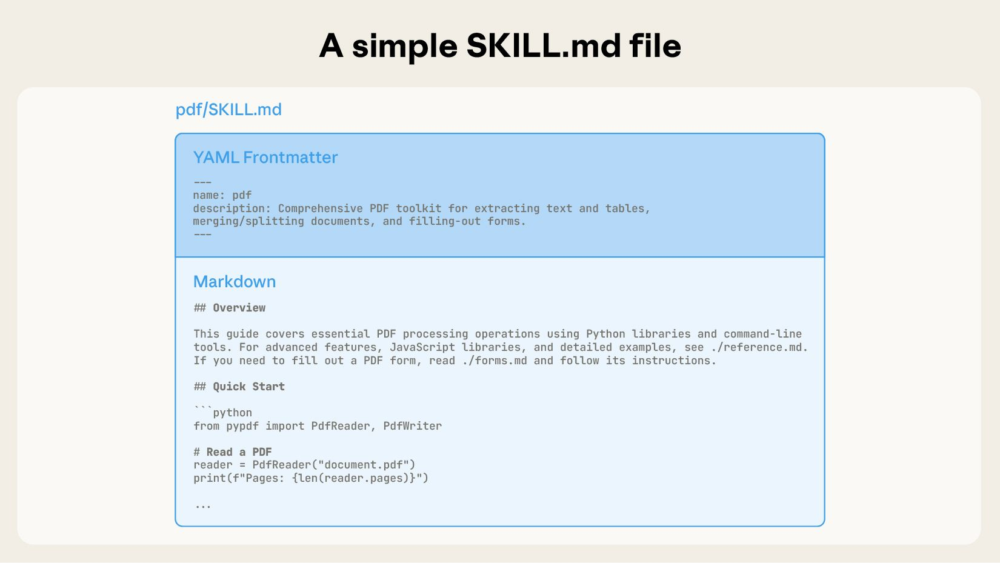

**"Are Skills really that useful?"** That was the question I kept asking myself when I first read articles on the subject, because the design is just so simple. Today, though, almost all of my tasks have project-level and personal-level Skills to reduce **control / alignment** costs: getting the Agent to follow a workflow I designed, and getting the model's output style and substance to align with my preferences. From the long-term perspective of [The Bitter Lesson](https://www.cs.utexas.edu/~eunsol/courses/data/bitter_lesson.pdf), hardcoding human knowledge into AI systems is often not the most scalable path; but in concrete task engineering, our goal isn't to push the frontier of general intelligence, it's to get the job done efficiently and save our own **thinking budget** for the steps that genuinely require taste and judgment. The whole definition of Skills also fits Anthropic's engineering philosophy very well: ***Do the simple thing that works***.

What do Skills provide to an Agent? In his [talk at AI Engineer](https://youtu.be/CEvIs9y1uog), Barry Zhang, lead of the Anthropic Skills team, defined them as "***composable procedural knowledge for agents***". The key phrase here is **Procedural Knowledge**. Unlike declarative or factual knowledge (knowing *what* something is), procedural knowledge describes *how* to do something and *what counts as doing it right*. Because it is bound to specific scenarios, it can also be understood as practical experience distilled from a particular domain (Domain Expertise).

!!! note "Why call it Procedural Knowledge instead of Workflow Knowledge?"

    When I first started writing this blog post, I intuitively used the term Workflow Knowledge. Later I wanted to figure out why Anthropic specifically chose the word Procedural, so I looked into the background: it comes from cognitive science, where in contrast to declarative knowledge ("knowing what"), it refers to the category of knowledge about "knowing how" (see [Wikipedia: Procedural knowledge](https://en.wikipedia.org/wiki/Procedural_knowledge)).

    After reading up on it, I came around to this usage too. Not every Skill is a workflow: a brand design Skill that only locks down color palettes and fonts can hardly be called Workflow Knowledge. Procedural has a broader scope, accommodating both simple "follow the spec" instructions and complex "follow the process" workflows. From here on, this post will consistently use Procedural Knowledge.

Even up to this point, though, one question remained unresolved for me: **What is the essence of Skills?** If you simply follow Anthropic's official narrative, it is easy to interpret Skills as "a packaging format for Agent capabilities," and this post would turn into a synthesis of several Anthropic blog posts, which wouldn't really need to be written by me (Opus / GPT might be better suited for that). Going back to first principles to think about this question, and combining it with thoughts from my earlier blog posts, my understanding starts from two points.

  

**First, Skills are essentially Context.** Technically, you can put any type of context into a Skills folder. Using the taxonomy from my post [One Poem Suffices: Context Engineering](../context-engineering/), it can be instructional context or informational context: factual data, API documentation, or even a RAG index. So "what type of knowledge it provides" is not the core innovation of Skills; plain Context files can provide Procedural Knowledge too.

Then why do best practices consistently show that Procedural Knowledge is especially well suited to the Skills format? As I see it, there are three reasons: (1) Its trigger signal is the **task type**: when the model sees "generate a PDF report," it knows it should load the PDF workflow; text classification over the Skill's `description` is enough, with no vector retrieval required. (2) Its content is **naturally structured**: steps, tools, and references map cleanly onto a folder hierarchy. (3) Its reuse is **whole-package and cross-session**: the same workflow applies as-is across different sessions and in different people's hands, and what gets pulled each time is the same complete body of content, which makes the ROI of packaging high enough. Take a counterexample from a common RAG scenario: an internal company product FAQ. There, the trigger signal is the semantics of the user's question (which calls much more for vector retrieval than task-type classification), the content is flat Q&A pairs, and the unit of reuse is individual entries rather than a whole package: each query hits only a few entries, different ones every time, and there is no "workflow" worth loading as a whole. For that kind of Context, RAG is a better fit than a Skill.

!!! question "At this point a very direct question may come up: `scripts/` are executable tools, so how can you simply say Skills are Context?"

    My thinking is: first, in my Context Engineering post I divided context into three categories, and alongside the two mentioned above there is a third, **actional context**: tool definitions and usage instructions are themselves Context. MCP (Model Context Protocol) is the standardized protocol for this, and `scripts/` can be viewed as its local counterpart. Second, from start to finish a Skill is only responsible for providing Context; "being able to run" is a capability provided by the Harness/Sandbox. Put the exact same Skill into a Harness without an execution environment, and `scripts/` degenerates into reference code that can be read. Section 1.3 below unpacks this in more detail.

**Second, the design of Skills reflects a paradigm shift from Push to Pull.** This judgment comes from my thinking while writing [One Poem Suffices: Just-in-Time Context](../just-in-time-context/). In the traditional mode, humans build retrieval systems and stuff whatever context they think the model might need into the prompt (Push); once model capability crosses a certain intelligence threshold, that kind of **hardcoding** becomes a constraint instead. That is why Anthropic started pushing Just-in-Time Context early on: give only **references and a directory**, and leave as much of the context window as possible for the model's own active exploration (Pull). The core mechanism of Skills is the core mechanism of JIT Context: **References as Context** and **Progressive Disclosure**. Resident metadata → body read on demand → references explored in depth is the concrete implementation of this paradigm.

Only by putting these two points together can we explain why Skills look the way they do today. So my conclusion is: **Agent Skills are one concrete implementation of Just-in-Time Context**. In the rest of this post I will also try to work from these two perspectives rather than merely summarizing the official blog posts.

On that basis, this post aims to answer three questions:

- **What?** As an implementation of JIT Context, what are the concrete format and mechanisms of Skills? How do they differ from existing mechanisms such as Prompt / MCP / Subagent / Memory?
- **Why?** Why now, and why in this form? What is the relationship between the rise of general-purpose Agents and Skills?
- **How?** What are the best practices for building a good Skill?

To keep the main text flowing smoothly, I moved some extended discussions into the appendices~ I poured my heart and soul into this post over several weeks, so I hope you'll give it your support~

## 1. What is a Skill?

In the introduction I started with two claims: Skills are essentially Context, and the way they are consumed is JIT/Pull. Let's start with **what a Skill is**, and explain what its concrete format and mechanisms look like.

### 1.1 Format: A Folder

Anthropic's definition of a Skill is very simple:

> Skills are organized collections of files that package composable procedural knowledge for agents. In other words, **they're folders**. This simplicity is deliberate. *"Skills are organized collections of files that package composable procedural knowledge for agents. In other words, **they're folders**. This simplicity is deliberate."*
>

Folders can be read by humans, managed with Git, shared across teams, and operated on by Agents using `Read` / `Bash` / filesystem primitives. Anyone can create a folder on their computer, write a `SKILL.md`, and iterate on it WYSIWYG-style. That makes it very friendly to a much broader base of non-technical users.

  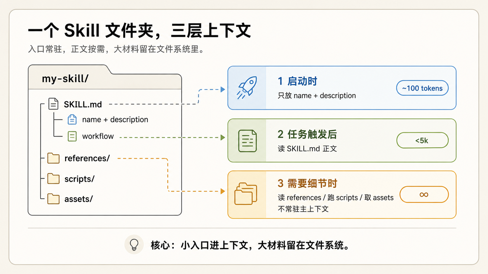

This diagram drawn by GPT shows the core structure and design of a Skill: **only a small amount of metadata stays resident in context as a trigger for the Agent to decide whether to load more; everything else stays in the folder and is pulled by the Agent on demand.** The token scale corresponding to the three-layer structure is:

- **Layer 1: metadata** (`name` + `description`): roughly **100 tokens**, preloaded into the System Prompt at startup
- **Layer 2: `SKILL.md` body**: Anthropic recommends keeping it **under 500 lines / 5,000 tokens**, read only after being triggered
- **Layer 3: bundled files** (`references/`, `scripts/`, `assets/`): **unbounded**, opened on demand by path

!!! tip

    In conversations with friends, I have noticed that many people don't realize Skills metadata stays resident in the System Prompt, just as they don't realize MCP injects Tool definitions into context. If you strip away the conceptual packaging and understand both as Context, then their presence in the context window is completely natural.

    For the same reason, more Skills is not always better. Anthropic's rule of thumb is that once you have 20-50 Skills enabled at the same time, it is time to re-evaluate and make trade-offs; a common approach is to merge similar Skills and push the detailed content down into `references/`, leaving it to progressive disclosure. Or you can go the route of the [Tool Search Tool paradigm](https://platform.claude.com/docs/en/agents-and-tools/tool-use/tool-search-tool).

### 1.2 The Core Mechanism of Skills

The core mechanism of Skills matches JIT Context: **References as Context + Progressive Disclosure**. Let me restate a few conclusions from the JIT blog post here: understanding this mechanism rests on one premise: **context is a finite resource with diminishing marginal returns**. The more tokens there are in the context window, the weaker the model's ability to extract accurate information from it ([context rot](https://research.trychroma.com/context-rot)), and Agent architectures naturally consume far more tokens than ordinary chat (Anthropic's figure is [more than 4x](https://www.anthropic.com/engineering/multi-agent-research-system)). So **managing the context window well is managing the Agent's reasoning quality**.

There is a line in [Agent Skills Best Practices](https://platform.claude.com/docs/en/agents-and-tools/agent-skills/best-practices): **"The context window is a public good."** The context window has to simultaneously hold the System Prompt, conversation history, tool results, other Skill metadata, and the materials for the current task. A Skill's three-layer structure is a way of managing this public resource: Layer 1 metadata handles trigger decisions (does this task need me?), Layer 2 body provides workflow and instructions (what exactly should be done?), and Layer 3 `references/` / `scripts/` provides detail and execution power (where to look when a specific problem comes up, and what tools to use?). The Agent drills down layer by layer, loading each layer only when needed, without wasting the attention budget.

### 1.3 Why Do Skills Need scripts/?

`scripts/` is an optional component of a Skill. Most Skills **do not need** it at the beginning (and do not have it); writing `SKILL.md` and `references/` is already enough. `scripts/` is the **ceiling** of a Skill, not the entry barrier.

**When should instructions written for the model to read be replaced with scripts for the model to run?** It's simple: **when an action has nothing to do with semantic understanding and needs to be 100% reproducible.** Anthropic gave an example: Claude kept writing the exact same styling Python snippet over and over in slide-deck tasks, so they had Claude save it into a Skill as a tool for its future self. **Repeated, stable, verifiable actions should move from natural-language interpretation into executable scripts.**

`scripts/` are essentially Tools (Anthropic's own phrase is "scripts as tools"). And to a model, tools have always been Context: the model doesn't actually "execute" anything; it sees the tool definitions (most Harnesses inject tool definitions into context when creating a new Session), emits a call, and waits for the result to come back as tokens, while execution happens outside the model in the Harness. So when the introduction says "Skills are essentially Context," `scripts/` is included in that statement: it is actional context whose definition has simply been placed in the filesystem. That brings two properties traditional Tools don't have. First, **the definition is readable and modifiable**: no matter how vaguely a traditional Tool's description (docstring) is written, the model just has to make do with it; a script is a file, the code itself is the most accurate definition, and when necessary the model can read the source directly and modify it, while when unused it sits quietly in the filesystem. Second, **it does not guarantee executability**: a script only provides the context of "here is a tool, and here is how to use it"; if actually running it runs into missing dependencies or the wrong environment, the Agent has to solve that on the spot (the `compatibility` field in the [frontmatter](https://agentskills.io/specification#frontmatter) exists to declare environment requirements up front).

  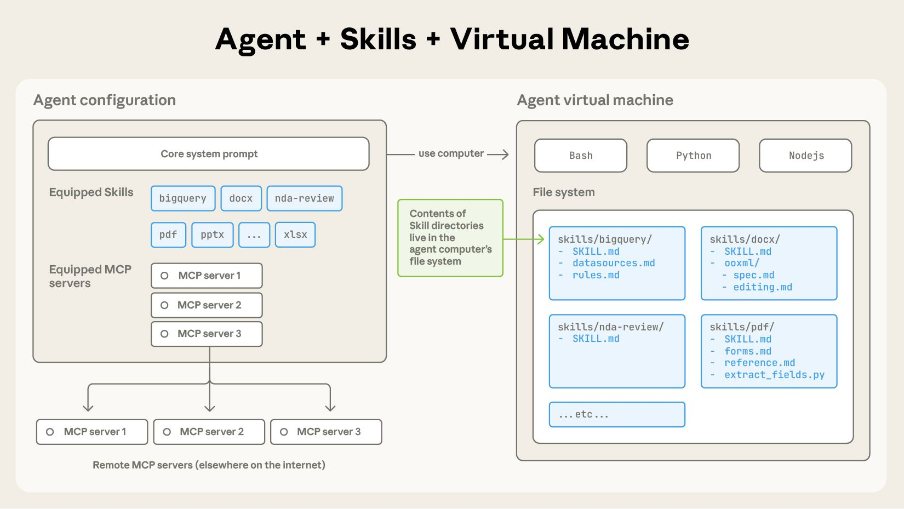

*Skill metadata is attached to the agent configuration, while the folder contents live in the filesystem of the agent's virtual machine alongside Bash / Python / Node runtimes; MCP servers live remotely. Source: [Equipping agents for the real world with Agent Skills](https://www.anthropic.com/engineering/equipping-agents-for-the-real-world-with-agent-skills)*

The second benefit is **saving tokens**. When an Agent reads a reference, it pulls the content into the context window on demand; running a script, by contrast, has an effect similar to dispatching a Subagent (you can simply think of a Subagent as an Agentic Tool), serving the role of **context isolation**. The script itself, the data it processes, and the intermediate steps are all isolated outside the "precious main context window," leaving only a single call and a single result in the window (though of course there may sometimes be a lot of log output). To give a slightly extreme example: having a model spit out the sorted result of a 1MB CSV line by line using generation tokens is both slow and expensive; a single `sort` command is enough. If progressive disclosure controls the attention budget through "read on demand," then `scripts/` takes it one step further to "don't need to read at all": turning complex, token-heavy workflows directly into tools and sparing unnecessary attention consumption.

**What is the difference between `scripts/` and MCP?**

Both are actional context, but they divide the labor differently. MCP solves **connectivity**: bringing external systems (databases, SaaS, internal services) in through a standard protocol, with tools hosted by a server and ready to use once connected. `scripts/` solves **determinism within a workflow**: it belongs to the workflow described by the Skill, hardening the repetitive, fragile steps that have nothing to do with semantic understanding into code in exchange for stability and token efficiency; it usually doesn't connect to any external system, runs locally, and if it fails to run there is no server-side fallback, so the Agent has to fix the environment itself. A common combination is therefore **MCP fetches the data → `scripts/` cleans and renders it → the model makes judgments and summarizes based on the Skill's domain knowledge**: connectivity goes to the protocol, determinism goes to scripts, and judgment stays with the model. For details, see [Extending Claude with Skills and MCP](https://claude.com/blog/extending-claude-capabilities-with-skills-mcp-servers).

In addition, `scripts/` is the only part of a Skill that imposes requirements on deployment: a pure-Context Skill can be used by any Agent that can read files; once scripts are included, you need a clean Sandbox. When deployment enters the picture, you have to navigate the trade-offs between the two schools of Agent Frameworks; see Appendix B for details.

### 1.4 How Should We Classify Skills?

Since Skills are essentially Context, we can also classify them from a Context perspective. A single Skill folder actually mixes three kinds of context (corresponding to the [three-way classification of context in the Context Engineering post](../context-engineering/)):

- **Instructional context**: workflow specifications, quality standards, and judgment principles in `SKILL.md`, telling the model "how to do it"
- **Informational context**: reference materials, templates, and data in `references/`, telling the model "what it needs to know"
- **Actional context**: executable code in `scripts/`, telling the model "what it can run"

This mapping is just a typical mental model, not a hard rule. You can certainly put a style guide (instructional) into `references/`, and `SKILL.md` will inevitably contain background information (informational). The main point here is simply that Skills can include all categories of context. Different Skills emphasize different ones. A brand design Skill may contain only instructional context (color specifications, font requirements); a PDF Skill has all three (workflow + reference docs + Python scripts).

Anthropic also offers another, complementary classification lens along two dimensions: **behavioral purpose** and **knowledge source** (from [Improving skill-creator](https://claude.com/blog/improving-skill-creator-test-measure-and-refine-agent-skills) and the [AI Engineer talk](https://youtu.be/CEvIs9y1uog)):

- **Behavioral purpose**: distinguishes whether a Skill is **compensating for capabilities the model cannot perform reliably on its own** (Capability Uplift, such as PDF parsing or Office document handling) or **encoding workflows and preferences** (Encoded Preference, such as a PR Review checklist, weekly report format, or commit message conventions).

- **Knowledge source**: distinguishes whether a Skill is **a general capability provided by the platform** (Anthropic's official `pdf` / `docx` Skills), **best practices from a third-party product** (Vercel / Supabase packaging usage of their own APIs into Skills), or **your own / your team's / your organization's way of working** (Coding Harness preferences, team PR templates, internal review processes).

Personally, I think "behavioral purpose" is a pretty good classification lens, and at present the Skills that give me the biggest efficiency boost are still the ones that encode workflows and preferences.

## 2. Skill vs Prompt / MCP / Subagent / Memory

When you put Skills side by side with related concepts, the differences are actually quite clear: they are either different types of Context or different ways of consuming it. Anthropic gave a complete comparison table in [Skills Explained](https://claude.com/blog/skills-explained); below I add some of my own understanding from my perspective.

### 2.1 vs Prompt / CLAUDE.md / AGENTS.md

Prompts, `CLAUDE.md`, `AGENTS.md`, and Skills are all telling the Agent "how to do things" (leaning more toward instructional context); the main difference lies in **when they get loaded**:

| Mechanism | When It Loads | Typical Scenarios |
|---|---|---|
| Prompt | Entered within the current conversation | One-off requests, on-the-spot corrections |
| `CLAUDE.md` / `AGENTS.md` | Loaded in full upon entering the project | Project structure, test commands, code style, prohibited actions |
| Skill | Loaded only when task semantics match | Release checks, database migrations, generating review docs in company format |

> If you find yourself typing the same prompt repeatedly across conversations, turn it into a Skill. *"If you find yourself typing the same prompt repeatedly across conversations, **create a Skill instead**."*

If you notice that completing a certain class of task requires typing the same instructions more than 5 times, those instructions should be persisted as **knowledge**. That raises a further question worth thinking through: **should you write it as a Skill, or update `CLAUDE.md`?**

The difference lies in the **scope** of that Context. `CLAUDE.md` is project-scoped: it stays resident in full in the System Prompt for every conversation, making it suitable for rules that are "always true" (project structure, test commands, code style). Repeated instructions, by contrast, are often needed only in **one specific class of task**; writing that kind of task-scoped knowledge as a Skill lets it load only on semantic match, without occupying the attention budget of unrelated conversations.

If we explain this through the Push / Pull paradigm: Prompts and `CLAUDE.md` are both **Push** (actively stuffed in by humans), whereas a Skill is **Pull** (loaded only when the Agent judges that it is needed). The three are not mutually exclusive; they stratify naturally by loading time.

### 2.2 vs MCP

"What is the difference between MCP and a Skill?" "Now that we have Skills, do we no longer need MCP?" I have seen both questions many times, but the questions themselves are aimed slightly off target: the two are compatible and complementary. Both extend Agents, just in different directions.

Anthropic's blog post [Extending Claude with Skills and MCP](https://claude.com/blog/extending-claude-capabilities-with-skills-mcp-servers) uses a kitchen analogy: **MCP is like a fully equipped kitchen**, where the stove, knives, ingredients, and walk-in cooler correspond to external systems, databases, files, and business APIs; **a Skill is like a recipe**, telling you what to do first, how much heat to use, and when to add each ingredient. **The model** is the chef standing in the middle: the kitchen gives it raw ingredients and tools, the recipe gives it the workflow, and the chef is responsible for judgment and improvisation on the spot.

The relationship between the two can be stated as: **"MCP provides connectivity; skills provide expertise."** The former solves "can it reach the thing?", while the latter solves "does it know how to use it?" Suppose you want AI to help you invest: MCP lets the Agent connect to your account, fetch holdings information, and execute trades; Skills guide the decision-making process, for example by equipping your Agent with a Warren Buffett Skill.

Moreover, the relationship between the two is **many-to-many**: a financial analysis Skill can orchestrate several data-source MCPs at once (one for market data, one for financial statements, one for research reports), while a single GitHub MCP can be reused across multiple Skills such as Code Review, Issue triage, and Release. The two ecosystems reinforce each other rather than replacing one another.

  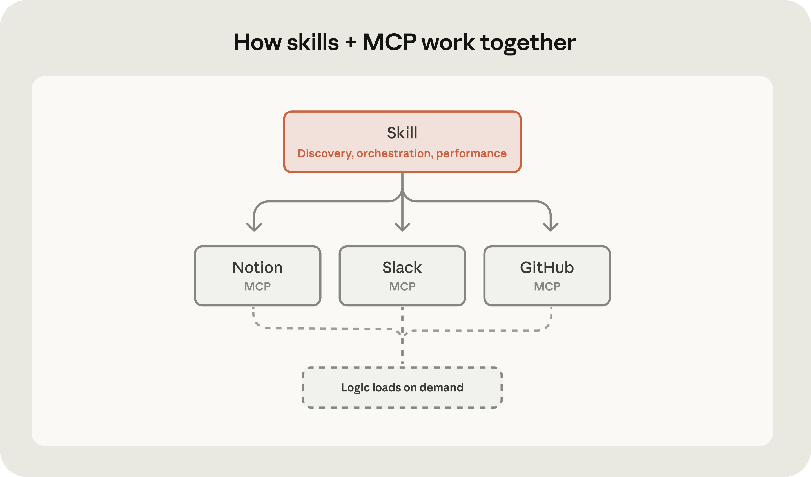

From a Context perspective: what MCP provides is almost entirely **actional context**: tool definitions, tool results, plus the channel for moving external data into the window (strictly speaking, the MCP spec also has `prompts` and `resources` primitives, but the center of gravity of the ecosystem is in `tools`, so I'm discussing the mainstream usage here). A Skill folder holds all three categories of context (see Section 1.4), but its center of gravity is **instructional context**: "how to process the data once you have it," and between the two, only the Skill is responsible for that. So we can say: MCP determines what the Agent can call, while a Skill determines whether it knows how to use it. They sit at different layers and complement each other.

### 2.3 vs Subagent

Subagents and Skills don't really live on the same plane, so they can't be compared directly. A Subagent is an **architectural mechanism**: it has its own independent Context Window and its own tool permissions; the main Agent hands off a chunk of work together with Handoff context and only takes back the final conclusion. This achieves many things, including changing the execution topology of complex tasks to enable more advanced multi-agent orchestration; scaling more tokens for subtask verification; and context isolation, keeping complex information flows out so they don't pollute the main context (**Isolate** in [One Poem Suffices: Context Engineering](../context-engineering/)). A Skill, on the other hand, is a layer of **reusable domain expertise**: it is not responsible for isolating task flows itself, only for "how this kind of job should be done."

How, then, do the two connect? Personally, I think the key lies in a necessary step when orchestrating Subagents: **every time you spawn a Subagent, you have to give it enough Handoff context**, including task background, tool usage, and workflow conventions. When your Agent repeatedly spawns Subagents for the **same class of task**, that context is highly repetitive across delegations, explaining the exact same setup over and over again. (For instance, previously every time I spawned a new Subagent, I had to explicitly require it to log progress according to my conventions based on the task type, which was a real nuisance.)

  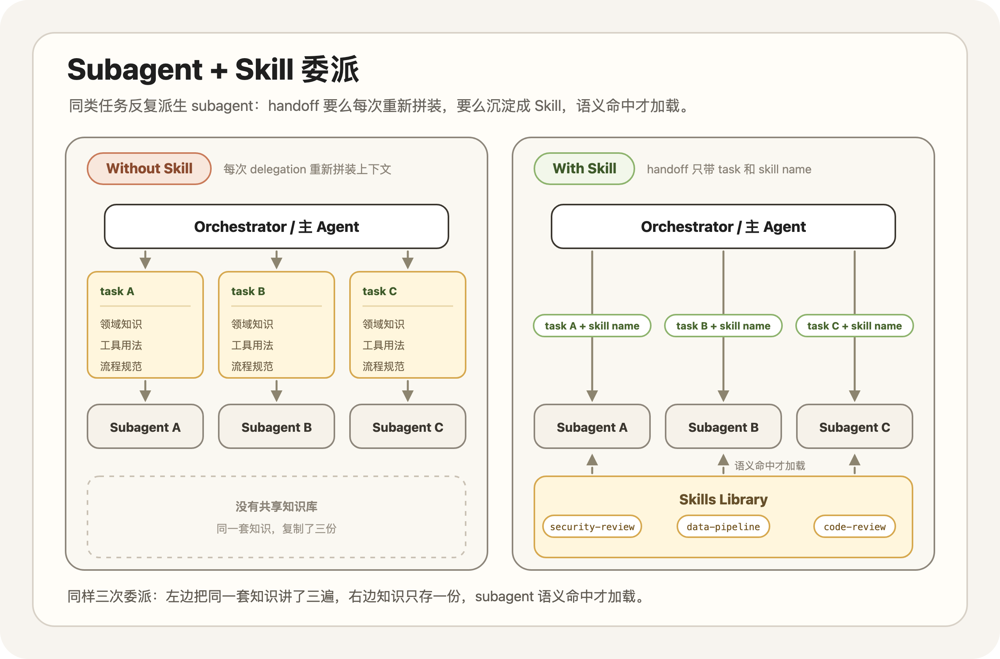

Skills fill this exact gap. By distilling that repeated context and tool usage into a Skill, you no longer have to reassemble it from scratch every time a Subagent is spawned; once the semantics match, it gets loaded. Anthropic also recommends combining Subagents and Skills in its blog posts. For example, in my own projects, if the task is a database implementation, the Orchestrator Agent designs a verification checklist based on my `my-work` Skill (renamed here for clarity) and requires another Agent to do the final review using the [supabase-postgres-best-practices Skill](https://github.com/supabase/agent-skills/tree/main/skills/supabase-postgres-best-practices). If the task is frontend-related, it automatically requires a review using the [react-best-practices Skill](https://github.com/vercel-labs/agent-skills/blob/main/skills/react-best-practices/SKILL.md). The whole workflow feels very natural and can be paired further with Hooks.

> In Claude Code and the Agent SDK, subagents can access and use Skills: pairing specialized Subagents with portable expertise is a very strong combination. *"In Claude Code and the Agent SDK, **subagents can access and use Skills**, creating powerful combinations where specialized subagents leverage portable expertise."*

To give a more everyday example, suppose you ask an Agent to produce a competitive analysis report. The main Agent dispatches a Subagent dedicated to data collection and analysis; that Subagent loads the `competitive-analysis` Skill (which defines the analytical framework: first look at positioning, then compare features, then examine pricing, and finally provide a one-page strengths-and-weaknesses comparison), runs the whole workflow inside an isolated window, and the main Agent receives only the final conclusions and key data. If you switch to a Deep Research task, you simply download a `deep-research` Skill from GitHub to replace `competitive-analysis`.

**So I lean toward the view that "Skill-equipped Subagents" will be the more natural orchestration paradigm**: the Subagent provides an isolated execution environment, the Skill provides a reusable professional workflow, and orchestration no longer relies on the Agent constructing a pile of repetitive Session-specific Context each time, instead letting the Subagent load the Skill it needs on demand. (A bit like handoff patterns in a modern company~ Though of course, aligning with human organizations is not necessarily the best practice for Agents.)

### 2.4 vs Memory

There is one more comparison worth thinking through: Memory is also cross-session, so how does it relate to a Skill? From a Context perspective, both are Context persisted across sessions, with no fundamental difference. Depending on its extraction preferences (facts vs. procedural knowledge), a Memory system can produce different types of Memory Context. Here I'll use the Memory implementation in Claude Code as an example: **Memory consists of scattered facts and preferences about you and your project that the Agent updates automatically; a Skill is procedural knowledge about how a class of task should be done, updated primarily under human direction.** That definition may not remain completely accurate in the future. Drawing on community-maintained unofficial mirrors of the Claude Code source code, I'll write down a few observations below.

!!! info "Skippable Deep Dive"

    The next few paragraphs unpack Claude Code's Memory read/write mechanisms based on "unofficial" source code. If you only care about the conclusions on how Memory and Skills differ, you can jump straight to **The differences mainly lie in three places** below without affecting the rest of your reading. Think of it as an exercise in progressive disclosure: this block is the reference file.

On the read side, both Memory and Skills follow the on-demand reading pattern. Based on the mechanism of Claude Code's auto-memory, I made the diagram below. The upper half shows Memory updates, while the lower half shows reads.

  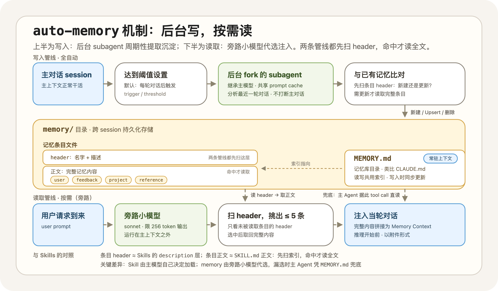

*The auto-memory mechanism in Claude Code*

The Memory write pipeline is fully automatic. If the current session is the main session and Memory is enabled, the background process forks a Subagent that inherits the main model (inheriting it so that it can share the Prompt Cache) according to a threshold setting (by default, after every turn of conversation). The Subagent is instructed to focus on analyzing the most recent turn of conversation and **comparing** it against existing memories: **if it finds a signal worth persisting, it updates the `memory/` directory and the `MEMORY.md` index by creating a new file, modifying/overwriting an existing one (Upsert), or deleting an existing file**. Note that this comparison follows the exact same paradigm as Skill loading and the Memory loading process described below: the Subagent first scans the headers (name and description) of all memory entries to decide whether to update an existing entry or create a new one, and only reads the full content of a memory entry if an update is needed.

The read pipeline also runs persistently in the background (when the relevant feature is enabled): whenever a user conversation Request arrives, a sidecar small model (in the code, it fetches sonnet with output capped at 256 tokens) reads the Headers (just like Skills, the name + description of each memory) of all **not-yet-read** Memory files, picks up to 5 of them, concatenates their full contents into Memory Context, and injects that into the current turn before reasoning begins.

Within this setup, `MEMORY.md` is a memory index similar to `CLAUDE.md`, which can be understood as the directory for the entire memory bank. It serves as an index in both the read and write pipelines of Memory (in line with Just-in-Time principles). `MEMORY.md` stays resident in context. As a result, **it also serves the main Agent: when the Memory read pipeline fails to match a memory that might actually be needed, the main Agent can directly use a tool call based on `MEMORY.md` to read the desired memory into context**.

Comparing the two, the metadata layer of Skills and the header format of Memory files are basically identical, while the body of `SKILL.md` corresponds to the concrete content of each Memory file.

The differences mainly lie in three places:

- **Type of Context**: Claude Code restricts Memory to four categories (user / feedback / project / reference), which are basically information and preferences (informational context), and the source comments specifically require storing only things that cannot be derived from project state; Skills mostly hold procedural knowledge (instructional context).
- **Construction / loading mechanism**: Memory construction is extracted periodically and "unsupervised" by a background Subagent, with the Agent rather than a human acting as gatekeeper; Skills are mostly constructed by humans and reviewed by humans. On the loading side, both follow the loading logic of Just-in-Time Context, but the decision-maker for recall differs: for a Skill, the main model reads the `description` itself and decides whether to load it, whereas Memory loading usually happens outside the main context, with a sidecar model making the decision on its behalf.
- **Scope**: Memory stores project-related informational context and is usually tightly bound to a project. The Context inside Skills leans much more toward being shareable and portable.

Personally, though, I feel that from a Context perspective, the boundary between the two can get very blurry. A feedback memory saying "run the code formatter before committing code" can be word-for-word identical to a rule inside a Skill; it is from the angle of loading and update mechanisms that more differences emerge. For my own part, my `autoMemoryEnabled` is still set to false to this day: memories generated automatically without human filtering waste tokens and occasionally even have side effects on problem solving. Thoughts on Memory and Skills in the context of continual learning are placed in Appendix C.

### 2.5 Summary

  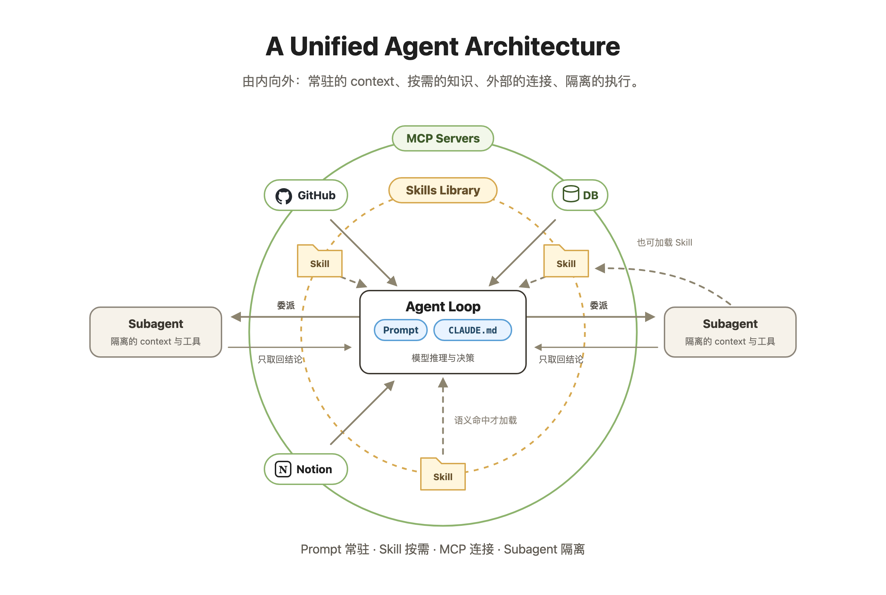

How do all of these concepts fit together? Most of them were actually proposed by Anthropic, and as I understand it, their vision is that **all future solutions should take the form of General Agent OS (Claude Code-like) + Agent Skills + MCP**.

In their view, adding capability in a new domain to an Agent often comes down to two things: configuring the right MCPs and installing the right Skills. And they are indeed rolling out industry solutions along this exact narrative: [life-sciences](https://github.com/anthropics/life-sciences) for life sciences (the repo was created the day after Skills launched, alongside the release of Claude for Life Sciences) and [financial-services](https://github.com/anthropics/financial-services) for finance, where each **"product"** is simply a packaged bundle of MCPs plus a bundle of Skills, together with a small number of Agent definitions.

To sum up briefly: Prompts and `CLAUDE.md` are Context that humans actively push into the model; MCP is responsible for connecting to the external world; Subagents are responsible for splitting off complex tasks and isolating context. What makes a Skill special is that it does two things at once: **it holds procedural knowledge, and it comes with its own on-demand loading mechanism**.

## 3. Why do we need Skills?

The first two sections answered "what" Skills are. This section puts more emphasis on "why": **why now, and why in this form?**

The Skills team itself used a vivid analogy: for filing taxes, would you hand the job to a 300-IQ math genius or an experienced tax specialist? Barry said he picks the latter every time; nobody wants a genius deriving the 2025 tax code from first principles on the spot. **Today's Agents are a lot like that genius: smart, but lacking hands-on expertise in your domain.**

At this point, models' base intelligence has crossed the threshold, and what Agents lack is **procedural knowledge**. Stuffing procedural knowledge into a long Prompt or Context file can achieve a similar effect (the content itself was never the innovation of Skills); what Skills solve is its engineering problem: where to put it, when to load it, how to reuse it across sessions, and how to distribute it across an entire team. Just as humans don't memorize an entire library, relying instead on indexes and catalogs. That is the real difference between Skills and an ordinary piece of Context. So **Skills are the standard approach Anthropic has offered for injecting this kind of knowledge**. After launch, Skills were quickly adopted as a standard by peers such as OpenAI, which also helps Skills and Agents co-evolve; the full argument is in Appendix A.

### 3.1 The Rise of General-Purpose Agents

In the past, everyone naturally assumed that different domains required different Agents: a legal Agent, a finance Agent, a research Agent, each with its own tools, System Prompt, and workflow. That line of thinking looked reasonable, because tasks across domains really are very different.

  

Drawing on its experience with Claude Code, however, Anthropic arrived at a different judgment, which Codex subsequently carried even further:

!!! important "Code is all we need"

    We used to think agents in different domains would look very different, and that each one would need its own tools and scaffolding. But **the agent underneath is actually more universal than we thought**. We realized that **code is not just a use case, but the universal interface to the digital world**. *"We used to think agents in different domains will look very different. Each one will need its own tools and scaffolding... Well, customization is still important for each domain. **The agent underneath is actually more universal than we thought.** What we realized is that **code is not just a use case but the universal interface to the digital world**."*

A financial reporting task looks unrelated to writing code on the surface. Yet an Agent can pull data via Tool calls (API or MCP), run analyses in Python, generate charts with code, and finally produce the report. If it also loads a few finance-related Skills ([financial-services](https://github.com/anthropics/financial-services)) and visual-design Skills ([skills/frontend-design](https://github.com/anthropics/skills/blob/main/skills/frontend-design/SKILL.md)), you can get a professional-grade report in 30 minutes.

At that point, what limits you is no longer your personal time: as long as you have enough tokens, you can easily run 10 reports in parallel, converting tokens directly into workforce. Marketing plans work similarly: pull customer data from the CRM, run analysis scripts, and generate slides and a brief. Even though the domains differ, the basic tools the Agent uses are the same set: **terminal, filesystem, code execution, plus a few external Tools / APIs**. My own codebase now has a large number of Automations helping me handle all kinds of tasks.

  

Moving from carefully building a dedicated Agent loop for each domain in the past to today's Coding Agents exhibiting general-purpose capabilities across all kinds of tasks, my personal sense is that **the key was that once base model intelligence met the bar, its Agentic capability crossed the threshold as well**. (A counterexample is the Gemini 3.1 Pro model, where weak Agent capability severely drags down the model's intelligence.)

Claude Code was the first to prove that a Coding Agent can take on general-purpose tasks (roughly starting from the Opus 4.0 series); I use it for writing blog posts, writing code, doing research, shopping analysis, and financial investing. Codex went a step further, **explicitly "rebuilding" the Coding Agent into a general-purpose workbench**, offering more plugins and design choices for more-than-code tasks, and growing into what I picture as a general-purpose agent workbench earlier than Claude Desktop did. I tend to think **General Agent Harnesses will keep getting hotter**, crossing the boundary of Coding Tasks and extending into any activity related to cognition (I recommend watching [AI Ascent 2026](https://www.youtube.com/results?search_query=aiascent+2026)).

Once the underlying Agent is general enough, the engineering focus naturally shifts from **building a new Agent for every domain** to **equipping the same general-purpose Agent with pluggable domain expertise**. This is part of the same trend as Push → Pull: the more general the Agent, the more it needs a lightweight way to load domain knowledge on demand, rather than being taught from scratch every time.

  

  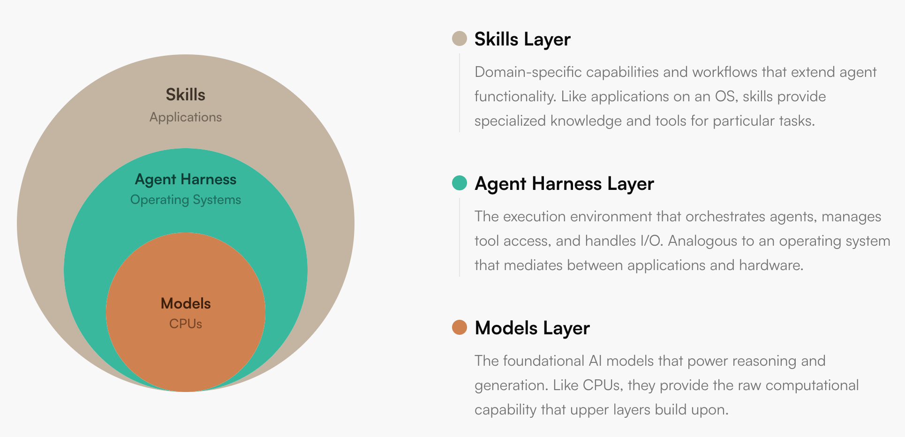

*The model is like the processor, the Agent Runtime is like the operating system, and Skills are the application layer. Source: [Building agents with Skills](https://claude.com/blog/building-agents-with-skills-equipping-agents-for-specialized-work)*

### 3.2 Making the Agent Stronger on Day 30 Than on Day 1

Anthropic views Skills as **a concrete step toward continuous learning**. "Learning" here does not mean updating model parameters; it means letting the workflows, scripts, preferences, and failure lessons that Claude writes down be reused by its future self.

!!! ambition "Continuous learning"

    Anything that Claude writes down can be used efficiently by a future version of itself. This makes the learning actually transferable. *"Anything that Claude writes down can be used efficiently by a future version of itself. This makes the learning actually transferable."*

Failure modes, user preferences, and verification workflows accumulated during task execution are distilled into structured context: standard workflows are written into `SKILL.md`, reusable code into `scripts/`, and detailed documentation into `references/`. The next time a similar task comes up, the Agent doesn't need to explore from scratch; it starts directly from accumulated experience.

  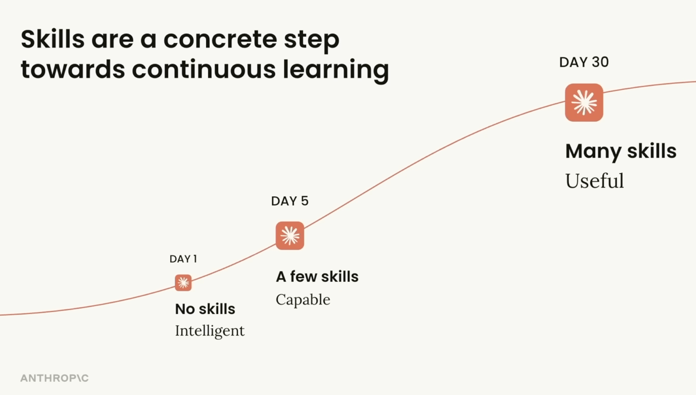

One of my own practices is maintaining a `contexts/` folder in my projects and splitting tasks into two phases: **Context (exploration)** and **Execution**. The Context task is responsible for exploring the problem space and outputting Context files (including any necessary experimental tool calls); by investing more tokens in the exploration phase (explore token scaling), it builds more accurate Handoff context for the execution phase in order to find a better implementation path. Because the execution phase involves extensive code changes, the cost of trial and error there is far higher than in exploration.

After an execution task finishes, I ask the Agent in the current Session to compare the actual execution trajectory against the plan formulated by the Context task: where things diverged, and what lessons are worth distilling back into `contexts/` and Skills. Because **this produces both a prediction (the plan given by the Context task) and a ground truth (the real execution trajectory plus user feedback), forming a learnable sample pair**. This bears a resemblance to the [Heuristic Learning](https://trinkle23897.github.io/learning-beyond-gradients/) proposed by Jiayi Weng (OpenAI), with the difference that what gets updated is not model parameters, but Skills files or automation scripts.

Learning from a task-solving Session is fundamentally different from asking an Agent to write Skills out of thin air: the latter has no ground truth.

  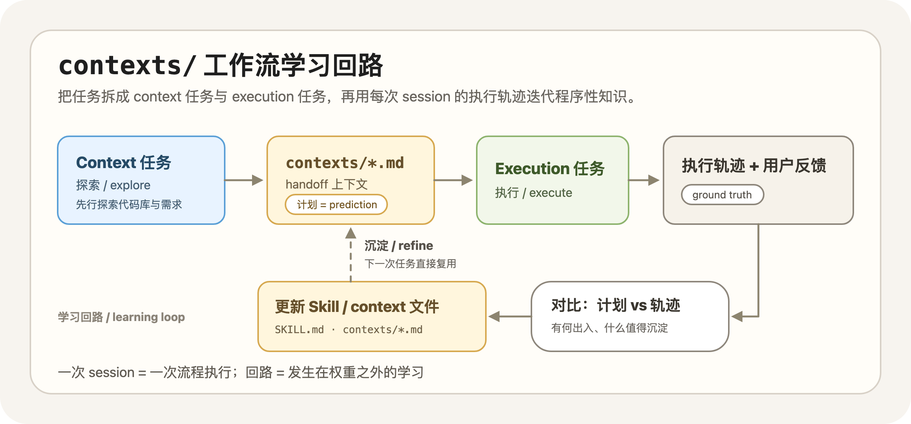

**Why can updating Skills be viewed as continual learning?**

If we treat the process of persisting conclusions into Context files as continual learning, you might think back to Memory from Section 2.4. Does that also constitute continual learning? I think it does as well; both run the same loop: information is generated during a Session, extracted in the background, written to files, and injected into context next time. Seen from this angle, auto-memory is fully automatic continual learning, while the `contexts/` / Skills workflow is human-in-the-loop continual learning. The differences are still the three points summarized in Section 2.4, among which the one I care about most is **who decides what gets written**.

Let's think about this by analogy to the RLHF (Reinforcement Learning from Human Feedback) framework. The core loop of RLHF is: the model produces behavior, humans provide feedback, the feedback is turned into a reward signal, the model is updated, and the next behavior improves. The Skills learning workflow runs a similar loop: one Session corresponds to one behavior, and **the gap between plan and reality, together with my evaluation**, forms the human feedback. The difference lies in the update mechanism: RLHF distills feedback into a reward model and then updates weights, whereas in this workflow the feedback is filtered directly by a human and what gets updated is the file describing the workflow (Skills). The carrier of learning shifts from model weights to Context files. This also offers one explanation for the SkillsBench experimental result in Appendix D (**when models write Skills for themselves and use them themselves, the gain is close to zero**): in RLHF the source of feedback is human, so having the model write and use Skills on its own is equivalent to removing the human from the loop.

In terms of form, the product of learning is essentially compression. The trajectory of a single Session can run to tens or hundreds of thousands of tokens, while merging it back into a Skill is often just a few lines of changes; dozens of task execution trajectories distilled down may condense into a single `SKILL.md` of a few hundred lines. In the Context Engineering post I quoted Ilya Sutskever's view that "compression is intelligence," and I think the same logic applies here: compressing long trajectories into short heuristic conclusions.

Anthropic's vision for Skills for learning is therefore this: Day 1 Claude has only general knowledge; Day 30 Claude, if it can read the accumulated Skills, understands the team's preferred formats, common toolchains, internal workflows, and the places where things tend to go wrong. It doesn't need to remember everything; what matters is **retrieving the right experience at the right moment**. That makes Skills an indispensable part of Harness Engineering: through continuous iteration, the Skills & Hooks I have built help me construct projects of several hundred thousand lines of code from scratch and run multiple tasks in parallel efficiently within them, so my own thinking budget only needs to be spent on the small number of problems that genuinely require deep thought (recommended reading: [OpenAI - An open-source spec for Codex orchestration: Symphony](https://openai.com/index/open-source-codex-orchestration-symphony/)).

!!! tip

    This is also the part individual developers need to optimize in Harness Engineering. My experience so far comes down to two points: the more you invest during the Harness design phase, the higher your efficiency in subsequent development; and you should keep expanding the boundary of your own efficiency by parallelizing your tokens (Subagents) and automating them (Automation / Loop) as much as possible.

## 4. How? Best Practices for Building Skills

On how to write a good Skill, Anthropic's own tutorials are already quite comprehensive; I recommend reading [Best Practices](https://platform.claude.com/docs/en/agents-and-tools/agent-skills/best-practices) and the [Complete Guide](https://claude.com/blog/complete-guide-to-building-skills-for-claude). A more AI-native approach is to hand those links directly to a Coding Agent and let it review your existing Skills against them.

So rather than rehashing the tutorials, this section starts from practice and discusses a few points I think are worth sharing. I'll organize it along the same two main threads used throughout this post: since Skills are essentially Context, we first look at **how to write good Context content** (Section 4.1); since the delivery mechanism is JIT, we next look at **how to design the structure and triggering** (Section 4.2); and finally **how to iterate and validate** (Section 4.3), followed by an analysis of concrete examples (Section 4.4).

Before getting into best practices, let's consider a prerequisite question: when is it worth writing a Skill? The criterion Anthropic gives is very clear: **"Have I done this task at least five times? Will I do it at least ten more times?"** (*"Have I done this task at least five times? Will I do it at least ten more times?"*) Only when the answer to both questions is yes is it worth investing the time.

My own criterion leans more toward **Learn by doing, distilling on demand**. For workflows that are obviously repetitive, I extract them into a Skill first and reuse them directly in subsequent similar scenarios. The first version rarely gets everything right in one shot, so I iterate on it based on actual Session performance (i.e., the workflow mentioned in Section 3.2); usually after two or three rounds of adjustment, the performance of the Agent with Skills stabilizes. The officially recommended starting approach, **Iterate-on-one-task**, follows the exact same idea: first get a single Prompt working on a challenging task, then extract the verified instructions into a Skill. The shared premise is to have a successful trajectory first; extraction happens after the trajectory, not by designing in a vacuum.

### 4.1 How to Write Good Context

Since Skills are essentially Context, the first half of the answer to **how to write a good Skill** lies in **how to write good Context**. I summarize this at two levels:

- **Content level: don't write what the model already knows, write clearly what it doesn't know, and don't mix in anything unrelated to the current task.**
- **Management level: maintain a Single Source of Truth and keep Context files consistent with one another.**

Both lessons come from hard-earned experience collaborating with Agents. Content-level issues are especially common: when generating and updating Context, Agents tend to pad it with redundant information and occasionally mix task-specific details from the current Session into general-purpose files. Moreover, they tend to write Context as an **error-notebook** collection of special cases rather than transferable heuristic conclusions, which is essentially a form of hardcoding and quite brittle. Management-level issues are just as common: much like when writing code, Agents are not good at abstraction and consolidation; the same conclusion easily ends up scattered across multiple files, a later update misses one or two places, downstream Agents read mutually contradictory versions, and reasoning quality drops accordingly.

On the content level, Anthropic's core advice can be summed up in a single sentence: **assume by default that the model is already very smart ("Claude is already very smart")**. What the Agent lacks is what counts as doing things right in *your* project. From that follows a practical test: every time you finish writing a piece of Context, it is worth stepping back and asking: **does this content earn the tokens it occupies?** Redundant tokens waste a precious attention budget.

Another important dimension on the content level is **the precision of instructions**. Borrowing an example from Anthropic: different tasks have different solution paths, or different Agent Action Spaces. You can picture tasks as two kinds of terrain: **a narrow bridge and an open field**. A narrow bridge has cliffs on both sides and almost zero room for error; for tasks like this (such as database migrations or release workflows), you should lock down the exact steps or even provide executable scripts directly. On an open field, many paths lead to the destination, so you only need to give direction and constraints and leave the concrete route to the model's judgment (as in highly context-dependent tasks like Code Review). In other words, **how much freedom you leave the model should depend on the task's own error tolerance, not on how much you trust the model**. Looking at my own Skills, they have indeed split naturally into these two categories: `file-issues`, `submit-pr`, and the like lean toward exact steps, whereas `db`, `web`, `core` development, and my self-analysis Skill `principle` lean toward heuristic constraints.

Industry best practices also include two recommendations that lean toward what I call Context management. **Consistency**: use the same term for the same concept throughout the entire text, instead of making the model guess whether two different phrasings refer to the same thing. **Single Source of Truth**: define a conclusion in only one place, and have every other place point to it by reference.

### 4.2 Aligning with the Philosophy of Just-in-Time Context

Structural optimization can be analyzed layer by layer against the three-layer structure from Section 1.1. The goal is to make the Skill's behavior fit the design philosophy of JIT: **triggering must be precise**, so the Agent loads it reliably when needed and doesn't misfire on unrelated requests; **disclosure must be progressive**, keeping details in reference files to be pulled on demand. If you can't achieve those two things, a Skill is no different in essence from a bloated System Prompt.

**Layer 1 metadata: controlling triggering.** `description` is the field with the widest blast radius in the entire Skill: it essentially acts as a text classifier and is the sole basis on which the main Agent decides whether to load the Skill. Writing it is an exercise in tuning the balance between under-triggering and over-triggering. The Claude Code team has a very clear framing for this:

> The description field is not a summary — it's a description of when to trigger this skill. Write it for the model.
> *"The description field is not a summary — it's a description of when to trigger this skill. Write it for the model."*

In practice there are four key points: (1) state clearly what it does and when it applies; (2) include trigger phrases users would actually say; (3) use the third person consistently; (4) add negative conditions when over-triggering occurs ("Do NOT use for X"). The reason for the third person is that `description` is injected into the System Prompt alongside the metadata of other Skills, so first-person phrasings like "I can help you" create an inconsistent narrative perspective, and the official observation is that this interferes with skill discovery and matching. There is also a handy debugging trick: ask Claude directly, **When would you use this Skill?**, and it will restate its own understanding so you can spot gaps and fix them.

**Layer 2 body: carrying instructions.** The value of `SKILL.md` does not lie in covering every last detail, but in serving simultaneously as the **main workflow** and the **router**: write the high-frequency path clearly in the body, and point to standalone files in the same directory with a single sentence for advanced details (for example, "see `forms.md` for form-filling conventions"), reserving entry points for progressive disclosure. When the body logic starts branching, or when the capability spans multiple relatively independent sub-workflows, the first thing to consider is not creating a new Skill, but splitting the content into **a main file + multiple reference files**; I'm in the habit of thinking of those referenced files as sub-skills. The official guideline is to keep the `SKILL.md` body under 500 lines and split it once it approaches that ceiling.

**Layer 3 `references/` / `scripts/`: supporting on-demand loading.** There are three practical rules for reference files. First, keep references only one hop deep: `SKILL.md → forms.md` is fine, whereas `SKILL.md → advanced.md → details.md` is risky; the official observation is that key information tends to get lost past the second hop, as models often read only partially. Second, for reference files over a hundred lines, include a table of contents at the top. Third, for multi-domain Skills, split files by domain. For `scripts/`, there is really only one core principle: **code execution is deterministic, natural-language interpretation is not**, so logic that can be handled in a script should not be handed back to the model to interpret and execute.

!!! note "Should a complex body of domain knowledge be organized as a single Skill + deeply nested `references/`, or split into multiple independent Skills?"

    The former has a simple structure and unified triggering, but `SKILL.md` easily bloats over time and tasks, gradually degenerating into full-context loading or forcing multi-level nesting; the latter keeps each Skill small and focused, but introduces two new problems: how to find the best split, and how to avoid overlapping `description` definitions. Some Harnesses currently support a Plugin format, but that specification has not been widely adopted yet, so I think this question is still evolving.

### 4.3 Eval Is the Key to Closing the Loop

Why do Skills need testing? Honestly, I think in the Agent era, testing (Verify / Eval) is even more important than generation. For Skills, I see two reasons:

1. **Preventing regressions / performance Regression**: Section 3.2 called updating a Skill "learning," and learning can learn the wrong thing; whether a revised version actually got better or worse needs to be answered by a fixed set of test cases, not gut feel. Large systems normally have multi-dimensional regression tests to catch potential performance issues introduced by updates.
2. **Capability tracking**: every time a model upgrades, some Skills shift from compensating for Agent limitations to getting in the Agent's way; running the test suite periodically is how you find out which Skills may no longer be needed (because the task can now be completed without skills).

A workflow worth highlighting in practice is the **Claude A / Claude B dual-instance setup**: A designs the Skill, while B tests it in a clean context to avoid self-confirmation bias.

  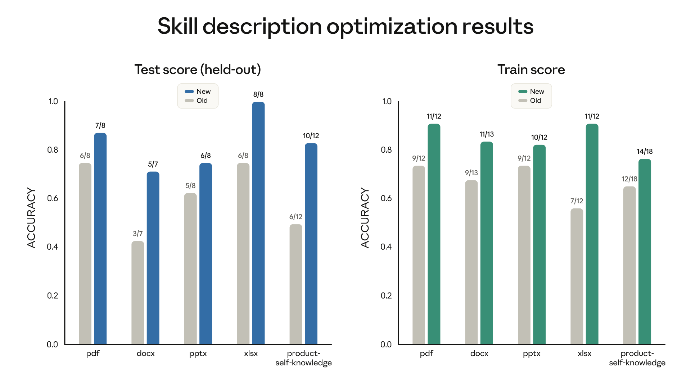

The chart above shows the measured effect of `skill-creator` optimizing `description`. Covering Skills for 5 document types, adjusting `description` improved trigger accuracy on the held-out test set across all of them. From these data we can infer that **problems related to Skill triggering are both evaluable and optimizable**. As for the more detailed methodology (how to build Evals, how to split test sets, and how to run cross-model tests and blind A/B evaluations), that belongs to advanced material, so to keep the reading flow smooth I'll progressively disclose it to you here as well: see the [Complete Guide](https://claude.com/blog/complete-guide-to-building-skills-for-claude) and [Improving Skill Creator](https://claude.com/blog/improving-skill-creator-test-measure-and-refine-agent-skills), or hand the job over to `skill-creator` to generate and run for you.

### 4.4 Practical Lessons from Three Skills

The preceding sections laid out best practices. Let's deepen our understanding by analyzing a few real-world Skills in practice.

**Case 1: `frontend-design`, a Skill consisting purely of content.**

[frontend-design](https://github.com/anthropics/skills/blob/main/skills/frontend-design/SKILL.md) is perhaps the highest-profile official Skill right now: it is a flagship example in the `anthropics/skills` repository (around 149k stars at the time of writing), Anthropic wrote a [dedicated case study](https://claude.com/blog/improving-frontend-design-through-skills) about it, and it is also listed in the official Claude Code plugin marketplace. It has neither `references/` nor `scripts/`; the entire Skill consists solely of a 55-line, ~1,300-word `SKILL.md`. Judged against the criteria in Section 4.1:

- **Write only the parts the model gets wrong by default.** Nowhere in the file does it teach CSS syntax (that is a capability the model already has); what it actually tackles is aesthetic convergence: right at the start it points out that current AI-generated designs cluster around three patterns, and states explicitly that those three are merely default outputs rather than genuine design choices.
- **For an open-field task, constrain the order of thinking rather than the execution path.** The only process requirement in the entire text is a two-pass check: come up with a plan first, check it once against the brief to confirm it hasn't fallen into common AI patterns, and only then write code.

The evolution of this Skill itself is also worth noting. While I was writing this post (early June 2026), it had just undergone a rewrite: the previous version was under 600 words and relied on a concrete exclusion list (no Inter font, no purple gradients, "don't converge on Space Grotesk every time"); the new version deleted all of those item-by-item exclusions and replaced them with a synthesis of the three default patterns above, plus that self-check procedure. In the terms of Section 4.1, Anthropic upgraded this Skill from item-by-item error correction to a transferable heuristic version.

**Case 2: `react-best-practices`, how to pack a large number of rules.**

[react-best-practices](https://github.com/vercel-labs/agent-skills/blob/main/skills/react-best-practices/SKILL.md) is Vercel's official React / Next.js performance optimization Skill (`vercel-labs/agent-skills`, around 27.8k stars at the time of writing); as mentioned in Section 2.3, I keep it enabled whenever I review frontend code myself. The challenge it faces is the exact opposite of Case 1: 70 rules across 8 categories, which if written directly into the body would turn the Skill into a sprawling Prompt. Vercel's solution makes full use of the three-layer structure: `SKILL.md` serves only as an index of under 150 lines containing three things: applicable scenarios, a table of categories ordered by impact (request waterfalls and bundle size at the top, marked CRITICAL), and a one-line summary for each rule; the 70 rule files live under `rules/`, all one level deep, with prefixes indicating category (`async-`, `bundle-`, ...), read by the model on demand. (It also ships with an `AGENTS.md` that expands all the rules inline, presumably for environments that do not support on-demand reading.)

Two design choices in Vercel's Skills practice are worth borrowing. First, **ordering itself is information**: the attention budget is finite, and the category table encodes what to read first directly into the structure. Second, **a one-line summary is often already enough**: for example, "run independent async requests concurrently with `Promise.all()`" tells the model what to do as soon as it reads that line; only when it needs to see concrete code examples does it need to open the full rule file. In other words, **the index itself already conveys most of the useful information**. This may well be a real-world answer to the open question I raised at the end of Section 4.2: one Skill + a set of `references/`, keeping rule bloat under control through a directory and explicit priorities.

**Case 3: My own practice.**

The two examples above are other people's Skills; I'll finish with two of my own: one leaning toward personal management (weekly journals and the accumulation of Personal Context), and one leaning toward engineering collaboration (Skills + Hooks on a 300k-line codebase).

My Personal Context stack uses **iCloud & Git + Obsidian + voice input + HAPI**. iCloud handles syncing, Obsidian handles cross-platform reading and editing, voice input lets me update my weekly journal at any time, and HAPI lets me remotely control my Mac mini from my phone so I can work on my Personal Context on the go as well (using Codex or Claude Code).

My Personal Context includes `PERSONAL.md` (describing core information about me), weekly journals, project notes (open source / side projects), blog materials (seed files, articles to read and already read), investment records (holdings, trade logs), and fitness plans and logs. I consolidate them into different `references/` or Skills. For example, I have a Codex Automation that runs a self-analysis every Sunday night at 22:00; because I have reread the book *Principles* many times, I named the Skill `Principle`.

Previously I wrote the Prompt by hand myself, which was a hassle, and many parts of the workflow really ought to have been fixed anyway. So I debugged and refined this personal Skill repeatedly across different Sessions. At this point it automatically reads `PERSONAL.md` and the past two weeks of journals (which may reference investment and fitness logs), and scans GitHub / local files to inspect my Git commit history to help me **recover my memory**. Finally, based on those records and scattered reflections, it generates an initial draft and reminders for next week's journal. Later on I plan to fold in more data (sleep, screen time, etc.), so in essence the `Principle` Skill is more like a fixed workflow. I also have a financial analysis Skill paired with a Codex Automation that recommends daily reading based on my holdings, including a few `scripts/` for portfolio visualization and updates. It is still a long way from Agent Trading, but it is already a reusable starting point.

The other category is Skills leaning toward Harness Engineering, which I also touched on earlier. Every task of mine is tracked via a GitHub Issue, and every project has a `contexts/` folder. My Skill setup covers a lot of ground; I'll just give a couple of simple examples:

- The `issue` sub-skill, used to file issues that meet my requirements based on the current Session and my needs. Here "meeting requirements" means that an Agent in a brand-new Session can independently complete the task and perform the necessary verification based solely on the issue body and the project folder. Its focus is defining the verification checklist required to complete the task. As mentioned earlier, I require Subagents to use best-practice Skills for verification (while also designing unit / integration / smoke tests), and this sub-skill relies on a corresponding Template. I also use a Hook to supervise whether newly created GitHub Issues meet the requirements.
- The `context` sub-skill, which checks where newly added Context should live, checks whether it is redundant and whether it respects the Single Source of Truth principle, and guides the Agent through any necessary Context update / refactor. I also pair it with a daily Automation that uses this sub-skill to check whether the project's context is **healthy** based on recent commits.

In short, well-crafted Skills are tremendously helpful for boosting efficiency. My personal style has always been to try things first and use real experience to sharpen my thinking afterward.

## 5. The End

Skills look very simple right now, but I think their complexity will keep rising in the future: a Skill that takes a few minutes to write today may take weeks to build and maintain tomorrow. I have heard people say: Skills are the software of the future.

The more complex a Skill becomes, the more it relies on JIT/Pull mechanisms to avoid blowing up Context. Of course, Skills have their own limitations too: the four context failure modes discussed in the [Context Engineering post](../context-engineering/) (poisoning, distraction, confusion, and clash) apply to Skills just as much. I also find myself thinking about conflicts as models and Skills co-evolve (self-obsolescence), and whether Skills might turn out to be a transitional artifact of the current stage of development. A carefully polished Skill may become useless or even counterproductive context once the next generation of models arrives (The Bitter Lesson: human-crafted constraints end up steering away from the optimal path), which makes the evaluation system discussed earlier especially important in this setting. Right now, I think Skills are still in a phase of wild growth.

Returning to the two claims from the beginning of this post: **Skills are essentially Context, and their delivery mechanism is JIT Context / Pull**. What Skills solve is not just what knowledge the model lacks, **but the engineering problem of how to deliver knowledge to the model at the right moment and at the right granularity**. Procedural knowledge has never been in short supply (it exists in documentation, in people's heads, and in training data); what was missing was a mechanism/specification for bringing it into place on demand. Built on top of that mechanism, we then design a packing specification for this class of knowledge, namely Skills.

In fact, from Context Engineering to JIT Context and now to Agent Skills, there has been a single thread running through the whole series: **Context is everything**. MCP lets Agents connect to more context, JIT teaches them to spend their attention budget (the context window) on demand, and Skills make procedural knowledge (Context) reusable and distributable.

Skills have been steadily solving the problem of **how to do a job well**, but the theme of 2026 belongs to Long-horizon Agents: how to keep an Agent going over the long haul, continuously delivering productivity and turning into an Agent Workforce. Task decomposition, state recovery, orchestration of Skills / MCP / Subagents, and context engineering for long-horizon tasks all belong to Agent Harness, which will also be the subject of my next blog post, *One Poem Suffices: Agent Harness* (there are some early practical notes in [Claude Code Source Distillation](../../zen-of-harness-engineering/claudecode-distillation-practice/)). In that post I also want to unpack a claim: good Automation is essentially real labor, continuing to produce output while you are not there. **A bit like the framing in *The Almanack of Naval Ravikant*, where on top of the original three forms of leverage (labor, capital, and products with zero marginal cost of replication) there is now an additional layer of leverage: Agent Workforce.**

At the end of the [JIT Context post](../just-in-time-context/) I wrote: **The boundary of an Agent's capability is determined by the boundary of your thinking.** To close, let me briefly share two small reflections of mine on Skills:

- First, an Agent's Action Space is huge, and one of the core values of Skills is **control and alignment**: getting the Agent's behavior to converge toward the direction you actually want, rather than exploring randomly in an unconstrained space. Skills are how you inject your taste into an Agent.
- Second, what truly needs **you** to define and optimize may be **Skills that define problems rather than Skills that solve problems**. Knowledge about solving problems is usually general (all kinds of best practices), whereas defining the problem is deeply bound to your specific context: how to break an ambiguous requirement down into a task description that an Agent can complete independently is the real bottleneck to productivity.

Feedback and corrections are very welcome.

## References

🔥 marks the ones I personally recommend most.

**Official Anthropic Series:**

- [🔥 Introducing Agent Skills](https://claude.com/blog/skills) — The initial launch announcement for Skills (2025-10-16)
- [🔥 Equipping agents for the real world with Agent Skills](https://www.anthropic.com/engineering/equipping-agents-for-the-real-world-with-agent-skills) — Design motivation and architectural principles behind Skills
- [🔥 Skills Explained: How Skills Compares to Prompts, Projects, MCP, and Subagents](https://claude.com/blog/skills-explained) — Comparing Skills against Prompts, MCP, Subagents, and other mechanisms
- [🔥 Extending Claude's Capabilities with Skills and MCP Servers](https://claude.com/blog/extending-claude-capabilities-with-skills-mcp-servers) — How to use Skills together with MCP
- [Building Agents with Skills](https://claude.com/blog/building-agents-with-skills-equipping-agents-for-specialized-work) — Overall architecture and ecosystem taxonomy for building Agents with Skills
- [How to Create Skills for Claude](https://claude.com/blog/how-to-create-skills-key-steps-limitations-and-examples) — Creation workflow and examples for Skills
- [Improving skill-creator: Test, measure, and refine Agent Skills](https://claude.com/blog/improving-skill-creator-test-measure-and-refine-agent-skills) — Taxonomy of Skills and directions for iterative optimization
- [🔥 Improving Frontend Design through Skills](https://claude.com/blog/improving-frontend-design-through-skills) — Case study on addressing convergence in AI-generated frontend design through Skills
- [A Complete Guide to Building Skills for Claude](https://claude.com/blog/complete-guide-to-building-skills-for-claude) — Comprehensive engineering guide to building Skills (2026-01-29)

**Official Documentation & Open Standard:**

- [🔥 Agent Skills Overview](https://platform.claude.com/docs/en/agents-and-tools/agent-skills/overview) — Entry point to the official documentation
- [🔥 Skill authoring best practices](https://platform.claude.com/docs/en/agents-and-tools/agent-skills/best-practices) — Best practices for authoring Skills, introducing the view that "the context window is a public good"
- [Using Agent Skills with the API](https://platform.claude.com/docs/en/build-with-claude/skills-guide) — Developer guide for using Skills via the API
- [🔥 AgentSkills.io: What are skills?](https://agentskills.io/what-are-skills) — Minimal specification of the Agent Skills open standard
- [Anthropic Skills Repository](https://github.com/anthropics/skills) — Official Skills repository, including examples such as `pdf`, `skill-creator`, and `frontend-design`

**Talks:**

- [🔥 Don't Build Agents, Build Skills Instead](https://youtu.be/CEvIs9y1uog) — Barry Zhang & Mahesh Murag @ AI Engineer 2025, a talk by the core designers of Skills

**Community & External Analysis:**

- [🔥 Claude Skills are awesome, maybe a bigger deal than MCP](https://simonw.substack.com/p/claude-skills-are-awesome-maybe-a) — Simon Willison's early in-depth review of Skills
- [🔥 OpenAI quietly adopted Anthropic's Skills format](https://simonwillison.net/2025/Dec/12/openai-skills/) — Simon Willison's discovery that OpenAI quietly adopted the Skills format
- [🔥 Agent Skills Work, but the Research Shows Most Teams Are Building Them Wrong](https://www.oreilly.com/radar/agent-skills-work-but-the-research-shows-most-teams-are-building-them-wrong/) — O'Reilly Radar's empirical analysis based on SkillsBench, including controlled experiment data
- [Skills vs MCP Tools for Agents](https://www.llamaindex.ai/blog/skills-vs-mcp-tools-for-agents-when-to-use-what) — LlamaIndex's comparative benchmark, finding relatively low Skill trigger rates in some scenarios
- [You're Probably Using Agent Skills Wrong](https://notes.ansonbiggs.com/youre-probably-using-agent-skills-wrong/) — Anson Biggs's sharp critique of common Skills anti-patterns
- [Why Cursor Rules Failed and Claude Skill Succeeded](https://lellansin.github.io/2026/01/27/Why-Cursor-Rules-Failed-and-Claude-Skill-Succeeded/) — Lellansin's Chinese-language article comparing the design differences between Cursor Rules and Skills
- [codeaashu/claude-code](https://github.com/codeaashu/claude-code) — Community-organized Claude Code source code, referenced for the Memory mechanism analysis in Section 2.4 and Appendix C of this post

**Academic Blogs / Papers:**

- [Learning Beyond Gradients](https://trinkle23897.github.io/learning-beyond-gradients/) — Jiayi Weng's concept of Heuristic Learning, arguing for continual learning through code iteration and regression testing
- [CoALA: Cognitive Architectures for Language Agents](https://arxiv.org/abs/2309.02427) — Introduces cognitive science's three categories of long-term memory (episodic, semantic, procedural) into Agent architecture design; the theoretical framework behind Appendix C of this post

**Previous Posts in This Blog Series:**

- [One Poem Suffices: Context Engineering](../context-engineering/) — The four core operations of context engineering: Write, Select, Compress, Isolate
- [One Poem Suffices: JIT Context](../just-in-time-context/) — Mechanisms for loading context on demand: References as Context, Progressive Disclosure, Attention Budget
- [One Poem Suffices: MCP](../model-context-protocol/) — Design, principles, and usage of the Model Context Protocol
- [One Poem Suffices: Multi-Agent System](../multi-agent-system/) — Architecture and orchestration of multi-agent systems
- [One Poem Suffices: Prompt Caching](../prompt-caching/) — Principles and practice of Prompt Caching

## Appendix A. The Standardization Timeline of Skills

The beginning of Section 3 referred to Skills as the standard way to inject procedural knowledge; here is a brief timeline of the key milestones:

- **2025-10-16**: Anthropic launches Agent Skills as a shared capability-extension mechanism across Claude.ai, Claude Code, and the API
- **2025-12-12**: OpenAI is spotted having quietly adopted the exact same Skills format ([Simon Willison](https://simonwillison.net/2025/Dec/12/openai-skills/))
- **2025-12-18**: Anthropic publishes Agent Skills as an open standard at [agentskills.io](https://agentskills.io), while simultaneously launching organization-level management and a partner directory
- **2026-01-29**: Anthropic publishes *The Complete Guide to Building Skills for Claude*, treating Skills as first-class software engineering artifacts

Within three months, Skills evolved from an internal Claude feature into an open standard (the name itself isn't the crucial part; calling them Skills or Flows would work either way). **What matters is that the ecosystem is converging on the same set of conventions.**

Following the precedent of function calling, once a format is fixed, model training gets a clear optimization target and can reinforce it directly. I tend to think models and Harnesses will continue to co-evolve around this format. A Skill written today will very likely become more effective as models become better adapted to the format (though format universality cannot guarantee that the content won't go stale, so a solid Eval pipeline remains essential for managing Skills). **A fixed format and model evolution tend to form a positive feedback loop.**

## Appendix B. scripts/ and Deployment: Trade-offs Between Two Schools of Agent Frameworks

Section 1.3 noted that `scripts/` is the only part of a Skill that imposes requirements on deployment; let's unpack that here.

A pure-Context Skill (`SKILL.md` + `references/`) places no extra requirements on the environment; any Agent that can read files can use it. Once executable scripts are introduced, the Agent needs a complete Sandbox: an isolated environment, script dependencies, and permission boundaries all have to be managed. **Introducing `scripts/` turns a Skill from a document meant to be read into a program that requires a runtime.**

Behind this lies a broader trade-off between two schools of Agent Frameworks. The code-based school (LangGraph, ADK, Camel, etc.) is deployment-friendly and cheap to scale horizontally; the filesystem-based school (Anthropic Agent SDK, Antigravity SDK, etc.) offers a more natural developer experience and is better suited to individual developers: Bash and the filesystem are themselves extensions of the Agent's capabilities (Agents and Harnesses co-evolved in the first place), but every Session may need to spin up an isolated container. **The filesystem lets an Agent extend its capabilities much more naturally, but it also brings the cost of a Sandbox into every single Session.** How to deploy Sandbox-based Agents in the cloud at low cost remains an open question. I welcome insights from anyone who has figured this out.

## Appendix C. Memory and Skills: Three Types of Memory, Two Learning Paradigms

Section 2.4 offered several observations; this appendix expands on the theoretical basis and technical details behind them.

  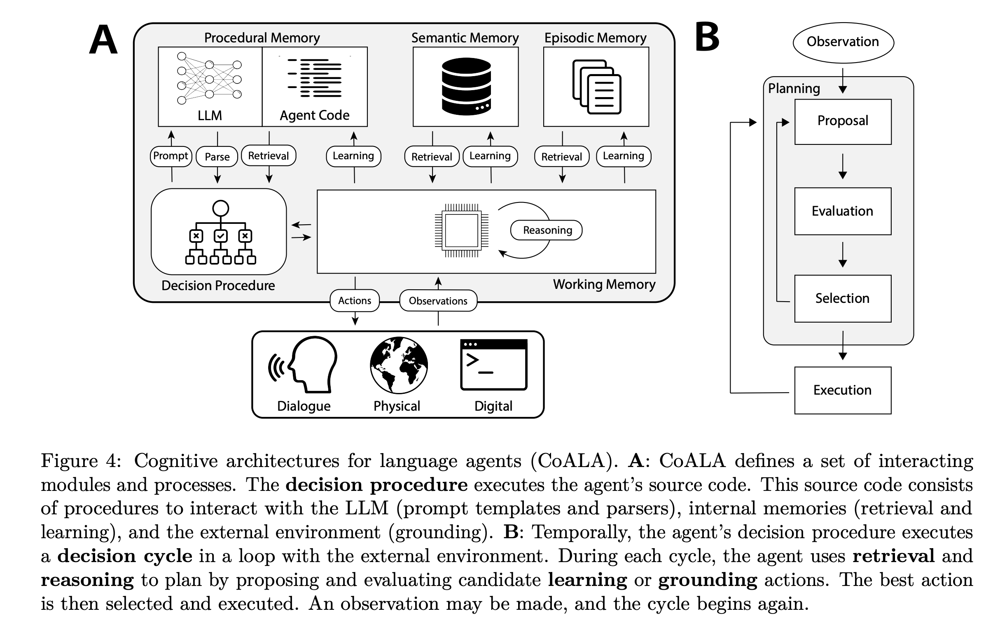

**Three Types of Memory and Where Skills Sit**

Cognitive science broadly divides long-term memory into three categories: episodic memory (what happened), semantic memory (what one knows), and procedural memory (what one knows how to do). Research on Agent memory has adopted this taxonomy: [CoALA](https://arxiv.org/abs/2309.02427) organizes an Agent's long-term memory along these three categories, and further divides procedural memory into two forms: implicit, stored in model weights; and explicit, written in the Agent's code or structured Context.

Following this framework, Skills can be understood as a standardized carrier for explicit procedural memory. This echoes the naming note in the introduction: by choosing the word "Procedural," Anthropic positioned Skills within the domain of procedural memory right from the start. CoALA also points out an important conclusion: **writing to procedural memory carries higher risk than writing to episodic or semantic memory, and is much more likely to introduce bugs or drift away from the intended design**. That conclusion corroborates the experimental data in Appendix D.

**From Episodic Memory to Two Learning Paradigms**

Mapped onto Agent systems, the raw form of episodic memory is the Session trajectory. Nobody uses raw Sessions directly as a memory system, though: information density is low, noise is high, and every reuse would require rereading the full transcript. Its real role is **raw material**: semantic memory and procedural memory are two different products refined out of this raw material, corresponding to two different routes.

**Route 1: Fully automatic extraction.** Claude Code's auto-memory forks a Subagent in the background and periodically extracts key points from the conversation according to a threshold setting (by default, after every turn); the output is four categories of memory files whose content leans toward **informational context**. I covered the loading side in detail in Section 2.4, so I won't repeat it here (see Section 2.4 for the mechanism diagram as well).

**Route 2: Human-in-the-loop distillation.** This is the `contexts/` workflow from Section 3.2. Humans participate in filtering which lessons are worth hardening, and the output is procedural knowledge that ultimately lands in Context files or Skills.

**Trade-offs and Outlook**

My current assessment is this: the fully automatic route lowers maintenance cost, but what gets learned lacks human gatekeeping, so quality fluctuates (and direction drifts), which is why I keep `autoMemoryEnabled` turned off; the human-in-the-loop route has a higher maintenance cost, but every memory passes through human judgment and filtering, and the SkillsBench experiments (Appendix D) lean toward supporting this direction as well.

Looking ahead, the two routes do not have to remain opposed forever. An intermediate form with automatic extraction and human approval may be a more sustainable direction. What is recorded here is simply a snapshot observation from mid-2026.

## Appendix D. Takeaways from SkillsBench

Controlled experiments from [SkillsBench](https://www.oreilly.com/radar/agent-skills-work-but-the-research-shows-most-teams-are-building-them-wrong/) (84 tasks across 11 domains) offer several noteworthy findings.

  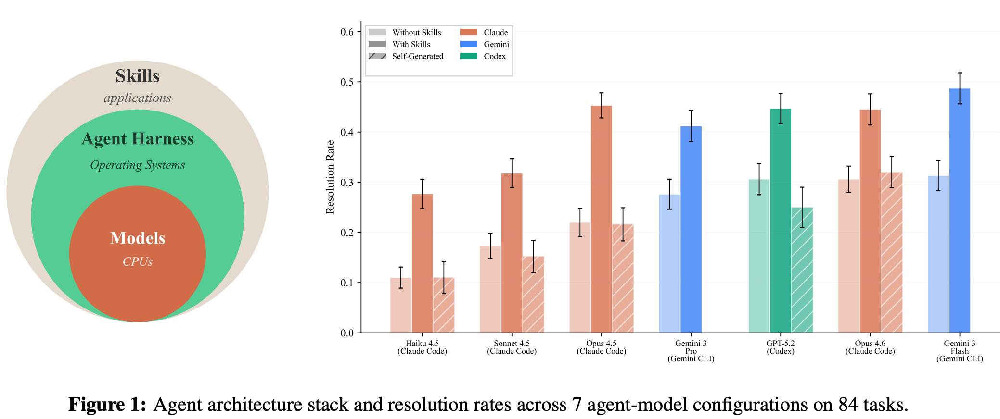

| Finding                                     | Implication                                      |
| ------------------------------------------- | ------------------------------------------------ |
| Human-curated and refined Skills yield an average gain of **16.2%** | Skills work, **provided a human gates the quality** |
| Healthcare improves by ~52%, SWE by only 4.5% | The thinner the model's pretraining coverage in a domain, the larger the marginal gain from Skills |
| Model self-generated Skills yield a **0%** gain | Having the model write a Skill itself and then execute with it produces no positive gain |
| Small model + refined Skill ≈ large model running bare | A Skill is a **de facto model capability upgrade** |

The third row is the most noteworthy. Letting an Agent write its own Skills sounds close to self-iteration, but the experiment's answer is that there is no gain. The underlying logic, as I see it, is that a Skill is essentially a procedural encapsulation of existing knowledge, and without external verifiable signals a model cannot **distill from itself knowledge that it does not yet possess**, just as RLHF needs the Human precisely because a model cannot reliably serve as its own judge. **Along the path of continual learning, at least at the quality-control step, human judgment remains indispensable in the near term.**

This also explains why the `contexts/` workflow in Section 3.2 has to be closed out by a human: comparing predictions against ground truth can be delegated to the Agent, but **the judgment of which conclusions are worth updating into Context still has to be made by a human**.
