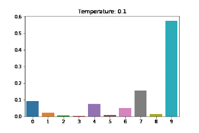
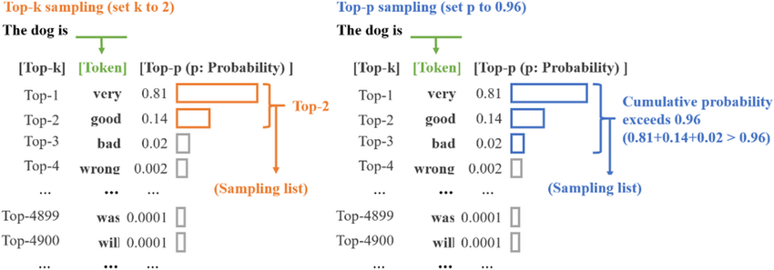
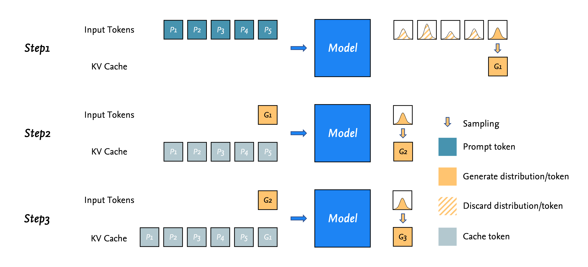
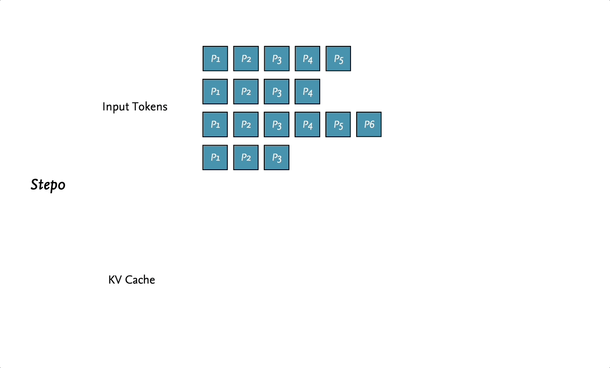

# One Poem Suffices: Basic LLM Inference and Generation

`⏰ Read: 30min`

!!! note "Preface"

    I am embarrassed to admit that while reading many other LLM-related articles, I realized I did not have a solid enough understanding of the LLM inference and sampling process. Without a solid foundation, everything shakes. So I am trying to understand the basic LLM inference pipeline first.

## 0. Goal

This post aims to answer two questions, with all inference operations explained by cross-referencing the `meta-llama` codebase.

- **Question 1: Given N input tokens (a prompt), how does an LLM get the next token? And how does it perform auto-regressive sampling?**
- **Question 2: How does an LLM handle variable-length batch inference?**

## 1. Pre-Knowledge

!!! info "In This Section"

    This section introduces the background concepts involved in generation. [📖 Est.: `8min`]

### 1.1. Temperature

Before running generation, the model sometimes requires a temperature value. What is it, and what does it do?

Usually, the model outputs raw values (logits) rather than a probability distribution, so we need to convert them into a distribution, typically using the Softmax function:

$$
\dfrac{\exp(z_i)}{\sum \exp(z_j)}
$$

Although Softmax gives us a distribution, it also has drawbacks. It tends to amplify or shrink differences among the internal elements, degenerating toward max or mean. For example (borrowed from another explanation):

- Applying Softmax to `[11, 12, 13]` yields `[0.0900, 0.2447, 0.6652]`, which makes the final sampled results **lack diversity**.

- Applying Softmax to `[0.01, 0.02, 0.03]` yields `[0.3300, 0.3333, 0.3367]`, which turns the final sampling step into nearly uniform random sampling and **generates unreasonable sequences**.

Temperature T is used to solve this problem by adjusting Softmax so that the resulting distribution better matches our expectations.

$$
\dfrac{\exp(z_i / T)}{\sum \exp(z_j / T)}
$$

As shown below, this animation helps us quickly understand how $T$ affects the Softmax distribution.

<div align=center>

</div>

- As $T$ increases, the distribution approaches a uniform distribution, and the sampled results become more random.
- As $T$ decreases, the distribution approaches a one-point distribution, and the sampled results become more deterministic.

So why is it called temperature? As we know, the higher the temperature, the more vigorous the Brownian motion; similarly, the higher the temperature, the more random the sampled results.

### 1.2. Top-p/Nucleus Sampling

The core idea of top-p sampling is to select **the smallest set of tokens whose cumulative probability exceeds a threshold p, and then randomly sample the next token from this set**. This set is called the `nucleus`, which is also where the name `nucleus sampling` comes from.

The diagram below illustrates the whole workflow (on the right): after selecting the nucleus set, we re-normalize the probabilities and then sample from them. If top-p sampling still feels unclear, you can refer to the [`sample_top_p` implementation](https://github.com/keli-wen/meta-llama2-explain/blob/main/llama/generation_cn_comment.py#L448-L490) in `llama2` (linked here in a version with Chinese comments).

<div align=center>

</div>

## 2. Learn by `llama` code 

### 2.1. `generate` function signature

There are already many explanations of the entire `llama` repository online. To differentiate this post and make it smoother to read, I will focus only on the `generate` function relevant to our topic. I will also omit parts of the code that do not affect the narrative flow, rather than explaining the code line by line in the article (I plan to create a dedicated repo to help with learning `meta-llama`).

First, let's look at the function signature:

- [`torch.inference_mode()`](https://docs.pytorch.org/docs/stable/generated/torch.autograd.grad_mode.inference_mode.html): You can think of this as an optimization similar to `torch.no_grad()`, used to speed up inference.
- `prompt_tokens`: A 2D list storing the token IDs of the tokenized prompts. The first dimension represents the batch size.
- `max_gen_len`: The maximum length of the generated text sequence.
- `temperature`: See the introduction above. Used to control sampling randomness.
- `top_p`: Likewise, see the introduction above. Used to set the threshold for top-p sampling.
- We can skip the remaining parameters, as they are not important for this post.

```python
@torch.inference_mode()
def generate(
    self,
    prompt_tokens: List[List[int]],
    max_gen_len: int,
    temperature: float = 0.6,
    top_p: float = 0.9,
    logprobs: bool = False,
    echo: bool = False,
) -> Tuple[List[List[int]], Optional[List[List[float]]]]:
```

### 2.2. Goal1: How to auto-regressive sampling?

`prompt_tokens` is 2D because it is designed for batch inference. Let's break the problem down and start with the simplest case: suppose `prompt_tokens` is a 1D sequence. What does auto-regressive sampling look like in that case?

A picture is worth a thousand words, and people learn more efficiently from visuals, so let's analyze this with the diagram below. Suppose we have $N$ tokens:

1. In the first step, the $N$ prompt tokens are fed into the model at the same time, producing $N$ distributions (for predicting the next token). Only the last one is the distribution we need; the other computed distributions are ignored. (`Right side of Step 1 in the figure`: only the last distribution goes through further sampling.)
2. At the same time, part of the computation results for the prompt tokens fed into the model is cached in the KV cache (`gray blocks on the left of Step 2 in the figure`), so subsequent auto-regressive sampling steps only need to take the token predicted in the previous sampling step to complete the computation.
3. Repeat this process until the model generates a **token representing the end of generation** or the generated sequence exceeds the **maximum sequence length** set for the model.



!!! note "A Note on KV Cache"

    Of course, I have to admit that if you do not know how the KV cache works, it may be harder to understand how tokens are computed inside the model. Even so, I do not think this prevents you from understanding or getting a feel for the basic LLM generation pipeline, and diving deep into it here would disrupt the flow of reading. For now, you can treat it as intuitive and correct. I will do my best to cover it in a future blog post and link to it here; for now, please read on.

### 2.3. Goal2: How to batch inference?

In Goal 1, we understood auto-regressive sampling without batching. Next, let's try to answer the second and final question: **how does an LLM handle variable-length batch inference?** Keep in mind that we are covering basic inference here, so this is the simplest case; modern inference libraries certainly apply all kinds of optimizations (which we will try to unpack step by step in future posts).

Suppose the input `prompt_tokens` has a batch size of `B`, and the sequences do not necessarily have the same length.

We focus on two lengths: `min_prompt_length` and `total_length`. The first is easy to understand: it is the sequence length of the shortest prompt in the input batch. The second is slightly more involved: it represents the maximum possible length in the batch.

!!! note "Computing total_length and Pre-allocating Memory"

    The code for computing `total_length` is `total_len = min(params.max_seq_len, max_gen_len + max_prompt_len)`. Looking at the code makes it easy to understand: before inference, we need to allocate memory (a tensor), and `total_length` is computed for memory pre-allocation.

Now comes the first key point: which position should we start generating from? Ideally, every sequence in the batch would start generating its next token right after its own prompt, with nothing wasted (at first I even wondered if that was how it worked, haha). However, the model has to process tensors of the same length, and we cannot guarantee that all sequences in the batch have the same length. Therefore, **batch inference initially starts generating from `min_prompt_length`** (see Step 1 in the animation).

After that, the workflow is relatively straightforward. Referring back to Goal 1, except for the first inference step, each subsequent inference step only needs to take a token sequence of shape `[B, 1]`.

The only difference is that in Goal 1, the token finally sampled by the model is always one we need. In batch inference, however (see Steps 1/2/3 in the animation), because we have to start generating from `min_prompt_length`, if the current position already has a user-provided token, the token sampled by the model is discarded.

To summarize the main differences compared with non-batch inference:

- We need to account for `min_prompt_length` in the batch, so inference efficiency is naturally constrained by it (consider one prompt of length $1$ token and three prompts of length $100$ tokens). An uneven sequence length distribution in the batch can severely limit inference performance. In batch inference, generated tokens may be invalid and wasted.



!!! tip "Open-Source Visualization Slides"

    The two visuals in Goals 1 and 2 may be helpful for understanding LLM inference. Since I spent quite a bit of time making this diagram and animation, to save everyone time (and because I did not want to add watermarks), I open-sourced the visualization slides in [`visualization/Basic-LLM-Inference.pptx`](https://github.com/keli-wen/AGI-Study/blob/master/visualization/Basic-LLM-Inference.pptx).

Once we understand how an LLM performs batch inference, we can also see that this paradigm involves substantial redundant computation and wasted performance, leaving plenty of room for optimization. This is the inevitable reason Continuous batching was later introduced.

## References

- [Blog: A Walkthrough of LLM Inference](https://xv44586.github.io/2023/03/10/llm-inf/index.html)
- [Github Repo: meta-llama/llama](https://github.com/meta-llama/llama)
- [Github Repo: keli-wen/meta-llama2-explain](https://github.com/keli-wen/meta-llama2-explain)
- [TORCH.MULTINOMIAL](https://pytorch.org/docs/stable/generated/torch.multinomial.html#torch.multinomial)
- [Blog: A 2023 Beginner's Guide to Deep Learning (19) - LLaMA 2 Source Code Analysis](https://juejin.cn/post/7259738325031944247)

## Next Read

- Continuous batching.
- KV Cache in LLM.
