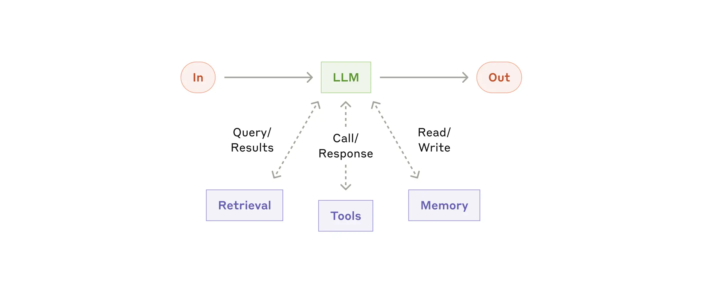
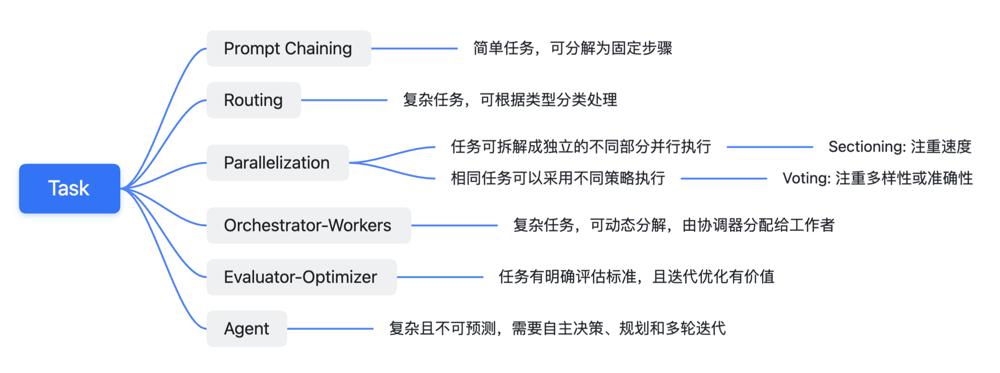
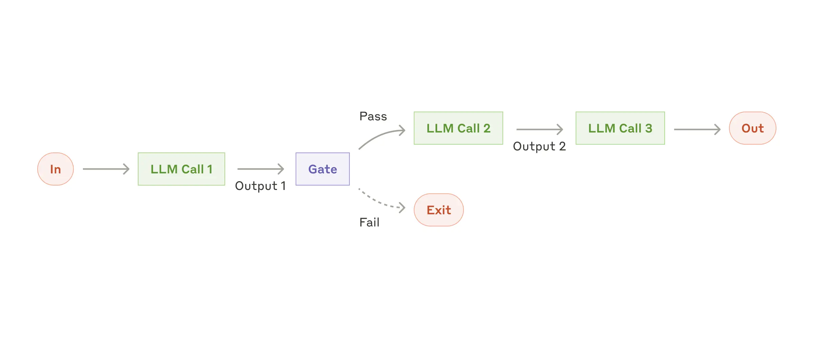
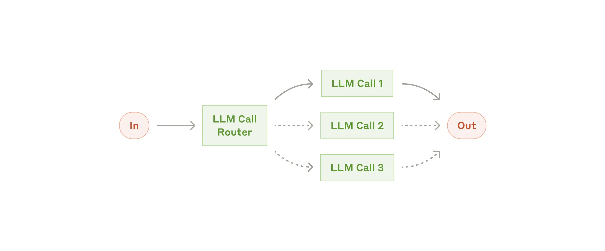
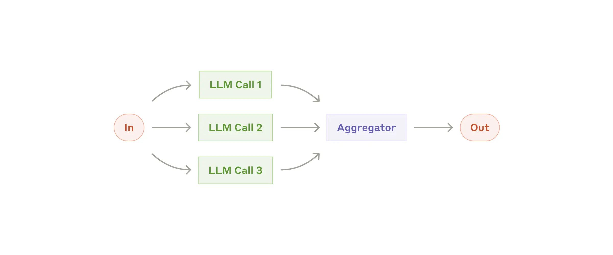
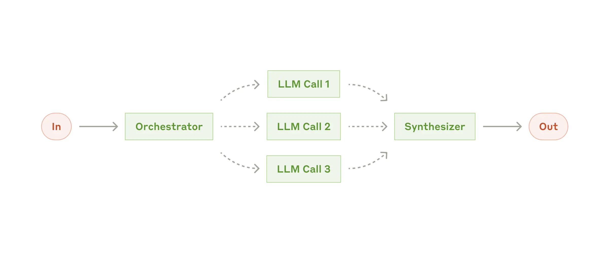
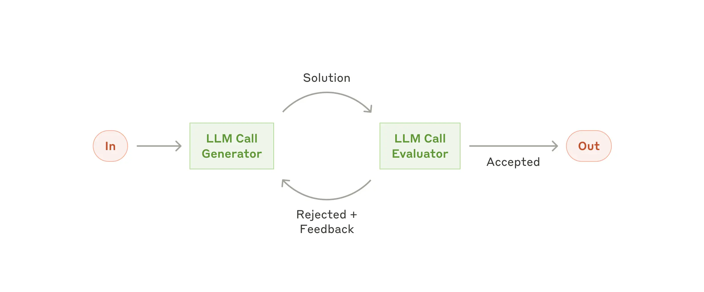
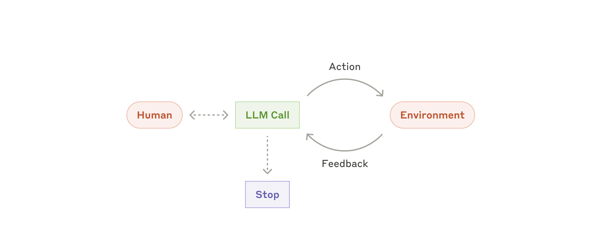
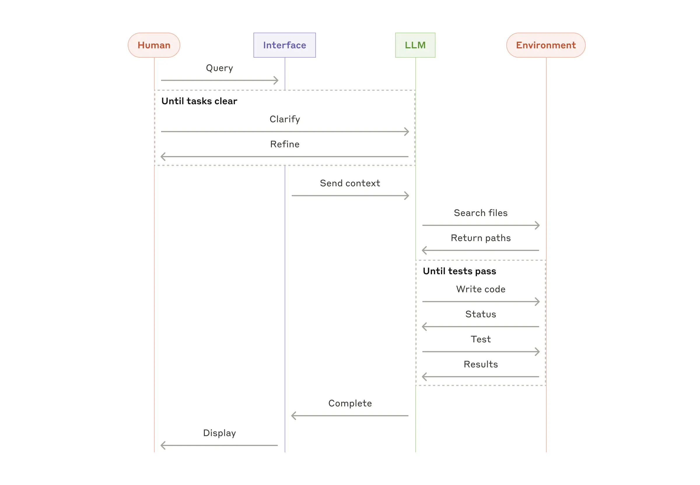

# One Poem Suffices: From Workflows to Agents — Reading Anthropic’s Best Practices

`⏰: 40min`

**Original article:** [Anthropic: Building effective agents](https://www.anthropic.com/research/building-effective-agents)

A reading report, with some of my own thoughts and additions.

## Intro

Over the past year, we have worked with dozens of teams across industries to build large language model (LLM) agents. We found that the most successful applications were built on simple, composable patterns, rather than complex frameworks or specialized libraries.

In this article, we will share what we have learned from working with customers and building agents ourselves, and **offer developers practical advice for building effective agents.**

## What are agents?

“Agent” has many definitions. Some customers use it to mean **fully autonomous systems** that operate independently over extended periods, using various tools to complete complex tasks. Others use the term for more prescribed implementations that follow predefined workflows. At Anthropic, we group all these variations under Agentic Systems, but make an important architectural distinction between Workflows and Agents:

- **Workflows** are systems in which predefined code paths orchestrate LLMs and tools.

- **Agents** are systems in which LLMs dynamically direct their own processes and tool use, controlling how they complete tasks.

Below, we will explore both types of agentic systems in detail. In Appendix 1 (“Agents in practice”), we will describe two areas where customers have found these systems especially valuable: customer support agents and coding agents.

## When (and when not) to use agents

**When building applications with LLMs, we recommend finding the simplest possible solution and adding complexity only when necessary.** That may even mean not building an agentic system at all. Agentic systems usually trade latency and cost, such as token cost, for better task performance, so you should consider when that tradeoff makes sense.

For more complex tasks, Workflows offer predictability and consistency (reproducibility) when tasks are clearly defined, while agents are a better fit when substantial flexibility and model-driven decisions are needed. **For the vast majority of applications, however, optimizing a single LLM call through retrieval (RAG) and contextual examples in the prompt (Prompt Engineering) is usually enough.**

## When and how to use frameworks

Many frameworks can simplify the implementation of agentic systems, including:

- LangChain’s [LangGraph](https://langchain-ai.github.io/langgraph/).
- Amazon Bedrock’s AI Agent framework.
- [Rivet](https://rivet.ironcladapp.com), a visual, drag-and-drop LLM workflow builder.
- [Vellum](https://www.vellum.ai), another graphical tool for building and testing complex workflows.

These frameworks help developers get started by simplifying standard low-level tasks such as calling LLMs, defining and parsing tools, and chaining calls. However, they often introduce **additional** layers of abstraction that can obscure the underlying prompts and responses, making debugging harder. They can also tempt developers to overengineer, introducing unnecessary complexity where a simple solution would have worked.

**We recommend that developers start by working directly with LLM APIs, rather than frameworks:** many common patterns take only a few lines of code to implement. If you choose a framework, make sure you understand its underlying code. **Incorrect assumptions** about how frameworks work internally are a common source of mistakes among customers.

You can find [example implementations](https://github.com/anthropics/anthropic-cookbook/tree/main/patterns/agents) in our cookbook.

## Building blocks, workflows, and agents

In this section, we will explore common patterns for agentic systems in production. We will start with the basic building block, the augmented LLM, and gradually work through more complex applications, from simple combinations of workflows to autonomous agents.

### Building block: The augmented LLM

The basic building block of an agentic system is an LLM augmented with capabilities such as **retrieval**, **tools**, and **memory**. Our current models can actively use these capabilities: generating their own search queries, choosing suitable tools, and deciding what information to retain.



We recommend focusing on two things during implementation: tailoring these capabilities to your specific use case, and giving the LLM simple, well-documented interfaces. There are many ways to implement these augmentations. One is our recently released [Model Context Protocol](https://www.anthropic.com/news/model-context-protocol), which lets developers integrate with a growing ecosystem of third-party tools through a simple [client implementation](https://modelcontextprotocol.io/tutorials/building-a-client#building-mcp-clients).

For the rest of this article, we will assume that every LLM call has access to these augmented capabilities.

In the following sections, Anthropic introduces several workflow applications. I will use a simple mind map to guide the discussion.



### Workflow: Prompt chaining

Prompt chaining breaks a task into a sequence of steps, with each LLM call processing the previous step’s output. You can add programmatic checks at any intermediate step (the “gate” in the diagram below) to ensure that the overall process stays on track.

!!! note "How should we understand the Gate in Prompt Chaining?"

    A Gate here could be an LLM, a non-LLM machine learning model, or even a **rule-based system**. It essentially adds a check to ensure that the result meets our expectations. When it does not, we can exit or give the LLM an updated prompt based on the error and let it try again.



**When to use this workflow:** This workflow is best suited to tasks that can be easily and clearly broken down into fixed subtasks. Its main goal is to trade latency for better accuracy by making each LLM call a simpler task.

**Practical uses of Prompt chaining:**

- Generate marketing copy `->` then translate it into other languages.
- Write a document outline `->` check whether it meets specific criteria `->` then write the document based on the outline.

### Workflow: Routing

Routing classifies an input and directs it to a specialized downstream task. This workflow enables **separation of concerns** and more specialized prompts. Without it, optimizing for one category of input may hurt performance on others.

!!! note "What is separation of concerns?"

    I did not quite understand this term at first. I later realized that *separation of concerns* is an important software engineering principle. Put simply, it means **breaking a complex problem or system into independent modules or components with a single responsibility, each focused on solving one specific subproblem or implementing one specific function.** Here, routing identifies the different concerns and routes them accordingly.

**When to use this workflow:** Routing is particularly useful for complex tasks with distinct categories that need to be handled separately, where an LLM or a traditional classification model or algorithm can classify inputs accurately.

**Practical uses of Routing:**

- Direct different types of customer support queries (general questions, refund requests, technical support) to different downstream processes, LLM prompts, and tools.
- Route simple or common questions to smaller models such as Claude 3.5 Haiku, and difficult or unusual questions to more capable models such as Claude 3.5 Sonnet, to optimize cost and speed.

!!! tip "An aside"

    Maybe the web version sometimes seems less intelligent because it has classified my question as a “stupid question.” :-)

### Workflow: Parallelization

LLMs can sometimes work on a task simultaneously, with their outputs combined programmatically. This parallelization workflow has two main variants:

- **Sectioning**: Split a task into independent subtasks that can run in parallel. (Each LLM Call in the diagram below represents a different subtask.)
- **Voting**: Run the same task multiple times to obtain varied outputs. (Each LLM Call in the diagram below represents the same task, possibly with different in-context prompts.)

**When to use this workflow:** Parallelization is particularly effective when subtasks can run concurrently for speed, or when **multiple perspectives or attempts** are needed for a more confident result. For **complex tasks with multiple considerations**, letting each LLM Call focus on one particular aspect often works better.

**Practical uses of Parallelization:**

- Sectioning

  - Implement guardrails: one model instance handles the user’s query while another screens for inappropriate content or requests. This works better than having the same LLM handle both guardrails and the core response.
  - Automate LLM performance evaluations, with each LLM Call evaluating a different aspect of the model’s response to a particular prompt.

!!! question "Why does handling tasks separately work better than handling them together?"

    A small question worth thinking about here is: **why does handling tasks separately work better than handling them together?** This may have to do with **cognitive load**. Having one LLM perform multiple tasks at once (generating a response and reviewing content) may reduce performance because the model has to switch its attention between different objectives. Separating the tasks lets each LLM focus on a single objective, potentially improving accuracy and efficiency. Human multitasking ability is limited too.

- Voting

  - Review code for vulnerabilities using multiple LLM Calls with different prompts, and flag the code as vulnerable when an issue is found.
  - Evaluate whether content is inappropriate, using multiple prompts to assess different aspects, or different voting thresholds to balance false positives and false negatives.

!!! example "A content moderation team: understanding Voting and threshold tradeoffs"

    The content moderation example takes a little unpacking. Let me try to explain it simply.

    Imagine a content moderation team whose members are all LLMs. To decide whether a piece of content is “**inappropriate**,” we do not ask just one bot. Instead, we have several bots (multiple LLM Calls) evaluate it from different angles, using multiple prompts, such as whether it contains violence, sexual content, or advertising.

    Each bot offers its own opinion (a vote). We then set a rule (a voting threshold), such as “classify it as inappropriate if more than half the bots say so.”

    This gives us a more comprehensive assessment and helps avoid the bias of a single bot. But we also have to consider two possible errors:

    - **False positive:** Classifying acceptable content as inappropriate.
    - **False negative:** Failing to recognize inappropriate content.

    We can adjust the “voting rule” to control the balance between these errors. With a strict rule (for example, all bots must agree that the content is inappropriate), false positives decrease but false negatives increase. With a looser rule (for example, one bot’s judgment is enough), false negatives decrease but false positives increase.

    We therefore need to choose a voting rule suited to the situation, finding a balance between false positives and false negatives. Clearly, Claude has a strong sense of morality, and its voting rules are relatively strict.

### Workflow: Orchestrator-workers

In an orchestrator-workers workflow, a central LLM dynamically breaks down tasks, delegates them to worker LLMs, and synthesizes their results.



**When to use this workflow:** This workflow is well suited to complex tasks where **the required subtasks cannot be predicted in advance**. In coding, for example, the number of files to change and the nature of each change may depend on the specific task. Although its topology resembles the Parallelization workflow, the key difference is **flexibility**: the subtasks are not predefined, but determined by the orchestrator based on the input.

**Practical uses of the Orchestrator-workers pattern:**

- Coding products that need to make complex changes across multiple files on each task.
- Search tasks that involve gathering and analyzing potentially relevant information from multiple sources.

!!! example "Cursor as an example: complex changes across multiple files"

    The examples here are rather brief, so let’s go a little deeper. The second is fairly easy to understand. Let’s focus on the first: “coding products that need to make complex changes across multiple files on each task.”

    Take Cursor, which has become quite popular recently. The complexity might include:

    - **Changes across files:** Large software projects usually consist of multiple interdependent files. Modifying or adding a feature may require changing several files at once, such as changing a function definition and all the files that call it.
    - **Complex dependencies:** Files can have complex dependencies. A change in one file may affect calls in others, so the order and manner of the changes need careful consideration.

    One possible design is therefore as follows. It also fits the earlier idea of reducing **cognitive load** by letting each LLM focus on a single objective.

    - **Orchestrator:** Receives the user’s request (such as “add a new feature”), analyzes the codebase, determines which files need to change and what changes each requires, and assigns those tasks to the appropriate Workers.
    - **Workers:** Receive tasks from the Orchestrator, make the specific changes to their assigned files, and return the modified code to the Orchestrator.

### Workflow: Evaluator-optimizer

In an evaluator-optimizer workflow, one LLM Call generates a response while another provides evaluation and feedback in a loop.



**When to use this workflow:** This workflow is particularly effective when we have clear evaluation criteria and iterative refinement offers measurable value. Two signs that it is a good fit are:

- First, LLM responses improve noticeably when humans articulate feedback clearly.
- Second, an LLM can provide that feedback. This resembles the iterative writing process a human author goes through when producing a polished document.

**Practical uses of the Evaluator-optimizer pattern:**

- Literary translation, where the translating LLM may initially miss nuances, but an evaluator LLM can offer useful criticism.
- Complex search tasks requiring multiple rounds of searching and analysis to gather comprehensive information. The evaluator decides whether further searching is necessary: whether the information available is sufficient to answer the query.

### Agents

Agents are beginning to appear in production as LLMs mature in key capabilities: **understanding complex inputs, reasoning and planning, using tools reliably, and recovering from errors**. Agents begin with a user’s instruction or an interactive conversation. Once the task is clear, they plan and operate independently, asking humans for more information or judgment when necessary. During execution, agents need to obtain “**ground truth**” from the environment at each step, such as tool results or code execution outcomes, to assess their progress. They can pause at checkpoints or when they encounter obstacles to obtain human feedback. Tasks usually end when completed, but often include stopping conditions, such as a maximum number of iterations, to maintain control.

Agents can handle complex tasks, yet their implementations are often simple. They are usually LLMs that use tools in a loop based on environmental feedback (**They are typically just LLMs using tools based on environmental feedback in a loop.** I think this sentence explains agents very well). That makes a clearly and thoughtfully designed toolset and its documentation crucial. We discuss best practices for developing tools in Appendix 2 (“Prompt engineering your tools”).



**When to use agents:** Agents suit open-ended problems where the number of required steps is difficult or impossible to predict, and a fixed execution path cannot be hardcoded. The LLM may need to operate over many rounds, and you need some trust in its decision-making ability. Agents’ autonomy makes them a good fit for scaling tasks in **trusted environments**.

!!! question "What are Trusted Environments?"

    I think this means **an environment in which the agent operates is relatively safe and controllable, and the consequences of its behavior can be predicted and managed**. In such an environment, we can place some trust in an agent’s autonomy, allowing it to perform tasks independently without worrying that it will cause serious negative effects.

Agents’ autonomy entails higher costs and the possibility of compounding errors. We recommend extensive testing in sandboxed environments and setting appropriate guardrails.

**Practical uses of Agents:**

Here are examples from our own implementations:

- A coding agent that solves [SWE-bench](https://www.anthropic.com/research/swe-bench-sonnet) tasks by editing multiple files based on a task description.
- Our ["computer use" reference implementation](https://github.com/anthropics/anthropic-quickstarts/tree/main/computer-use-demo), in which Claude uses a computer to complete tasks.



!!! note "Similarities and differences between Agents and Orchestrator-Workers"

    At this point in my reading, I noticed that the SWE-bench example under Agents does something rather similar to the Orchestrator-workers workflow.

    In my view, the difference is that an Orchestrator-workers workflow **is more like a Divide and Conquer strategy: it breaks a complex task into clearly defined subtasks and assigns them to Workers.** Its focus is task decomposition and parallel execution, making it suitable for tasks that **can be planned in advance or decomposed deterministically based on the input**. Agents, by contrast, solve more flexible, open-ended problems, including asking humans for additional information.

### Combining and customizing these patterns

These building blocks are not fixed prescriptions. They are common patterns that developers can adapt and combine for different use cases. As with any LLM capability, success depends on measuring performance and iterating on the implementation. To reiterate: **you should consider adding complexity *only* when it clearly improves results.**

## Summary

Success with LLMs is not about building the most complex system, but the **right** system for your needs. Start with simple prompts, improve them through comprehensive evaluation, and add multi-step agentic systems only when simpler solutions are insufficient.

When implementing Agents, we try to follow three core principles:

1. Keep the agent’s design **simple**. (Maintain **simplicity** in your agent's design.)
2. Show the agent’s planning process clearly so its decisions are transparent. (Prioritize **transparency** by explicitly showing the agent’s planning steps.)
3. Carefully design the agent-computer interface (ACI) through thorough tool **documentation and testing**. (Carefully craft your agent-computer interface (ACI) through thorough tool **documentation and testing**.)

Frameworks can help you get started quickly, but as you move to production, **you can reduce the abstraction layers in your code and build directly with basic components** (*don't hesitate to reduce abstraction layers and build with basic components as you move to production*). Following these principles can help you build agents that are powerful, reliable, maintainable, and trusted by users.

### Acknowledgements

Written by Erik Schluntz and Barry Zhang. This work draws upon our experiences building agents at Anthropic and the valuable insights shared by our customers, for which we're deeply grateful.

## Appendix 1: Agents in practice

Our work with customers has revealed two particularly promising areas for AI agents that demonstrate the practical value of the patterns above. Both show where agents create the most value: **tasks that combine conversation with action, have clear success criteria, allow feedback loops, and integrate meaningful human oversight.**

### A. Customer Support

Customer support combines the familiar chatbot interface with capabilities added through tool integrations. It is well suited to more open-ended agents because:

- Customer support is naturally conversational, but also requires access to external information and the ability to take specific actions.
- Tools can retrieve customer data, order histories, and knowledge base articles.
- Actions such as issuing refunds or updating tickets can be handled programmatically.
- Whether the user’s problem is resolved provides a clear measure of success.

Some companies even charge only for successful resolutions (*usage-based pricing models that charge only for successful resolutions*), demonstrating their confidence in their agents’ abilities.

### B. Coding agents

Software development has already shown the considerable potential of LLM capabilities, which have progressed from code completion to autonomous problem-solving. Agents are particularly effective in this domain because:

- Code solutions can be checked through automated tests.
- Agents can use test results as feedback to iterate on their solutions.
- The problem space is clearly defined and structured.
- Output quality can be measured objectively.

In our own implementation at Anthropic, agents can now solve real GitHub issues from the [SWE-bench Verified](https://www.google.com/url?sa=E&q=https%3A%2F%2Fswe-bench.com%2Fverified) benchmark based solely on pull request descriptions. Although automated tests can verify functionality, human review remains essential to ensure that a solution meets broader system requirements.

## Appendix 2: Prompt engineering your tools

Whatever kind of agentic system you are building, tools may be an important part of it. [Tools](https://www.anthropic.com/news/tool-use-ga) let Claude interact with external services and APIs by specifying their precise structure and definitions in our API. When Claude plans to call a tool, its API response includes a [tool use block](https://docs.anthropic.com/en/docs/build-with-claude/tool-use#example-api-response-with-a-tool-use-content-block). Tool definitions and specifications deserve as much engineering attention as the overall prompts. In this short appendix, we will discuss **prompt engineering** for tools.

There are often several ways to specify the same operation. For example, a file edit can be expressed as a diff or by rewriting the entire file. For structured output, code can be returned inside Markdown or JSON. In software engineering, these differences are superficial: the formats can be converted into one another without losing information. But some formats are harder for LLMs to write than others. Writing a diff requires knowing how many lines are changing in the chunk header before writing the new code. Writing code in JSON, compared with Markdown, requires additional escaping of newlines and quotation marks.

A diff looks something like this:

```diff
+ print("")
- print()
```

We have the following suggestions for choosing a tool format:

- Give the model enough tokens to “think” without backing itself into a corner.
- Keep the format close to what the model naturally encounters in text on the internet.
- Avoid formatting “overhead,” such as requiring an exact count of thousands of lines of code or string-escaping every piece of code it writes.

As a rule of thumb, consider the effort that goes into human-computer interfaces (HCI), and plan to invest as much in creating good **agent**-computer interfaces (ACI). Here are some suggestions:

- **Think from the model’s perspective.** Given the current description and parameters, would you know clearly how to call the tool, or would you still need to think carefully? If the latter, the LLM probably would too. A good tool definition usually includes usage examples, edge cases, input format requirements, and **clear boundaries with other tools**.
- **Could changing parameter names or descriptions make things clearer?** Think of it as writing an excellent docstring for a newcomer to your team. This matters especially when there are many similar tools.
- **Test how the model uses your tools:** Run many example inputs in our [workbench](https://console.anthropic.com/workbench), observe the mistakes the model makes, and iterate.
- **Design your tools to prevent errors ([Poka-yoke](https://en.wikipedia.org/wiki/Poka-yoke)).** Change the parameters to make mistakes harder to make.

!!! question "How should we understand HCI and ACI?"

    **Human-computer interface (HCI):** Think of everything you see when using your phone or computer: buttons, menus, icons, and so on. This is the human-computer interface. It acts as a “translator” between people and computers, making it easy for us to tell the computer what we want to do and to understand its feedback.

    **Agent-computer interface (ACI):** If HCI is designed for humans, ACI is designed for AI assistants, or “agents.” Just as we need understandable buttons and icons, AI agents need clear “instructions” and “tools” to interact with a computer. Think of the detailed working guide we would hope to receive when joining a new company. ACI gives the AI assistant an instruction manual it can accurately understand and follow, telling it how to use the computer’s various functions correctly.

    More simply:

    - HCI is design that lets humans use computers easily.
    - ACI is design that lets AI use computers accurately.

!!! question "What does ‘clear boundaries with other tools’ mean?"

    Imagine two similar tools in your kitchen: a knife for chopping vegetables and a knife for peeling them.

    If you do not explain clearly what each knife is for, people can easily confuse or misuse them. The same applies when designing tools for AI: each needs a clear, specific responsibility, without ambiguity. For example:

    - One tool is specifically for reading files.
    - Another is specifically for writing files.
    - Rather than one vaguely defined tool for “handling files.”

    This avoids leaving the AI wondering, “Which tool should I use for this task?”

!!! question "How should we understand error-proofing tools (Poka-yoke)?"

    Poka-yoke is a concept from the Toyota Production System. Put simply, it means “mistake-proofing” or “error-proofing.” An everyday example:

    - A USB 3.0 connector is designed to fit in only one orientation; this is error-proofing.
    - It cannot be inserted the wrong way around, preventing damage to the device.

When building our [SWE-bench](https://www.anthropic.com/research/swe-bench-sonnet) agent, we actually spent more time optimizing the tools than the overall prompt. For example, we found that the model made mistakes with tools using relative file paths after the agent moved out of the root directory. To address this, we changed the tools to require absolute file paths every time, and found that the model used this approach perfectly.
