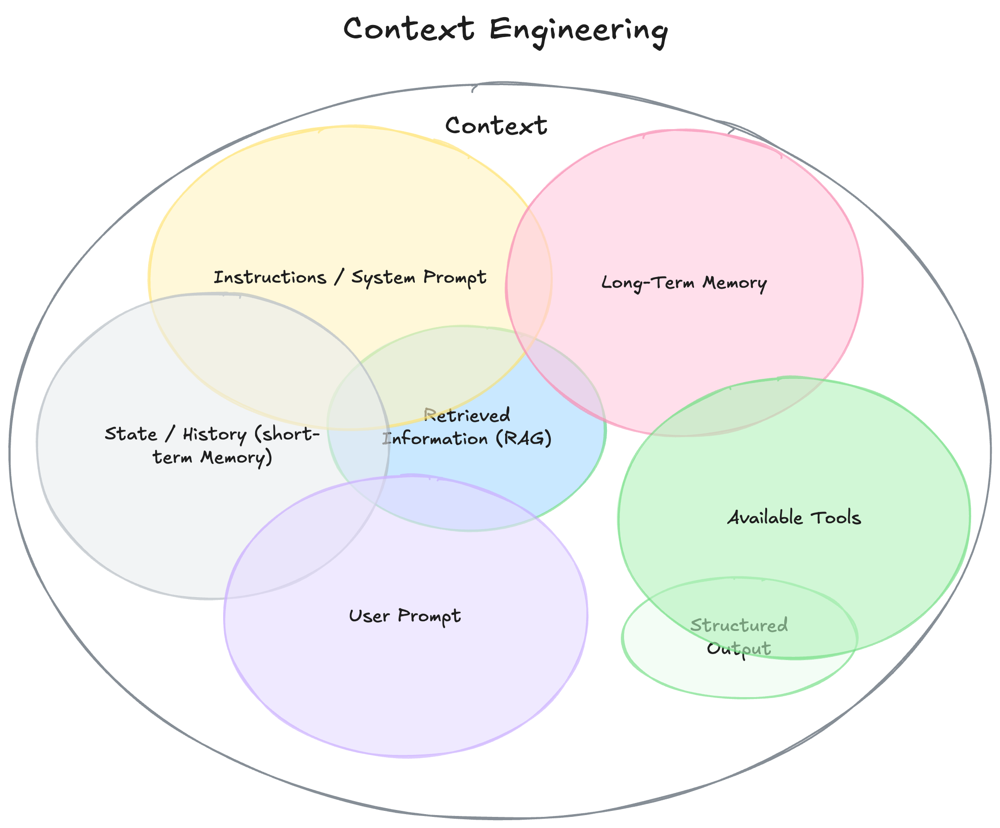
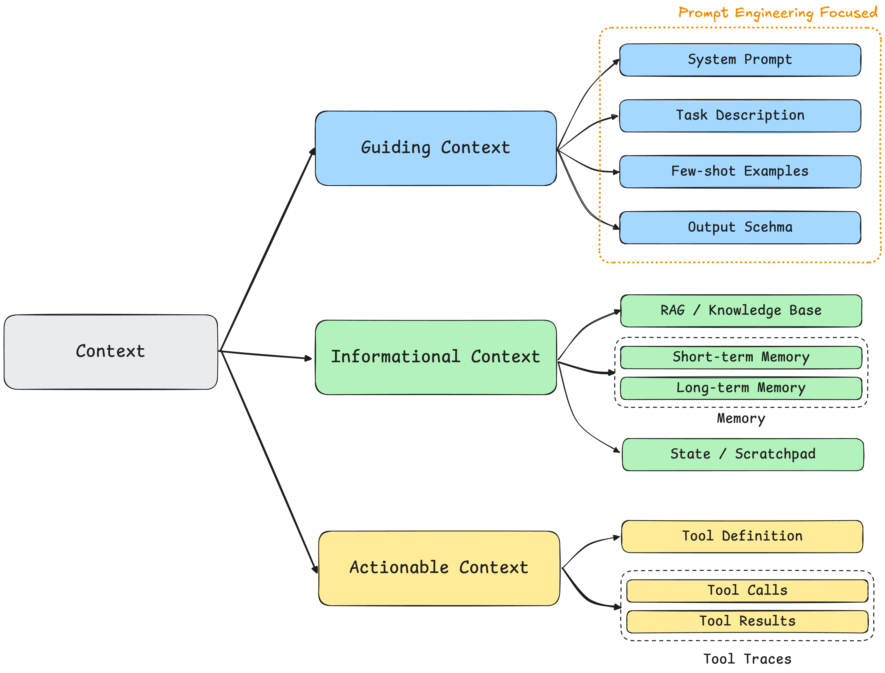
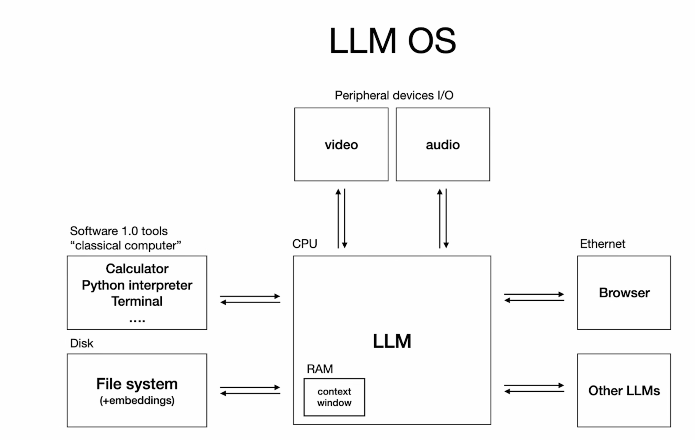
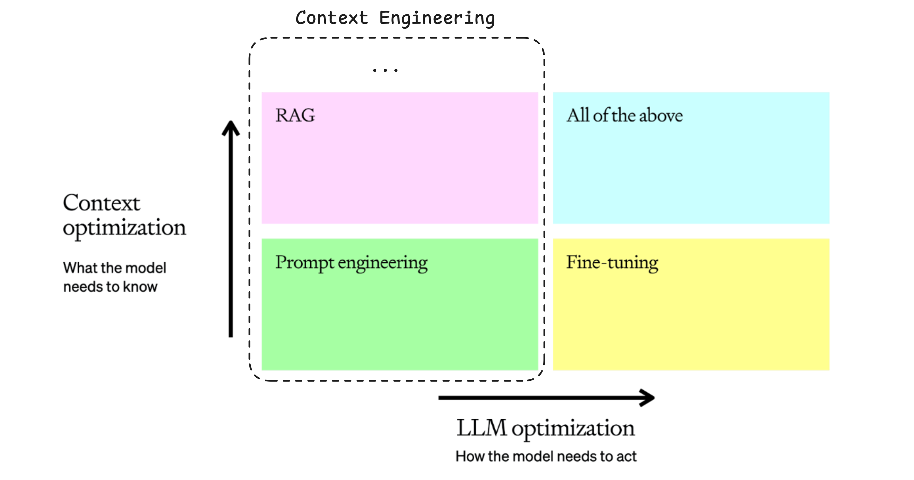
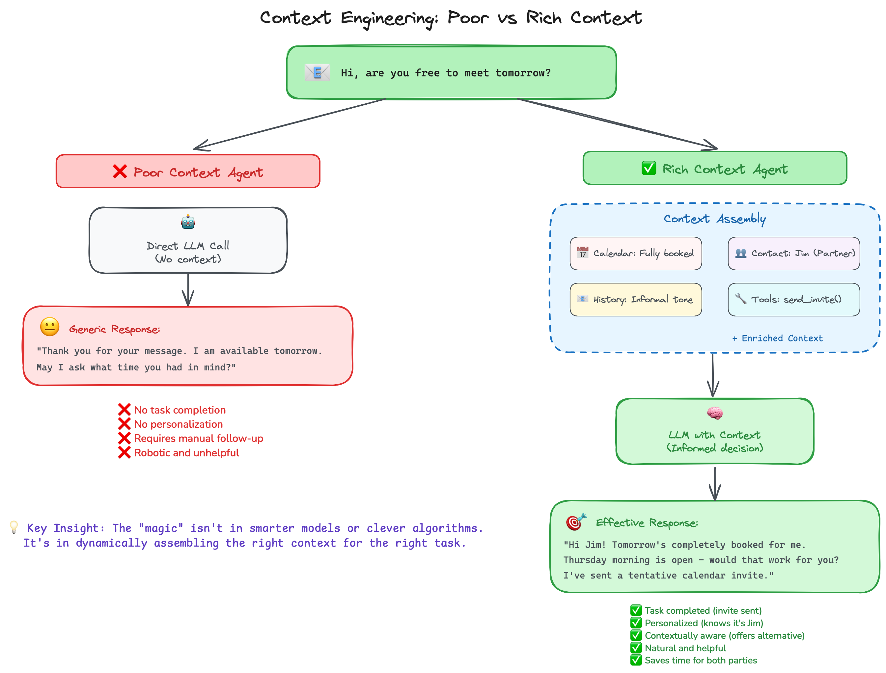
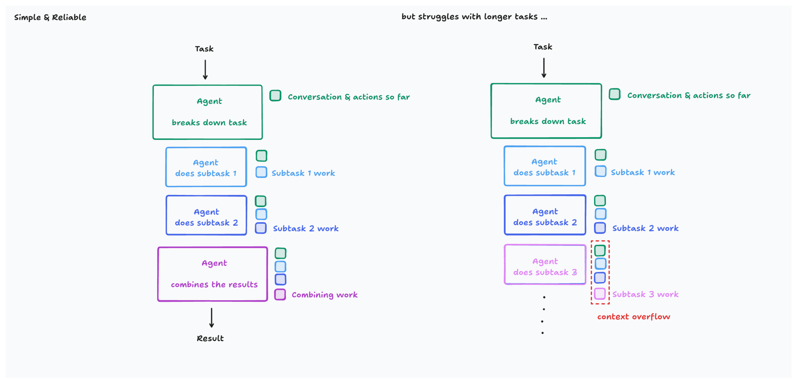
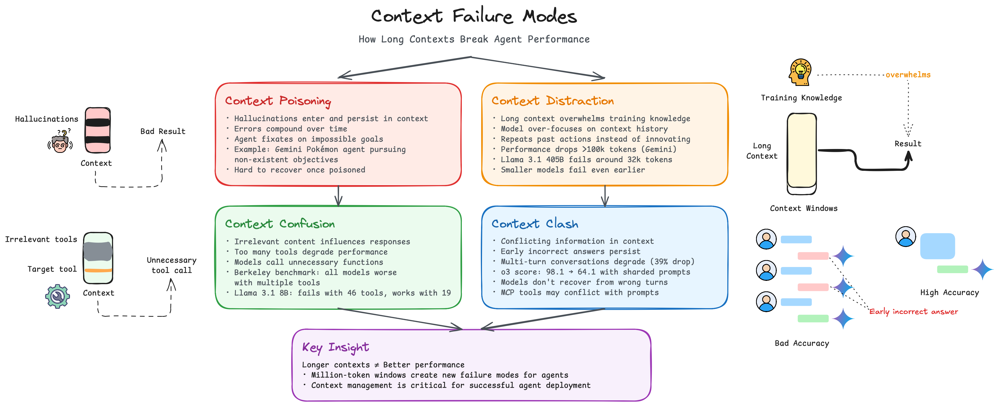
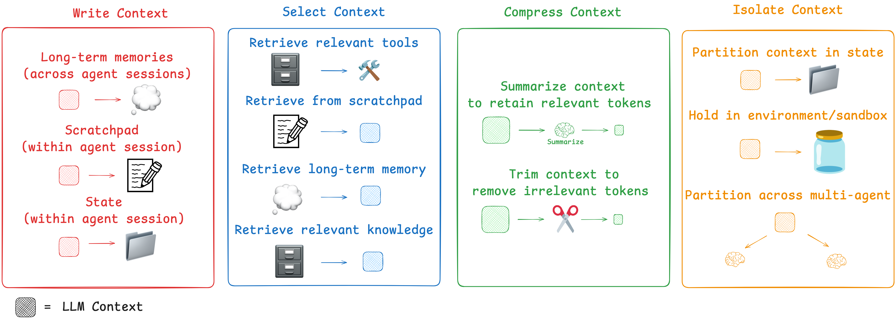
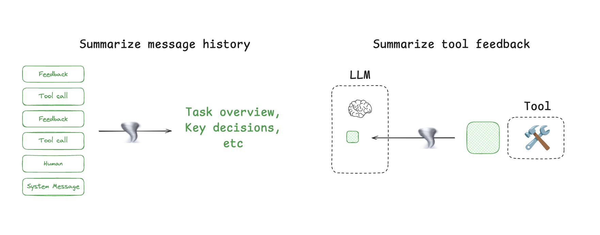
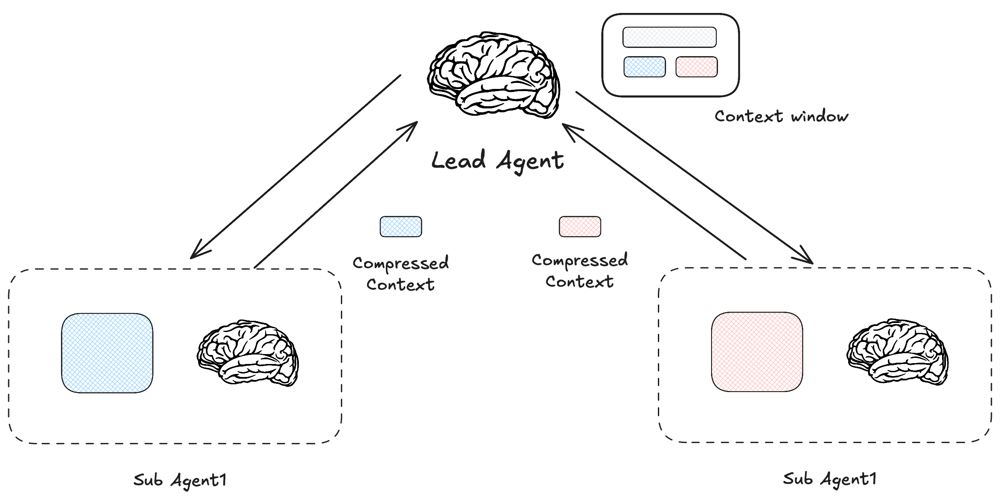

# One Poem Suffices: Context Engineering

> "**Most AI Agent failures are not failures of model capability, but failures of context engineering.**"

The term Context Engineering suddenly gained popularity a while ago. At first, I also questioned whether this was just another round of conceptual hype. How does it relate to the familiar concepts of Prompt Engineering, RAG, or even MCP (Model Context Protocol)?

The concept of Context Engineering largely originated from tweets by Tobi Lütke and Andrej Karpathy: “It describes the core skill better: the art of providing all the context for the task to be plausibly solvable by the LLM.” && "When in every industrial-strength LLM app, context engineering is the delicate art and science of filling the context window with just the right information for the next step."

By tracing and analyzing the concept of context engineering, this post argues that **simply equating** context engineering with "advanced prompt engineering" or "complex RAG" is a misreading. It is better understood as a set of **philosophies and principles**. Although its core idea seems intuitive, these are key principles that have gradually crystallized during the evolution of Agentic Systems to cope with the complexity of industrial-grade applications. For any developer committed to building robust, scalable AI applications, understanding and mastering these principles is essential. (This topic also fits my taste quite well, and it is suitable for readers of any level.)

This blog post aims to answer the following three questions:

- What? What is Context Engineering? What is the fundamental difference between it and the familiar Prompt Engineering and RAG?
- Why? Why do we need such a new concept? What role does it play, and what value does it provide?
- How? How do we practice Context Engineering systematically? What components does Context Engineering include, and what are the corresponding best practices for each?

Because the substance of context engineering is still evolving rapidly and its conceptual boundaries remain fairly open, covering every detail comprehensively in a single post is quite challenging. Therefore, the core goal of this post is not exhaustiveness, but focusing on its most valuable core to build a clear, solid understanding for the reader (seen this way, calling it "One Poem Suffices" is slightly clickbaity).

## 1. What is Context Engineering?

### 1.1 How Do We Define Context?

Before understanding what Context Engineering is, we first need to clarify what Context is. Quite a few people think the user's chat history is the context. This understanding is **partially** correct, as the scope of context is much broader than simple conversation history. Essentially, **Context is the entire set of information provided to an LLM to complete the next reasoning or generation task**. Let's use an image to summarize it:

Although the diagram above provides a comprehensive view, it does not categorize these elements further. For a clearer analysis, I prefer to divide context into three core categories:

- Guiding Context: The core function of this type of context is to **guide the model on what to do and how to do it**, primarily setting the framework, goals, and rules for model behavior. **Prompt Engineering generally aims to optimize Guiding Context**. It includes: System Prompt; Task Description; Few-shot Examples; Output Schema (the first three are straightforward, while Output Schema is generally a structural definition that forces the model to output in a specific format, such as JSON or XML).
- Informational Context: The core function of this type of context is to **tell the model what knowledge it needs to know**, providing the facts, data, and knowledge required to solve the problem. It includes: RAG (external knowledge base); Memory (Short-term Memory: current conversation history, Long-term Memory: important information and preferences stored across sessions); State / Scratchpad (state maintenance and scratchpads, such as Claude Code's temporary TODOs when starting to plan, as well as the thinking "scratchpad" under Thinking models).
- Actionable Context: The core function of this type of context is to **tell the model what it can do and the results after doing it**, providing the model with the ability to interact with the external world. It includes: Tool Definition; Tool Calls & Results / Tool Traces (which tools were called and the results returned by the tools, i.e., the historical trace of tool calls).

Therefore, **context is a multi-dimensional, dynamic, systematic concept serving a specific task**.

### 1.2 How Do We Understand Context Engineering?

Having clarified the definition of "context," we can return to the core question: what exactly is context engineering?

Looking back at the views of Tobi Lütke and Andrej Karpathy: “It describes the core skill better: the art of providing all the context for the task to be plausibly solvable by the LLM.” && "When in every industrial-strength LLM app, context engineering is the delicate art and science of filling the context window with just the right information for the next step."

From this, this post proposes the following definition for context engineering: **Context Engineering is a systematic discipline focused on designing, building, and maintaining a dynamic system responsible for intelligently assembling the optimal combination of context for an Agent at every step of task execution, ensuring that the task can be completed reliably and efficiently.**

Because context engineering is closer to a development philosophy, it can be interpreted from multiple angles. One highly illuminating analogy comes from [YouTube: Andrej Karpathy: Software Is Changing (Again)](https://www.youtube.com/watch?v=LCEmiRjPEtQ&t=620s).

If we view LLMs (or more broadly, Agentic Systems) as a new type of operating system, the LLM is like the CPU, and the Context Window is like RAM (similarly limited in capacity, managing the memory needed by the CPU). Context engineering is the memory manager in this operating system. Its responsibility is not simply to cram data into RAM (the context window), but to decide through sophisticated scheduling algorithms, at every "clock cycle," which data should be loaded, which should be swapped out, and which should be prioritized, thereby ensuring the smooth operation of the entire system and the accuracy of the final result. This also corresponds to **"context engineering is the delicate art and science of filling the context window with just the right information for the next step."**

Overall, context engineering marks an upgrade in how we interact with LLMs, shifting from optimizing Guiding Context via traditional Prompt Engineering to "building the most efficient information supply system." (Why does this upgrade exist, and why is it needed? You can think about it briefly, and I will try to answer it in Section 2.)

### 1.3 Context Engineering vs Prompt Engineering vs RAG

Before reading Sections 1.1 and 1.2, you (including me) might have found the definition of Context Engineering somewhat muddled with Prompt Engineering and RAG. Some people think it is just supersized Prompt Engineering, while others might think it simply means putting all relevant information into the context window via RAG.

However, with the definitions above, the distinctions and relationships among the three become clear. They are not mutually exclusive; rather, they operate at different levels and collaborate with one another. To put it in one sentence: **Prompt engineering is a subset of context engineering whose core function is optimizing *Guiding Context*, while RAG is one of the key technical means of implementing dynamic *Informational Context*.**

If you already understand the differences among them, you can skip the redundant explanation below.

Prompt Engineering's main task is to optimize the instruction portion of a single interaction, such as defining a role in the system prompt and adding few-shot examples and output schemas to guide the model's writing. Therefore, it is a finer-grained engineering practice oriented toward specific problems (single-turn interactions).

RAG's responsibility is to retrieve relevant information from an external knowledge base and populate it into the context window as part of the **Informational Context**. Therefore, the scope of context engineering is much larger than RAG: it is responsible not only for "what to retrieve" (the core of RAG), but also for considering how to dynamically combine the resulting Informational Context with the other two types of context. An advanced Context Engineering System might not use RAG at all in certain steps, or might use other tools after RAG fails.

## 2. Why Context Engineering?

In the previous section, we deconstructed the definition of "Context Engineering" and its distinctions from related concepts. A natural question follows: **why do we need such a new concept?**

### 2.1 Fault of the Model, or Failure of Context?

In the LLM Accuracy Optimization blog series I wrote previously, I mentioned a "two-dimensional mental model for optimizing LLMs" (at the time, the concept of Context Engineering had not yet emerged). When the output of an agentic system or a single LLM call falls short of expectations, the root cause can often be attributed to two aspects:

1. **Limitations of model capability:** The foundation model itself lacks sufficient capability, requiring optimization of the model itself.
2. **Missing contextual information:** The model did not receive the **appropriate context** needed to generate a high-quality response.

Usually (especially now that the intelligence of foundation models has crossed a certain threshold), disappointing outputs point more often to the latter. That is, we failed to implement effective context engineering, leaving the model without key information needed to solve the problem. **Models cannot read minds**, so they can only make uncertain assumptions or even fall into unnecessary hallucinations. (This also leads to a direction worth pondering: could an LLM that proactively identifies and requests missing context fundamentally solve a significant portion of these problems?)

### 2.2 Two Simple Examples

These two examples will clearly demonstrate the necessity of Context Engineering.

**Example 1: The Cost of Missing Context**

This example comes from an observation by [Philipp Schmid](https://www.philschmid.de/context-engineering), showing how the most basic lack of context can create a massive difference in results.

Imagine your AI assistant receives a simple email:

> *"Hi, are you free to get together tomorrow?"*

A **Poor Context** Agent can only see this request and has no other context. Its response is mechanical:

> *"Thank you for your message. I am free tomorrow. What time would you like to meet?"*
>
> **Analysis:** This Agent failed to move the task forward because it lacked the **Informational Context** needed to make the next decision.

Now, consider a **Rich Context** Agent. Before its system calls the LLM, its primary task is to dynamically assemble a context containing multi-dimensional information:

- **Informational Context (Informational):**
  - `[Calendar Data]`: Retrieves your calendar and finds that tomorrow's schedule is full.
  - `[Contact Data]`: Identifies the sender Jim as an important partner.
  - `[Email History]`: Analyzes past emails and determines that communication should use an informal tone.
- **Actionable Context (Actionable):**
  - `[Tool Definition]`: Provides the description of the `send_calendar_invite` tool.

Based on this complete context, it can generate a genuinely effective response:

> *"Hi Jim! My schedule is completely packed tomorrow. I'm free Thursday morning, does that work for you? I sent a tentative invite, please confirm if the time suits you."*
>
> **Analysis:** The "magic" here does not come from a smarter model, but from a **system capable of dynamically assembling the right context** for a specific task.

This example demonstrates the first level of why Context Engineering is necessary: **a lack of context creates a significant performance gap.**

**Example 2: The Challenge of Context Degradation**

The first example seems to suggest a simple solution: provide all possible context to the model. Setting aside model capability (most LLMs do not have a very large context capacity) and economic cost for the moment, when tasks become complex and long-horizon, this "simple accumulation" strategy not only fails, it can even degrade model performance. For example, if you have thousands of emails back and forth with Jim, many of them quite long, feeding all of that into the LLM is not a wise move.

Here I will use another example to further introduce the importance of Context Engineering (inspired by a Cognition AI blog post).

Imagine an Agent assigned a long-term task: over the course of several days in a large codebase, implement a new feature involving multiple files and dependencies. For ease of explanation, let's assume a linear Agentic System is used (because parallel architectures carry inherent complexities such as inconsistent decision-making, making them suboptimal in certain scenarios like Coding).

- **A naive strategy:** To ensure the model is "all-knowing," the system records every interaction, including every user instruction, file read, compilation error, and successful tool call, and passes this entire history as context in full to the LLM on every Agent call.

- **The inevitable failure cascade**
    1. **Performance degradation:** First, performance quietly degrades. Unimportant details from earlier in the task (such as an already resolved syntax error) continuously dilute the core information needed for the current step, causing **Context Distraction**.
    2. **Surging cost and latency:** As the context grows linearly, the number of tokens per API call balloons rapidly, leading to runaway costs and higher latency.
    3. **Eventual crash:** Eventually, the system hits an architectural limit: **Context Overflow**. When the total accumulated information exceeds the upper limit of the model's context window (whether 200K or 1M tokens), the API call fails outright, potentially interrupting the task or leading to incorrect results due to information truncation.

Context Engineering is designed to solve problems like this. For example, by intelligently managing and compressing context, it can inject only high-value conclusions and information into the context (a considerable portion of tokens consists of low-value analysis), thereby avoiding the risks above. The diagram below is a simple example.

This example shows that **context is a finite resource that must be actively managed.** A simple accumulation strategy is unsustainable in scaled applications.

### 2.3 Summary

As the capabilities of foundation models have generally crossed a critical threshold, context engineering has not only become a higher-priority option for improving system performance, in many scenarios it is even the only viable path. While missing context certainly leads to degraded Agentic System performance and frequent hallucinations, indiscriminately piling all historical information into the context likewise triggers various **context degradation** problems.

As a result, both the importance of context and the complexity of managing it are becoming familiar to all AI engineers. This requires us to establish a systematic methodology to intelligently and dynamically **Write, Select, Compress, and Isolate** context. These four operations constitute the implementation details of context engineering and are the core topic we will explore in the next section.

## 3. How? The Best Practice of Context Engineering

> *“Prompt engineering” was coined as a term for the effort needing to write your task in the ideal format for a LLM chatbot. “Context engineering” is the next level of this. It is about doing this automatically in a dynamic system. It takes more nuance and is effectively **the #1 job of engineers building AI agents**. —— Cognition AI*

The practice of context engineering can be approached along two dimensions: first identifying common failure modes, and then building the corresponding engineering methods. This section analyzes the topic from the two levels of problem diagnosis and solutions. Given the rapid evolution of technology, the methods below represent common implementations at the current stage rather than permanent conclusions.

### 3.1 What is Context Degradation?

Before introducing the best practices of context engineering, it is worth considering what kinds of context-related problems industrial-grade Agentic Systems typically encounter. Only by understanding where the problems lie can we better understand the corresponding solutions. The most common problem is missing Informational Context, in which case what needs optimization is RAG, i.e., the retrieval component. Solutions for problems that simply involve missing relevant information are relatively mature. However, in industrial-grade, long-horizon, complex Agentic Systems, a more fundamental and insidious threat is **context degradation**.

Take a Coding Agent as an example: token consumption for a single task is typically several times that of an ordinary chatbot. Anthropic's Multi-Agent Research System consumes 15 times as many tokens as a typical application. This consumption pattern makes context window management and cross-agent context passing core technical challenges. Regarding the problems that Long Context may cause, refer to my summary based on the blog post [How Long Contexts Fail](https://www.dbreunig.com/2025/06/22/how-contexts-fail-and-how-to-fix-them.html).

Long context brings cost and coordination pressure, making it easier to expose four types of context failure: poisoning, distraction, confusion, and clash. They are often coupled with one another and directly undermine reasoning stability and cross-agent transmission.

- Context Poisoning: Primarily occurs when hallucinations enter the Context and lead to abnormal results.
- Context Distraction: When the Context approaches overflow, knowledge acquired during model training gets "overwhelmed," causing the model's effective intelligence to drop.
- Context Confusion: Redundant and irrelevant Context causes the output to deviate from expectations.
- Context Clash: Occurs when information within the context contradicts itself, such as when past incorrect answers remain in the context.

### 3.2 Best Practices of Context Engineering

To address the challenges above, the industry has gradually converged on a systematic response framework. Referring to [Lance's Blog](https://rlancemartin.github.io/), context engineering can be divided into four parts as shown below: **Write, Select, Compress, and Isolate**. There is a great deal to dig into regarding the specific implementation strategies and details of each part, so I will only provide a broad overview here.

**Write**

Write is mainly about **persisting context beyond the limits of the context window** so that it can be retrieved on demand in the future. It is usually divided into:

- **Session-level Write:** The Agent writes intermediate thoughts, plans, or temporary data into a session-internal **Scratchpad**. This is a lightweight, non-persistent write used to manage the complexity of the current task.
- **Persistent Write:** The system writes information with long-term value (such as summaries of user preferences or key facts) into an external **Memory** system, such as a vector database or knowledge graph. This enables cross-session knowledge accumulation. For example, applications like ChatGPT and Cursor use this approach to allow the Agent to "learn" and "grow" through continuous interaction with the user, so users do not need to manually introduce context when solving certain problems.

Anthropic also suggested in a blog post: **Subagent output to a filesystem to minimize the ‘game of telephone.’** By writing subagent output to files, we can avoid meaningless context passing and unnecessary context window occupation.

**Select**

The purpose of Select is to dynamically pull the information most relevant to the current subtask from all available information sources before each LLM call. This is key to ensuring a high signal-to-noise ratio in the context.

Selection in context engineering includes three categories:

- **Deterministic Select:** Refers to loading context according to preset rules. For example, when a coding Agent (Claude Code) starts up, it **consistently loads** the `CLAUDE.md` file in the project root directory, which is a simple and efficient way to inject prior knowledge.
- **Model-driven Select:** When there are too many available information sources (such as a massive number of tools or documents), the model's own capabilities can be used to filter them.
- **Retrieval-based Select:** This is the most mainstream approach, whose core paradigm is to **select** information from memory, scratchpads, or external knowledge bases via similarity retrieval. Therefore, the success or failure of the selection operation depends to a large extent on the quality of the underlying retrieval system.

**Compress**

The purpose of Compress is to perform lossy or lossless compression on information **before** it enters the context window, carrying the core signal with fewer tokens. This is a direct means of accommodating more effective information given limited context window capacity.

As mentioned earlier, Agentic Systems such as Claude Code require substantial token overhead. Therefore, when the context window approaches overflow, they usually adopt what is called "auto-compact." As shown on the left side of the diagram above, it automatically summarizes the Context and retains "what it considers the most important parts." Consequently, the strategy and performance of automatic compression have a huge impact on subsequent task processing. Based on actual usage, Claude Code's auto-compact feature is still imperfect, and restarting directly with minimal context is safer.

Referring again to the image from Section 2.2, in order to compress context for efficient transmission between agents, Cognition AI used a fine-tuned "compression LLM" dedicated to performing the compression step.

There are also pruning strategies, such as hard-truncating history that exceeds the limit, at the cost of losing some context.

**Isolate**

Compared with the first three principles, which optimize within an "information stream," Isolate is a more fundamental context management strategy carried out at the **system architecture level**. The purpose of isolation is to set boundaries between multiple information streams, having subprocesses digest information first and hand up only the key points. **It can be viewed as 'compression' across streams**.

Anthropic mentioned a very interesting point: “The essence of search is compression: distilling insights from a vast corpus.” Put simply: **"Search is compression: extracting insights from a vast corpus."** This inevitably brings to mind the idea originating from Ilya that **compression is intelligence**.

In a multi-agent system, subagents play the role of "intelligent filters." They work **in isolation and in parallel** within their respective domains, digesting large amounts of raw information and then submitting the most critical "**compressed**" insights (the most important tokens) to the lead agent.

This mechanism greatly reduces the cognitive load on the Lead Agent. It does not need to read every raw document itself; it only needs to process the preprocessed and distilled "summary reports" submitted by each specialist team. Therefore, **the most classic manifestation of Isolate in context engineering is multi-agent architecture. Because the Lead Agent receives only the most valuable parts of the isolated contexts, it can largely avoid potential problems brought by Long Context, such as Context Distraction and Context Clash, and isolation also indirectly increases the information density in the context.** Tool calls and similar sandbox environments embody the same idea of isolation.

!!! info "Reflections on Compress vs Isolate"

    - **Compress** acts on the **content of a single information stream**, aiming to **increase its intrinsic information density**.
    - Isolate acts on multiple information streams, aiming to manage system complexity while also serving as a broad form of compression.

    In my view, their purposes lead to the same destination: ultimately increasing the information density in the Context. A mature system will often employ both strategies **simultaneously**.

!!! question "A Question Worth Pondering"

    **Where does Prompt Engineering fit within this framework?**

    Careful readers may notice that while we repeatedly emphasize that "prompt engineering is a subset of context engineering," the four principles above, "Write, Select, Compress, Isolate," do not seem to directly include core prompt engineering activities like "how to design a System Prompt."

    I think this mainly comes down to a difference in perspective. These four best practices focus primarily on how to manage **dynamic, flowing information** (such as RAG results and conversation history). Meanwhile, the "Guiding Context" produced by prompt engineering (such as the System Prompt) is treated more as a **relatively static core configuration** within this framework. It gets loaded into the context during the "Select" step.

## 4. Conclusion

At this point, we have fully deconstructed the "what," "why," and "how" of context engineering. It is not mere conceptual hype, but a development philosophy and set of principles that emerged as AI application development moved from demos to industrial-grade applications.

The center of gravity of our work has also irreversibly shifted from "how to find that one perfect prompt" to "**how to design a robust, reliable system capable of dynamically assembling the ideal context for the model at every step**." We are returning from "alchemy / prompt hunting" to more solid and reliable **systems engineering**.

Understanding and skillfully applying the four best practices of **Write, Select, Compress, and Isolate** will be the key that separates an "interesting demo" from a "reliable, scalable application."

Finally, let's look back at **MCP (Model Context Protocol)**. Once we understand context engineering, perhaps we can better appreciate the intent behind this name. MCP is a standardized interface / context exchange protocol for tools and data. At its core, it is an effort to standardize interactions for "**Actionable Context**" and parts of "**Informational Context**," allowing Agents to communicate more smoothly and securely with external tools and data sources (i.e., the sources of context). From this perspective, MCP is one of the pieces of infrastructure needed to implement robust context engineering, providing standardized interfaces for this complex systems engineering effort (looking at it now, one cannot help but admire how Anthropic has consistently stayed at the forefront of creating standards).

**Most AI Agent failures are not failures of model capability, but failures of context engineering**. In the final analysis, whether it is a well-crafted prompt, RAG, or MCP, they all point toward the same goal: **preparing just the right context for the model before it makes a decision**. I hope that having read this far, you now have a deeper understanding of Context Engineering. Context Engineering is a bit like the Zen of Agentic System development; my writing skill is still too limited to express it fully, and any code example could only show a small fraction of a complex context engineering system, so this post mainly aims to clarify the concepts. If you find any issues, I welcome your criticism and corrections.

The next blog post will probably be "One Poem Suffices: Agentic RAG," in which I will try to introduce some hands-on examples.

## References

🔥 indicates the ones I recommend more strongly.

- [Tobi Lütke Tweet](https://x.com/tobi/status/1935533422589399127)
- [Andrej Karpathy Tweet](https://x.com/karpathy/status/1937902205765607626)
- [🔥 Context Engineering 101 cheat sheet](https://x.com/lenadroid/status/1943685060785524824)
- [Blog: The New Skill in AI is Not Prompting, It's Context Engineering](https://www.philschmid.de/context-engineering)
- [LlamaIndex: Context Engineering - What it is, and techniques to consider](https://www.llamaindex.ai/blog/context-engineering-what-it-is-and-techniques-to-consider)
- [LangChain: The rise of "context engineering"](https://blog.langchain.com/the-rise-of-context-engineering/)
- [Youtube Andrej Karpathy: Software Is Changing (Again)](https://www.youtube.com/watch?v=LCEmiRjPEtQ&t=620s)
- [12-factor-agents: ch3 Own your context window](https://github.com/humanlayer/12-factor-agents/blob/main/content/factor-03-own-your-context-window.md)
- [🔥 Lance: Context Engineering for Agents](https://rlancemartin.github.io/2025/06/23/context_engineering/)
- [🔥 Cognition AI: Don’t Build Multi-Agents](https://cognition.ai/blog/dont-build-multi-agents#principles-of-context-engineering)
- [🔥 How Long Contexts Fail](https://www.dbreunig.com/2025/06/22/how-contexts-fail-and-how-to-fix-them.html)
