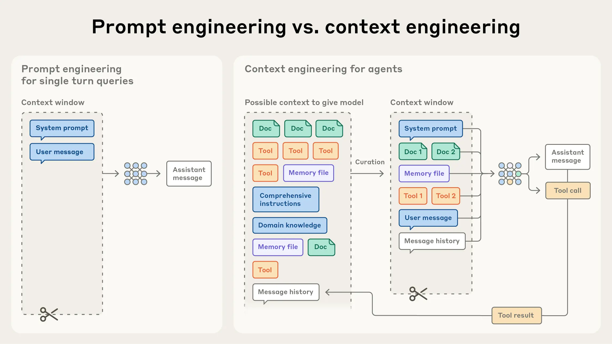
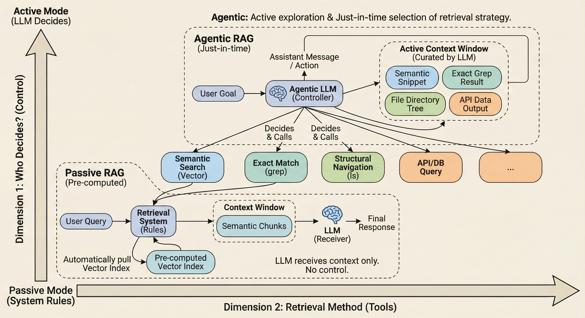
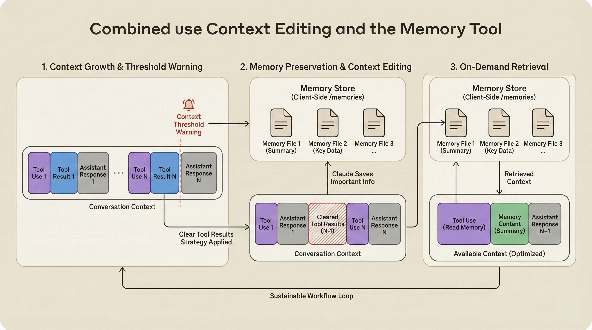

# One Poem Suffices: Just-in-Time Context

`READ⏰: 35min`

> ☁️ *Thinking in Context*

It has been quite a while since my last blog post. I spent some time reading non-technical books recently, and I'm finally getting back to writing.

Drawing on blog posts I've read lately and my own experience using Agent products, this post discusses a key paradigm shift in Context Engineering: **from LLMs passively receiving context to Agents actively acquiring context (Just-in-Time Context)**.

This post covers:

- **Recall**: Revisiting and expanding on the What & Why of Context Engineering.
- **JIT Context**: What is Just-in-Time Context (which I think could also be called Agentic Context), and why do we need it?
- **Effective JIT Context Engineering**: The costs of JIT, and how to achieve efficient context management through Compress / Write / Isolate.

Think of this as a deeper dive into my previous post. It's fairly dense, and much of it reflects my own thinking, so feedback and corrections are very welcome~

## 1. Recall & Introduction

In my previous post, *One Poem Suffices: Context Engineering*, I mainly introduced the concept and definition of Context Engineering, including how it differs from Prompt Engineering. Shortly after I finished writing that post, Anthropic published a diagram that helps illustrate the difference between the two much more clearly (a picture is worth a thousand words):



To briefly recap their definitions: **Prompt engineering** refers to methods for writing and organizing LLM instructions to achieve optimal inference results, whereas **Context engineering** refers to dynamically planning and maintaining the optimal set of input tokens during LLM inference (including any information that might enter the context).

Let's also revisit **why Context Engineering is so important**. In the previous post, I used two examples to demonstrate its importance. Here, I can add some more academic evidence. Research on [context rot](https://research.trychroma.com/context-rot) shows that as the number of tokens in the context window increases, a model's ability to accurately extract information from that context diminishes accordingly (the "Context Degradation" section in my previous post actually implied this conclusion as well). Although performance degradation is relatively gradual in some models, this phenomenon is **universally present** across all models. Therefore, we need to treat **context as a finite resource with diminishing marginal returns** (just as the previous post compared the context window to memory in a computer system).

Anthropic noted in their blog post that, much like humans with limited working memory capacity, LLMs have an "**attention budget**" that they draw down when parsing long contexts, with every newly introduced token consuming a portion of that budget. This further highlights the importance of Context Engineering: dynamically planning and maintaining the optimal set of input tokens without wasting the attention budget. This scarcity of attention stems from the architectural limitations of the Transformer. Because a Transformer allows every token to attend to every other token across the entire context, $N$ tokens result in $N^2$ pairwise interactions.

As sequence length grows, this quadratic demand for interactions inevitably "dilutes" attention. Combined with the natural scarcity of long sequences in training data and the perceptual blurriness introduced by positional encoding interpolation [[1]](https://www.anthropic.com/engineering/effective-context-engineering-for-ai-agents), models exhibit a gradient-like performance decay when processing long contexts. They don't crash outright, but their precision in long-range retrieval and reasoning drops significantly. Meanwhile, agent architectures inevitably introduce long contexts ("In our data, agents typically use about 4× more tokens than chat interactions, and multi-agent systems use about 15× more tokens than chats." — Anthropic [[2]](https://www.anthropic.com/engineering/multi-agent-research-system)). This is the fundamental reason Context Engineering exists: **to counter these architectural diminishing marginal returns and build capable Agentic systems**.


Beyond briefly introducing the definition and importance of context, the previous post also tried to establish a general framework for context engineering and management, as shown in the diagram above: **Write, Select, Compress, and Isolate**. This framework remains effective in traditional LLM application and system development, but as we move toward more complex Agentic Systems, more fundamental challenges begin to surface. We need to look closely at the details to build more effective context engineering.

In this post, let's focus on **Context Select** and explore one of the most critical evolutions currently happening in Agent/Context Engineering: **the shift from developer-driven "Pre-computed Context" to Agent-driven "Just-in-Time Context."**

## 2. The Shift: From Pre-computed to Just-in-Time

In the Context Select stage mentioned in the previous post, the most familiar paradigm is undoubtedly RAG (Retrieval-Augmented Generation). The workflow of traditional RAG goes like this: the user inputs a Query → the retrieval system automatically performs embedding matching → the results are injected into the context → the LLM reasons over that context.

In this workflow, **the LLM is a passive recipient of context**. It cannot decide what information it needs (the retrieval system decides), nor can it judge whether the content returned by the retrieval system is actually useful. Retrieval systems based on semantic similarity rely on the assumption that **"the information needed to solve a problem is close to the problem itself in vector space."** Is this assumption always true?

For knowledge queries like "What is the company's leave policy?", this assumption holds. However, when we move to complex Agent tasks, it quickly breaks down. For example, fixing a bug might require inspecting its error logs, while the root cause of the bug is hidden in a **semantically unrelated** configuration file; their embedding vectors might be far apart, yet they are causally linked in logic.

Although techniques like GraphRAG enhance retrieval systems by introducing structured relationships, they still haven't fundamentally left the **Pre-computed** paradigm. This static indexing strategy, which attempts to "exhaust all connections before inference," tightly couples system performance to the quality of the underlying knowledge graph and never breaks through the inherent limitations of pre-computation.

This brings us to the core philosophy of **Just-in-Time (JIT) Context**: **turning the LLM from a passive recipient of context into an active explorer**.

### 2.1 Passive vs Active

The key to understanding this shift lies in distinguishing between two orthogonal dimensions. Agentic and Semantic sit on two different axes. For example, the transition from traditional RAG to Agentic RAG is not an upgrade from semantic search (Semantic) to a stronger retrieval algorithm; rather, it is a shift in the decision-making mechanism, where the Agent moves from passively receiving information to actively acquiring it. As shown in the diagram below:



**Dimension 1: Who makes the decisions?**

- **Passive mode**: The retrieval system triggers automatically based on preset rules, and the LLM can only receive the context returned by the retrieval system.
- **Active mode**: The LLM judges for itself what information it needs and decides when and how to acquire it.

**Dimension 2: What retrieval method is used?**

- Semantic search (vector similarity commonly used in traditional RAG)
- Exact match (grep, keyword search)
- Structural navigation (ls, file traversal)
- API calls, database queries, and so on.

These two dimensions are **orthogonal**. In active mode, an Agent can autonomously decide, based on the task context, whether to call vector search to capture fuzzy semantics or use `grep` to pinpoint exact code locations. So the key point is: **Agentic describes "who makes the decisions," not "what method is used for retrieval."**

> My original title for this section was *From Semantic to Agentic*, but after mulling it over, I felt it wasn't quite right because they don't belong to the same dimension. The main reason for this misreading is equating traditional RAG with Semantic Search, assuming that traditional RAG is defined by being Semantic rather than Pre-computed.

The limitation of traditional RAG lies not in "semantic search" itself, but in the LLM's lack of control over the retrieval process. Once we give the LLM the ability to explore actively, it can, **ideally**, flexibly choose the most appropriate retrieval strategy based on the task requirements, sometimes semantic matching and sometimes exact search. Freed from the shackles of "pre-computation," it shifts toward **Just-in-time Context** built on the fly around task needs.

### 2.2 JIT Context: References as Context

To implement JIT Context, a prerequisite question is: **How does the Agent know where information might be without stuffing the information itself into the context window first?**

Just as the human cognitive system doesn't memorize the contents of an entire library, relying instead on indexes and catalogs, in JIT Context we need to introduce **lightweight identifiers** such as file paths, API endpoints, and web links as **references**. Through these references, the Agent knows where information is stored and can dynamically load data into the context window on demand at runtime.

Based on the attention budget discussed in Chapter 1 (the finite capacity of the context window and how the model allocates attention across input tokens), these references are tokens with very low **attention cost**, yet they provide a high density of **reasoning cues**. For example, `test_utils.py` under the `tests/` folder and a file of the same name under `src/` imply **completely different** purposes to the Agent. Metadata such as folder hierarchies, naming conventions, and timestamps form the Agent's "map" of the external world, enabling it to perform global planning without loading the actual content.

### 2.3 JIT Context: Progressive Disclosure

With a map in hand, the Agent can acquire information through **progressive disclosure**. Each interaction yields context that informs the next decision: file size hints at complexity (does it need truncation, or should a sub-agent be used for context isolation?); naming conventions hint at purpose (for instance, `xx_test` uniformly denotes unit tests inside Google). The Agent can build understanding layer by layer, keeping only what is necessary in the context window and using **note-taking strategies** (which we'll cover later, and which are essentially the Write method from the previous post) for additional context persistence. This allows the Agent to stay focused on **tokens directly relevant to the problem**, rather than being drowned in a sea of potentially irrelevant information.

Take the tools commonly used by Claude Code as an example:

1. **List (`ls`)**: Inspect the directory structure and infer potentially relevant modules from naming and hierarchy
2. **Search (`grep`)**: Perform exact matching based on specific variable names or error codes
3. **Read (`read_file`)**: Load content into the context only after the Agent has confirmed through reasoning that the target contains key logic

This exploration is driven by **logical chains** rather than **semantic similarity**: the Agent traces from A to B because it understands the call relationships between pieces of code, not because the embedding vectors of the two code snippets are similar. Compared to Semantic Search, which can introduce a large amount of "semantically related but logically irrelevant" noise, this active exploration significantly reduces context pollution, thereby reducing hallucinations and focusing on the **minimal complete set of tokens needed to solve the problem**. (Because **every piece of content in the context window affects the model's attention allocation**, reducing irrelevant information also lowers the risk of the model being misled into hallucinating.)

### 2.4 The Trade-off & Hybrid Strategy

While JIT Context improves context precision, it also introduces non-trivial engineering costs:

**Latency**: Multiple rounds of tool-calling interactions inevitably increase response time. In Pre-computed mode, computing vector similarity itself is very fast, and the retrieval system can execute queries in parallel; in JIT mode, exploration **typically takes the form of** a serial decision-execution loop (similar to the ReAct pattern), which inevitably increases latency in single-Agent scenarios.

**Engineering Complexity**: In JIT mode, we need to design an appropriate toolset and heuristic instructions for the Agent. Instructions cannot be too hardcoded (or they degenerate into an if-else workflow), nor can they be too vague (leaving the Agent unsure of what concrete actions to take). This requires engineers to have strong technical intuition and accumulated Agent engineering experience (placing high demands on an engineer's technical intuition).

Therefore, in engineering practice, a **hybrid strategy** is often the best choice:

- **Push (Static Preload):** Preload high-frequency, general-purpose context directly into the window. A good example is Claude Code's `CLAUDE.md` (project conventions, development preferences, whether to reply in Chinese or English). This information is used in almost every task, so preloading it saves the cost of Agentic exploration.
- **Pull (Just-in-time Exploration):** For task-specific information, provide a rich toolset and let the Agent explore autonomously as needed. During exploration, it can flexibly choose its method: semantic search, grep, ls, API calls, etc. The specific choice depends on which tool best fits the current task context (current developments show two distinct trends; see [Why I’m Against Claude Code’s Grep-Only Retrieval? It Just Burns Too Many Tokens](https://milvus.io/blog/why-im-against-claude-codes-grep-only-retrieval-it-just-burns-too-many-tokens.md)).

The essence of this design is: **use preloading for context that will definitely be used, and just-in-time exploration for context that might be used**. It avoids the context pollution caused by blind preloading while reducing unnecessary exploration overhead, making it a solid choice for building efficient agent systems today.

!!! quote "Do the simple thing that works."

    **If a bicycle is enough to solve the problem, we don't need to invent a spaceship**.

    This is one of Anthropic's slogans. I really like it and find it worth reflecting on, because many "clever" designs seem to get brutally steamrolled by raw gains in LLM performance. When it comes to tool selection (such as whether to use `grep` or Vector Search in a Coding Agent), there are differing views in the industry right now. Although some argue that a pure grep strategy is extremely expensive in terms of token consumption (see the [Milvus blog](https://www.google.com/url?sa=E&q=https%3A%2F%2Fmilvus.io%2Fblog%2Fwhy-im-against-claude-codes-grep-only-retrieval-it-just-burns-too-many-tokens.md)), Anthropic seems to lean toward more deterministic tools.

    In light of this slogan, perhaps a simple, deterministic `grep`, paired with an Agent's strong logical reasoning, aligns better with **"Simple & Robust"** than an elaborate but black-box vector retrieval system?

## 3. Effective JIT Context Engineering

> **There is an inherent tension between the freedom to explore and the signal-to-noise ratio of the context**

The essence of JIT Context is **delegation**: allowing the Agent to acquire information through multi-step reasoning and progressive trial and error. However, this freedom comes at a price, namely **process noise** generated during exploration.

Under the Pre-computed paradigm, context is static (Static Top-K Chunks); under the JIT paradigm, context is **dynamically growing**. Every tool call made by the Agent leaves behind indelible process noise in the context window.

Recall the core argument of Chapter 1: **context is a finite resource with diminishing marginal returns**. The ideal of JIT is to "precisely pull what is currently needed," but ironically, to achieve that precision, the Agent often has to generate a large number of tentative intermediate tokens. Consider a typical JIT code exploration sequence:

```
Agent: [Call ls src/] → Returns 20 filenames
Agent: [Reasoning] Based on naming, auth.py might be relevant
Agent: [Call grep "login" src/auth.py] → Returns 15 matching lines
Agent: [Reasoning] The function on line 42 looks like the entry point
Agent: [Call read_file src/auth.py -n 40-60] → Returns 20 lines of code
Agent: [Reasoning] Finds that it depends on utils.py
Agent: [Call read_file src/utils.py] → Returns 200 lines of code
...
```

Every step is reasonable. Yet by the time the Agent finally pinpoints the root cause of the problem, the context is already stuffed with the complete record of its "exploration path" (Tool traces). Those early `ls` outputs, `grep` results, and code snippets that were ultimately not used have almost no value for "**making the current decision**," yet they occupy precious attention budget.

When the Agent finally locates the bug in `utils.py`, a large pile of early `ls` listings and `grep` results has accumulated in the context window. This information served as necessary signposts during the **"exploration phase,"** but in the **"decision phase"** it degrades into a **set of useless tokens** consuming the attention budget.

!!! tip

    💡**Some might wonder: are the outputs of `ls` and `grep` really completely worthless?**

    Obviously not. When solving related follow-up subtasks, this information might be accessed again (meaning it exhibits "temporal locality").

    Therefore, we can borrow ideas from **cache management in computer architecture** to rethink context governance:

    - **Lazy eviction**: We don't have to clear results the instant a tool finishes executing. Depending on task progress, we can tolerate their brief presence in the context until the current task is confirmed complete, and manage them then.
    - **Tiered storage**: Eviction doesn't mean outright deletion. We keep the most important information in the context (Cache), while information that may no longer be immediately important can be written out to an external file system.

    When information is "evicted" from the context window, we should **Offload** it to external storage (such as writing it to a persistent file or a memory database) rather than destroying it outright. This is also the theoretical basis for the **Write** strategy we will discuss later.

This is the cost of JIT: **the smarter the Agent and the deeper its exploration, the faster entropy (disorder, context window usage) accumulates in the Agent system**.

Even for tasks that aren't particularly long-horizon, without an effective governance mechanism, the precious context window will quickly fill up with process noise. Therefore, we need to introduce a **"context metabolism mechanism"** to achieve effective JIT Context Engineering. This typically involves engineering practices across three dimensions: **Write (offloading), Compress (compression), and Isolate (isolation)**.

### 3.1 Compress

**Compress** is the most direct metabolic strategy: when context accumulates to a certain threshold, trade fidelity for space through lossy transformation. In current engineering practice, this mainly falls into two categories: **model-based semantic compression** and **rule-based structured pruning**.

**3.1.1 Model-Based Semantic Compression**

Mainstream Coding Agents widely implement this feature, typically by passing the full history to a model for summarization. For example, summarizing and retaining architectural decisions, unresolved errors, and implementation details while discarding redundant tool outputs or messages.

This is the mainstream approach in Coding Agents (such as Claude Code and Codex). When the context reaches a threshold, the system calls an LLM to summarize the interaction history. Its core is **semantic reconstruction**: retaining architectural decisions, unresolved errors, and critical paths while discarding redundant tool outputs. At the same time, to prevent compression from disrupting task continuity, we can forcibly retain the most recent segment of context to mitigate the impact of compression on the task.

To reuse an example from my previous blog post, Cognition AI uses a dedicated context compression LLM in Devin to perform compression.


Context compression itself is **an art**. The core challenge of compression lies in what to keep and what to drop. Overly aggressive compression may lose context that "seemed irrelevant at the time, but turned out to be critical later." This requires careful tuning on specific tasks. Anthropic recommends maximizing recall first (ensuring no critical information is lost) and then gradually optimizing precision (reducing redundancy). The logic behind this order is that **the cost of missing critical context is usually higher than keeping a small amount of redundancy**. Vendors like Cognition AI even fine-tune dedicated compress models for this purpose to find the optimal balance between compression ratio and fidelity.

**3.1.2 Rule-Based Structured Pruning**

While semantic compression is flexible, it operates as a black box and comes with higher cost. Anthropic's recently introduced **[Context Editing](https://platform.claude.com/docs/en/build-with-claude/context-editing)** represents a deterministic, lightweight compression paradigm. Its core logic is **retrospective cleanup**: the system automatically clears earlier Tool Outputs or Thinking Blocks from the history, leaving behind only a **placeholder**. Rather than simple deletion, it categorizes context according to straightforward rules:

- **Hot data**: Retains the full details of the most recent $N$ turns of interaction (configurable by the user), maintaining the coherence of short-term memory.
- **Cold data**: Clears outdated data (Tool Traces & Thinking Blocks) and collapses them into placeholders. Combined with the Memory Tool (writing to a memory directory), the Agent still retains the metacognition of "knowing that it once knew," and can reload the information via JIT Context when necessary.

The concrete effect of Context Editing is illustrated below. This is just a simplified diagram showing how a large amount of context is freed up after pruning.


My previous blog posts touched on Prompt Caching. Introducing Context Editing brings a tricky side effect: **it breaks the prefix matching mechanism of Prompt Caching**. Most Prompt Caches rely on a static prefix (Prefix Match). Once we "punch holes" in the historical context (by deleting intermediate Tool Outputs), all subsequent token sequences shift position, invalidating the cache and significantly increasing inference cost and latency. The mechanism is illustrated below:


This is a classic trade-off, so you need to weigh the priority between "prompt caching" and "context window availability" for your own use case. Anthropic provides a simple configuration option for this called `clear_at_least`. Compression is executed only when the number of tokens to be cleared exceeds the threshold (i.e., when the value of the saved context space > the cost of recomputing the cache).

This kind of fine-grained trade-off also marks the evolution of Context Engineering from simple "prompt tricks" into a discipline of systems engineering.

### 3.2 Write

If Compress is "digestion," trading fidelity for space within the window through lossy compression, then **Write** is "externalization," offloading information intact into persistent storage outside the window.

**Scratchpad** is the most common Write pattern. During task execution, the Agent actively maintains a structured notes file (e.g., `Plan.md`) to record key findings, open questions, and current progress. Once transferred to the file system, this information no longer occupies the context window, but can be reloaded on demand.

The real power of the Write strategy lies in combining it with Context Editing to form a mechanism similar to Swap (memory swapping) in operating systems. As shown in the diagram, before the context management system clears a segment of "hot context," **the Agent actively writes high-value information from it (such as code analysis results or test logs) into "cold storage" (a file system or dedicated memory directory) to perform a memory swap**.



This "write first, clear later" Swap pattern fits the philosophy of JIT Context: the Agent relies on references (file paths) rather than full text to maintain memory, breaking through the limits of the context window. Compress has a theoretical ceiling (repeated compression leads to information distortion) and always consumes some tokens. Write, by contrast, achieves **"infinite extension of context."** Even in long-horizon tasks where the context window is reset, or if the Agent crashes and restarts, the "externalized memory" saved on disk still ensures that the task can resume from where it left off.

### 3.3 Isolate

**Isolate** is an architectural metabolic strategy: using the independent context windows of sub-agents to distribute the **heavy Select overhead** of exploration across multiple isolated processing units.

When the main agent needs to explore a complex subproblem, it can dispatch a sub-agent to complete the exploration in an independent context. **The sub-agent may accumulate tens of thousands of tokens of process noise, but those tokens remain isolated within its own context, and the main agent receives only the distilled conclusion**. At the same time, isolation can in some cases keep outputs and search results cleaner, preventing conflicting information in the context from degrading output quality.

Take a Coding Agent scenario as an example. In some cases, JIT Context needs to understand the specific roles of several modules in the current codebase, which may span tens of thousands of lines of code. Multiple sub-agents can be used to analyze and summarize them separately, writing their analysis results to the file system and returning only the corresponding file paths. The main Agent can then easily retrieve the exploration results for these modules via tool calls without polluting its own context window.

This is similar to hierarchical reporting in an organization: frontline employees handle a large volume of details and submit only summaries and conclusions to their superiors. The sub-agent architecture replicates this pattern of "information compression and upward reporting" within an Agent system.

I covered Isolate in more detail in my previous blog post:

The conclusion was that a sub-agent architecture significantly outperforms a single Agent on complex tasks. The fundamental reason is precisely the **"distributed Select & Compress & Write" brought about by isolation: each sub-agent independently handles its own process noise, can apply compression and write strategies when returning its conclusions, and leaves the main agent to simply integrate high-density conclusions**.

### 3.4 Summary

At this point, we have built a complete **Effective JIT Context Engineering** framework. Combining this with the ingestion (Select) strategies from Chapter 2, we can divide JIT Context Engineering into two stages:

| Stage | Strategy | Core Action |
| -------- | :---------------------------------- | ---------------------- |
| **Ingestion** | References + Progressive Disclosure | Agent pulls information on demand |
| **Metabolism** | Compress / Write / Isolate | Manage process noise generated during exploration |

> **Best-practice combination**: The main agent dispatches tasks via **Isolate** -> sub-agents explore and **Write** conclusions to files -> the main agent reads the conclusions and periodically applies **Compress** to its own history.

**JIT Context Engineering evolves the Agent from a "passive recipient of information" into an "active manager of context."** If we focus only on retrieval (ingestion) while ignoring governance (metabolism), the system's reasoning ability will eventually collapse under the weight of context bloat. Only by establishing healthy management mechanisms can an Agent remain effective across long-running, complex tasks.

## 4. Conclusion

Looking back over the entire post, one core insight becomes clear: **the essence of Context Engineering is optimizing information density**.

Whether it is on-demand pulling in JIT Context, summary compression in Compress, persistent storage in Write, or context isolation in Isolate, they all serve the same goal: **at every step of reasoning, preparing a "just right" context for the model, neither missing critical information nor drowning in redundant noise**.

This post has tried to break JIT Context Engineering down into two stages: **Ingestion** (References + Progressive Disclosure) and **Metabolism** (Compress / Write / Isolate). The former enables the Agent to actively explore and acquire the key information needed to solve a problem; the latter manages the context bloat that inevitably arises during exploration. A JIT Context System without a metabolic mechanism is like an organism that only eats and never excretes: it may function normally in the short term, but it is bound to collapse eventually.

Personally, I really like the concept of Context Engineering. In my previous post, I cited a diagram from OpenAI around 2023 showing the two dimensions of performance optimization: the base model and the context. Once model capabilities cross a certain threshold, the importance of Context Engineering becomes increasingly prominent. Moreover, it is relatively Model Agnostic, which makes me even more motivated to keep exploring in this direction.


One preliminary observation I have right now is that practices around Select (such as Agentic RAG / JIT Context) are relatively mature, whereas effective context engineering practices for metabolic mechanisms like Compress / Write / Isolate are still in their early stages. If all of these pieces reach sufficient maturity in the future, the bottleneck for long-running Coding Agents may shift from "context management" to "task decomposition and goal definition." In other words, **the boundary of an Agent's capability depends on the boundary of your thinking**. How much an Agent can do may depend on how clearly you can describe what you want.

Finally, I'll wrap up with two thoughts.

**Do the simple thing that works.** This is a slogan from Anthropic that kept coming back to me as I wrote this post. The evolution of Context Engineering will likely grow out of concrete engineering practice rather than being deduced top-down from grand theoretical frameworks. Start with the simple thing that works, and iterate from there.

**"[♪ The Line](https://www.bilibili.com/video/BV1nszPYDEmR/?share_source=copy_web&vd_source=bd9505cd5755b31ae828d616a71119dc)"**: *Will they still let me over, if I cross the line?* This is a lyric from a song in an animated series. I often write about "model capabilities crossing a certain threshold," but what happens after they cross it? No one really knows. The capability boundary of Agents will eventually cross a certain line. Will they still let Agent over, If Agent cross the line?

## References

- [[1] Anthropic: Effective context engineering for AI agents](https://www.anthropic.com/engineering/effective-context-engineering-for-ai-agents)
- [[2] Anthropic: How we built our multi-agent research system](https://www.anthropic.com/engineering/multi-agent-research-system)
- [[3] Anthropic: Building agents with the Claude Agent SDK](https://www.anthropic.com/engineering/building-agents-with-the-claude-agent-sdk)
- [[4] Anthropic: Managing context on the Claude Developer Platform](https://claude.com/blog/context-management)
- [[5] Claude Docs: Context editing](https://platform.claude.com/docs/en/build-with-claude/context-editing)
- [[6] Claude Docs: Memory tool](https://platform.claude.com/docs/en/agents-and-tools/tool-use/memory-tool)
- [Blog: context rot](https://research.trychroma.com/context-rot)
- [Milvus blog: Why I’m Against Claude Code’s Grep-Only Retrieval? It Just Burns Too Many Tokens](https://milvus.io/blog/why-im-against-claude-codes-grep-only-retrieval-it-just-burns-too-many-tokens.md)
- [My Blog: One Poem Suffices: Context Engineering](../context-engineering/)
- [My Blog: One Poem Suffices: Multi-Agent System](../multi-agent-system/)
- [My Blog: One Poem Suffices: Prompt Caching](../prompt-caching/)
- [Music: ♪ The Line](https://www.bilibili.com/video/BV1nszPYDEmR/?share_source=copy_web&vd_source=bd9505cd5755b31ae828d616a71119dc)
