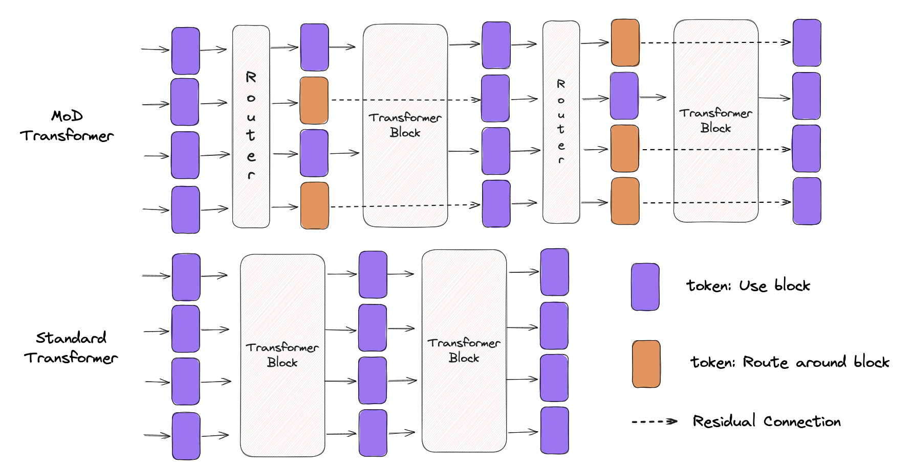
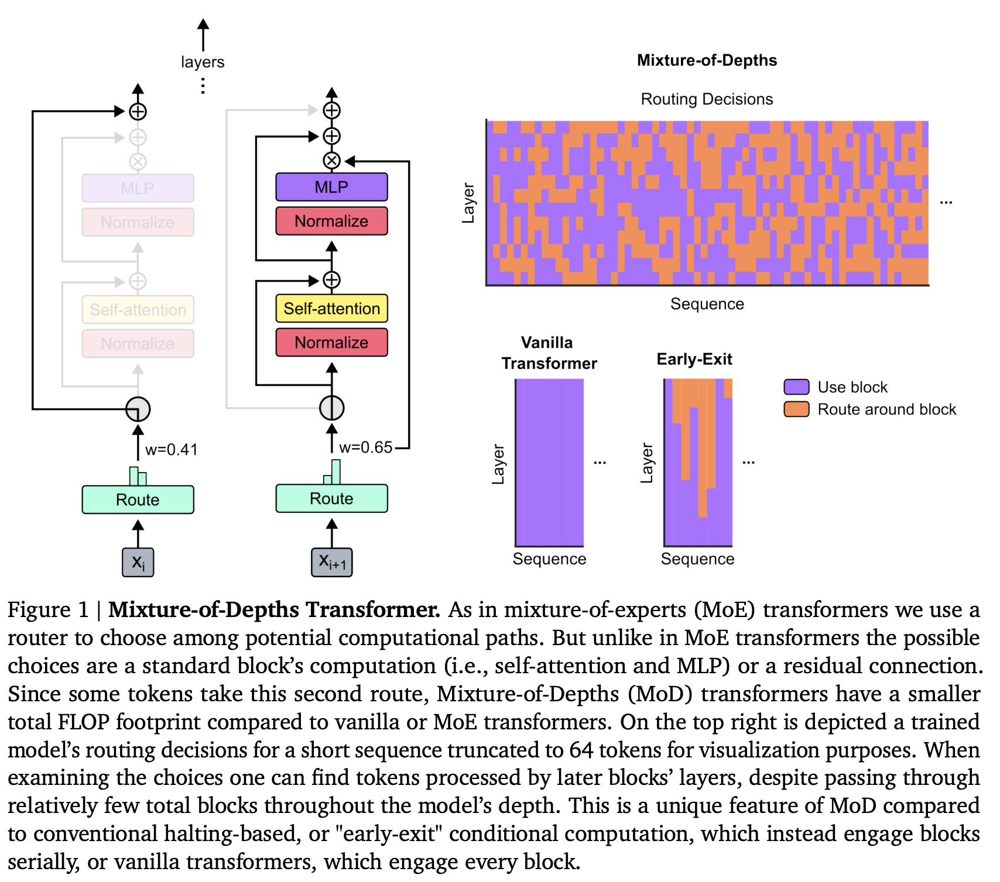
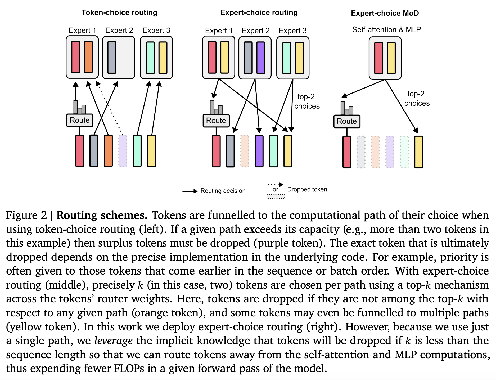
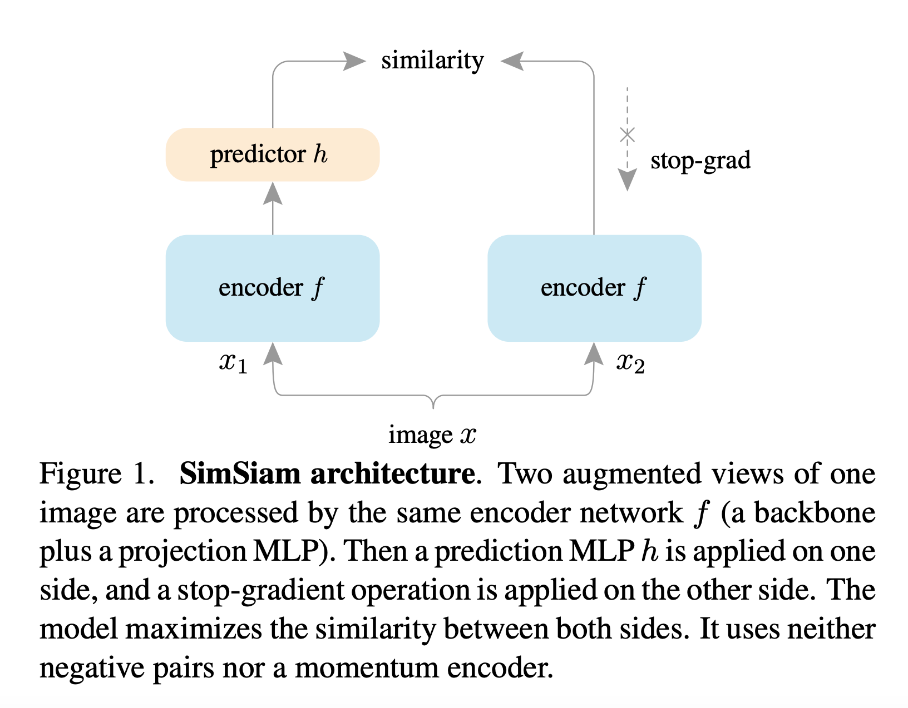
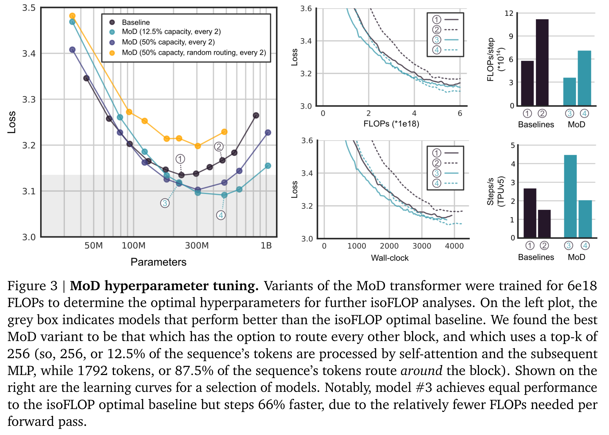
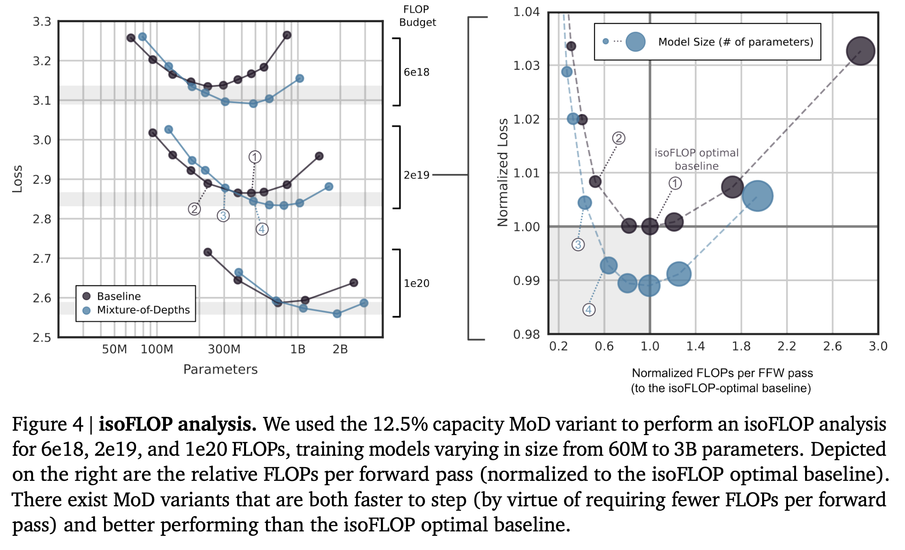
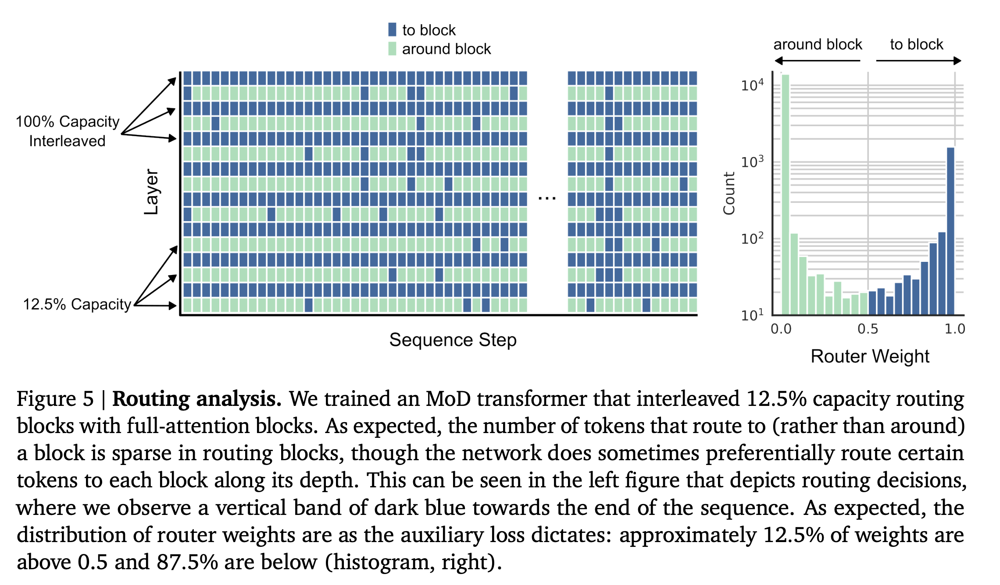
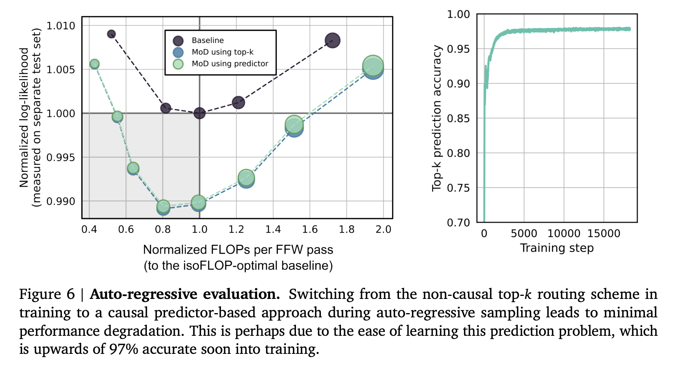
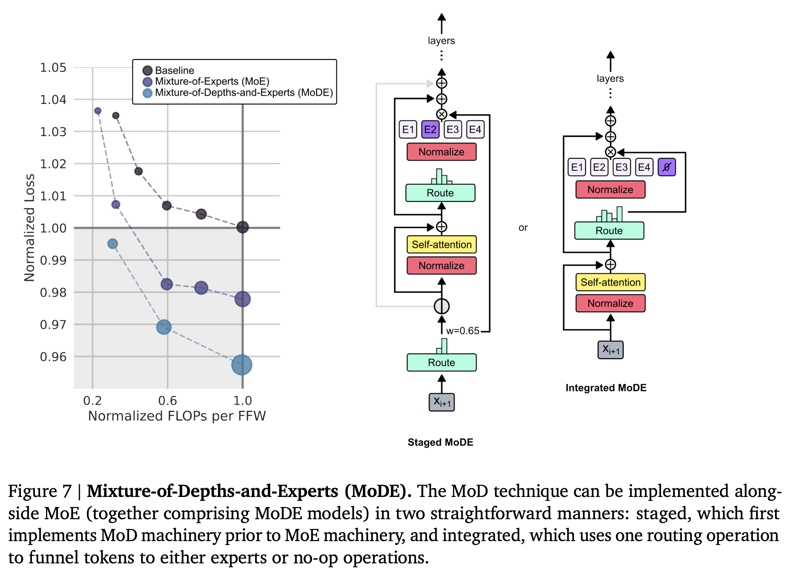

# One Poem Suffices: Mixture-of-Depths and Dynamic Compute Allocation in Transformers


This is the first paper in the conditional computation field that I have read closely. I will go as deep as I can to make sure I understand not just what it does, but why.

Although the title says "One Poem Suffices," I think my current reading still has plenty of shortcomings. Because my own knowledge is limited, I hope this post can serve not only as a walkthrough of the MoD paper, but also as a place to discuss the details and implementation with everyone.

Since MoD is not open-sourced, I wrote an unofficial code implementation here, though some design details are not yet aligned with the original paper. [Code repository](https://github.com/Mixture-AI/Mixture-of-Depths)

The diagram above is a rough sketch meant to give a quick intuitive sense of how MoD works, leaving out many details.

## 0. Abstract

Transformer-based language models typically distribute FLOPs (compute) uniformly across the entire input sequence. However, Mixture-of-Depths demonstrates that Transformers can learn to dynamically allocate FLOPs (or compute resources) to **specific positions** in a sequence, optimizing compute allocation across different depths (different layers).

MoD enforces a cap on total compute by restricting the maximum number of tokens $k$ that **can participate** in a standard Transformer block's computation (Self-Attention and MLP). A top-k routing architecture decides which tokens need to be processed. Unlike other conditional computation techniques, because $k$ is predefined, MoD has a static computation graph with known tensor sizes. Yet because the specific $k$ tokens that participate in computation are determined dynamically (by the router), the method can **distribute FLOPs non-uniformly** across both time and model depth. As a result, total FLOPs are predictable in aggregate, while still being dynamically allocated and context-sensitive at the token level.

Models trained in this way not only allocate compute dynamically, they also become much more efficient. Compared to the baseline, these models reach the same performance under equivalent FLOPs and training time, while requiring only a fraction of the baseline's FLOPs per forward pass and achieving more than a 50% speedup during subsequent inference.

## 1. Introduction

In everyday work, we can feel that **not all problems require the same amount of resources to solve**. Some tasks are more important and deserve more compute; others are minor and can be handled lightly or even skipped. Similarly, in language modeling, not all tokens require the same amount of resources (compute) to process. Yet a Transformer model spends the exact same amount of compute on every token during a forward pass. **If the assumption above holds, Transformers could ideally reduce their total compute overhead by avoiding unnecessary computation.** (Refer back to the very first diagram.)

This brings us to Conditional Computation, which tries to reduce total compute by performing computation only when needed. If you are interested, you can read [ICLR2016: CONDITIONAL COMPUTATION IN NEURAL NETWORKS FOR FASTER MODELS](https://arxiv.org/pdf/1511.06297).

However, the MoD authors argue that existing approaches **introduce dynamic computation graphs** and therefore perform poorly in practice; the most promising conditional computation methods should stick to static computation graphs and known tensor sizes so hardware utilization can be maximized.

> ⚠️ Honestly, my understanding of the computational advantages of dynamic vs. static graphs is not very deep. I hope someone more experienced can share their insights here.
>
> I previously skimmed a paper on static-graph acceleration called JAX-LOB, where the entire performance gain came from fixed tensor sizes and JAX JIT optimization, achieving up to an 8x speedup.

Consequently, MoD approaches language modeling with a **static compute budget** that can be smaller than the compute budget of a standard Transformer. **The network must learn how to make compute allocation decisions for each token at every layer, thereby dynamically distributing the available compute resources.**

In the MoD implementation, total compute is not decided on the fly by the network; it is defined by the user before training and stays constant throughout training. As a result, MoD's computational efficiency is guaranteed to improve: for example, model memory footprint drops, or the FLOPs required per forward pass decrease. Crucially, as explained later, **these efficiency gains can be achieved without hurting overall performance.**

MoD adopts an idea similar to Mixture of Experts (MoE) Transformers, dynamically deciding token routing across different depths (different layers). Unlike MoE (which chooses among different MLPs), we choose between different computation paths: either compute on a token (equivalent to a standard Transformer block) or skip it via a residual connection (saving compute overhead). Also unlike MoE, MoD applies this routing operation to the standard Transformer block (both MLPs and Self-Attention), whereas MoE typically activates different subnetworks selectively only in the MLP while Attention still processes all input tokens. **Therefore, this affects not only the keys and queries we process, but also how the router decides which tokens get updated and which tokens are available to be attended to. We call this strategy Mixture-of-Depths (MoD) to emphasize that tokens can be processed by different numbers of layers across the depth of a Transformer model.**

MoD also makes it possible to trade off model performance against efficiency. Using the same compute, MoD can produce a better model than a standard Transformer; alternatively, MoD can train a model that matches the performance of a standard Transformer while requiring only 50% of the FLOPs per forward pass. In short, the experiments show that MoD can route tokens intelligently, achieving better models with less compute.



***Figure1.Explanation*** Mixture-of-Depths Transformer. Similar to a Mixture-of-Experts (MoE) Transformer, we use a router to choose among candidate computation paths. Unlike an MoE Transformer, however, the choice here is between **1) participating in the standard Transformer block computation** and **2) taking the residual connection**. Because some tokens take the second path, an MoD Transformer always uses fewer total FLOPs than a standard or MoE Transformer. The top-right plot shows the routing decisions made by a trained model on a short sequence (truncated to 64 tokens for visualization). Looking at these choices, we can see that some tokens undergo very little processing overall (purple) yet are still processed in deeper layers of the model. Compared with traditional **early-exit** conditional computation methods (which compute continuously until exiting) or standard Transformers (where every block processes every token), MoD exhibits a distinct computation pattern.

## 2. Implementing Mixture-of-Depths Transformers

Our overall design strategy is as follows:

- Set a static compute budget lower than that of a standard Transformer by limiting the number of tokens allowed to participate in a Transformer block's computation. For example, while a standard Transformer allows all tokens in a sequence to participate in Self-Attention, we might restrict it so that only 50% of the tokens can participate in self-attention.
- Use a per-block router to estimate a scalar weight for each token, representing the router's preference for that token (whether it should participate in computation or take the residual connection).
- For each sequence and each Transformer block, identify the set of tokens whose routing weights fall into the top-k; this set is the set of tokens that will participate in computation. Because a fixed number of $k$ tokens participates in the Transformer block computation, the computation graph and tensor sizes remain constant throughout training, while only the specific set of participating tokens is dynamic and context-sensitive.

### 2.1 Defining a compute budget

To control the total compute budget on each forward pass, we use the concept of capacity. **Capacity** defines the total number of tokens that participate in computation for each input. For instance, in a standard Transformer, the total number of tokens participating in computation across all sequences in a batch can be defined as capacity $T$. In a Transformer using Mixture of Experts, the capacity of each expert MLP is smaller than $T$, but because each block has multiple experts, the total compute of an MoE is roughly equivalent to that of a standard Transformer.

> There are two easily confused concepts here: **capacity** and compute budget.
>
> - The static compute budget can be understood as the total amount of computation or number of FLOPs across the entire model.
> - Capacity represents the total number of tokens participating in computation in the Transformer.
>
> In my reading of this paper, we can think of it this way: "**we change the compute budget by changing the capacity**." Put more concretely: "**by controlling k in top-k, we control the total number of tokens participating in computation, which in turn controls the overall static compute budget**." Keeping this in mind may help when reading the experimental section later.

In general, the total FLOPs of a conditional-computation Transformer are determined by its **capacity**, not by the outcome of any given routing decision. This is because a **static-graph implementation** must account for the worst case. **For example, if only a small number of tokens are routed to a path, we pad up to the capacity size, or we drop any tokens that exceed the capacity.**

> ✨Personal thought: Without this design, `MoDTransformerBlock` would not natively support batched operations. In a multi-batch setting, the number of tokens participating in computation at a given layer would not necessarily be the same across sequences, as in the post-routing example below.
>
> ```
> [1, 2, 3]             [1, 2]                 [1, 2, o]
> [1, 2, 3] - Router -> [3]       - Padding -> [3, o, o]
> [1, 2, 3]             [1, 2, 3]              [1, 2, 3]
> ```

We can achieve a smaller compute budget (compared to a standard Transformer) by lowering the computational **capacity**. However, reducing the compute budget indiscriminately can degrade performance. Our hypothesis is that certain tokens may not need to be processed as many times as others, and that these tokens can be identified through learning. Therefore, if the network can learn how to pick the right tokens to **fill the capacity**, it may be possible to preserve model performance. Next, we introduce the routing architecture designed for this purpose.

### 2.2 Routing around transformer blocks

Routing effectively performs binary classification on each token's behavior at a given layer:

- Path 1: Participate in computation, meaning the token goes through the standard Transformer block computation, including Self-Attention and the MLP.
- Path 2: Residual connection, meaning the token skips the standard Transformer block without undergoing any computation.

If we set the capacity of Path 1 to any value smaller than $T$ (the total number of tokens across the sequence and batch), the total FLOPs per forward pass will be lower than in a standard Transformer. For example, if we set the block capacity to $\dfrac{T}{2}$ (half as many tokens as in a standard Transformer), then the query-key matrix multiplication in Self-Attention requires only $25$% of the FLOPs of a standard Transformer ($\dfrac{T^2}{4}$ vs. $T^2$). A similar calculation gives the corresponding FLOP reduction in the MLP.

Intuitively, as we shrink the block capacity further, the total FLOPs per forward pass decrease (and the time needed to complete a forward pass drops as well). However, downstream performance will depend both on how aggressively we shrink the block capacity and on the routing algorithm we implement.

Consider the two extremes. If we keep every block's capacity at $T$ and route every token through the block as usual, we recover a standard Transformer. At the other extreme, if we set every block's capacity to $0$ and route all tokens around the blocks, we end up with a very fast model that skips computation for almost all Transformer parameters, which obviously leads to terrible downstream performance. MoD hypothesizes that **between these two extremes lies an optimal model that is faster than a standard Transformer while performing just as well or even better, with a faster step time (i.e., faster training) as well.**

### 2.3 Routing schemes

**How tokens are routed determines the performance of this method.** To give a slightly imperfect analogy, suppose a student is learning English, and the teacher randomly picks only a few words from each sentence to teach. Take the sentence `She is a very good teacher`. If the teacher picks words at random, **and in some extreme cases makes a very poor selection** such as teaching only `she, a, good`, the student may end up misunderstanding the true meaning of the sentence or failing to grasp its full semantic structure altogether. (Okay, I admit this example is a bit of a stretch, but you get the idea.)

The most basic routing scheme is to **randomly select and drop** tokens (similar to `dropout`). Subsequent experiments use this as a baseline to show that an overly simplistic routing implementation causes a sharp drop in performance compared to a standard Transformer.

The counterpart to random dropping is learnable routing. We start from the assumption that learnable routing is feasible: that the network should be able to learn which tokens need more processing and which need less. If a Transformer really does perform a lot of redundant computation, then the question shifts from **"Does a Transformer have redundant computation?"** to **"How much computation in a Transformer is redundant?"** This is an empirical question, so we use experiments to determine how aggressively we can reduce Transformer compute capacity and how many tokens we can allow to skip computation in each Transformer block.

There are currently two mainstream learnable routing architectures (see Figure 2): token-choice and expert-choice.

In token-choice routing, a router is trained to produce a probability distribution over all possible **(computation) paths** for each token (for example, choosing which expert a token goes to in MoE). The token is then sent to the path with the highest probability. To prevent all tokens from choosing the same path, an auxiliary loss can be introduced. However, **even with an auxiliary loss, token-choice routing can still suffer from load-balancing issues if most tokens converge on the same small subset of paths.**

In expert-choice routing, each path uses the router to pick its top-k tokens. This architecture guarantees that load-balancing issues cannot arise, because every path **is assigned and only assigned** $k$ tokens. However, this architecture has its own limitation: some tokens may appear in the top-k sets of all paths and thus be overused, while other tokens may not appear in any path at all.

> Thinking through the following two questions will help make sense of this subsection:
>
> - In a token-choice architecture, **how do we guarantee that compute capacity is fully and accurately utilized**? Each token has a probability distribution and chooses a path, but because every path has finite capacity, tokens compete with one another, which can leave capacity only partially utilized.
> - For any given path, if the number of tokens choosing that path exceeds its capacity, how do we decide which tokens get dropped?



***Figure2.Explanation*** When using a token-choice routing architecture (left), tokens choose the path they prefer. If the tokens choosing a path exceed its capacity, the excess tokens are dropped (for example, Expert 1 on the left has a capacity of 2, so the purple token is dropped because it can no longer select Expert 1). The paper also notes that when the number of tokens choosing a computation path exceeds its capacity, **the underlying implementation decides which specific tokens are dropped**. For instance, priority might be determined on a first-come, first-served basis (by position in the sequence or **by order within the batch**). When using an expert-choice routing architecture (middle), we instead pick **exactly $k$ tokens** for each path based on the tokens' routing weights and a top-k operation. Tokens not selected by any path are dropped (orange), while some tokens are selected multiple times (yellow). In MoD, we adopt the expert-choice routing architecture (right). Because MoD has only a single computation path (participating in the Transformer block computation), tokens that are not selected are sent directly along the residual connection, reducing FLOP consumption during the forward pass.

MoD chooses the expert-choice routing architecture for several reasons:

- It does not require an extra auxiliary loss to address potential load-balancing issues.
- The top-k operation implicitly compares relative magnitudes, allowing the router to compare the weights of all tokens and pick the ones it considers most in need of computation. If the router learns the right weights, this architecture guarantees that the most important tokens will land in the top-k set, whereas a token-choice architecture cannot guarantee this. In token-choice routing, each token's decision depends only on its own routing weight, with no relative comparison across tokens. For MoD, the alternative computation path is effectively a **no-op**, so making sure that important tokens participate in computation is critical, and top-k is a better fit for that requirement.
- Finally, **coming back to the questions I raised earlier, a token-choice architecture struggles to guarantee an exact amount of compute**. It can suffer from both over-processing and under-processing because different token path choices lead to different numbers of participating tokens and therefore different amounts of compute, while also requiring extra priority rules to decide which excess tokens to discard. **This makes token-choice unnecessarily complicated to implement.** By contrast, expert-choice can **partition tokens into two disjoint sets with a single top-k operation while guaranteeing precise control over compute**.

### 2.4 Routing Implementation

Before implementing the routing architecture, let's briefly review the routing workflow:

```
(tokens) - router -> (tokens router weight) - TopK -> (top-k tokens router weight) - SelfAttention, MLP -> (output)
```

Tokens pass through the router to obtain their corresponding weights, and top-k then selects the subset of tokens that will be fed into the Transformer block.

Suppose that for a given layer $l$, we have the embeddings of all tokens in a sequence of length $S$, i.e., $X^{l} = \{ x_{i}^{l} | i \text{ is an integer, } 1\le i \le S\}$. For a given token embedding, its routing weight is a scalar value computed by a linear layer: $r_{i}^{l} = w_\theta^{T} x_{i}^{l}$.

Beyond using routing weights to select the top-k set, **our goal is to use the routing weights to determine the output of each token after passing through the Transformer block**. Let $P_{\beta}(R^l)$ denote the $\beta$-percentile of the set of routing weights $R^l$, where $\beta = 1 - \frac{C}{S}$ and $C$ is the user-defined compute capacity per batch (recall that compute capacity defines the number of tokens that will be processed, so we obviously need $C < S$). For a given token, the Transformer block output is:

$$
x_i^{l+1}= \begin{cases}  r_i^l f_i (\tilde{X}^l)+x_i^l, & \text{ if } r_i^l>P_\beta (R^l) \\\\ x_i^l, & \text{ if } r_i^l < P_\beta ( R^l ) \end{cases}
$$

Here $\widetilde{X}^l$ is the set of token embeddings whose routing weights are in the top-k (that is, all token embeddings satisfying $r_i^l > P_\beta(R^l)$), and $f$ denotes the operators inside the Transformer block (Self-Attention and MLP). Notice that the result $x_i^{l+1}$ for token $i$ is also influenced by other tokens $x_{i\neq j}^{l}$ because of the Self-Attention operation. Since fewer tokens are fed into $f$ (the cardinality of $\widetilde{X}^l$ is $C$ and $C < S$), the compute cost of Self-Attention and the MLP is reduced, so an MoD Transformer requires less compute than a standard Transformer.

Notice also that we multiply the output of $f$ by the router weight $r_i^l$. **This places the router weight on the gradient path, so it is updated by gradient descent during language modeling** (which is how the router gets trained). Google also mentions that they tried **different implementation variants**, including incorporating the routing weight into the residual connection path as well (which can be thought of as $x_i^{l+1} = r_i^l x_i^l$), but later found that **the current version already achieves better results and is simpler to implement.**

### 2.5 Sampling

Although the expert-choice architecture has many advantages, it has one notable problem: **the top-k operation is non-causal**.

> When I first started writing this post, I was stuck here for a long time. I could not understand why the paper had this limitation: "While expert-choice routing has a number of advantages, it has one distinct problem: the top-$k$ operation is non-causal. **This means that whether a given token’s routing weight is among the top-$k$​ for the sequence depends on the values of the routing weights for tokens that come after it, which we don’t have access to when autoregressively sampling."**
>
> Later I realized it was because I did not understand the basic principles of LLM inference. I strongly recommend reading this post: [One Poem Suffices: Basic LLM Inference/Generation](../basic-llm-inference/). I think it will clear up a lot of confusion. If you want to understand LLM generation from a code perspective, I also recommend reading my annotated [`Llama` source code snippet](https://github.com/Mixture-AI/meta-llama-explain/blob/main/llama/generation_cn_comment.py#L225-L416).

How should we understand this causality issue? During training, the entire token sequence is fed into the Transformer block at once to produce the next output. Thus, during training, the router can see the full sequence (even though we apply a mask) and then perform the top-k operation. During autoregressive sampling, however, we only have the sequence generated so far (not the full post-generation sequence), so we cannot tell whether the routing weights of the already generated tokens fall into the top-k of the **full generated sequence**.

> **Q:** Why do we need to know whether the currently sampled tokens are in the top-k of the **full generated sequence**, instead of just applying top-k over the tokens sampled so far?
>
> **A:** Aside from staying consistent with the training setup, I think we also need to ask: what is the difference between using the **full** top-k and the **current** top-k? If we think about it from the perspective of the KV Cache, the **full top-k** guarantees that once a token is in the top-k set, it will remain in the KV Cache for all subsequent steps. That is much simpler to implement, and it aligns better with the design goal of "**deciding which tokens get updated and which tokens are available to be attended to**."
>
> Using the **current top-k**, on the other hand, introduces several problems. First, we might have to recompute the top-k set at every step, which I think adds compute overhead. Second, **if a token was previously in the current top-k set but later falls out of the top-k, the KV Cache space used to store it would be wasted.**

We address this problem with two different methods.

The first method is to **introduce a simple auxiliary loss**. Empirical results show that it degrades the primary language modeling objective by about 0.2 - 0.3%, but it solves the autoregressive sampling problem. This loss works as follows:

1. **Model outputs logits**: During training, the model (specifically, the router) outputs a set of logits, which are unnormalized scores that can be any real numbers.
2. **Compute top-k**: Compute top-k from these `logits`, selecting the k tokens with the highest scores.
3. **Generate target labels**: Create a `target` tensor of the same shape as `logits`. Set the target to 1 for tokens that belong to the top-k, and 0 for all other tokens.
4. **Compute the loss**: Using binary cross-entropy loss, apply `sigmoid` to the logits, compare them against `target`, compute the loss, and backpropagate.

Intuitively, this auxiliary loss pushes the router's output `logits` for top-k tokens to be greater than 0.5 (approaching $1$) after `sigmoid`, while tokens outside the top-k are pushed below $0.5$ (approaching $0$).

> 📖: Because `BCEWithLogitsLoss` automatically applies `sigmoid` to its inputs, we do not need to call it explicitly in code.

The second method is to introduce a small auxiliary MLP (similar to a second router) that receives the same input as the router, but with a stop-gradient operation (blocking gradient backpropagation so it does not affect the gradients of the input). Its output predicts whether the token's routing weight falls within the top-k set for the sequence. Because of the stop-gradient, this method does not affect the language modeling objective, and experiments show that it does not hurt `step` efficiency either.

> **Q:** What is **stop gradient**, and how does it differ from the familiar `no_grad` in `PyTorch`?
>
> **A:** This concept is discussed in Kaiming He's paper [Exploring Simple Siamese Representation Learning](https://openaccess.thecvf.com/content/CVPR2021/papers/Chen_Exploring_Simple_Siamese_Representation_Learning_CVPR_2021_paper.pdf). The idea is very simple: it **stops** gradients from flowing back into the `input`. In `PyTorch`, you can think of its implementation as `input.detach()`.
>
> 
>
> It is completely different from `no_grad`, which means that no gradients are computed for any of the operations inside that block.
>
> **Q:** Why does Method 2 leave the language modeling objective unaffected while Method 1 affects it?
>
> **A:** Because in Method 1, the router itself is given an auxiliary task, so the auxiliary loss alters the router's weights and consequently affects language modeling. In Method 2, we use an auxiliary MLP to handle the prediction, and the stop-gradient guarantees that training this auxiliary task does not affect the gradients of the input, so it naturally leaves language modeling performance untouched.

With either of these two new methods, we can decide during **autoregressive** sampling whether a token participates in the Transformer block computation using only the router's output, without depending on future tokens. **Empirically, predicting whether a token belongs to the top-k set turns out to be a relatively easy auxiliary task, quickly reaching 99% accuracy.**

### 2.6 Training methods

All models use the same basic hyperparameter configuration (for example, a cosine schedule equal to 1x the number of training steps, a batch size of 128, and a sequence length of **2048**), varying only the number of layers, number of heads (in multi-head self-attention), and embedding dimension to produce models of different scales for the isoFLOP analysis.

## 3. Result

> 📖 This is the experimental section. Here I am mainly paraphrasing the paper; since the work is not open-sourced, I will try to preserve all the content from the original text.

### 3.1 Training, isoFLOP comparisons

We first use a relatively small FLOP budget (6e18) to determine the optimal hyperparameters. In **Figure 3 (left)**, we can see that the optimal MoD model achieves a **lower loss** while training more parameters (shifted down and to the right). From this observation, it is easy to infer that there exists a smaller MoD model with fewer parameters that can match the performance of the SOTA baseline while training faster.

**Figure 3 (right)** illustrates this possibility. We compare MoD Model #3 (around 220M parameters, labeled `3` in the left plot) against the isoFLOP SOTA baseline Model #1 (also 220M parameters, labeled `1` in the left plot). Model #3 slightly outperforms Model #1 while **executing each training step nearly 60% faster**. Even more importantly, when run on identical hardware, the two models require roughly the same wall-clock training time (meaning we can train a model with slightly better quality and much better efficiency in the same amount of time).

> **Q:** What is an `isoFLOP` analysis?
>
> **A:** This term can be understood as an **equal-floating-point-operations analysis**: comparing the performance of different models and algorithms while holding the total number of floating-point operations (FLOPs) constant. The prefix `iso` here likely means `equal` (as in isometric). When I first read the paper, I searched all over the web and could not find the origin of the term, before realizing it probably came from the NeurIPS 2022 paper [Training Compute-Optimal Large Language Models](https://proceedings.neurips.cc/paper_files/paper/2022/file/c1e2faff6f588870935f114ebe04a3e5-Paper-Conference.pdf). Interestingly, that is also a DeepMind paper. So was this coined by DeepMind? (Corrections welcome.)
>
> **Q:** **When parameter count is the same, model quality is similar, and training step efficiency is much better, why is it notable that total training time is the same?**
>
> **A:** Some readers might skim right past that sentence, but I think it is worth pausing on. Shouldn't it take less training time to reach the same model performance?!
>
> The reason is that although we still need the same total training time (**given the higher training step efficiency, this means MoD needs to train for more epochs**) to reach comparable quality, MoD optimizes the forward pass. That means we end up with an **inference model** of comparable quality whose inference efficiency is dramatically higher. I think this is very valuable in production.
>



***Figure3.Explanation*** MoD hyperparameter tuning. This figure shows hyperparameter tuning for MoD models, searching for the optimal hyperparameters under a fixed 6e18 FLOP budget for isoFLOP analysis. **In the left plot, the gray box indicates MoD models that outperform the isoFLOP-optimal baseline.** We find that **the best MoD model routes every other Transformer block with top-k set to $k=256$** (that is, 12.5% of tokens participate in the Transformer block computation, while 87.5% of tokens skip computation via the residual connection). The right plot shows learning curves for several models. Model #3 matches the performance of the isoFLOP SOTA baseline, but trains 66% faster because each forward pass requires fewer FLOPs.

We tested two routing schedules: routing **before every Transformer block** and routing **every other Transformer block**, using capacities ranging from 12.5% to 95% of the full sequence. While **interleaved routing** is crucial for performance, we found that aggressively reducing capacity actually works better (performance steadily improves as capacity is reduced down to 12.5% of the sequence, where 87.5% of tokens bypass the block, and only starts to degrade beyond that point). **Thus, as long as the network has frequent opportunities to pass through full-capacity Transformer blocks, it remains remarkably robust even under drastic capacity reductions.**

> ✨Personal thought: If MoD uses interleaved routing, then the upper bound on its training / forward-pass speedup is 100%, which feels a bit less dramatic.

Figure 3 also shows that **learnable routing is essential** (see the orange curve): if MoD uses a random router (selecting the top-k token set from routing weights sampled from a Gaussian distribution), performance drops sharply, leaving a large gap relative to both the baseline and MoD with learnable routing.



***Figure4.Explanation*** isoFLOP analysis. Using the 12.5%-capacity MoD configuration selected in the previous experiment, we run isoFLOP analyses at FLOP budgets of 6e18, 2e19, and 1e20, with trained model sizes ranging from 60M to 3B parameters. The right plot shows the normalized FLOPs per forward pass required by each model relative to the optimal baseline. The results show that **there exist MoD models that not only train faster (because each forward pass requires fewer FLOPs), but also outperform the SOTA baseline**.

At heart, Figure 4 is an isoFLOP analysis across several orders of magnitude in parameter count. The results confirm that we can train MoD models that achieve better quality while running training steps / forward passes faster.

The training speedup comes from two main sources:

1. In MoD Transformers, the ratio of FLOPs required per parameter is lower than in the baseline because a fraction of tokens skip computation. Consequently, for a given model size, MoD Transformers require fewer FLOPs per forward pass.
2. Because the isoFLOP-optimal MoD Transformers have more parameters and lower loss than the isoFLOP SOTA baseline, there exist smaller MoD models whose performance matches or exceeds the isoFLOP SOTA baseline while achieving higher step efficiency thanks to their smaller parameter count.

**Overall, there exist MoD Transformers that match the performance of the isoFLOP SOTA baseline while running steps faster**, because they use fewer FLOPs per parameter and have fewer total parameters.

Figure 4 also highlights an important rule of thumb: **the optimal MoD Transformer is the one whose FLOPs per forward pass match those of the isoFLOP SOTA baseline (the black marker at 1.0 on the horizontal axis)**. Using this property, we can **directly predict** which parameter size of MoD Transformer will perform best under a given isoFLOP training budget: we simply scale the model size until the FLOPs per forward pass under a given MoD configuration (capacity and routing frequency) match those of the isoFLOP SOTA baseline, yielding the optimal MoD model for that configuration. **Empirically, when adding FLOPs, increasing depth (number of layers) works better than increasing width (feature dimension).**

However, while matching the forward-pass FLOPs of the isoFLOP SOTA baseline lets us identify the optimal MoD model size for a fixed total compute budget and a given MoD configuration, it does not guarantee that we have found the **optimal MoD configuration** itself. The optimal capacity is determined empirically, and **the paper finds that 12.5% capacity with alternating routing is generally the optimal MoD setting.**

**We also note that at larger parameter scales, MoD Transformers save memory relative to equivalently sized baselines**, with some MoD models requiring fewer total devices (i.e., a smaller TPU topology). The paper does not study this extensively, **but anticipates that as models scale up, these savings could become an important consideration when choosing to train MoD Transformers, and should have a significant positive impact on KV cache size during autoregressive sampling.**

> **Q:** Why does it have a positive impact on KV cache size?
>
> **A:** Because of how the routing mechanism works, each routed Transformer block only needs a KV Cache of size $k$, since **we only need to record and supply the KV Cache entries for tokens in the top-k set so they can participate in the Attention computation**. Compared with the unbounded KV Cache of a standard Transformer, memory usage will definitely drop substantially as the sequence grows. I think this property is quite valuable, since it explicitly optimizes KV Cache usage.



***Figure5.Explanation*** Routing analysis. We trained an MoD Transformer that alternates between 12.5%-capacity Transformer blocks and standard Transformer blocks. As expected, only a sparse subset of tokens participates in computation in the routed Transformer blocks, although the network sometimes still prefers to **keep certain tokens participating in computation throughout** (see the tail end of the sequence in the left plot, where there are continuous vertical blue stripes). Meanwhile, as shown on the right, the distribution of router weights matches what the auxiliary loss enforces: roughly 12.5% of the weights are above 0.5 and 87.5% are below 0.5 (right histogram).

Figure 5 shows the routing behavior of an MoD Transformer trained with **interleaved routing**. Even though the routing strategy is very aggressive (with a very small capacity), the MoD Transformer still improves over the baseline. Figure 5 also reveals some interesting phenomena worth further study: some tokens appear to participate in every block as computation goes deeper into the Transformer, while other tokens skip computation whenever possible. **Preliminary analysis suggests that tokens which frequently participate in computation correlate with higher-entropy output predictions, which likely correspond to harder predictions.**

> **Q:** How should we understand higher-entropy output predictions, and what does "harder to predict" mean here?
>
> **A:** First, entropy is a measure of uncertainty. In this context, higher prediction entropy means the model is less confident in its prediction and the probability distribution is more spread out. That means the model has a harder time deciding which output is correct, so **there is greater predictive uncertainty**.
>
> Suppose we are doing a language modeling task such as text generation or machine translation. For some tokens, such as common words or tokens in simple sentence structures, the model can easily make an accurate prediction because the context is clear, model confidence is high, and entropy is low. For complex sentence structures, polysemous words, or tokens that depend on long-range information, however, the model may struggle, leading to higher prediction entropy.
>
> For example (this example comes from GPT-4o):
>
> - **Easy prediction**: In the sentence `The cat sits on the mat`, predicting `sits` is relatively easy because the context is clear, the model's confidence is high, and entropy is low.
> - **Hard prediction**: In the sentence `She noticed the man with the telescope`, predicting `telescope` may be harder because the sentence is ambiguous (does `telescope` modify `man` or `noticed`?), so the model's predictive uncertainty and entropy are higher.
>
> In other words, "harder to predict" here likely means that the token needs information from many more surrounding tokens, and therefore needs to participate in multiple Transformer block computations.

### 3.2 Auto-regressive Evaluation

We evaluated different MoD model configurations during autoregressive sampling (see Figure 6). Every model was tested on the same **held-out data** comprising 256,000 sequences (500M tokens). When we **switch from the top-k routing architecture to the predictor-based routing architecture**, we observe almost no drop in performance. Consistent with the training experiments, there exist MoD models that outperform the isoFLOP SOTA baseline while requiring fewer FLOPs per forward pass. These results show that the compute savings of MoD Transformers carry over across settings (training, sampling, evaluation, etc.).

> **Q:** What is held-out data?
>
> **A:** "Held-out data" is a standard term in machine learning and statistics referring to a dataset that was not used to train the model during training.
>
> **Q:** Why does `MoD using top-k` appear in this Auto-regressive Evaluation? Didn't the earlier section say that method is infeasible during sampling? How is the paper able to run it as a comparison here?
>
> **A:** One very natural guess is that on the held-out sequences, we only perform a single next-token prediction pass. If you only predict once over a known sequence, top-k can be treated as causal. But that would contradict the subsection title "Auto-regressive Evaluation," which is quite puzzling.



***Figure6.Explanation*** Auto-regressive evaluation. During autoregressive sampling, switching from the non-causal top-k routing used in training to the causal predictor-based method (i.e., the MLP) causes almost no loss in performance. This is likely because learning this prediction task is relatively easy, reaching over 97% accuracy early in training.

### 3.3 Mixture-of-Depths-and-Experts (MoDE)

The names MoD and MoE are so parallel that it is natural to wonder whether the two techniques can be stacked. It turns out that MoD can be integrated not only into standard Transformer models, but also combined with MoE (Mixture of Experts) models to form **MoDE (Mixture of Depths and Experts) models**. **In Figure 7**, the paper shows the results of combining MoD with MoE, demonstrating that the performance gains from the two methods compound. For the MoDE implementation, the paper explores two MoDE architectures (though it is not obvious from the experimental plot alone which one is better; from context, I suspect the plotted results come from Integrated MoDE):

**Staged MoDE**:

- Before the Attention step, a router decides whether a token participates in the block's computation or skips it via the residual connection.
- The advantage of this architecture is that it allows tokens to skip the Attention stage.

**Integrated MoDE**:

- Achieves routing equivalent to MoD by integrating a **no-op** expert alongside the regular MLP experts.
- The advantage of this architecture is that it simplifies the routing machinery (avoiding the efficiency overhead and other complications of routing multiple times as in Staged MoDE).

We note that Integrated MoDE performs significantly better than simply reducing expert capacity (the number of tokens an expert can receive) in a conventional MoE model and relying on token dropping to implement residual routing. **We believe this is because in the Integrated MoDE architecture, tokens can explicitly learn to choose the residual path that bypasses the experts, rather than wanting to choose an expert and being dropped only because of reduced capacity limits.**



***Figure7.Explanation*** Mixture-of-Depths-and-Experts (MoDE). MoD can be integrated with MoE in two straightforward ways: Staged MoDE applies MoD first and then MoE, whereas Integrated MoDE uses a single routing operation to assign tokens either to standard MoE experts or to a no-op expert corresponding to MoD.

## 4. Discussion

### 4.1. Advantages of MoD Transformers

Experiments show that MoD Transformers can outperform the isoFLOP SOTA baseline while using fewer FLOPs per forward pass. This means that within a given training FLOP budget, we can train models that are both faster and better-performing than the baseline. Prior to MoD, training a model that was both fast and at least as strong as the isoFLOP SOTA baseline required spending extra compute to overtrain a smaller model (notably, this overtraining technique still applies to MoD Transformers, and the speedup will be even more pronounced because we can train MoD models with smaller capacity).

### 4.2. More Efficient Ways to Use FLOPs

Although MoD Transformers require fewer FLOPs per forward pass, this does not mean we can cut FLOPs arbitrarily. We must use a learned router (similar to the router in MoE Transformers) to decide whether each token participates in self-attention and the subsequent MLP computation (consuming FLOPs) or bypasses them (saving FLOPs). We can then reinvest the saved FLOPs elsewhere, for example by scaling up model parameters or training for longer. **More importantly, our results suggest that standard Transformer models may not be using FLOPs as efficiently as possible, and that more efficient allocations exist in principle.**

### 4.3. Important Details of the Routing Scheme

> 🔥 This entire paragraph is very important and worth re-reading several times.

Learned routing mechanisms are sometimes non-causal; that is, they **use future information to determine the routing decision for a current token**. This is especially common in top-k routing mechanisms, which are attractive because they avoid the need for auxiliary load-balancing losses. However, top-k routing runs into trouble during post-training autoregressive sampling, where future token information is unavailable when making routing decisions. **This paper shows that one can successfully use a top-k routing scheme during training without needing it during subsequent autoregressive sampling. A simple auxiliary classifier, or an auxiliary loss on the router, is sufficient to learn the top-k routing decisions so that the model can mimic top-k routing during autoregressive sampling with virtually no loss in performance.**

> ✨Personal take: This clarifies that during training we can train with the true top-k token set, whereas during inference we use the auxiliary MLP trained alongside the model to make the routing predictions.

### 4.4. Promising Directions for the MoD Transformer Mechanism

Imagine that because the prediction at a certain step is relatively easy and does not require much computation, a token chooses to bypass that Transformer block. Yet this is clearly not all that the network learns. **If a token does not participate in self-attention in a given block, then subsequent tokens cannot attend to it there either. Therefore, whether a token decides to bypass computation affects not only the prediction at the current step, but also future predictions through causal self-attention.** The network weighs its routing decisions according to their impact on the overall language modeling objective.

> ✨Personal take: The sentence "If a token does not participate in self-attention in a given block, then subsequent tokens cannot attend to it there either" actually tells us a lot about the rough code structure of MoD.

This perspective opens the door to MoD variants that decouple the routing of queries, keys, and values (using three separate routers). For instance, a token might want to act as a query in a Self-Attention computation without acting as a key. We can imagine extending this idea further into the domain of long-term memory: some tokens may be extremely valuable as keys even if it does not matter whether they act as queries at the moment they appear. **This means a token could skip the query computation at the current step while still being stored as a key in long-term memory so that other queries can attend to it at future steps.** Learned routing could become a powerful mechanism for deciding which tokens deserve to enter a long-term memory buffer for use in future self-attention. **One advantage of such a long-term memory approach is that tokens decide at the moment of "memory encoding" whether they should be retrievable in the future. That is far more efficient than performing a full content-based lookup over the entire memory buffer at every future step, and could be a step toward dramatically expanding the usable context length for prediction.**

> ✨Personal take: With a design like this, we would not need to cache huge numbers of potentially useless keys; at the moment a token is first encoded, the routing mechanism could already judge whether its key should be added to some long-term buffer. Since we can control the compute budget, could we guarantee a bounded yet high-value key cache even in ultra-long-context settings?

### 4.5. Differences Between MoD and MoE Transformers

> ✨Personal thought: The idea sounds very fancy: it could support some very heavy computations, and because we have capacity control, we could plug in those heavy operations without letting compute blow up unnecessarily. That said, when you think about it, doesn't this sound pretty close to MoE? It also feels a bit hand-wavy.

Unlike MoE Transformers, which route among computations of the same type (typically MLPs), MoD Transformers highlight the value of routing among different types of computation. In MoD, the computation types are either a standard Transformer block or zero computation. However, one can imagine extending this idea to route among a wider variety of computation types. For example, some tokens could be routed to a "memory lookup" function while others are routed to a "tool use" function. More broadly, the routing mechanism we deploy provides a knob for tuning the types of computation available to the network and their relative cost (in total FLOPs): **if we want to introduce an expensive computation, we can offset its cost by setting its capacity to a small value, so that only a small number of tokens are routed to it**.

## 5. Summary

In summary, MoD Transformers provide another tool for **tuning the FLOPs per forward pass of a model** (and thus its inference time). The mechanism used to implement MoD is also general, opening the door to many extensions and integrations with other techniques such as MoE. This flexibility and extensibility give MoD Transformers substantial potential for improving both computational efficiency and model performance.

## Reference

- [Blog: FLOPS vs FLOPs](https://blog.csdn.net/Caesar6666/article/details/125102569)
- [Paper: Training Compute-Optimal Large Language Models](https://arxiv.org/pdf/2203.15556)
