# One Poem Suffices: MCP (Model Context Protocol)

`READ⏰: 20min (read) + 30min (practice)`

Recently, the keyword MCP has been popping up more and more in the articles and comment sections I browse. Realizing I only had a rough understanding of it, I decided to study it in depth and write down my notes.

Before writing this post, I briefly browsed existing articles introducing MCP. I found that most of them stop at "translating" the content on https://modelcontextprotocol.io/ or spend time on technical details that most users do not care about (along with some purely AI-generated posts).

So I will approach this from a user's perspective, share practical content, and end with an example showing the development process and real-world use of MCP. This post aims to answer three questions:

- What is MCP?
- Why do we need MCP?
- As users, how do we **use** / develop MCP?

Of course, a single article is far from enough to cover every concept in MCP. I can only do my best to distill the most important parts for you to read. Discussion is welcome.

## 1. What is MCP?

MCP originated in an article published by Anthropic on November 25, 2024: [Introducing the Model Context Protocol](https://www.anthropic.com/news/model-context-protocol).

MCP (Model Context Protocol) defines how applications and AI models exchange context information. This enables developers to **connect various data sources, tools, and capabilities to AI models in a consistent way** (an intermediate protocol layer), much like how USB-C lets different devices connect through the same interface. The goal of MCP is to create a universal standard that makes developing and integrating AI applications simpler and more uniform.

As the saying goes, a picture is worth a thousand words. Here I am citing a few very well-made diagrams to help explain it:

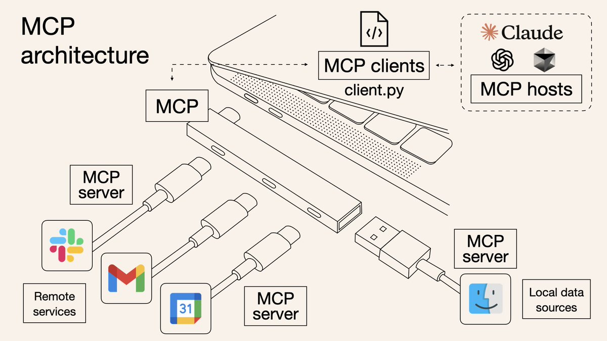

As you can see, MCP lets LLM chat applications use different tools in a more standardized way. A simpler visualization is shown below, which should make the concept of an "intermediate protocol layer" easier to grasp. Anthropic is aiming to establish a standard for LLM tool calls.

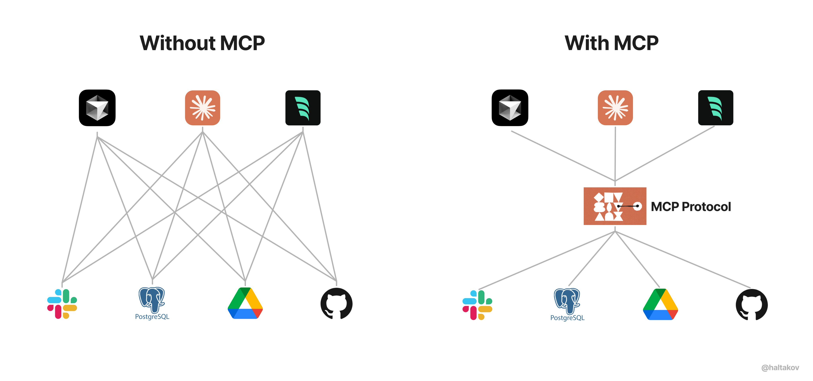

!!! tip

    💡 To keep the reading flow smooth, the definitions of MCP Host / Client / Server are placed later in this article. Beginners and general users can ignore these concepts for now without affecting their ability to use MCP.

## 2. Why MCP?

I see the emergence of MCP as a product of the evolution of prompt engineering. More structured context information brings a noticeable improvement to model performance. When constructing a prompt, we want to provide more specific information to the model (such as local files, databases, real-time web information, and so on) so that it can better understand problems in real-world scenarios.

**Imagine what we used to do before MCP.** We might manually filter data from a database or use tools to retrieve potentially needed information, and then manually paste it into the prompt. As the problems we want to solve grow more complex, **manually** bringing information into the prompt becomes increasingly difficult.

To overcome the limitations of manual prompting, many LLM platforms (such as OpenAI and Google) introduced `function call` capabilities. This mechanism allows a model to call predefined functions when needed to fetch data or perform actions, significantly increasing the level of automation.

However, function calling also has its limitations (my understanding of function call vs. MCP may not be fully mature yet, so feel free to add to it). In my view, the key issue is that **function calling is heavily platform-dependent**, with substantial differences in how function call APIs are implemented across LLM platforms. For example, OpenAI's function calling mechanism is incompatible with Google's, so developers have to rewrite code when switching models, which increases adaptation costs. Beyond that, there are also issues around security, interactivity, and more.

**The data and tools themselves already exist objectively**; we just want the step that connects data to the model to be smarter and more unified. Anthropic designed MCP around this pain point to act as a "universal adapter" for AI models, allowing LLMs to easily fetch data or invoke tools. More specifically, the advantages of MCP lie in:

- **Ecosystem** - MCP provides many ready-made plugins that your AI can use directly.
- **Uniformity** - It is not tied to a specific AI model; any model that supports MCP can be switched in and out flexibly.
- **Data security** - Your sensitive data stays on your own computer without having to be uploaded in full (because we can design the interfaces ourselves to determine which data gets transmitted).

## 3. How Do Users Use MCP?

As users, we do not really care how MCP is implemented; we usually just care about how to use this feature as simply as possible.

For specific usage instructions, refer to the official documentation: [For Claude Desktop Users](https://modelcontextprotocol.io/quickstart/user). I will not repeat the steps here. Once configured successfully, you can test it in Claude with: `Can you write a poem and save it to my desktop?` Claude will ask for your permission and then create a new file locally.

The official team and community also provide a large number of ready-made MCP Servers. You simply choose the tools you want to connect and hook them up.

- [Awesome MCP Servers](https://github.com/punkpeye/awesome-mcp-servers)
- [MCP Servers Website](https://mcpservers.org/)
- [Official MCP Servers](https://github.com/modelcontextprotocol/servers)

For example, the official `filesystem` tool allows Claude to read and write files just as in a local file system.

## 4. Deconstructing the MCP Architecture

First, let's refer to the architecture diagram provided by the official documentation.

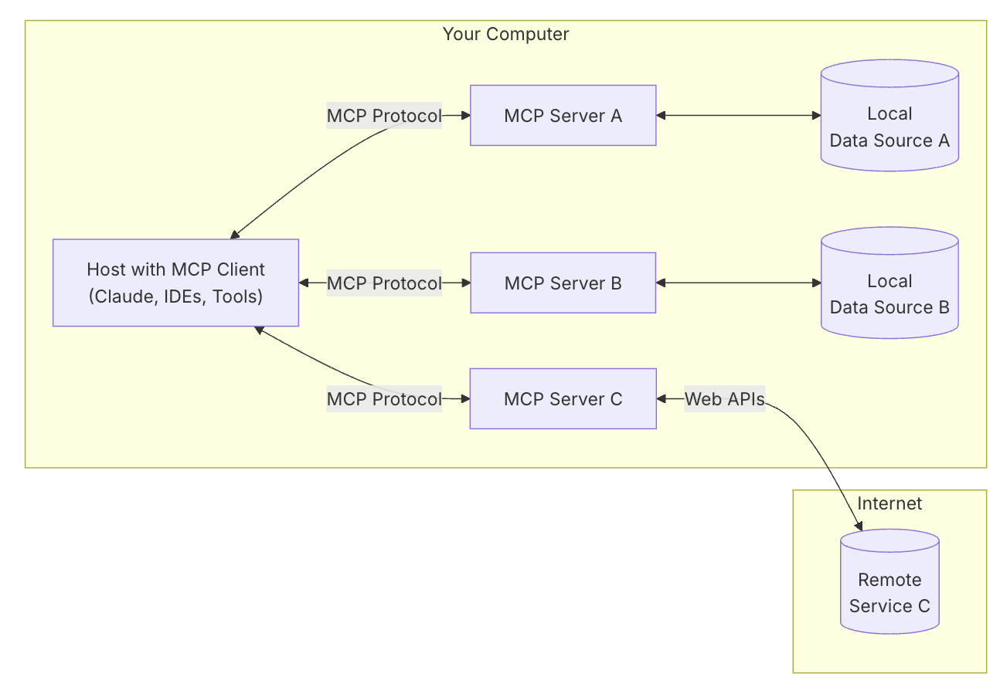

MCP consists of three core components: Host, Client, and Server. Let's walk through a real scenario to understand how these components work together:

Suppose you are using Claude Desktop (Host) and ask: "What documents are on my desktop?"

1. **Host**: Claude Desktop acts as the Host, responsible for receiving your question and interacting with the Claude model.

2. **Client**: When the Claude model decides it needs to access your file system, the built-in MCP Client inside the Host is activated. This Client is responsible for establishing a connection with the appropriate MCP Server.

3. **Server**: In this example, the file system MCP Server is invoked. It is responsible for performing the actual file scanning operation, accessing your desktop directory, and returning the list of documents found.

The entire flow looks like this: Your question → Claude Desktop (Host) → Claude model → Needs file information → MCP Client connects → File system MCP Server → Executes operation → Returns result → Claude generates answer → Displayed in Claude Desktop.

This architectural design allows Claude to flexibly invoke various tools and data sources across different scenarios, while developers only need to focus on building the corresponding MCP Server without worrying about the implementation details of the Host and Client.

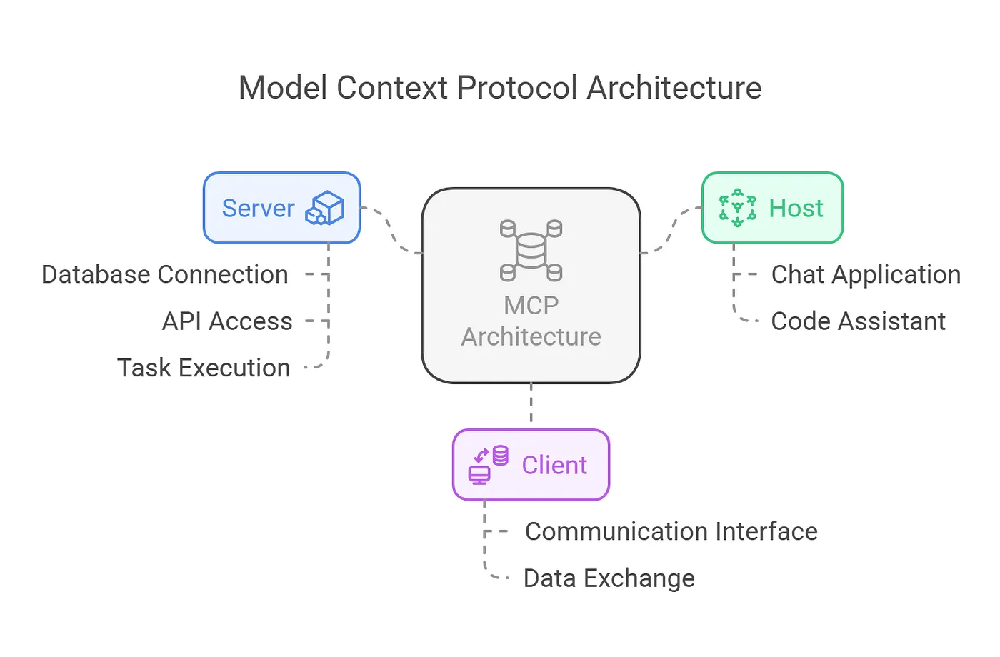

## 5. Under the Hood: How Does the Model Decide Which Tool to Use?

While learning about MCP, I kept wondering about one question: **When does Claude (the model) decide which tools to use?** Anthropic provides a simple [explanation](https://modelcontextprotocol.io/quickstart/server#what%E2%80%99s-happening-under-the-hood) on its official website:

When a user asks a question:

1. The client (Claude Desktop / Cursor) sends your question to Claude.
2. Claude analyzes the available tools and decides which one (or ones) to use.
3. The client executes the selected tool(s) through the MCP Server.
4. The execution results of the tool(s) are sent back to Claude.
5. Claude combines the execution results to construct the final prompt and generates a natural language response.
6. The response is finally shown to the user!

> MCP Servers are actively selected and called by Claude. The interesting question is: how exactly does Claude determine which tools to use? And could it try to use tools that do not exist (hallucination)?

**(Forgive me for keeping the earlier explanation overly simple.)** To explore this question, let's dive into the [source code](https://github.com/modelcontextprotocol/python-sdk/tree/main/examples/clients/simple-chatbot/mcp_simple_chatbot). Clearly, this invocation process can be divided into two steps:

1. The LLM (Claude) determines which MCP Server(s) to use.
2. The corresponding MCP Server is executed, and the execution result is processed again.

First, here is a simple visualization to help understand the flow:

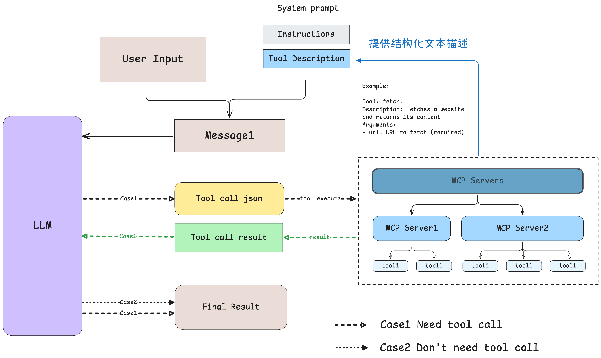

### 5.1 How Does the Model Intelligently Select Tools?

Let's first understand step one: **how does the model determine which tools to use?** Here I use the [client example](https://github.com/modelcontextprotocol/python-sdk/tree/main/examples/clients/simple-chatbot/mcp_simple_chatbot) provided by the official MCP repository as our walkthrough example, with the code simplified (removing some exception-handling code that does not affect the reading logic). By reading the code, we can see that the model determines what tools are currently available through the prompt. We **pass the concrete usage descriptions of the tools to the model in text form**, allowing the model to know what tools exist and choose among them based on the real-time context. See the comments in the code:

```python
... # 省略了无关的代码
async def start(self):
    # 初始化所有的 mcp server
    for server in self.servers:
        await server.initialize()

    # 获取所有的 tools 命名为 all_tools
    all_tools = []
    for server in self.servers:
        tools = await server.list_tools()
        all_tools.extend(tools)

    # 将所有的 tools 的功能描述格式化成字符串供 LLM 使用
    # tool.format_for_llm() 我放到了这段代码最后，方便阅读。
    tools_description = "\n".join(
        [tool.format_for_llm() for tool in all_tools]
    )

    # 这里就不简化了，以供参考，实际上就是基于 prompt 和当前所有工具的信息
    # 询问 LLM（Claude） 应该使用哪些工具。
    system_message = (
        "You are a helpful assistant with access to these tools:\n\n"
        f"{tools_description}\n"
        "Choose the appropriate tool based on the user's question. "
        "If no tool is needed, reply directly.\n\n"
        "IMPORTANT: When you need to use a tool, you must ONLY respond with "
        "the exact JSON object format below, nothing else:\n"
        "{\n"
        '    "tool": "tool-name",\n'
        '    "arguments": {\n'
        '        "argument-name": "value"\n'
        "    }\n"
        "}\n\n"
        "After receiving a tool's response:\n"
        "1. Transform the raw data into a natural, conversational response\n"
        "2. Keep responses concise but informative\n"
        "3. Focus on the most relevant information\n"
        "4. Use appropriate context from the user's question\n"
        "5. Avoid simply repeating the raw data\n\n"
        "Please use only the tools that are explicitly defined above."
    )
    messages = [{"role": "system", "content": system_message}]

    while True:
        # Final... 假设这里已经处理了用户消息输入.
        messages.append({"role": "user", "content": user_input})

        # 将 system_message 和用户消息输入一起发送给 LLM
        llm_response = self.llm_client.get_response(messages)

    ... # 后面和确定使用哪些工具无关
    

class Tool:
    """Represents a tool with its properties and formatting."""

    def __init__(
        self, name: str, description: str, input_schema: dict[str, Any]
    ) -> None:
        self.name: str = name
        self.description: str = description
        self.input_schema: dict[str, Any] = input_schema

    # 把工具的名字 / 工具的用途（description）和工具所需要的参数（args_desc）转化为文本
    def format_for_llm(self) -> str:
        """Format tool information for LLM.

        Returns:
            A formatted string describing the tool.
        """
        args_desc = []
        if "properties" in self.input_schema:
            for param_name, param_info in self.input_schema["properties"].items():
                arg_desc = (
                    f"- {param_name}: {param_info.get('description', 'No description')}"
                )
                if param_name in self.input_schema.get("required", []):
                    arg_desc += " (required)"
                args_desc.append(arg_desc)

        return f"""
Tool: {self.name}
Description: {self.description}
Arguments:
{chr(10).join(args_desc)}
"""
```

Where do the tool's description and the `input_schema` in the code come from? By further analyzing the MCP Python SDK source code, we can see that in most cases, when a function is decorated with `@mcp.tool()`, the corresponding `name`, `description`, and so on come directly from the user-defined function's name and its `docstring`. Only a small snippet is shown here; to learn more, please refer to the [original code](https://github.com/modelcontextprotocol/python-sdk/blob/v1.6.0/src/mcp/server/fastmcp/tools/base.py#L34-L74).

```python
@classmethod
def from_function(
    cls,
    fn: Callable,
    name: str | None = None,
    description: str | None = None,
    context_kwarg: str | None = None,
) -> "Tool":
    """Create a Tool from a function."""
    func_name = name or fn.__name__ # 获取函数名

    if func_name == "<lambda>":
        raise ValueError("You must provide a name for lambda functions")

    func_doc = description or fn.__doc__ or "" # 获取函数 docstring
    is_async = inspect.iscoroutinefunction(fn)
    
    ... # 更多请参考原始代码...
```

In summary: **the model determines which tools to use through prompt engineering, specifically by being given structured descriptions of all tools along with a few-shot example**. On the other hand, Anthropic has certainly done specialized training on Claude (since it is their own protocol, Claude is better at understanding tool prompts and outputting structured tool-call JSON).

### 5.2 Tool Execution and Result Feedback Mechanism

The execution of a tool is actually quite simple and straightforward. Continuing from the previous step, we send the system prompt (instructions and tool call descriptions) together with the user message to the model, and then receive the model's reply. After analyzing the user's request, the model decides whether a tool call is needed:

- **When no tool is needed**: The model directly generates a natural language reply.
- **When a tool is needed**: The model outputs a tool call request in a structured JSON format.

If the reply contains a structured JSON tool call request, the client executes the corresponding tool based on that JSON code. The specific implementation logic is all in `process_llm_response` ([code](https://github.com/modelcontextprotocol/python-sdk/blob/main/examples/clients/simple-chatbot/mcp_simple_chatbot/main.py#L295-L338)), and the logic is very simple.

If the model executed a tool call, the tool execution result `result` is **resent** to the model along with the system prompt and user message, asking the model to generate the final reply.

What if there is an issue with the tool call JSON or the model hallucinates? By reading the [code](https://github.com/modelcontextprotocol/python-sdk/blob/main/examples/clients/simple-chatbot/mcp_simple_chatbot/main.py#L295-L338), we can see that invalid call requests are simply skipped.

The execution-related code and comments are as follows:

```python
... # 省略无关的代码
async def start(self):
    ... # 上面已经介绍过了，模型如何选择工具

    while True:
        # 假设这里已经处理了用户消息输入.
        messages.append({"role": "user", "content": user_input})

        # 获取 LLM 的输出
        llm_response = self.llm_client.get_response(messages)

        # 处理 LLM 的输出（如果有 tool call 则执行对应的工具）
        result = await self.process_llm_response(llm_response)

        # 如果 result 与 llm_response 不同，说明执行了 tool call （有额外信息了）
        # 则将 tool call 的结果重新发送给 LLM 进行处理。
        if result != llm_response:
            messages.append({"role": "assistant", "content": llm_response})
            messages.append({"role": "system", "content": result})

            final_response = self.llm_client.get_response(messages)
            logging.info("\nFinal response: %s", final_response)
            messages.append(
                {"role": "assistant", "content": final_response}
            )
        # 否则代表没有执行 tool call，则直接将 LLM 的输出返回给用户。
        else:
            messages.append({"role": "assistant", "content": llm_response})    
```

Putting this analysis of the underlying mechanism together:

- Tool documentation is crucial: the model understands and selects tools through their descriptive text, so carefully writing tool names, docstrings, and parameter descriptions is essential.
- Because tool selection in MCP is prompt-based, any model is technically compatible with MCP as long as you provide the corresponding tool descriptions. However, when you use a non-Claude model, the effectiveness and user experience of MCP are hard to guarantee (since those models have not undergone specialized training for it).

## 6. Summary

MCP (Model Context Protocol) represents the establishment of a standard for how AI interacts with external tools and data. From this article, we can see that:

1. **The essence of MCP**: It is a unified protocol standard that enables AI models to connect to various data sources and tools in a consistent way, similar to a "USB-C" interface for the AI world.

2. **The value of MCP**: It solves the platform-dependency problem of traditional function calling, providing a more unified, open, secure, and flexible tool invocation mechanism that benefits both users and developers.

3. **Usage and development**: For everyday users, MCP offers a rich set of ready-made tools that **can be used without knowing any technical details**; for developers, MCP provides a clear architecture and SDKs that make tool development relatively simple.

MCP is still in its early stages, but its potential is huge. Even more important is the ecosystem: an ecosystem built on top of a unified standard will positively drive the development of the entire field.

The content above has covered the basic concepts, value, and usage of MCP. For readers interested in technical implementation, the **appendix below provides a simple hands-on guide to developing an MCP Server** to help you gain a deeper understanding of how MCP works.

## Appendix A: Hands-On MCP Server Development

`READ⏰: 30min`

After understanding the components of MCP, it is easy to see that for the vast majority of AI developers, we only need to care about implementing the Server. Therefore, I have prepared the simplest possible example here to show how to implement an MCP Server.

MCP servers can provide three main types of capabilities:

- Resources: File-like data that can be read by clients (like API responses or file contents)
- Tools: Functions that can be called by the LLM (with user approval)
- Prompts: Pre-written templates that help users accomplish specific tasks

This tutorial will primarily focus on Tools.

### A.I Best Practices for Building MCP with LLMs

Before we start, Anthropic provides a guide on [best practices for developing](https://modelcontextprotocol.io/tutorials/building-mcp-with-llms) MCP Servers using LLMs, which can be summarized as follows:

1. Introduce domain knowledge (in plain terms, feed it some examples and reference materials on MCP Server development)

  - Visit https://modelcontextprotocol.io/llms-full.txt and copy the full documentation text. (In my testing, this file is too long and can be skipped.)
  - Navigate to the MCP [TypeScript SDK](https://github.com/modelcontextprotocol/typescript-sdk) or [Python SDK](https://github.com/modelcontextprotocol/python-sdk) GitHub repository and copy the relevant content.
  - Feed these into your chat conversation as prompts (serving as context).

2. Describe your requirements

  - What resources your server will expose
  - What tools it will provide
  - What prompts or guidance it should offer
  - What external systems it needs to interact with

Here is an example prompt:

```txt
... (domain knowledge already introduced here)

Build an MCP server that can:

- Connect to my company's PostgreSQL database
- Expose table schemas as resources
- Provide tools for running read-only SQL queries
- Include prompts for common data analysis tasks
```

The remaining sections of the guide are also important, but they lean more toward methodology and are less hands-on, so I will not expand on them here. I recommend reading the [official documentation](https://modelcontextprotocol.io/tutorials/building-mcp-with-llms) directly.

### A.II Hands-On Practice

This section mainly draws from the official documentation: [Quick Start: For Server Developers](https://modelcontextprotocol.io/quickstart/server). You can choose to skip this part directly or skim through it.

Here I prepared a simple example using Python to implement an MCP Server that **counts the number of `.txt` files currently on the desktop and retrieves their filenames** (you can think of it as completely useless, but it is simple enough, mainly intended to provide a short, self-contained walkthrough for readers who find environment setup painful). All of the following steps were run on my macOS system.

**Step 1. Prerequisites**

- Install Claude Desktop.
- Python 3.10+ environment
- Python MCP SDK 1.2.0+

**Step 2. Environment Setup**

Here I am using the officially recommended setup:

```shell
# 安装 uv
curl -LsSf https://astral.sh/uv/install.sh | sh

# 创建项目目录
uv init txt_counter
cd txt_counter

# 设置 Python 3.10+ 环境
echo "3.11" > .python-version

# 创建虚拟环境并激活
uv venv
source .venv/bin/activate

# Install dependencies
uv add "mcp[cli]" httpx

# Create our server file
touch txt_counter.py
```

!!! question

    **Question**: What is `uv`, and how does it differ from `conda`?

    **Answer**: An ultra-fast (100x) Python package manager and environment management tool written in Rust, developed by Astral. It is positioned as a replacement for `pip` and `venv`, focusing on speed, simplicity, and modern Python workflows.


**Step 3. Construct a Prompt**

```txt
"""
... (domain knowledge already introduced here)
"""

Build an MCP server that can:
- Features:
    - Count the number of txt files currently on the desktop
    - Get the names of the corresponding files

Requirements:
- Do not include prompt- or resource-related code.
- You can assume my desktop path is /Users/{username}/Desktop
```

- The Domain Knowledge was copied from the MCP Python SDK [README file](https://raw.githubusercontent.com/modelcontextprotocol/python-sdk/refs/heads/main/README.md).

**Step 4. Implement the MCP Server**

The following code was generated directly by Claude 3.7. Of course, that is mainly because my requirements were simple enough; when you need to implement a complex MCP Server, you may need multi-step guidance and debugging to arrive at the final code.

```python
import os
from pathlib import Path
from mcp.server.fastmcp import FastMCP

# 创建 MCP Server
mcp = FastMCP("桌面 TXT 文件统计器")

@mcp.tool()
def count_desktop_txt_files() -> int:
    """Count the number of .txt files on the desktop."""
    # Get the desktop path
    username = os.getenv("USER") or os.getenv("USERNAME")
    desktop_path = Path(f"/Users/{username}/Desktop")
    
    # Count .txt files
    txt_files = list(desktop_path.glob("*.txt"))
    return len(txt_files)

@mcp.tool()
def list_desktop_txt_files() -> str:
    """Get a list of all .txt filenames on the desktop."""
    # Get the desktop path
    username = os.getenv("USER") or os.getenv("USERNAME")
    desktop_path = Path(f"/Users/{username}/Desktop")
    
    # Get all .txt files
    txt_files = list(desktop_path.glob("*.txt"))
    
    # Return the filenames
    if not txt_files:
        return "No .txt files found on desktop."
    
    # Format the list of filenames
    file_list = "\n".join([f"- {file.name}" for file in txt_files])
    return f"Found {len(txt_files)} .txt files on desktop:\n{file_list}"

if __name__ == "__main__":
    # Initialize and run the server
    mcp.run()
```

The task is very simple and only requires basic `os` calls to complete.

**Step 5. Test the MCP Server**

(The official quickstart does not include this step, but I highly recommend doing it.)

```shell
$ mcp dev txt_counter.py
Starting MCP inspector...
Proxy server listening on port 3000

🔍 MCP Inspector is up and running at http://localhost:5173 🚀
```

After opening the link provided, you can operate it roughly as shown in the screenshot below:

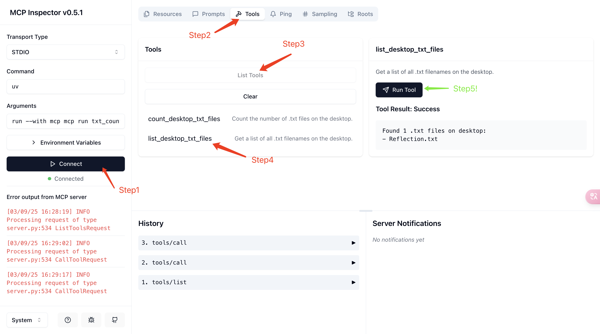

If it succeeds, you should see the corresponding output (`Tool Result`) just like I did.

**Step 6. Connect to Claude**

The final step is to connect the MCP server we wrote to Claude Desktop. The process is as follows:

```shell
# 打开 claude_desktop_config.json (MacOS / Linux)
# 如果你用的是 cursor 或者 vim 请更换对应的命令
code ~/Library/Application\ Support/Claude/claude_desktop_config.json
```

Add the following content to the configuration file. Remember to replace `/Users/{username}` with your actual username and update the other paths to your actual paths.

```json
{
  "mcpServers": {
    "txt_counter": {
      "command": "/Users/{username}/.local/bin/uv",
      "args": [
        "--directory",
        "/Users/{username}/work/mcp-learn/code-example-txt", // 你的项目路径（这里是我的）
        "run",
        "txt_counter.py" // 你的 MCP Server 文件名
      ]
    }
  }
}
```

- It is best to use an absolute path for `uv`; running `which uv` is recommended to get it.

After configuring it, restart Claude Desktop. If everything is set up properly, you will see the corresponding MCP Server.

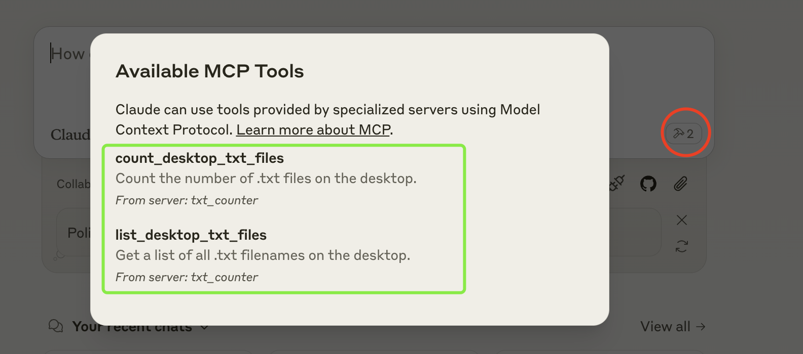

**Step 7. Actual Usage**

Next, let's run an actual test with a simple prompt:

```txt
Can you guess what the txt filenames currently on my desktop mean?
```

It may ask for your permission to use the tool, as shown in the first image; you can click `Allow for This Chat`.

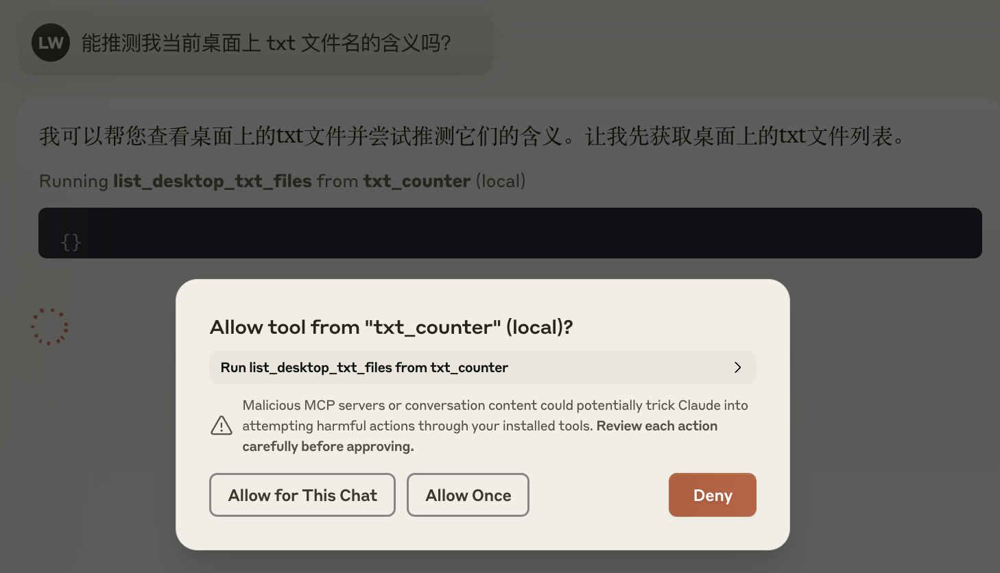

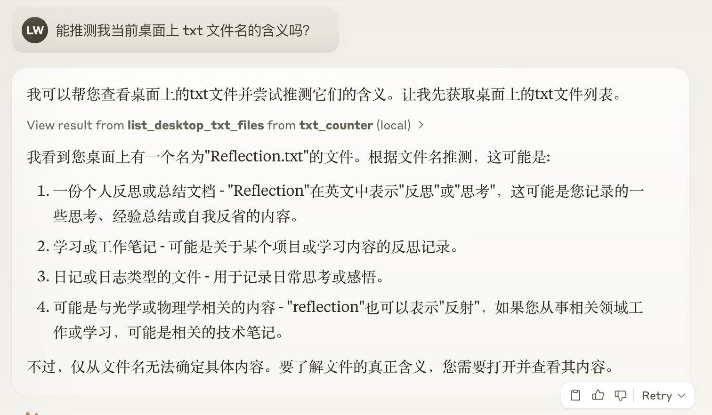

It looks like our MCP Server is working properly!

### A.III MCP Server Debugging

Debugging is a very complex topic, so here I directly recommend the official tutorials:

- [Official Tutorial: Debugging](https://modelcontextprotocol.io/docs/tools/debugging)
- [Official Tutorial: Inspector](https://modelcontextprotocol.io/docs/tools/inspector)

## Appendix B: MCP Chatbot DEMO

Talk is easy, show me your code. Reading concrete code is always an easier way to deeply understand a technology. Here I am sharing a simple MCP Chatbot DEMO I built as a reference and starting point for learning.

[](https://github.com/keli-wen/mcp_chatbot)

Terminal version (with more comprehensive Tool JSON parsing and a Workflow Tracer):

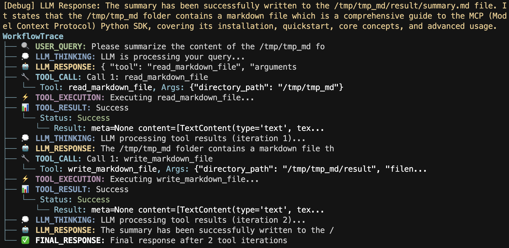

Streamlit version

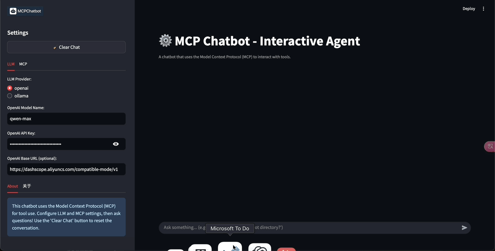

## Reference

-  [MCP Official Docs](https://modelcontextprotocol.io/)
- [MCP Python SDK](https://github.com/modelcontextprotocol/python-sdk)
- [MCP Available Server](https://github.com/modelcontextprotocol/servers)
- [Blog: 🔗What is Model Context Protocol? (MCP) Architecture Overview](https://medium.com/@tahirbalarabe2/what-is-model-context-protocol-mcp-architecture-overview-c75f20ba4498)
- [Blog: LLM Function-Calling vs. Model Context Protocol (MCP)](https://www.gentoro.com/blog/function-calling-vs-model-context-protocol-mcp)
