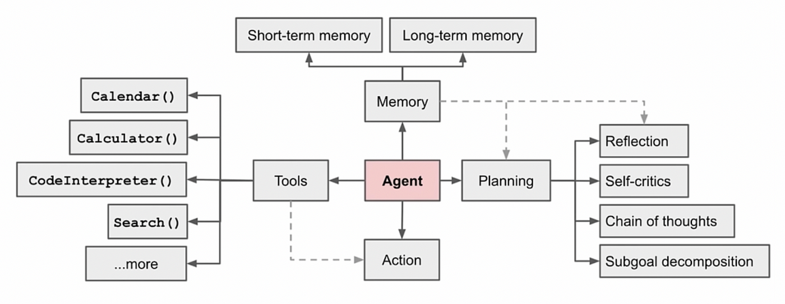
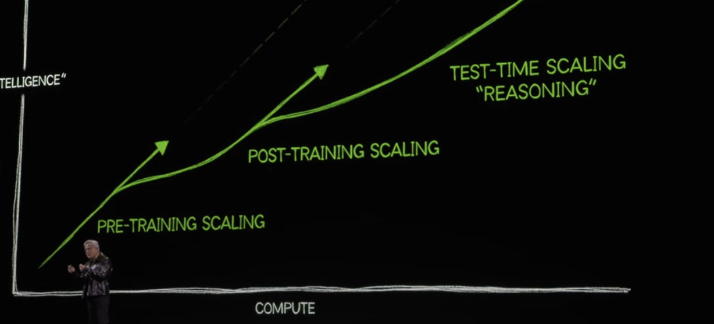
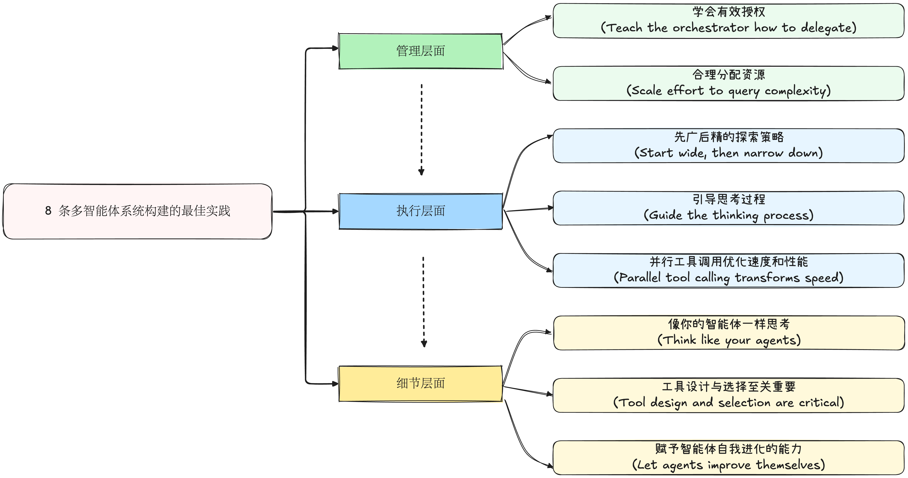
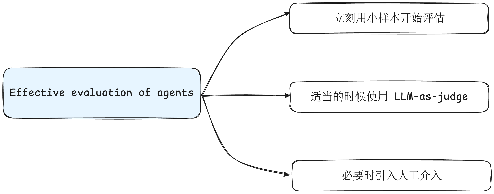
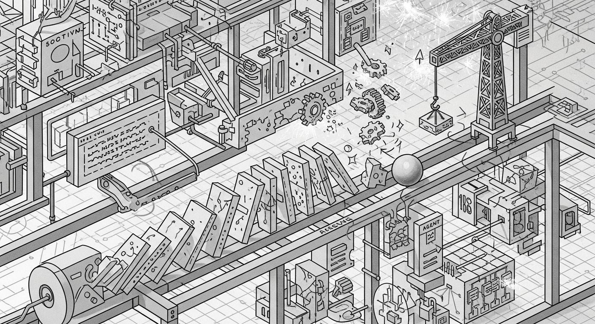
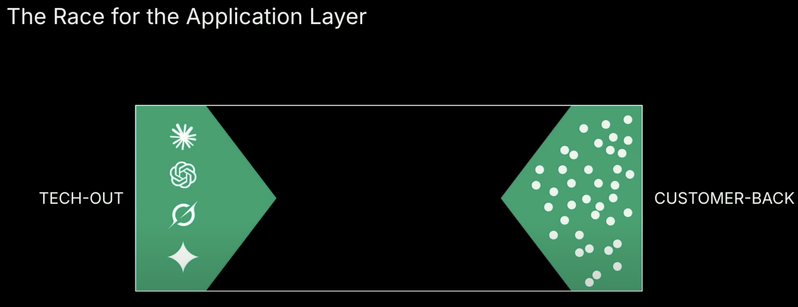

# One Poem Suffices: Multi-Agent Systems

`READ⏰: 45min`

Subtitle: Anthropic -- Paradigm Shift, from Model Intelligence to System Intelligence

*Anthropic found in their internal research evaluations that a multi-agent system with Claude Opus 4 as the lead agent and Claude Sonnet 4 as subagents outperformed a single-agent Claude Opus 4 by 90.2%. Once intelligence reaches a threshold, multi-agent systems become a vital way to scale performance.*

Just like in human society, individual human intelligence has not grown significantly over a very long period of time, yet the overall capability of human society in the information age has improved exponentially. On one hand, this is due to the emergence of computers and more powerful tools; on the other hand, it is the result of human collaboration and collective wisdom.

This is why I, along with a growing number of people, am paying attention to multi-agent systems. As the capability growth of individual LLMs gradually slows down, Multi-Agent will undoubtedly become a new research hotspot. This blog post aims to answer three questions:

- What? What is a multi-agent system? (This question is very simple)
- Why? Why do we need multi-agent systems? (The opening quote mentions part of it)
- How? What are the best practices for building a multi-agent system?

This blog post is mainly based on ["How we built our multi-agent research system"](https://www.anthropic.com/engineering/built-multi-agent-research-system#), published by Anthropic a while ago. I had the idea to write this blog post early on, but I always felt it would end up as a mere translation. After reading it repeatedly, I tried to write a blog post about multi-agent systems based on it and my own understanding. It doesn't include code, so just treat it as a simple introductory overview~ Criticisms and corrections are welcome.

## 1. What is Multi Agent System?

A multi-agent system is a **computational system composed of multiple agents capable of autonomous action**. These agents interact within a shared environment and can communicate, collaborate, compete, or negotiate with one another to solve complex problems that are difficult or impossible for a single agent to solve.

For the vast majority of ordinary users (including myself at first), it is easy to hold the biased view that a so-called Multi Agent System is nothing more than prompt engineering, and that setting up different role-playing personas for different Agents turns them into a multi-agent system. In reality, that is not the case. Advanced Prompt Engineering is a **necessary condition** for building a multi-agent system. For example:

- **Role setting:** "You are a Project Director Agent..."
- **Process definition:** "Your workflow is to plan, delegate, integrate..."

**However, a truly robust and efficient multi-agent system also encompasses "systems engineering" design that goes far beyond Prompt Engineering**: for example, **system architecture design**. Do you use the orchestrator-worker pattern, the Evaluator-optimizer pattern (where some Agents are responsible for generating results and others for evaluation and feedback), or a more complex hierarchical structure? This requires trade-offs based on the task type and is a software-architecture-level consideration. Another example is **tool design and development**. A single Agent mainly consists of four key components, and the tools used by the Agent (APIs, MCP Tools) have a significant impact on performance. For instance, can the tool be correctly understood by the Agent, and what is the rate of correct tool invocation? Beyond that, there are also state management (persistent memory and exception recovery), cost control, and so on.

!!! note

    Our perception of multi-agent systems sometimes falls into a misconception similar to our perception of "management."

    From a layperson's perspective, management seems to be just holding meetings and assigning tasks, which easily leads to the simplified perception that "its essence is nothing more than passing orders from top to bottom." Similarly, an initial understanding of multi-agent systems might stay at the superficial level of "splitting one large Prompt into several smaller Prompts."

    However, whether managing a human team or building a multi-agent system, **the core challenge is shifting from "relying on individual superpowers" to "designing a system that enables ordinary individuals to create extraordinary results."**

## 2. Why Multi Agent System?

In the previous section, we described what a multi-agent system is and understood that it is far more than Prompt Engineering; it is a complex systems engineering effort. But a deeper question is: **Why must we take this more complicated path?** Couldn't a more powerful single agent, such as a future Gemini 3, Claude 5, or GPT-6, solve all problems?

Anthropic's answer is no. They have proven through practice that multi-agent systems solve **fundamental problems** that single agents find **structurally** difficult to overcome.

### 2.1 Non-linearity and Emergence

Truly valuable tasks in the real world, such as conducting market research on a frontier technology or formulating a three-year growth strategy for a company, are inherently **open-ended** and **unpredictable**. You cannot plan all the steps at the outset using a fixed flowchart. On the contrary, the process of solving such problems is itself a dynamic process of constantly discovering new clues, adjusting directions, and even completely changing initial hypotheses.

**The Dilemma: The "Tunnel Vision" of a Single Agent**

Setting aside the efficiency gains of parallel execution in multi-agent systems for a moment, a single agent is like a detective working a case alone. As it digs deep along one clue, it may miss other equally important clues because it is too focused, finding it difficult to maintain a "God's-eye view" of the big picture while delving into details. Its thinking is **linear**, making it very fragile when dealing with "unexpected situations." For instance, once the initial path is wrong, **its ability to adjust is very limited** because it only has one "brain" and one "context." In Anthropic's words, "A linear, one-shot pipeline cannot handle these tasks".

**The Advantage: The "God's-Eye View" of Multi-Agent Systems**

Let's take the orchestrator-worker pattern as an example. Anthropic's Research feature is based on this type of pattern. As shown in the figure above, a multi-agent system naturally resolves the dilemma of a single agent at a structural level. It introduces two core concepts: **parallel exploration** and **Separation of Concerns**.

*   **Parallel exploration:** The lead agent (Orchestrator) acts like a commander-in-chief at the entrance of a maze, dispatching multiple subagents to explore different paths simultaneously. This ensures that at any given moment, the system is conducting breadth-first exploration, greatly increasing the probability of discovering the "optimal solution." At the same time, based on priors from probability theory, voting-like methods can be used to ensure the stability of results and reduce variance.
*   **Separation of Concerns:** Each subagent is an independent "expert" with **its own independent context window**, toolset, and exploration history. An Agent responsible for technical analysis will not be "polluted" by market news. This isolation guarantees the depth and purity of each subtask.

As Anthropic emphasizes: **"You can’t hardcode a fixed path for exploring complex topics, as the process is inherently dynamic and path-dependent."** Multi-agent systems were born precisely to embrace this dynamism.

### 2.2 From Pre-train Scaling Law to Inference Compute Scaling Law

For some time in the past, when we heard about Scaling laws, they more often described the pre-training domain, namely making foundation models smarter through larger parameter counts and more data. However, some current experimental results and studies are gradually showing that: **after reaching a certain intelligence threshold, the decisive factor in performance becomes whether you can invest enough "effective compute", that is, Tokens, into the problem.** A Multi Agent System can naturally support greater token consumption because the multi-agent structure determines its almost limitless token capacity. In the future, perhaps more vendors will invest more tokens into multi-agent systems to explore the inference compute scaling law.

In Anthropic's practice, they found that three factors explained 95% of the performance variance in the [BrowseComp](https://openai.com/index/browsecomp/) evaluation (which tests the ability of browsing agents to locate hard-to-find information). **Token usage by itself explained 80% of the variance, while the number of tool calls and model choice were the other two explanatory factors.** This finding validates Anthropic's multi-agent architecture, which distributes work across agents with separate context windows to add capacity for parallel reasoning.

This is the key point where multi-agent systems work their magic. A single agent is limited by its one-off context window size and processing capability, placing a physical ceiling on its "Token budget." A multi-agent system, by decomposing a large task into multiple subtasks and assigning them to multiple subagents with independent context windows for execution, **is essentially an architecture that scales total Token usage with extreme efficiency** (corresponding to the "almost limitless token capacity" mentioned above).

At the same time, these architectures also have cost issues. In practice, these architectures burn through Tokens quickly. Based on Anthropic's data, agents typically use about 4x more Tokens than chat interactions (chatbots), and multi-agent systems use about 15x more Tokens than chats. To be economically viable, multi-agent systems require tasks where the value of the task is high enough to pay for the increased performance.

!!! tip

    💡I think this advantage is valuable enough because it may open up a new track. At present, most vendors have already lost their qualification to compete in foundation model training. However, multi-agent systems might pioneer a new track, **shifting from purely pursuing the raw IQ of foundation models to building systematic and engineered multi-agent systems**, and achieving a lead in certain specific domains based on non-SOTA models.

### 2.3 Search is Compression, Compression is Intelligence

Anthropic also mentioned a very interesting point: "The essence of search is compression: distilling insights from a vast corpus." Translated, this means: **"Search is intelligence: distilling insights from a vast corpus"**. This inevitably brings to mind **compression is intelligence**, which originated from Ilya.

In a multi-agent system, subagents play the role of "intelligent filters." They work **in parallel** within their respective domains, digesting vast amounts of raw information, and then submit the most critical "compressed" insights (the most important tokens) to the lead agent.

This mechanism greatly reduces the cognitive load on the Lead Agent. It does not need to read every raw document itself; it only needs to process the pre-processed and distilled "summary reports" submitted by the various expert teams. This allows the lead agent to focus on higher-level strategic planning, logical reasoning, and final decision-making, thereby producing higher-quality comprehensive outputs.

### 2.4 Summary

In summary, multi-agent systems provide an effective architectural choice for tackling complex problems. By simulating collaborative patterns, they aim to break through the inherent limitations of single-agent intelligence; through architectural innovation, they raise the ceiling on the **"compute budget"** that a system can invest in inference; and through hierarchical information processing, they achieve efficient distillation of insights.

## 3. How? The best practice for Multi Agent System

Having analyzed the what and the why, I will try to distill some best practices for building multi-agent systems in conjunction with Anthropic's blog post.

### 3.1 Anthropic: Architecture overview for Research

The example in Anthropic's blog post is how they designed the Claude Research feature. Research, or Deep Research, is a recent trend. This task is essentially about retrieving a large amount of information and distilling valuable content from it to form a summary, which is useful in any field.

Before diving into its architectural details, I recommend taking a moment to think about the difference between Multi Agent System-based Deep Research and RAG (Retrieval-Augmented Generation). Traditional RAG uses **static retrieval**: fetching the most relevant text chunks in one go based on the user query, and then generating an answer based on this fixed information (of course, I think Anthropic is referring to very traditional RAG here; the boundary between Agentic RAG and Deep Research is actually quite blurry?).

In contrast, Multi Agent System-based Deep Research is a **dynamic, multi-step research process**. Instead of "fetching" information in a single pass (search + rerank), it "generates" insights through the active exploration of agents, and adjusts its strategy in real time based on new discoveries made along the way.

Anthropic uses the classic **Orchestrator-Worker pattern**:

The figure above shows its complete workflow. When a user submits a query, the system's workflow is as follows:

1. **Initiation and Planning:** The system creates a **Lead Researcher** agent. It first thinks through and formulates a research plan, and **saves this plan to Memory**. This is a crucial step because it ensures that in long-horizon tasks, even if the context window is truncated, the core objective and plan will not be lost.
2. **Delegation and Parallelism:** Based on the plan, the lead agent creates multiple **specialized Subagents** and assigns specific, independent subtasks to each subagent. (In the figure, two sub-agents are created.)
3. **Execution and Evaluation (Introducing "Interleaved Thinking"):** Each subagent executes its task independently (such as web searches). Crucially, they use the **"Interleaved Thinking"** technique. This means that between two tool calls, the Agent inserts a "thinking step" to evaluate the quality of the results returned by the previous tool, identify information gaps, and iteratively refine its next action.
4. **Synthesis and Decision-Making:** The subagents return their findings to the lead agent (**compression**). The lead agent **synthesizes these results** and judges whether further research is needed. If needed, it can create more subagents or adjust the strategy.
5. **Citation and Output:** Once sufficient information has been gathered, the system calls a dedicated **CitationAgent**, which is responsible for processing all documents and research reports to ensure all claims are backed by sources. Finally, a complete research result with precise citations is returned to the user.

### 3.2 8 Best Practices for Building Multi-Agent Systems

Multi-agent systems have key differences from single-agent systems, including a rapid growth in coordination complexity. Early in agent development, it is easy to make mistakes such as spawning 50 subagents for a simple query, endlessly searching the web for nonexistent sources, and agents distracting each other with excessive updates. Although we mentioned earlier that multi-agent systems are not equivalent to Prompt Engineering, **because each agent is steered by a Prompt, Prompt Engineering remained our primary lever for improving multi-agent system behaviors.** Based on their experience, Anthropic summarized the 8 most valuable Agent Prompt Engineering practices.

Based on my personal understanding, I have divided them into three categories: Management Level; Execution Level; Detail Level. I made a simple diagram as follows:

**Management Level**

This part mainly leans toward the management philosophy needed by the lead agent (Orchestrator). It is about direction, resources, and goals.

- **Teach the orchestrator how to delegate** Turn vague tasks into clear ones. Providing subagents with clear objectives, formats, tools, and boundaries is the cornerstone of project success. Avoid letting the Lead Agent give vague instructions like "research the semiconductor shortage," which may cause Sub Agents to duplicate work. Anthropic initially allowed the Orchestrator to give simple, short instructions, but found that these instructions were often vague enough that subagents misinterpreted the task or performed the exact same searches as other agents.
- **Scale effort to query complexity** This is actually equivalent to hardcoding some priors in the prompt to prevent "using a sledgehammer to crack a nut" on simple problems. *"Simple fact-finding requires just 1 agent with 3-10 tool calls, direct comparisons might need 2-4 subagents with 10-15 calls each, and complex research might use more than 10 subagents with clearly divided responsibilities."* (Prior knowledge such as simple fact-finding usually requiring only one Agent making 3 to 10 tool calls, and so on.)

**Execution Level**

This part mainly leans toward the specific strategies that subagents (Sub-agent) need to follow when executing tasks. It is about efficiency, quality, and speed.

- **Start wide, then narrow down** Search strategy should mirror expert human research: explore the landscape before drilling into specifics. Agents often default to overly long, specific queries that return few results. **Anthropic found that prompting agents to start with short, broad queries**, evaluate what's available, and then progressively narrow focus effectively counteracted this tendency.
- **Guide the thinking process** This one is quite common now. In Claude, it corresponds to Extended Thinking. Using extended thinking provides a "scratchpad" for the agent's subsequent actions, helping with the agent's planning and design. At the same time, introducing the **"[Interleaved Thinking](https://docs.anthropic.com/en/docs/build-with-claude/extended-thinking#interleaved-thinking)"** mentioned earlier allows the agent to think between tool calls so it can adjust dynamically.
- **Parallel tool calling transforms speed** Complex research tasks (DeepResearch) naturally involve exploring many sources. Anthropic's early agents executed sequential searches, which was painfully slow. For speed, they introduced two kinds of parallelization: (1) the lead agent spins up 3-5 subagents **in parallel** rather than serially; (2) the subagents use 3+ tools **in parallel**. These changes cut research time by up to 90% for complex queries, allowing the research feature to do more work in minutes instead of hours while covering more information than other systems. To summarize further: **implement parallelization at both the task level and the tool level simultaneously**.

**Detail Level**

This part is more about guiding the detailed aspects of building a multi-agent system. It is about how to debug prompts, how to design and select tools, and so on.

- **Think like your agents** To iterate on prompts, you must understand their effects. Similar to single-step debugging, watch the agents work step-by-step. This helps you discover where the agents are going wrong, such as "agents continuing when they already had sufficient results, using overly verbose search queries, or selecting incorrect tools."
- **Tool design and selection are critical** Tools are to LLMs somewhat like UIs are to humans. UI stands for User Interface, an interface facing the user. **Therefore, tools like MCP are interfaces facing the LLM. Using the right tools is efficient and often necessary.** Bad tool descriptions can send agents down completely wrong paths, so each tool needs a distinct purpose and a clear description. At the same time, Anthropic also designed explicit heuristics: ***examine all available tools first, match tool usage to user intent, search the web for broad external exploration, or prefer specialized tools over generic ones***.
- **Let agents improve themselves** When large models optimize themselves, it is just like how in AI Coding software such as Claude Code or Cursor we hand the bugs they wrote back to them to fix themselves. Models like Claude 4 can also be excellent prompt engineers. When given a Prompt and a failure mode, they are able to diagnose why the agent is failing and suggest improvements. You can even try developing a tool-testing Agent to automatically optimize MCP tools.

In my experience, most of these tips still require readers to understand them further through their own practice. Overall, prompts for agents should focus on instilling good **heuristics** rather than hardcoded rules (which become somewhat rigid like if-else statements). Anthropic believes that: **beyond the 8 suggestions above, you need to dive deep into the domain you are working on. For instance, when doing Deep Research, you need to think about how skilled humans approach research tasks, summarize that, and incorporate it heuristically into our prompts, such as decomposing large research questions into smaller problems and recognizing when to focus on depth versus breadth. Then, prevent the multi-agent system from spiraling completely out of control by setting some explicit boundaries. After doing the above two steps, build an observable test case and iterate repeatedly. This is the best practice for multi-agent system development.**

### 3.3 The Last Mile from Prototype to Product

I think whether it is an agent or a multi-agent system, building a prototype is far simpler than building a pipeline that can run long-term without much human intervention. So after building a prototype, how do we cover this last mile from prototype to product? It mainly breaks down into two major challenges: **scientific evaluation** and **reliable engineering**.

**The first step is evaluation.** How do we effectively evaluate an agent? Agents are different from traditional data structure algorithms or business code. Traditional software execution usually has clear, roughly predictable steps (multithreading/multiprocessing might be less fixed), such as: given input X, the system should follow path Y to produce output Z. But this is not the case for agents, especially multi-agent systems. Even with the identical starting point, they might take completely different valid paths to reach the goal. They might use different tools and retrieve different sources. Because there is usually more than one right path to solve a problem, merely checking whether the agent followed our preset so-called "correct path" is not rigorous enough. We need **more advanced evaluation methods that combine outcome checks with process checks.**

**Start evaluating immediately with small samples.** In early agent development, changes tend to have dramatic impacts **because there is abundant low-hanging fruit**. A prompt tweak might boost success rates from 30% to 80%. With effect sizes this large, you can spot changes with just a few test cases. The Anthropic team started with a set of about 20 queries representing real usage patterns. Testing these queries often allowed us to clearly see the impact of changes. **We often see AI developer teams delay creating evals because they believe only large evals with hundreds of test cases are useful. However, it's best to start with small-scale testing right away using a few examples, rather than delaying until you can build more thorough evals.**

**Scale with LLM-as-judge when appropriate.** As mentioned above, just as we use AI to fix AI-generated bugs in AI Coding tools like Cursor, we can use AI to evaluate AI when appropriate. We need to establish the right grading criteria for the results (outputs), such as: factual accuracy (do claims match sources?), citation accuracy (do the cited sources match the claims?), completeness (are all requested aspects covered?), source quality (did it use primary sources over lower-quality secondary ones?), and tool efficiency (did it use the right tools a reasonable number of times?), and embed them properly into the Prompt. We can use multiple LLMs in parallel to score different components (each LLM responsible for one metric), **but experimental results proved that a single LLM call with a single Prompt outputting the scores was the most consistent and aligned with human judgments.**

**Introduce human intervention when necessary.** Sometimes automated evaluations miss edge cases. For example, Anthropic found in experiments that early agents consistently chose SEO-optimized content Farms over more authoritative but lower-ranked sources like academic PDFs or personal blogs when searching. Therefore, they manually added heuristics to the prompts to resolve this issue. This shows that even though we all hope to automate everything, human intervention remains necessary in certain situations.

Multi-agent systems easily trigger butterfly effects; minor changes to an agent can unpredictably alter the trajectory of the entire system. Therefore, when building a successful product, beyond understanding and analyzing individual agent behaviors, you need to understand the **interaction patterns** of the entire system. Consequently, **the best practice for prompts should be heuristic rather than strictly hardcoded. The focus should be on how to manage and divide problems, how to solve problems, and so on. Overly strict hardcoding will only turn into an if-else style workflow. Achieving this is not easy; it requires careful design of prompts and tools, the application of heuristics, and a complete evaluation feedback loop.**

**The second step is productionization/engineering.** How to build a stable and reliable production-grade agentic system is a new challenge in the current era. As mentioned above, multi-agent systems easily trigger butterfly effects. In traditional software, a bug might break a feature, degrade performance, or cause outages. In an agentic system, minor changes cascade into large behavioral shifts, which makes it remarkably difficult to write code for complex agents that must maintain state over long-running processes.

On this front, since I haven't developed very complex production-grade agentic systems myself, I can only provide a high-level summary of Anthropic's experience. Anthropic shared four major challenges and countermeasures they encountered in productionization:

- **Stateful & Errors:** Agents are long-running and stateful. A minor system failure can be catastrophic for an Agent, and the cost of restarting (Token consumption, user experience) is expensive. **The countermeasure is to build systems that can resume from where the error occurred, combining the model's intelligence (such as letting the Agent know a tool is failing and letting it adapt) with deterministic engineering (such as retry logic and checkpoints) to handle errors gracefully.**
- **Debugging:** The non-determinism of Agents makes reproducing bugs extraordinarily difficult. **The countermeasure and the only way out is Full Production Tracing.** Every decision step, tool call, and returned result of the Agent must be recorded to systematically diagnose the root cause of failures.
- **Deployment:** How do you update this continuously running complex system without disrupting currently running Agents? **The countermeasure is to use Rainbow Deployments, letting old and new versions of the system run side-by-side and gradually shifting traffic from the old version to the new one.**
- **Bottlenecks:** The current synchronous execution model simplifies coordination, but also creates bottlenecks where the entire system is held back by the slowest subagent. **The future direction is asynchronous execution. While this will bring new challenges like state consistency and error propagation, the performance gains will be massive.**

## 4. Conclusion

At this point, we have fully deconstructed Anthropic's thinking and practices in building multi-agent systems. Starting from "what" and "why," this article explored the necessity of multi-agent systems: they aim to solve the structural "tunnel vision" and "compute ceiling" problems of single-agent intelligence when handling complex, open-ended problems.

Subsequently, we broke down the core of "how to build": from the "orchestrator-worker" system architecture, to the 8 best practices for building multi-agent systems, and finally to the evaluation and engineering challenges that must be crossed to go from prototype to product.

This process can be seen as a shift in mindset from cultivating a highly capable "individual hero" (single Agent) to building an "organization" (multi-agent system) that enables numerous members to collaborate efficiently.

The ceiling of single-agent intelligence depends on its individual capability (model intelligence); whereas the performance of a system is determined more jointly by its top-level design (architecture), collaborative workflows (Prompting Principles), evaluation framework, and engineering robustness.

Anthropic's sharing reveals an important trend: **the competitive focus of AI applications may be shifting from an "arms race" over the models themselves to the engineering and organizational capabilities of building efficient, reliable intelligent "systems"**. I feel this track will actually be much wider, because foundation models are bound to be a track for a handful of players, while the application layer has a much broader vacuum. As stated in the 2025 Sequoia AI Ascent presentation, nature abhors a vacuum:

For practitioners, this means that beyond the ability to "use AI," the ability to "organize AI" and build Agentic Systems is becoming increasingly critical. Perhaps this is the most thought-provoking takeaway this article brings us.

## References

- [How we built our multi-agent research system](https://www.anthropic.com/engineering/built-multi-agent-research-system)
- [anthropic-cookbook: agent prompts](https://github.com/anthropics/anthropic-cookbook/tree/main/patterns/agents/prompts)
