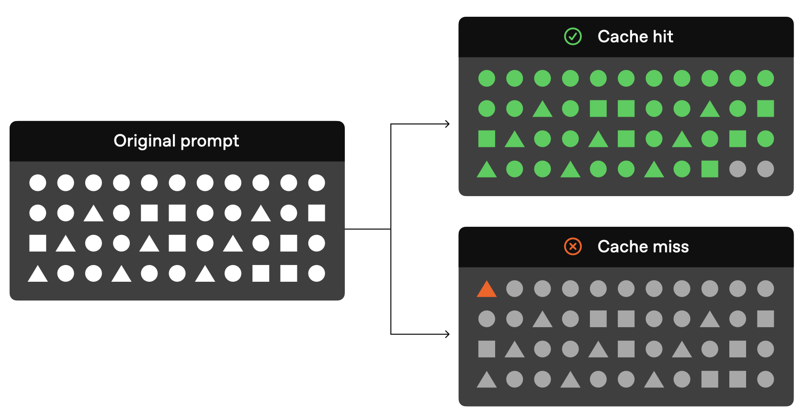
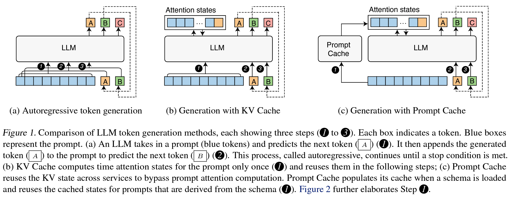
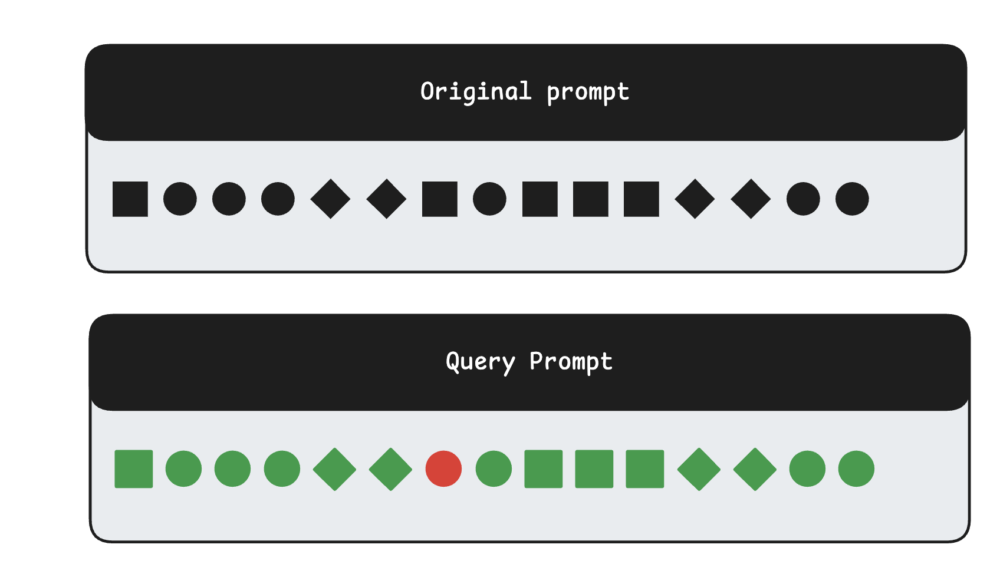
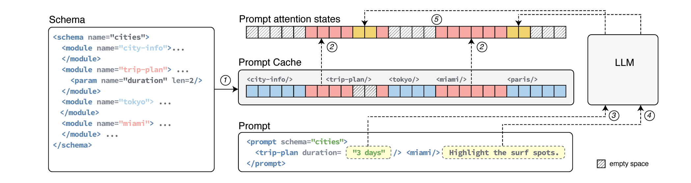
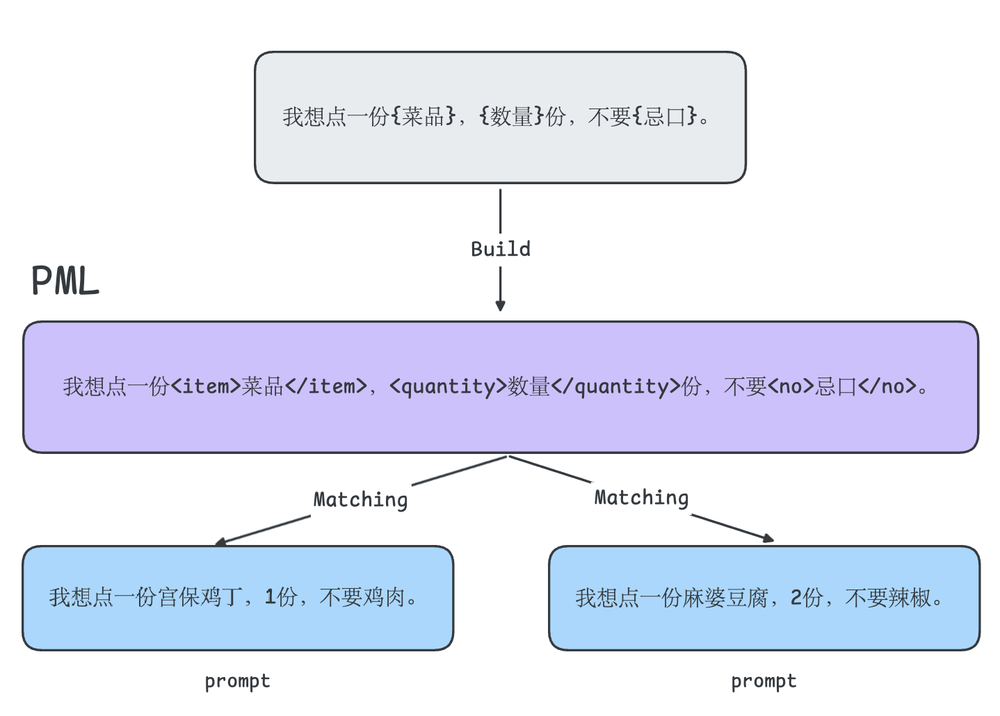

# One Poem Suffices: Prompt Caching

`⏰ Read: 25 + 30min`

The first time I heard about prompt caching was probably when DeepSeek launched cache hits at 0.1 RMB per million tokens ([DeepSeek API Innovatively Adopts Disk Caching, Lowering Prices by Another Order of Magnitude](https://api-docs.deepseek.com/zh-cn/news/news0802)). After that, major providers rolled out their own prompt caching features one after another.

**This post aims to answer four questions**:

- What is prompt caching, and why do we need it?
- How does prompt caching work under the hood?
- As users and developers, how can we make better use of prompt caching?
- How is prompt caching related to KV caching? And does using prompt caching in turn affect output quality?

Drawing on OpenAI's [documentation](https://platform.openai.com/docs/guides/prompt-caching), the paper [Prompt Cache: Modular Attention Reuse for Low-Latency Inference](https://arxiv.org/abs/2311.04934), and information I gathered myself, I will do my best to build a concise post around these four questions.

Of course, as users, what we are after **may simply be how to use this feature effectively**. Mixing the underlying mechanics into the **best practices** makes for a choppy reading experience, so I have split the post into two sections, **How to Use It** and **Deep Dive**, to keep the flow as smooth as possible. My understanding has its limits, so corrections are welcome!

- Update 2025/01/10: Further elaborated on how PML-based Prompt Cache handles positional encoding.

## 1. How to Use It

`⏰ Read: 25min`

!!! note

    **Prompt caching is a technique used to reduce latency and cost.**

This single sentence sums up what prompt caching actually does.

```
model prompt = system prompt + user prompt
```

This is basic knowledge. In practice, a model prompt usually contains a lot of repeated content, such as the system prompt and common instructions that appear in the user prompt (for example, role-playing instructions or data analysis instructions).

Prompt caching is therefore designed to **"store" and "reuse"** this repeated content in the model prompt, reducing both latency and cost at the same time. Users get lower costs and faster responses, while providers reduce compute consumption, making it a win-win.

For example, OpenAI routes API requests to servers that recently processed the same prompt, which is cheaper and faster than processing the prompt from scratch. For longer prompts, this can **reduce latency by up to 80% and cost by 50%**. Prompt caching works automatically on all your OpenAI API requests (with no code changes required) and comes with no additional fees attached.

To understand this optimization, we need to look at an important concept in LLM responses: Time to First Token (TTFT). This is the time it takes from sending a request to receiving the model's first token in response.

"In online serving scenarios such as chatbots, large language model inference generally uses streaming output. The TTFT of LLM inference is **the response time of the LLM inference service as perceived by the user, directly affecting user experience**." For online services, we want TTFT to be as small as possible to improve user experience, and that is why we need prompt caching.

TTFT is closely tied to prompt length. For long prompts, most of the latency happens during this stage because the model has to **finish processing the entire input before it can start generating output**. With prompt caching, the model can directly reuse the cached processing results, significantly cutting down this initial wait time. It is as if the model has already "previewed" this material and can start responding much faster (this is very similar to KV Cache; it is worth thinking about how they differ, and I will share my thoughts later in the post). This advantage is especially pronounced when handling requests with large amounts of repeated content, such as system prompts or fixed instructions.

!!! tip

    Understanding TTFT touches on a bit of LLM inference knowledge. I recommend reading another post of mine: [One Poem Suffices: Basic LLM Inference/Generation](../basic-llm-inference/)

The short section above has already answered Question 1. Now that we know how **important and practical** prompt caching is, how can we as users **use it effectively?**

### 1.1 Structuring prompts

In the vast majority of current LLM APIs, a cache hit only occurs when two requests share the exact same prefix (matching from token 0 onward). To take advantage of caching, **place static content** (such as instructions and examples) **at the beginning of the prompt, and put variable content** (such as user-specific information) **at the end**. This also applies to images and tools, which must be identical across requests.



Using it really is that simple: "just put the content that needs to be cached at the beginning of the prompt." Next, I have synthesized best practices from OpenAI's and Anthropic's documentation.

!!! question "Why is caching identified via prefix matching? Does it have to use prefix matching?"

    **Thoughts:** The importance of prefix matching lies in its ability to **efficiently** identify repeated prompt segments so the cache can be reused.

    Why can it **identify them efficiently**? Technically speaking, it can use a data structure similar to a "trie" (prefix tree) in computer science. By storing prompt prefixes as paths in a tree structure, the system can quickly look up whether a matching prefix exists. The advantage of this approach is fast lookup speed, with a time complexity that is typically $O(m)$, where $m$ is the length of the prefix. In addition, prefix matching fits real-world usage patterns well, **because in most cases, changes in a prompt are concentrated at the end, while the beginning remains relatively fixed.**

    Does it have to be prefix matching, though? In certain cases, only a section in the middle might change, for example:

    ```text
    Original Prompt:
    "You are a professional article translation assistant. Please translate the following article about artificial intelligence into Chinese.
     [Article content...]
     Please maintain the accuracy of technical terms."
    ```

    This prompt is just an example, but we can see that only the middle part changes. In a case like this, prefix-based prompt caching cannot cache the static content in the second half.

    The `cache_control` feature supported by Claude is more flexible: it can cache different text segments separately (since we could split the prompt above into three parts and apply `cache_control` to the first and third parts respectively). Later in this post, we will also introduce another method, though I think its drawback is that it is not **user-friendly** enough. Prefix matching is a very clean matching strategy that works in the vast majority of cases; the choice here is essentially an engineering tradeoff.

### 1.2 Best practices for effective caching

- **Choose cached content wisely** Cache content that is stable and reusable. This includes **system instructions, background information, large blocks of context, or frequently used tool definitions**. These are often foundational components that you set up once and reuse repeatedly, so making good use of them goes a long way.
- **Optimize content placement** Place static or repeated content that needs to be cached at the beginning of the prompt, and put dynamic content at the end. This layout makes the most of the caching mechanism.
- **Monitor and optimize continuously** Regularly check cache-related metrics such as cache hit rate, latency, and the percentage of cached tokens, and refine your prompts and caching strategy based on actual usage. This keeps the caching mechanism working effectively.
- **Optimize request strategy** **Use longer prompts** and make API requests during **off-peak hours**, as cache evictions happen more frequently during peak hours. Also, prompts that have not been used recently are automatically removed from the cache. To minimize evictions, **maintain a steady stream of requests that share the same prompt prefix**. (Typically, APIs only cache prompts longer than a certain threshold, usually 1024 tokens.)
- **[Claude Only]** Unlike OpenAI, Claude does not enable prompt caching automatically; you need to manually add `cache_control` markers. By carefully placing cache breakpoints, you can separate different cacheable prefix segments. This keeps your cache better organized and improves the cache hit rate.

At this point, we have rough answers to the first three questions. As users, we now know what prompt caching is and how best to use it! Next, let's try to dig deeper into the logic behind it.

## 2. Deep Dive

`⏰ Read: 30min`

### 2.1 How prompt caching works

Here I will reference the material from OpenAI's official documentation (Claude's setup is a bit more involved; if you are interested, I recommend reading [Build with Claude - Prompt caching](https://docs.anthropic.com/en/docs/build-with-claude/prompt-caching)).

For **prompts of 1024 tokens or longer**, caching is enabled automatically. When you make an API request, the following steps occur:

1. **Cache Lookup**: The system checks whether the initial portion (prefix) of the prompt is stored in the cache.
2. **Cache Hit**: If a matching prefix is found, the system uses the cached result. This significantly decreases latency and reduces costs.
3. **Cache Miss**: If no matching prefix is found, the system processes your full prompt. After processing, the prefix of the prompt is cached for future requests.

Cached prefixes generally remain active for 5 to 10 minutes of inactivity. However, during off-peak periods, caches may persist for up to one hour.

Of course, walking everyone through the exact API usage is not the goal of this post. I have linked the relevant API documentation and common use cases in the references at the end, and you can also check those docs directly for FAQs.

### 2.2 Differences from KV Caching

For readers familiar with KV caching, prompt caching has a lot in common with it. Both avoid recomputing repeated attention embeddings and speed up inference through caching.

Let's briefly review what KV Cache does. In autoregressive inference, each step predicts (computes) the next token based on all previous content. Without any optimization, the amount of computation required to predict the next token in autoregressive generation grows with each step (because earlier tokens get recomputed multiple times). That is why KV Cache was introduced, following the classic idea of "trading space complexity for time complexity." Referencing an animation from my previous post, the gray parts represent the retained KV cache, which we can use directly in the next autoregressive computation step.

<!-- TODO: batch-inference.gif 动图待迁移 -->

Prompt caching does the same kind of thing: "**reusing** previously computed results." So what is the actual difference between them? The figure below is taken from the paper "Prompt Cache: Modular Attention Reuse for Low-Latency Inference."



In my view, the difference is that KV Cache is a single-session cache, whereas prompt cache supports cross-session caching (perhaps using "sequence" rather than "session" here would be more accurate). Let's break down this figure:

- Figure (a) shows the most basic autoregressive computation process. As noted above, certain tokens have to be recomputed multiple times.
- Figure (b) shows KV cache, which adds an `attention states` component. This component stores already-computed results so they can be reused in the next autoregressive step, greatly reducing computation. (As for why KV caching works in the first place, that is a topic I promised to write about a long time ago; when I get the chance to fill that gap, I will update the reference here.)
- Figure (c) shows our main subject, prompt cache, which adds a prompt cache layer on top of the KV cache. Essentially, it introduces a global manager to enable cross-sequence caching. It can supply results cached from other sequences for use in the current inference run, so **it provides an overall speedup across requests rather than a speedup within a single inference pass**. (Put this way, it feels somewhat similar to PagedAttention, which indirectly improves throughput by reducing GPU memory footprint; of course, that is just my rough intuition, and corrections are welcome.) The cache here does not necessarily live in GPU memory or system RAM; it can even sit on disk. As for performance, reading a large batch of tokens all at once is actually not that slow (compared to the cost of recomputing them).

So coming back to the difference between prompt cache and KV cache: **prompt cache provides a cross-sequence cache, and its effect operates globally (across multiple requests) rather than within a single inference run.**

The biggest challenge with prompt cache is how to **maintain and identify** cached entries. Unlike KV cache, which by nature is "**guaranteed**" to be reused within the sequence, a prompt cache entry may end up sitting in storage without ever being used again, and **how entries are identified** is also a key factor affecting the cache hit rate.

### 2.3 Prompt Cache Matching Mechanisms

In the **How to Use It** section, we looked at the most straightforward approach: prefix matching (which is what OpenAI uses). At the same time, we ran into a question in the discussion box: **"What if our prompts only differ somewhere in the middle?"** Generalizing further: **"What if our prompt follows a template and only differs at certain fixed positions (similar to string formatting in Python)?"**

For example, in the figure below, the two prompts differ only at one specific token position, which causes simple prefix matching to fail.



To address this, the paper introduces Prompt Markup Language (PML). What is PML? Prompt Markup Language (PML) is designed to represent prompts in a structured way, specifically highlighting the **invariant (fixed)** parts and the **variable (changeable)** parts of a prompt.



As we noted in our earlier question, prefix matching breaks down when it encounters prompts that only differ somewhere in the middle. PML neatly solves this by explicitly marking those variable sections. A simple example makes this immediately clear:



- `<item>`, `<quantity>`, and `<no>` are **variable slots**, representing the parts that can change.
- The rest of the prompt is **fixed text**.

Now, even if two customers order different dishes, quantities, and dietary restrictions, PML can recognize that they follow the same template and accurately identify which parts are variable. Compared with blunt prefix matching, PML enables more accurate template-based matching and achieves more efficient caching.

!!! info "Positional Encoding and Attention State Reuse"

    **We also need to consider another issue: the attention states of a text segment can only be reused if that segment appears at the exact same position in the large language model (LLM) input.** The reason is that Transformers bake positional information directly into the key (k) and value (v) attention states. For a single prompt's KV cache, this is not an issue, because across all generation steps, the prompt stays in the exact same position, namely at the beginning of the input.

    If we use non-prefix matching, however, we run straight into this problem: how do we handle positional encoding? Shared text may appear at different positions in different prompts. To reuse attention states across prompts (and therefore across different positions), the cache system must solve two problems. First, **even though a text segment may appear at different positions in different prompts, the system must still support reusing it**. Second, when the system receives a new prompt, it must be able to efficiently identify text segments whose attention states may already be cached so they can be reused.

    To solve these two problems, the paper combines two ideas. First, it proposes using Prompt Markup Language (PML) to make the structure of a prompt explicit, representing reusable text segments explicitly as modules, i.e., prompt modules. PML solves the second problem above nicely (identifying which text segments are repeated), and it also opens the door to solving the first problem, because each prompt module can be assigned unique Position IDs. **Second, we found empirically that LLMs can operate on attention states with discontinuous Position IDs. As long as the relative positions between tokens are preserved, output quality is not affected.** (*Our second idea is our empirical finding that LLMs can operate on attention states with discontinuous position IDs. As long as the relative position of tokens is preserved, output quality is not affected.*) This means we can extract different attention state segments and concatenate them to construct new semantics. Leveraging this property, users can select prompt modules according to their needs and even swap out certain meanings at runtime.

    That raises another question: when positions change, even identical text would produce different KV attention states during actual inference. Here, however, we are reusing the exact same KV attention states. Does that affect output quality? Section 5.3 of the paper notes that **across all datasets, the accuracy of outputs using prompt cache is comparable to the baseline**. (There are still slight differences, though, so PML-based prompt caching is not a bit-for-bit identical replacement like KV cache.)

    Admittedly, my explanation here is still a bit fuzzy. I will leave this as a placeholder for now, and after I finish reading the relevant code, I will come back and try to explain more clearly what it means that "LLMs can operate on attention states with discontinuous position IDs."

At the same time, as mentioned earlier, Claude's `cache_control` feature can achieve a **PML-like** effect to some extent. Comparing OpenAI and Claude:

- OpenAI provides a more straightforward caching strategy that is more user-friendly, but it can easily fail in certain cases.
- Claude provides a more specialized caching strategy that may be harder for beginners to grasp at first, but once you learn it, you can achieve optimal caching performance.

Finally, let's answer the last question: "**Does using prompt caching in turn affect output quality?**" KV cache does not affect inference quality because it is an exact mathematical equivalence. By the same token, prefix-based prompt caching does not affect inference quality either. However, as we saw in the analysis above, although empirical results show that PML-based prompt caching produces outputs close to the baseline, there are still differences between them; it is not perfectly equivalent. Therefore, when using PML-based prompt caching, you should take into account how the matching mechanism might affect output quality.

That wraps up this post. There are still more details we could dig into, but I think I have answered the four questions posed at the beginning. Much like OpenAI's approach, I am offering a simple, straightforward overview here so you can understand what prompt caching is and learn the best practices for using it.

## References

- Documentation and code resources:
  - [Claude: Prompt caching examples](https://docs.anthropic.com/en/docs/build-with-claude/prompt-caching#prompt-caching-examples)
  - [Google: Context caching](https://ai.google.dev/gemini-api/docs/caching)
  - [Anthropic: Prompt caching cookbook](https://github.com/anthropics/anthropic-cookbook/blob/main/misc/prompt_caching.ipynb)
  - [Anthropic: news prompt caching](https://www.anthropic.com/news/prompt-caching)
- Technical blog posts and papers:
  - [OpenAI: Prompt caching Best Practices](https://platform.openai.com/docs/guides/prompt-caching)
  - [Paper: Prompt Cache: Modular Attention Reuse for Low-Latency Inference](https://arxiv.org/abs/2311.04934)
  - [Zhihu: LLM Inference: TTFT Optimization and System Prompt Caching](https://zhuanlan.zhihu.com/p/687685636)
  - [Zhihu: Prompt Cache: Modular Attention Reuse for Low-Latency Inference](https://zhuanlan.zhihu.com/p/706709303)
  - [How to Understand Contextual Retrieval? (With a Quick Walkthrough of Prompt Cache)](https://www.linkedin.com/pulse/%E6%80%8E%E4%B9%88%E7%90%86%E8%A7%A3contextual-retrieval-%E9%A1%BA%E6%89%8B%E8%AE%B2%E4%B8%80%E4%B8%8Bprompt-cache-boyang-zhou-4of4c/)
