# One Poem Suffices: ZeRO (Zero Redundancy Optimizer)

## ZeRO Read Report

Over the past few days, I read the ZeRO paper and consulted many people's reading notes. Noticing that a few pieces were missing across those notes, I decided to write as complete a set of reading notes as possible. Given my own limitations, mistakes are inevitable, so please take this as a starting point for discussion and feel free to point out any errors.

**Update 2024/07/24: Added several supplementary explanations from the comment section into the article. If you have additional questions, you can check whether the same question has already been asked in the comments; if not, feel free to ask~ I plan to try writing *One Poem Suffices: Megatron-LM* soon, and I welcome everyone's feedback and corrections then.**

**Update 2023/11/06: Added a visual analysis of communication volume**

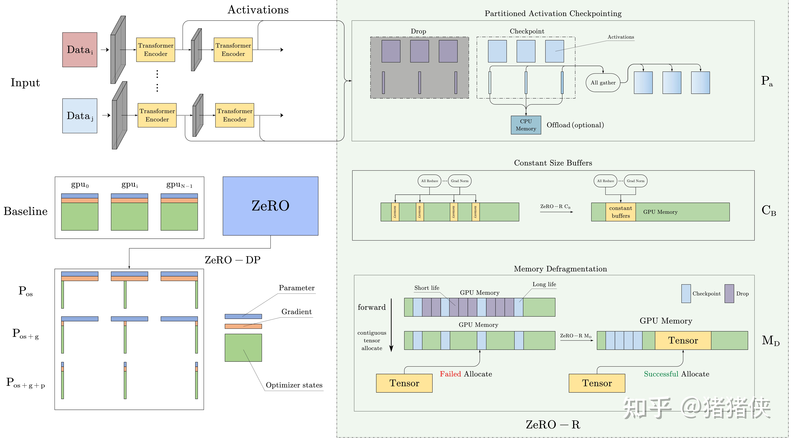

*Overview of the ZeRO Framework*

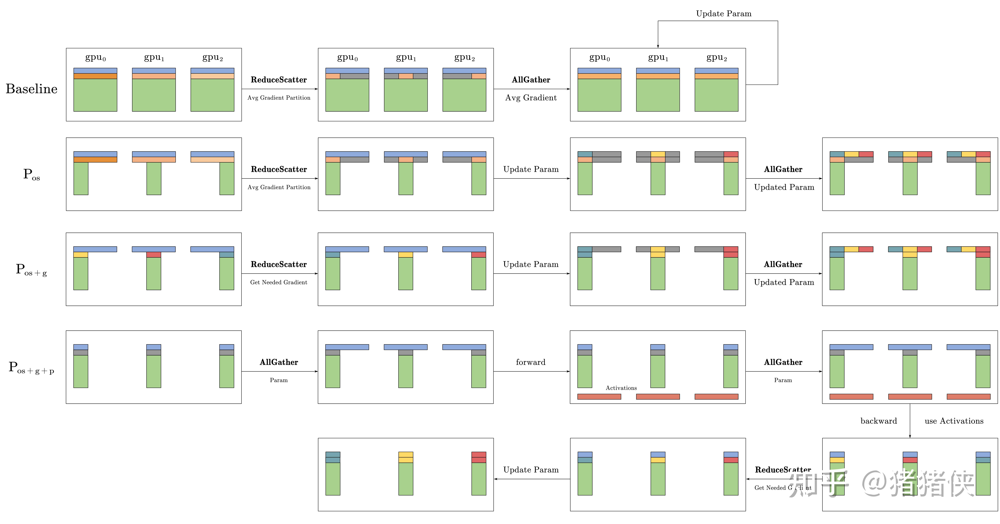

*Visualization of ZeRO-DP Communication Volume Analysis*

### 1 Existing Problem

Large deep learning models can significantly improve metrics (such as accuracy). However, training models at an ultra-large parameter scale (trillions of parameters) still faces many GPU memory challenges. Currently, common solutions such as Data Parallelism (DP) and Model Parallelism (MP) have fundamental limitations due to finite device memory, and they also run into issues with computation, communication, and development efficiency.

Basic DP cannot reduce the memory footprint on each device (GPU) (because it replicates the model, as shown in the left figure below), so the number of model parameters is constrained by the memory of a single device, and adding more devices cannot solve this problem. To overcome the single-device memory limit, approaches such as Pipeline Parallelism (PP), MP, or leveraging CPU memory have been proposed, but without exception, they all come at the cost of sacrificing certain key performance aspects, such as memory or computation/communication overhead.

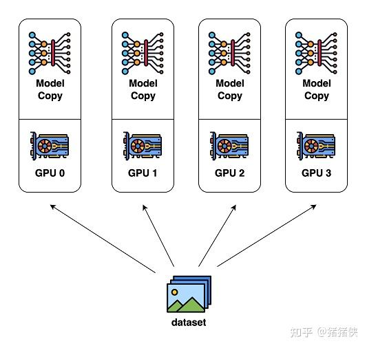

*DP*

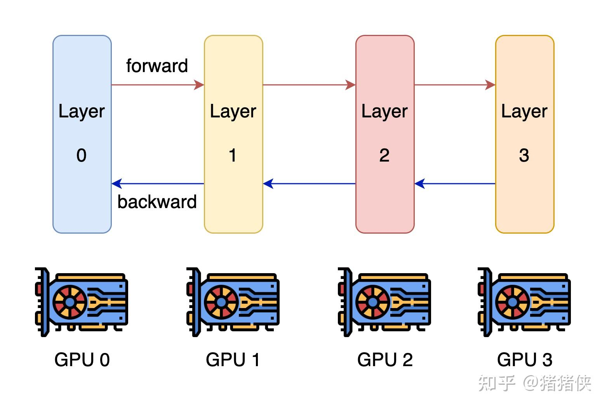

*MP*

Among these, the most effective and promising approach is MP. MP works by splitting the model vertically, partitioning the network and parameters across multiple devices, which requires substantial communication between every layer. As shown in the right figure above, MP works well within a single node/device, but once it scales beyond a single node/device, efficiency drops rapidly due to communication overhead.

### 2 ZeRO Overview

ZeRO (Zero Redundancy Optimizer) was developed to solve the problems in DP and MP; you could say it brings together the best of existing approaches while discarding their drawbacks. ZeRO eliminates memory redundancy in data- and model-parallel training while preserving low communication volume and high computational granularity, allowing us to scale model size proportionally with the number of devices while maintaining consistently high efficiency.

However, jumping straight into the optimizations made by ZeRO does not follow the logic of research or engineering. First, we need an in-depth understanding of the problems currently facing DP/MP:

- [ ] Why is memory consumption so large?
- [ ] Is there room for optimization (is the memory taken up by actual parameters, or by redundancy due to the design)?
- [ ] And how do we optimize it?

Next, we will first examine the specific memory costs, and then introduce ZeRO's optimizations and communication volume analysis based on that. If you want to jump directly to ZeRO's optimizations and communication volume analysis, please skip ahead to Section 4.

### 3 Where Did All the Memory Go?

Taking the example from the paper, a 1.5B-parameter GPT-2 model trained in FP16 only needs $\mathrm{2byte \times 1.5 * 10^{9} \approx 3GB}$ to store the model parameters, yet it cannot be trained on a single 32GB GPU. So where did all the memory go?

Experiments show that during training, most of the memory is consumed by **Model States**, namely: optimizer parameters (Optimizer states), gradients (Gradients), and model parameters (Parameters). Beyond that, **Residual States** consume the remaining memory; residual states include the Activations produced during forward propagation, temporary buffers used for computation and communication, and memory fragmentation that has not been properly managed.

Next, I will explore how memory is consumed and whether there is room for optimization in two parts (Model and Residual).

### 3.1 Model States Memory

Mixed precision training and the Adam optimizer have basically become standard for training language models, so let's briefly review the relevant concepts.

Building on SGD, Adam adds first-order momentum (momentum) and second-order momentum (variance) for each parameter gradient. Mixed precision training, as the name suggests, maintains values in both FP16 and FP32 formats at the same time: the model parameters and model gradients are in FP16, and in addition there is an FP32 master copy of the model parameters; if the optimizer is Adam, there are also FP32 momentum and variance states.

**Update 2024/07/24**

Someone asked: **Why does Adam need an FP32 backup copy of the model parameters?** The reason for keeping this copy is that accumulation errors in FP16 build up over time.

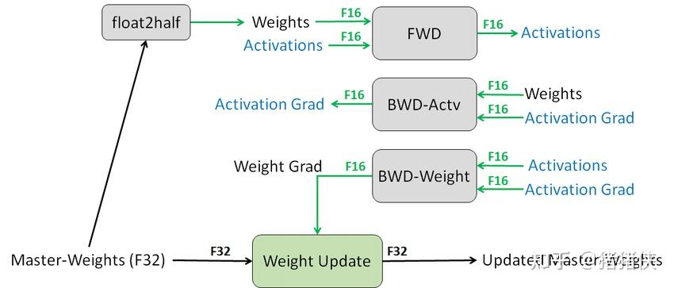

To make the analysis more general, let's assume we use the Adam optimizer with mixed precision training. If our model has $\Psi$ parameters, the total memory footprint of the Model States is:

$$
\begin{array}{rl} \mathrm{Model\; States\; (bytes)}  &= \overbrace{2 \times \Psi}^{\text{Param}} + \overbrace {2 \times \Psi}^{\text{Gradient}} + \overbrace{3\times 4 \times \Psi}^{\text{Optimizer, 3 for Adam,  4 for  FP32}} \\ &= 16 \times \Psi\\ \end{array}
$$

We can see that when using the Adam optimizer and mixed precision training, the Optimizer States account for 75% of the overall memory cost, causing the Model States to take up 24GB of memory, far higher than the 3GB needed to store the model itself.

Clearly, this answers part of the questions we raised earlier: the main reason memory consumption is so large is the footprint of the Optimizer States. And because the memory required to store the model itself is much smaller than the memory occupied by the entire Model States, the current design leaves substantial room for optimization.

### 3.2 Residual States Memory

Next, keeping the earlier questions in mind, we will continue by exploring the memory footprint of the Residual States. It is worth noting that the concepts in Model States are relatively intuitive and their analysis is straightforward. In contrast, Residual States involve some less familiar concepts, and most blogs and reports online lack an analysis of this part, so I will try to explain the terminology as concisely as possible.

### 3.2.1 Activations

First are the activations (Activations). For example, training a 1.5B-parameter GPT-2 model with a sequence length of 1K and a batch size of 32 requires about 60 GB of memory[^1]. This overhead is obviously huge. A common optimization technique is Activation checkpointing, which can reduce this memory cost to 8GB, but for extremely large models, activation memory remains quite large even with Activation checkpointing.

!!! question "What are Activations?"

    Most readers may find this concept somewhat confusing when encountering it for the first time. Here is my explanation:

    - In a neural network, Activations refer to the results computed at the neurons of each layer.
    - Activations are produced during the **forward propagation** phase of the network, which is the prediction phase of the neural network. During backward propagation, the model combines gradients with these Activations to update the network parameters. (In other words, the lifecycle of Activations spans from the start of forward propagation to the end of backward propagation; having a clear grasp of this concept **helps in understanding** the subsequent optimizations on Residual States Memory.)

!!! question "What is Activation Checkpointing?"

    Specifically, during the forward pass, it saves Activations only at specific points in the network (i.e., checkpoints), and recomputes the required Activations during backward propagation. The cost of this approach is additional computation time, because certain activations need to be recomputed during backward propagation. It is very useful when dealing with massive neural networks and long sequences, as it can significantly reduce the required memory footprint.

    As a small side note, how does Checkpointing choose which checkpoints to keep? Choosing randomly is obviously undesirable; our basic principle is to "save the Activations of layers in the network that have high computational cost but small memory footprint," and **the specific strategy can be either fixed or heuristic**.

### 3.2.3 Temporary buffers

Temporary buffers used to store intermediate results also consume a considerable amount of memory for large models. Operations such as Gradient AllReduce or Gradient norm computation, when implemented in high-performance libraries, often attempt to **fuse all parameters into a single buffer to improve throughput**, and in most cases the size of these buffers scales with the model size. Moreover, such fused buffers may also upcast the precision of the parameters; for example, FP16 gradient tensors may be stored in FP32 format inside the fused buffer.

**Many readers might wonder why this affects memory consumption.** The reason is that when the model is very large, certain operations or high-performance libraries will wait to fill or allocate a very large fused buffer to execute the operation. While this brings advantages in bandwidth and efficiency, it sometimes becomes a memory bottleneck. For example, for a 1.5B model, an FP32 fused buffer will consume 6GB of memory. This is clearly unacceptable: **being slow is acceptable, but being unable to train at all is not**.

### 3.2.3 Memory Fragmentation

Memory fragmentation is a fundamental concept in operating systems: when there is too much memory fragmentation, allocation can fail even when total free memory is sufficient. In other words, if there is not enough contiguous memory to satisfy a memory request, the request will fail even if the total available memory is greater than the requested amount. Experiments show that this phenomenon is very pronounced during large-model training.

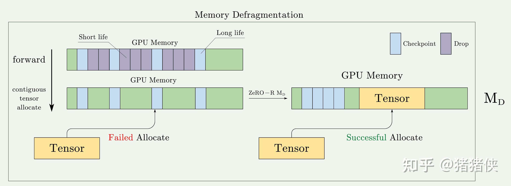

!!! question "How does memory fragmentation arise, and why doesn't the framework manage it?"

    Here is my personal explanation (which you can read alongside the figure above). Remember the note earlier in the Activations section? The lifecycle of Activations starts when they are generated in a forward pass and ends after parameter updates are computed in the corresponding backward pass. Ideally, the memory occupied by Activations is contiguous, but because of Activation checkpointing, some Activations are freed early, meaning their lifecycle ends ahead of time. At that point, the Activation tensors selected as checkpoints have not yet been freed, and these checkpoints effectively split the memory into multiple non-contiguous fragments.

    It is also understandable why deep learning frameworks do not resolve this on their own. Speaking as someone who has been deeply involved in neural network framework development, we are very cautious when designing such policies:

    - **Existing policies**: The framework may already have a very serviceable memory management policy, or be built around certain other memory management assumptions.
    - **Performance considerations**: Memory defragmentation (reorganizing memory to reduce fragmentation) is a compute-intensive operation that can hurt training performance. Therefore, frameworks tend to avoid performing this operation frequently.
    - **Complexity and usability**: Memory management is a very complex and important problem. Although we try our best to optimize memory management during design, we have to balance performance, memory efficiency, and programming complexity.

    Just as a powerful compiler may still fail to optimize some seemingly obvious code, CS:APP points out that compiler optimizations can never fully replace human judgment; to optimize this properly, we need to design a dedicated memory allocator/policy.

### 3.3 Memory Summary

This section mainly introduced how memory is used, covering the memory overhead of Model States and Residual States respectively.

Based on this analysis of memory overhead, we identified several prominent shortcomings in existing frameworks, such as Adam's excessive memory footprint, and the fact that Activations can still become a performance bottleneck even after Checkpoint optimizations. There are also less obvious issues: various high-performance libraries and communication operations use unbounded temporary buffers in order to optimize performance/throughput, and optimizations such as Activation checkpointing introduce memory fragmentation. These shortcomings point us toward the directions for optimization.

- [x] Why is memory consumption so large?
- [x] Is there room for optimization (is the memory taken up by actual parameters, or by redundancy due to the design)?

Anyone who regularly works on performance optimization knows that compared with how to optimize, finding the bottleneck is often what matters most. Next, we will answer the final question raised earlier. **We will briefly introduce ZeRO's optimizations at both the Model States and Residual States levels, and focus on the parts that are either confusing or particularly interesting,** since most of the optimizations themselves are not hard to understand.

## 4 Deep Dive into ZeRO

The diagram below is my visual summary of the optimizations performed by ZeRO. The discussion that follows will mainly build around this diagram, supplemented with mathematical derivations where necessary, to keep the reading experience as smooth and pleasant as possible✨.

ZeRO consists of two sets of optimizations: ZeRO-DP aims to reduce the memory footprint of model states, while ZeRO-R aims to reduce residual memory consumption. We will introduce these optimizations and the rationale behind them, which enable ZeRO to reduce memory footprint while maintaining high efficiency. Note that efficiency is the key here: without this constraint, simple solutions such as offloading all parameter states to CPU memory or arbitrarily increasing the degree of MP parallelism ($N_M$) could also reduce memory overhead.

### 4.1 ZeRO-DP: Optimizing Model States Memory

A few prerequisite observations before we dive into the optimizations:

- DP has better scaling efficiency (computational efficiency) than MP, because MP reduces computational granularity while increasing communication overhead.
- DP is memory-inefficient because Model States are stored redundantly across all devices. By contrast, MP partitions the model states to achieve higher memory efficiency.
- Both DP and MP retain all model states needed throughout the entire training process, **but not everything is needed at all times**. For example, the parameters corresponding to each layer are only needed during the forward and backward propagation of that layer.

Therefore, ZeRO-DP combines the strengths of DP and MP. Instead of replicating Model States on every device, ZeRO-DP partitions them and uses a dynamic communication schedule that exploits the inherent temporal nature of Model States while keeping communication volume to a minimum. By doing so, ZeRO-DP **linearly** reduces the per-device model memory footprint as the degree of DP parallelism increases, while keeping communication volume close to that of standard DP (which is critical for efficiency).

Next, we will look more closely at how this optimization works.

As shown in the ZeRO Framework diagram (hereafter "ZeRO Framework" refers to this diagram) or the classic diagram in the ZeRO paper, we can see that ZeRO-DP's optimizations are divided into three stages, each targeting one of the three components of Model States discussed earlier. To keep the reading flow smooth, we will **set aside the communication volume analysis for now and cover it in a dedicated section below**.

### 4.1.1 $P_{os}$ : Optimizer State Partitioning

Let $N_d$ be the degree of DP parallelism, or simply think of it roughly as the number of GPUs. First, for the Optimizer States, which account for the largest share of Model States, we partition them into $N_d$ parts stored across different GPUs, and name this optimization $P_{os}$. As $N_d$ increases, we can express the memory cost as:

$$
\begin{array}{rl} \mathrm{Model\; States\; (bytes)}|P_{os}  &= \overbrace{2 \times \Psi}^{\text{Param}} + \overbrace {2 \times \Psi}^{\text{Gradient}} + \overbrace{\dfrac{12 \times \Psi}{N_d}}^{\text{Optimizer}} \\ &\approx 4\Psi |N_d \rightarrow \infty \\ \end{array}
$$

In other words, through $P_{os}$, we reduce the memory overhead by nearly a factor of 4.

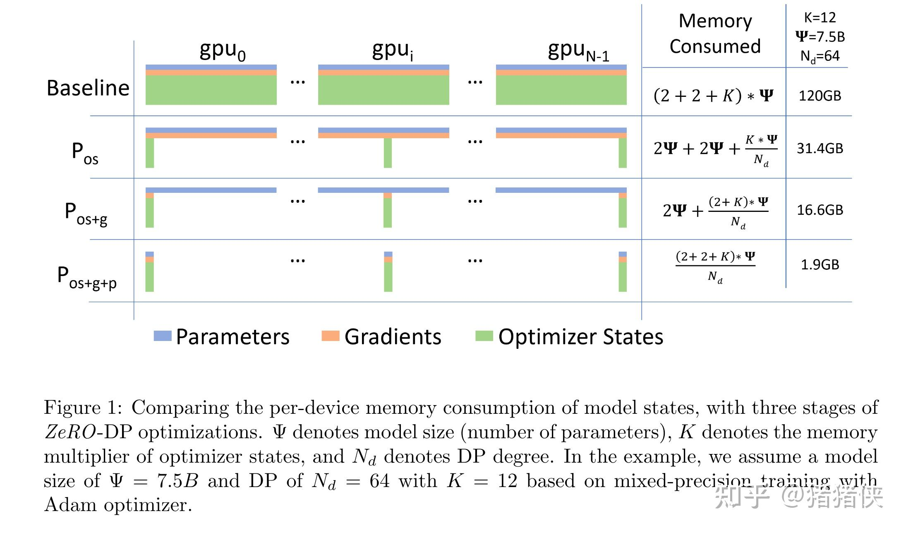

### 4.1.2 $P_{g}$ : Gradient Partitioning

Similarly, in this stage we partition the Gradients into $N_d$ parts stored across different GPUs, and name this optimization $P_{g}$. When $P_{os+g}$ are applied together, as $N_{d}$ increases, we get:

$$
\begin{array}{rl} \mathrm{Model\; States\; (bytes)}|P_{os+g}  &= \overbrace{2 \times \Psi}^{\text{Param}} + \overbrace{\dfrac{14 \times \Psi}{N_d}}^{\text{Gradient + Optimizer}} \\ &\approx 2\Psi |N_d \rightarrow \infty \\ \end{array}
$$

In other words, with $P_{os+g}$ we can reduce the model's memory overhead by a factor of 8. Simple and intuitive!

### 4.1.3 $P_{p}$ : Parameter Paritionging

Just like $P_{os}$ and $P_{g}$ above, we have each process store only the parameters corresponding to its partition; when forward and backward propagation require parameters outside its partition, it receives them from the corresponding DP process via communication operations (broadcast). **Although at first glance this may seem to incur massive communication overhead, the paper shows that this approach only increases the total communication volume of a baseline DP system to 1.5x, which we will analyze in full in the next subsection.** And its key property is that combining $P_{os+g+p}$ achieves a memory reduction proportional to $N_{d}$.

$$
\begin{array}{rl} \mathrm{Model\; States\; (bytes)}|P_{os+g+p}  &=  \overbrace{\dfrac{16 \times \Psi}{N_d}}^{\text{Param + Gradient + Optimizer}} \\ &\approx 0 |N_d \rightarrow \infty \\ \end{array}
$$

This has profound implications: it means that as long as there are enough devices to share the Model States, ZeRO allows DP to accommodate models of arbitrary size.

### 4.1.4 ZeRO-DP Communication Analysis

Since ZeRO-DP scales up model size by eliminating memory redundancy, a natural question is whether we are trading communication volume for memory efficiency. Next, we will carry out a detailed analysis!

Let me state the conclusion first: using $P_{os}$ and $P_{g}$ in ZeRO-DP incurs no extra communication while reducing memory overhead by up to 8x; when using $P_{p}$, ZeRO-DP incurs at most 1.5x the communication volume while further reducing the memory footprint by a factor of $N_d$.

First, let's briefly review the communication volume of standard DP. [If you are not yet familiar with basic communication primitives, please refer to Appendix A. Collective Operations, **as this will affect whether you can follow the subsequent analysis**.]

### **Communication Analysis of Standard DP**

In standard DP training, after backward propagation finishes, all Gradients are averaged across devices. This averaging process uses AllReduce. For extremely large models, AllReduce communication is the bottleneck of overall communication bandwidth, so our analysis focuses primarily on AllReduce. Accordingly, we restrict our analysis to the total communication volume sent to and received from each DP process.

In practice, AllReduce is broken down into two steps: ReduceScatter and AllGather (**see** Appendix B. Ring AllReduce Operation). If both steps use the optimal implementation, namely Ring-ReduceScatter and Ring-AllGather, then a single device incurs a communication volume of $\Psi$ during either Ring-ReduceScatter or Ring-AllGather. Thus, the per-GPU communication volume for the entire AllReduce is $2\times \Psi$.

!!! note "Analyzing the Purpose of Each Communication Step in Standard DP"

    There is actually a crucial insight here if we understand the purpose of each communication step in traditional DP:

    - ReduceScatter: shards and averages the Gradients, placing each shard on a device.
    - AllGather: distributes the averaged Gradients to every GPU.

    In fact, right after ReduceScatter, each GPU already has enough information to perform an independent update on its portion of the model. Because if you have the corresponding Optimizer States and the averaged Gradient shard, you can update that subset of model parameters and then distribute the updated parameters via AllGather. It is precisely by seizing on this redundancy that ZeRO achieves its subsequent optimizations.

### $P_{os}$ **Communication Volume Analysis**

Because $P_{os}$ partitions the Optimizer States, each step first uses ReduceScatter to reduce the gradients across different GPUs so that each GPU holds one averaged shard of the Gradient (here "one shard" means each device holds its own distinct fraction of the averaged Gradient). Each GPU uses this Gradient shard to update its Optimizer States and corresponding parameters, and then distributes the updated model parameters to all GPUs via AllGather. Based on the earlier analysis, both ReduceScatter and AllGather have a communication volume of $\Psi$, so overall the communication volume remains $2 \times \Psi$.

Moreover, we can see that **each GPU actually computes the full Gradient, yet because the Optimizer States are partitioned, each GPU only needs a subset of the Gradient. In effect, every GPU is redundantly storing the rest of the Gradient.** This is also why the communication volume of $P_{os}$ is equal to that of $P_{os+g}$.

### $P_{os+g}$ **Communication Volume Analysis**

Because the Gradients are partitioned, before updating the parameters we first use ReduceScatter to send the Gradients needed by each partition of Optimizer States to the corresponding device. Therefore, the communication volume of this operation is still $\Psi$ (take a moment to think this through carefully).

Once each partitioned Optimizer State receives its corresponding Gradient and updates its parameters, we only need to execute a single AllGather to send out the locally updated model parameters and collect the model parameters updated by other devices. Based on the analysis in the appendix, this also has a communication volume of $\Psi$. Therefore, the total communication volume per training step is $\Psi + \Psi = 2 \Psi$, which is identical to standard DP.

### $P_{os + g + p}$ **Communication Volume Analysis**

Because the parameters are partitioned, an obvious consequence is that **both the forward and backward propagation phases** require an AllGather to ensure correct computation. It is worth noting that the distribution of model parameters is pipelined according to the computation order of the neural network, because distributing everything upfront without regard to the computation order would **cause some parameters to be distributed multiple times and immediately discarded**. From a macro perspective, this is equivalent to adding two AllGather operations per training step. At this point, you might wonder: **then why isn't the communication volume** $4\times \Psi$**?**

**The reason is that because the model parameters happen to be partitioned as well, we no longer need an AllGather to share the model parameters after updating them.** We only need to use ReduceScatter to distribute the corresponding Gradients before updating the parameters.

In summary, the total communication volume is $2\times \Psi (\texttt{forward + backward}) + \Psi(\texttt{gradient average}) = 3\times \Psi$, which is 1.5 times the communication volume of standard DP.

**Update 2024/07/24**

Someone commented in the comment section: "**Since you have to do an AllGather before moving to the next step, isn't the peak memory of $P_{os + g + p}$ roughly the same as $P_{os + g}$?**"

This understanding is actually **incorrect.** The original paper explains this part directly:  
*"After parameter partitioning, each data parallel process only stores the parameters that it updates. Therefore, during the forward propagation it needs to receives the parameters for all the other partitions. However, this can be pipelined to avoid the memory overhead. Before computing the forward propagation on the part of the model corresponding to a particular partition, the data parallel process responsible for that partition can broadcast the weights to all the data parallel processes."*

To summarize: although we do need AllGather to obtain the parameters, **this does not happen all at once**. Instead, communication happens layer by layer along with the computation: we broadcast the corresponding parameters for each layer **when that layer needs to be computed**, so each device **only retains the subset of Parameters needed for the current computation** rather than all of them, and discards those parameters once the computation is finished.

An example may make this easier to understand. Suppose 64 devices are running with ZeRO-3 optimization, and the model consists of 64 \* 3 = 192 blocks (a simplified scenario). When computing the first 3 blocks, Device 1 broadcasts the Parameters of these 3 blocks; **at this moment, the other 63 devices hold two parameter partitions (their own partition plus the one broadcast by Device 1)**. Once computation on these 3 blocks finishes, those broadcast parameters are discarded, and computation proceeds to the next 3 blocks (at which point another device, say Device 2, broadcasts its parameters). Therefore, at peak, the parameter memory footprint on each device is only equivalent to 2 / 64 of the total parameters.

Similarly, quoting the original paper: "*In other words, we reschedule the parameter all-gather by spreading it across the entire forward propagation, and discarding the parameters once they have been used.*" This means we communicate parameters progressively throughout the forward pass, which is equivalent to a rescheduled AllGather operation.

### Visualization of ZeRO-DP Communication Volume Analysis

*Visualization of ZeRO-DP communication volume analysis; note that bold black text indicates communication operations*

In fact, I finished drawing this diagram quite early on, but while making it I ran into a point of confusion. I re-read the paper several times, checked the official DeepSpeed docs, and even opened a rather silly issue (which still hasn't received a reply TAT). So I'm sharing my question here in case it helps clarify things for you as well.

!!! question "Can we partition according to the mapping to avoid ReduceScatter?"

    Here was my question: under $P_{os + g}$, after backward propagation produces the gradients, we need a ReduceScatter to route those gradients to the corresponding parameters to be updated. At first glance this sounds reasonable, but I wondered: normally, there should be a concrete mapping among Gradients, Model Parameters, and Optimizer States. Taking the simplest model as an example, couldn't we partition the Gradients and Model Parameters according to that exact correspondence from the start, thereby avoiding this ReduceScatter altogether? That would cut the communication volume in half! Amazing, a new paper is waving at me!

In reality, that's not how it works /(ㄒoㄒ)/\~~. I had tied myself in knots. Let's refer to the original paper:

**"Therefore, as each gradient of each layer becomes available during the backward propagation, we only reduce them on the data parallel process responsible for updating the corresponding parameters."**

Reading this carefully, what it means is: during backward propagation, we dynamically obtain the Gradients of certain layers, and because of partitioning, these Gradients need to be routed to the corresponding Model Parameters via communication. In other words, every process **actually** computes gradients for all parameters, but as those gradients are produced, the ones belonging to other partitions are dynamically communicated to their corresponding processes. This is also why the paper immediately introduces a bucketization strategy right after this paragraph: because we have to perform frequent small-batch communications, we need bucketing to optimize it. In the visualization, under $P_{os+g}$, the different colors at the very beginning represent the fact that each device generates Gradients that do not belong to its own partition and must send them out via communication.

### 4.2 ZeRO-R: Optimizing Residual States Memory

### 4.2.1 $P_a$ : Partitioned Activation Checkpointing

A few observations:

- MP partitions the model states, but typically needs to replicate Activation memory. For example, if we vertically split the parameters of a linear layer and compute them in parallel across two GPUs, each GPU needs the entire Activation input in order to compute its partition.  
- For GPT-2 or larger models, the arithmetic intensity (the ratio of computation per iteration to the number of Activation Checkpoints) is very large ($\ge 10K$), which also means that using Activation Checkpointing introduces substantial recomputation overhead, and this overhead grows linearly with the hidden dimension. As a result, **when bandwidth is low, saving Activations can actually be cheaper than recomputing them.**  

ZeRO also reduces memory redundancy by partitioning Activations. Referring to the diagram: once the forward pass of a model layer is computed, the input Activation is partitioned across all MP processes until it is needed again during backward propagation (see the purple and blue blocks). At that point, ZeRO uses an AllGather operation torematerialize the replicated Activation copies. We call this optimization $P_a$. It works in tandem with Activation Checkpointing (where the blue blocks represent the selected Activation Checkpoints), so that only partitioned Activation Checkpoints are stored rather than full replicas. Furthermore, for very large models with severely limited device memory, these partitioned Activation Checkpoints can also be offloaded to the CPU (see Offload in the diagram), **reducing Activation memory overhead to nearly zero at the cost of additional communication**; this optimization is denoted $P_{a + cpu}$.

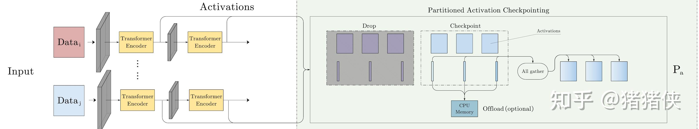

Let $N_M$ be the number of devices / degree of parallelism in MP; the $P_a$ optimization reduces the space occupied by Activations by a factor proportional to $N_M$.

### 4.2.2 $C_B$ : Constant Size Buffers

ZeRO-R uses constant-size buffers to prevent temporary buffers from blowing up as model size increases, while keeping the buffers large enough to maintain efficiency. The reason was already explained earlier in Section 3.2.2:

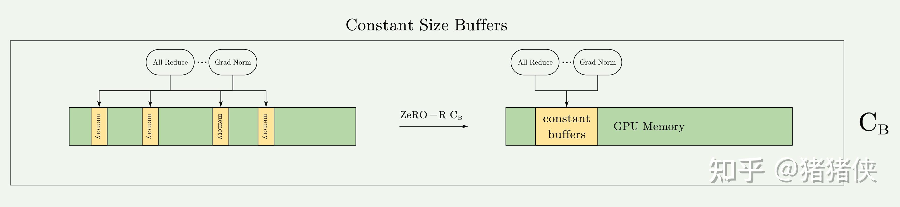

To briefly repeat it here: when the model size is very large, certain operations or high-performance libraries will wait to fill or allocate a very large fused buffer to execute the operation. While this brings advantages in bandwidth and efficiency, it sometimes becomes a memory bottleneck. For example, for a 1.5B model, an FP32 fused buffer will consume 6GB of memory. This is clearly unacceptable: **being slow is acceptable, but being unable to train at all is not**.

### 4.2.3 $M_D$ : Memory Defragmentation

Earlier we also briefly discussed why memory fragmentation occurs. The main cause is that Activation Checkpoints and Gradients have very long lifecycles.

ZeRO-R performs on-the-fly memory defragmentation by pre-allocating contiguous memory chunks for Checkpoints and Gradients (**as shown in the diagram, the blue blocks are grouped together to represent Checkpoints placed in contiguous memory**) and copying them into the pre-allocated memory as they are produced; this optimization is named $M_D$. $M_D$ not only enables ZeRO to train large models with larger batch sizes, but also improves training efficiency under limited memory.

### 4.2.4 ZeRO-R Communication Analysis

The communication trade-off of Partitioned Activation Checkpointing depends on the model size, the checkpointing strategy, and the MP strategy. To provide a concrete analysis, we examine it in the context of Transformer-based models implemented with the SOTA MP approach, namely Megatron-LM.

1.  In Megatron-LM-based Model Parallelism (MP), each Transformer block requires a communication volume of $12 \times \text{seq_length} \times \text{hidden_dim}$, because it performs two AllReduce operations each in the forward pass, forward recomputation, and backward pass, and the communication volume of each operation is twice the message size, just like the $2\Psi$ we saw repeatedly earlier.  
2.  When using ZeRO-R's $P_a$ technique to partition Activation Checkpoints, an extra AllGather operation is required before the forward recomputation of each Activation Checkpoint during backward propagation, adding $\text{seq_length} \times \text{hidden_dim}$ of communication volume. However, this is less than 10% of the standard MP communication volume.  
3.  When MP is used together with Data Parallelism (DP), introducing $P_a$ enables a much larger batch size, which in turn can reduce data-parallel communication volume by an order of magnitude, despite increasing model-parallel communication volume by $10\%$. For instance, $N_M$ can reach 16 (e.g., the number of GPUs in a DGX-2 node), meaning the batch size can increase by up to 16x. **Because communication volume in data-parallel training is inversely proportional to batch size**, such a large increase in batch size enabled by $P_a$ can lead to an order-of-magnitude reduction in data-parallel communication volume.  
4.  In addition, with $P_{a+cpu}$, offloading partitioned Activation Checkpoints to the CPU incurs the overhead of transferring twice the data to/from the CPU. Even so, this can still be beneficial when the batch size is small, as it can further reduce the overall overhead of DP communication.  

**Update 2024/07/24**

Someone asked in the comment section: **"Why does each phase of activation checkpointing require two all-reduces?"**

This actually comes down to NVIDIA's Megatron-LM paper; if you want to dig deeper, you can refer to: [arxiv.org/pdf/1909.0805](https://arxiv.org/pdf/1909.08053.pdf). The figure below is taken from Figure 4 of that paper.

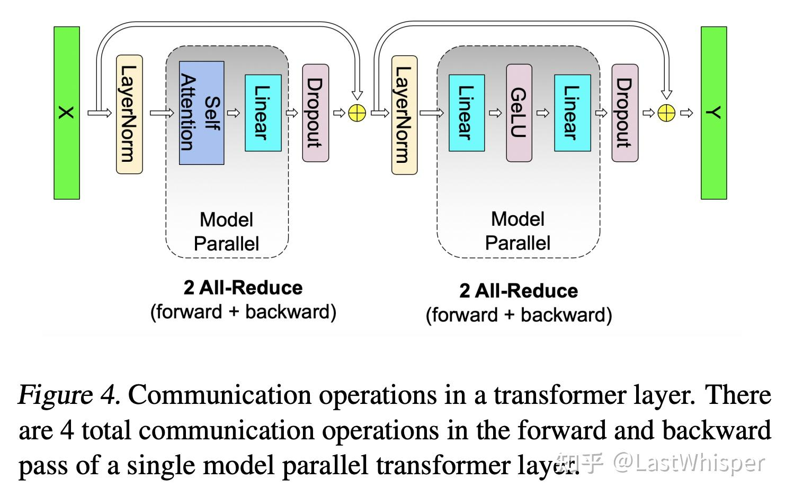

A Transformer Layer can be divided into two stages, Attention and MLP. If Model Parallelism (Tensor Parallelism) is used across these two blocks, communication is undoubtedly required, and the specific way the tensors are split was designed by NVIDIA. **Here we only need to know the takeaway**: under that design, we only need one AllReduce in each stage (one for Attention and one for MLP). Once you understand this, it is easy to see why each phase (forward, recomputation, backward) requires two AllReduces.

How model parallelism is designed so that Attention and MLP each require only a single AllReduce is a topic that could be expanded on at length. Meanwhile, what ZeRO's Partitioned Activation means is simply: **we shard the Activation across different devices, and when performing backward recomputation we just use a single AllGather to synchronize it. That is why it only adds less than 10% communication overhead.**

## 5 Summary and My Viewpoints

Below are some of my personal thoughts.

- Has hardware progress masked software laziness? When GPU memory was sufficient in the past, did people lack the motivation to explore memory optimizations? Looking at ZeRO as a whole, the optimizations themselves are not overly complicated. In practice, that makes sense: we always prioritize work with higher ROI.
- Unbounded optimizations can create even bigger bottlenecks. Consider the relationship between high-performance libraries and buffers: optimizations meant to improve performance ended up becoming a potential memory bottleneck. This reminds us to look closely at so-called optimization tools and strategies, as we may uncover hidden issues in them.
- Performance optimization requires a sharp eye for redundancy in operations: what information exists in duplicate, and can we exploit it? That is the intuition and foundation of optimization.
- Mathematical analysis is crucial~ While ZeRO as a whole does not look complicated, it is grounded in solid mathematical analysis (the communication volume analysis), which is what proves ZeRO's value. In our own optimization work, we should do more mathematical analysis before running experiments, and write more Design Docs.

## Appendix A. Collective Operations

First, we need to understand some basic [collective communication functions](https://docs.nvidia.com/deeplearning/nccl/user-guide/docs/usage/collectives.html). Here I will only introduce four basic ones to facilitate the mathematical analysis in this post:

### 1 Reduce

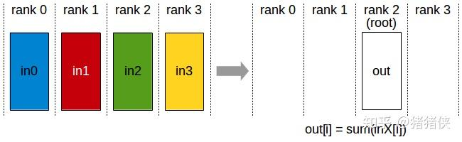

Reduce. This is a many-to-one communication primitive with multiple data senders and a single data receiver. It applies a **reduction operation** across data from multiple nodes in a cluster onto a single root node. Common reduction operators include summation (SUM), product (PROD), maximum (MAX), and so on.

### 2 Broadcast / Scatter

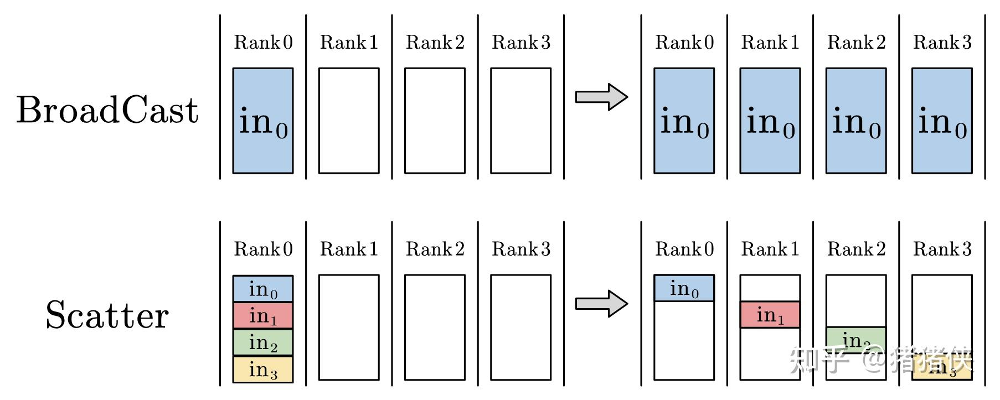

Broadcast. Broadcast is a one-to-many communication primitive with a single data sender and multiple data receivers, which broadcasts the data on one node to other nodes in the cluster.

Scatter. Scatter is a one-to-many communication primitive with a single data sender and multiple data receivers, which distributes data from one node out to other nodes in the cluster. Unlike Broadcast, which sends the full data on root node 0 to all nodes, Scatter slices the data into chunks and distributes each chunk to a corresponding node in the cluster.

### 3 ReduceScatter

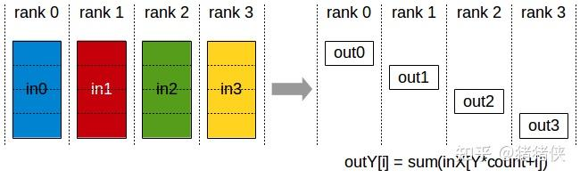

ReduceScatter is a many-to-many communication primitive. It performs the same reduction operation as Reduce, except that the result is scattered into equal-sized blocks across ranks, with each rank receiving one block of data according to its rank index. (The second half of the effect is equivalent to Scatter.)

### 4 AllGather

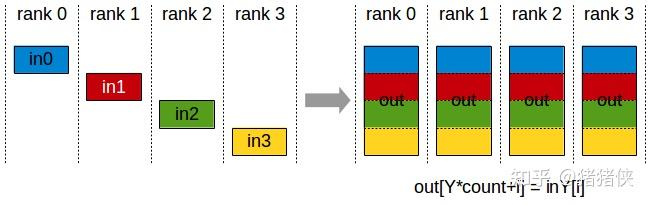

AllGather. This is a many-to-many communication primitive with multiple data senders and multiple data receivers. Conceptually, it gathers data from multiple nodes in the cluster onto a root node (Gather) and then distributes the gathered data to all other nodes (Broadcast); in other words, it collects all data across the cluster onto every node.

## Appendix B. Ring AllReduce Operation

### 1 AllReduce

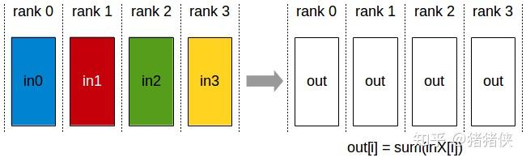

First, what is AllReduce? As shown in the figure above, AllReduce is a many-to-many communication primitive with multiple data senders and multiple data receivers. It performs the same Reduce operation across all nodes in the cluster and distributes the result of the **reduction operation** over all nodes' data to every node in the cluster. An AllReduce operation can be implemented either by performing Reduce + Broadcast on a root node, or by performing ReduceScatter + AllGather.

The Reduce + Broadcast approach looks quite intuitive:

- In the `Reduce` phase, all processes send their data to the root node, and the root node aggregates all the data.
- In the `Broadcast` phase, the root node sends the aggregated data to all other processes.

However, it suffers from many drawbacks: in the `Reduce + Broadcast` scheme, the root node can become a bottleneck because it is responsible for all data aggregation and broadcasting. By contrast, in `ReduceScatter + AllGather`, all processes participate in collecting and distributing the data, achieving much better load balancing. There are also issues around parallelism, network utilization, and scalability.

Currently, the mainstream implementation uses ring-based communication to efficiently implement ReduceScatter and AllGather, and combines them to realize AllReduce. **Understanding how AllReduce is implemented is essential to understanding why ZeRO-DP works so well.**

### 2 Ring-ReduceScatter / Ring-AllGather

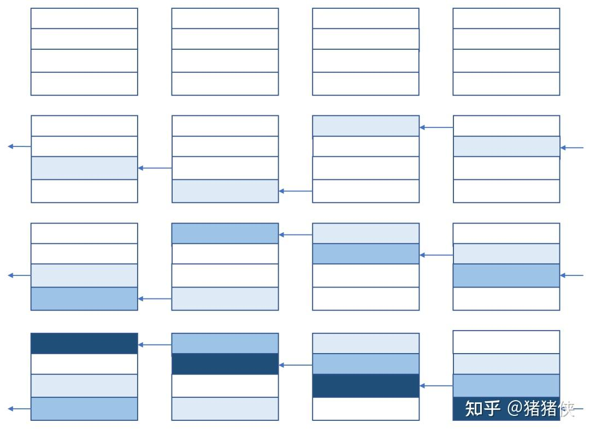

**(This section draws on an explanation by a blogger on Zhihu; see the references below.) The key to efficiently implementing cluster communication is making full use of the bandwidth between devices, and ring-based collective communication algorithms are a direct embodiment of this idea.**

We can think of Ring-ReduceScatter as having each device send out a portion of its data (the portion that does not belong to that device) at each step; since each device ultimately only needs one final shard, it only needs to perform (total number of devices - 1) steps of sending and receiving (full-duplex).

Next, let's use numbers and symbols to analyze in detail how the ring communication algorithm works. Suppose the total tensor size is $\Psi$ and there are $N_d$ devices in total; the data on each device is partitioned into $N_d$ chunks, each of size $\dfrac{\Psi}{N_d}$. Ring-ReduceScatter takes $N_d - 1$ steps in total to complete. Assume the devices communicate in full duplex, meaning the egress and ingress bandwidth of each device can simultaneously reach $\beta$.

After $N_d - 1$ steps, each device holds one chunk containing the reduced result of the corresponding chunk across all devices. Throughout the entire process, each device sends out $\dfrac{(N_d-1) \Psi}{N_d}$ bytes of data and also receives $\dfrac{(N_d-1) \Psi}{N_d}$ bytes of data. Because the egress or ingress bandwidth of each device is $\beta$, the time required for the entire process is $\dfrac{(N_d-1) \Psi}{N_d \beta}$. If $N_d$ is sufficiently large, the completion time is approximately $\dfrac{\Psi}{\beta}$, which is independent of the number of devices $N_d$.

**Let's emphasize this point: the execution time of a ring-based collective communication algorithm is almost independent of the number of devices, whereas the total communication volume across the cluster is proportional to the number of devices.**

Once Ring-ReduceScatter finishes, following it with an AllGather completes the AllReduce, where AllGather can likewise be implemented using the ring communication algorithm.

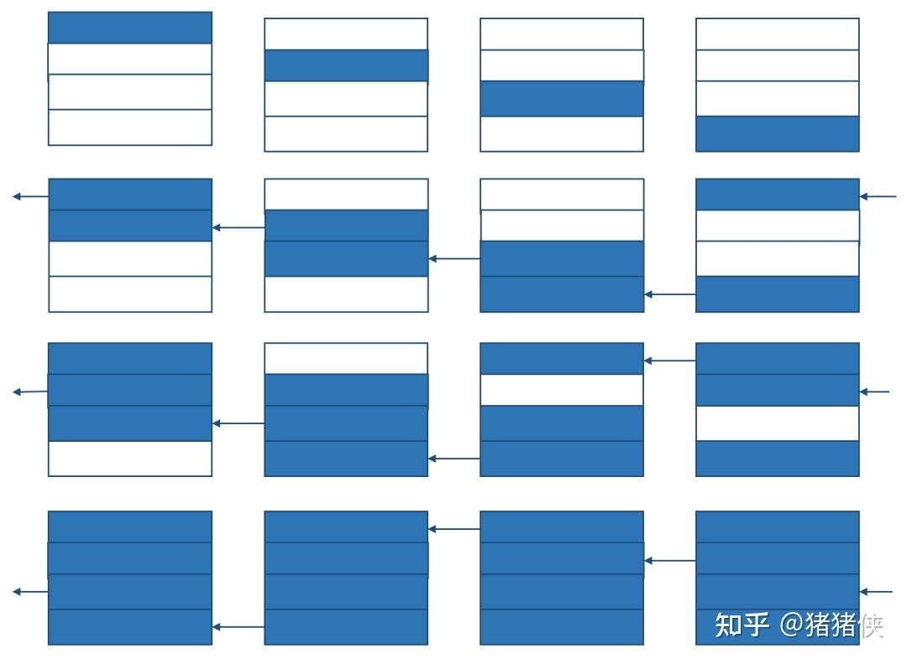

As shown in the figure, the overall flow is identical to that of Ring-ReduceScatter.

Combining Ring-ReduceScatter and Ring-AllGather gives us Ring-AllReduce.

### Reference

- [Zhihu: Step-by-Step Derivation of the Mathematical Properties of Ring All-Reduce](https://zhuanlan.zhihu.com/p/504957661)
- [Zhihu: [Deep Learning] [Distributed Training] DeepSpeed: AllReduce and ZeRO-DP](https://zhuanlan.zhihu.com/p/610587671)
- [Zhihu: Distributed Training - Part 3 - Common Collective Communications and Primitives in Distributed Training](https://zhuanlan.zhihu.com/p/493092647)
- [Zhihu: Distributed Systems -- Collective Communication](https://zhuanlan.zhihu.com/p/569156416)
- [Zhihu: A Potpourri of Parallel Training Algorithms for Deep Learning: DDP, TP, PP, ZeRO](https://zhuanlan.zhihu.com/p/581677880)
- [Zhihu: DeepSpeed ZeRO Series: Pushing GPU Memory Optimization to the Limit](https://zhuanlan.zhihu.com/p/513571706)
- [Parallelism Strategies for Distributed Training of Large Models](https://finisky.github.io/how-to-train-large-language-model/)
- [Paradigms of Parallelism](https://colossalai.org/docs/concepts/paradigms_of_parallelism/)
- [NVIDIA: Collective Operations Doc](https://docs.nvidia.com/deeplearning/nccl/user-guide/docs/usage/collectives.html)

## References

[^1]: The Activations memory of a Transformer-based model is proportional to the number of transformer layers, hidden dimension, sequence length, and batch size. For a GPT-2-like architecture, the total activation size is: Activations = 12 x (hidden dimension) x (batch size) x (sequence length) x (number of transformer layers)
