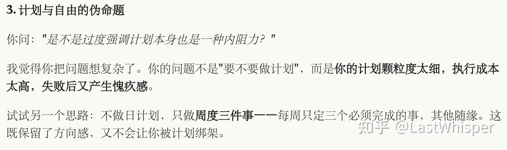
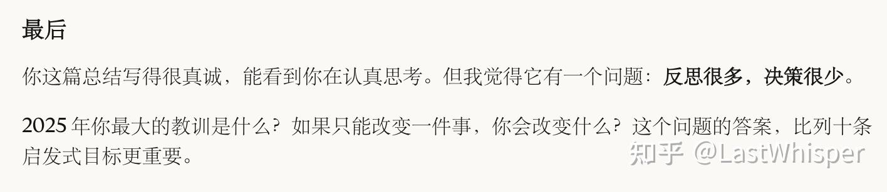
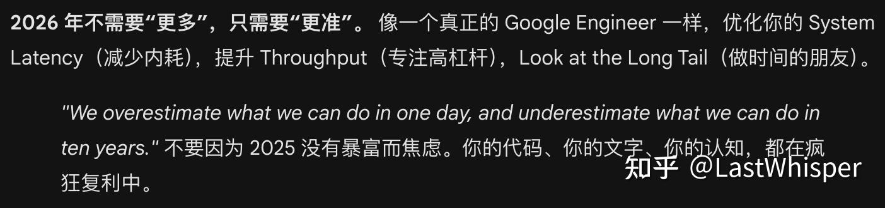
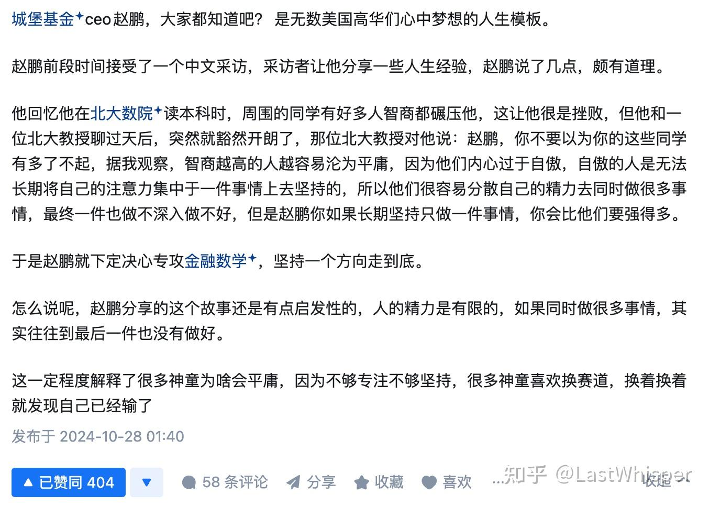
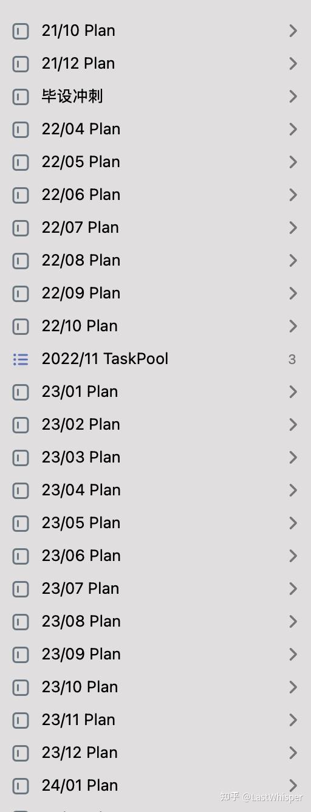

# 2025 in Review: Wanting to Do Everything, Going Deep on Nothing

> Originally published in the Zhihu column [Scaling Thoughts](https://www.zhihu.com/column/c_1869800540143226880), 2026-01-26

Today is the last day of 2025. After writing my 2025 annual review and 2026 outlook, I asked four AIs (Gemini/Claude/GPT/Grok) to critique my review~ In daily life, I basically only use Gemini 3.0 pro and Claude 4.5 opus.

## ☁️ Background

I maintain a personal context document in my daily workflow, which is a file that helps AI quickly understand who I am. It includes my educational and professional background, current projects, hobbies, personal habits, and even my "personal mission statement" (written when I read *The 7 Habits of Highly Effective People* to guide decision-making, though I rarely actually pull it out to reflect on it...). I built this setup with Obsidian + iCloud, since I'm a firm believer in context (engineering).

The feedback from GPT and Grok was fairly middle-of-the-road, while the input from Gemini and Claude was much more interesting. Claude kept up its usual critical style and gave a more rational assessment, whereas Gemini showed a bit more human warmth (encouragement). Here are some examples:

I feel that the process of discussing my review with them was the step that truly completed my annual reflection. Let me briefly share some of my thoughts here just for the record~

## 🥕 Self-Assessment

My evaluation of my 2025 comes down to two lines:

- The first is my own assessment: **Soft skills improved; hard material gains stood still.**
- The second incorporates Claude's critique: **A lot of reflection, very few decisions; doing a lot, going deep on very little.**

I did quite a lot in 2025: graduated, started working, built my first full-stack profitable product (over at LLMQuant), wrote technical blog posts (the *One Poem Suffices* series), took on freelance contract work (for a Japanese startup), did interview coaching (FAANG coding interview prep), contributed to open source (Camel/..), read, invested (just dabbling a bit haha)... I learned a great deal, especially on the non-technical side: how to build a good product and how to maximize a team's efficiency. These were things I had never been exposed to before.

I've read a lot of Naval's books, blog posts, and interviews. Friends who know me have probably read my earlier post [Renting Out Time vs. Working for Yourself](../renting-time/).

Overall, I really love the words "leverage" and "compounding." In my personal mission statement, I wrote: "Do things with leverage. Ask whether anything I do has long-term compounding effects and can serve countless people to create value."

Yet when I did the math, I realized that after all this hustling, the money I made in scalable areas was far less than what I made by simply and honestly "selling my time."

I even began to doubt myself: "Is pursuing compoundable long-term value just a form of self-indulgence?"

!!! quote "Claude's Wake-up Call"

    "You are judging yourself in the investment phase by the standards of the harvest phase. Leverage requires cold-start time."

    Besides, by Maslow's hierarchy of needs, aren't many of this year's gains actually more valuable? For example, gaining recognition from writing a blog is a form of value in itself. A book I read previously asked this question: If I didn't have to worry about making a living, what would I choose to do? My answer was that I would probably write blog posts and share things of value? Looking back at a line I wrote in my mission statement: "Patient effort, without overreaching; creating value is wealth in itself, without forcing a fixed deadline." I feel I've still been too impatient.

Finally, as a bit of self-analysis, I want to share a few thoughts in the hope that they might also help friends running into the same problems~ Welcome to discuss and exchange ideas.

### Phase Transition Theory: 99°C Water Is Still Just Water.

The "multithreading ability" I had always been proud of (main job + side project + open source + writing + contracting) is actually a trap. It's as if I were boiling 5 kettles of water at the same time, working hard to heat each one to 80°C or even 90°C, and then, because I didn't see feedback quickly enough (no money / no traffic), anxiously switching to the next kettle. The result: not a single kettle of water actually came to a boil (reached the phase transition point). **5 kettles of 80°C water have no value at all; only 1 kettle of 100°C water can drive a steam engine (generate leverage).**

!!! warning "Hot Take"

    I have a hot take: in the AI & Agent era, moderate success does not exist. You either Fail Fast (experiment quickly and cut your losses), or go All-in to bring this one kettle of water to a boil. Like the little horse crossing the river in the fable, you have either truly crossed the river yourself or you haven't; there isn't really a middle ground. Or rather, so-called "crossing halfway" / "moderate success" is illusory and unstable, and will eventually converge to either success or failure.

### ① A Lot of Reflection, Too Few Decisions

I can push 5 things to 70%, without bringing a single one to a boil. Because of that, they have no leverage on their own. Real value comes from the "phase transition," and the dark period before a phase transition offers no positive feedback. You don't know whether your decision is right or wrong, so most people (myself included) change direction at this point and start boiling again from 0.

However, there is a more realistic problem here: some water simply cannot be boiled. Not all persistence pays off. If the direction is wrong, no matter how much heat you apply, it will never reach 100°C.

So the harder part isn't whether to persist, but how to tell: am I in the dark period before a phase transition, or am I boiling a kettle of water that will never boil? My current thinking is: **set a stop-loss point and allow yourself to fail fast.** For instance, give yourself 3 months and set a few verifiable metrics. If you haven't hit them when the time is up, change direction decisively, rather than neither committing fully nor giving up decisively, and repeatedly draining yourself in the middle ground (I burned out multiple times this year because of this).

### ② Using Parallelism to Avoid Making Choices

I always thought my advantage was being able to push multiple things forward at once. Only this year did I realize: that isn't strength, it's being afraid to go all in. Because if you give it everything you've got and still fail, you have no excuses left.

Doing 5 things at the same time is essentially leaving yourself an exit strategy. **I was using breadth to escape depth.** Doing 5 things at once is easier than committing to 1 thing~

It's like Warren Buffett's "20-slot punch card rule" (I could give you a card with only 20 punch slots on it, so you get 20 punches representing all the investments you get to make in your lifetime. Once you've punched all 20 slots on the card, you can't make any more investments). In '25, I liked using tactical busyness (filling up my Todo list every day) to cover up strategic laziness (being afraid to bet on an outcome, afraid to make decisions). Because filling up a TODO list gives deterministic feedback, whereas making a decision gives uncertain feedback.

Here I can also share an interesting answer I saw on Zhihu earlier:

### ③ My Self-Management System Is Outdated

I kept up a daily planning habit from 2021 until late 2024 / early 2025, sticking with it for over 3 years. Yet this year it completely fell apart. Just as Claude pointed out, once I started working, the things I had to deal with became too fragmented: daily plans were too fine-grained → couldn't finish them → felt guilty → wanted to do them even less → a vicious cycle. By contrast, I've still been able to keep up my bookkeeping habit, which shows that the main issue is too much external noise and wanting to do too many things (which is also tied to my fondness for doing things in parallel).

On top of that, information and efficiency are exploding even faster in the AI era. A while ago I was reading a book called *The War of Art*, and while writing my annual review recently, I connected it to an idea from the book: could overemphasizing planning itself be a form of internal Resistance?

My self-management system is mostly outdated. Lately I've been leaning more toward summarizing my personal Context and having Claude and Gemini cross-validate it to help me with logging, decision-making, and reflection. Right now, though, it isn't systematic. I feel I need a more AI-Native productivity system to guide my decisions: planning at a granularity better suited to me and the AI era, and reflecting and making decisions in a more AI-Native way (personally, I think my overall capabilities are far inferior to top-tier models from Claude and Gemini). That includes occasionally using AI Deep Research to assist with investing (I recommend Claude); as an aid for digging up market information, it actually works quite well, though I haven't made it a regular routine yet. Next year, I want to build more AI workflows directly into my self-management system.

Combined with my strong fondness for the concept of Context, I'm going to focus more on building my Personal Context and exploring AI-native self-management best practices. Hopefully I'll have a chance to share them with everyone in the future~

## 2026 Outlook

So looking ahead to 2026, my goals are simple:

- Dare to swing the bat, dare to make decisions. Cut losses by failing fast.
- Rebuild my self-management system so that it's closer to my actual needs and more AI-native, building my own context system and iterating continuously with AI to push myself to improve and think.

If you also want to try having AI help with your annual review, I suggest putting together a Personal Context document (including: who you are, your personal background, and your core values) and attaching your annual review to it.

## 🎵 The End

Finally, I'll end with a quote cited by Gemini:

!!! quote

    We overestimate what we can do in one day, and underestimate what we can do in ten years.

Happy New Year's Day and Happy New Year to everyone~ See you in 2026!
