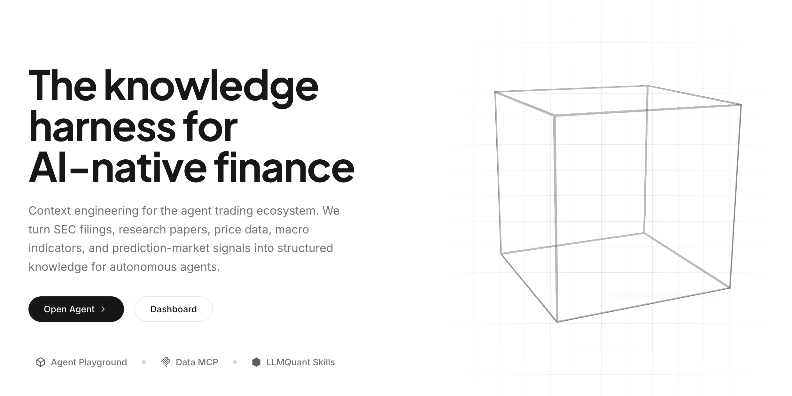

# Scaling Thoughts: Blogging, Aesthetics, and Taste

I recently set up my own blog site: [lastwhisper.dev](https://lastwhisper.dev). Thanks to Astra and Fable, the whole site is in a style I love. On the homepage, I wrote a line: "Some say that in the age of AI, taste is the part of being human that is hard to replace." This feels like a good opportunity to talk about blogging, aesthetics, and taste.

*Each of the four series has a hand-drawn style icon, and the footer is a gently flowing river.*

*A sticky note, a sprout, a cloud: the icons for the admonition blocks in the body text were all redesigned.*

*Stacked stones, a bell, a picture frame, a speaking figure, a candle, a mountain with a flag.*

## Blogging

I didn't expect that I would end up building my own blog site after all—a place to showcase taste. In a way, I'm grateful for this era. My earliest blog posts were written on cnblogs; many people might feel that "cnblogs" is already a very ancient word. Back then, limited by my own skill level, the platforms I wanted where I could DIY weren't fully open, and I didn't yet have the skills to build a site from scratch.

Many friends have told me that in today's world, especially as AI becomes more widespread, more people will lean toward video, then podcasts, and only last what we call print media. And blogs and essays have to line up behind even more fragmented forms of text. In short, writing a blog is very low priority, and very few people will read it.

When I was a kid, we had a few books at home—I don't remember whether they were *New Concept Composition* or *New Concept Prose*. The word "prose" broke into my mind back in elementary school, and at that time, prose meant something sophisticated to me. Later on, anyone who competed in ACM (a collegiate informatics competition) should be no stranger to writing blog posts. In the era before AI, you had to constantly reflect and write up problem solutions, just like keeping a notebook of wrong answers. When you ran into a problem you couldn't solve, you had to look for solution write-ups, but I couldn't really understand most of them either. Those problems that sat somewhere between half-understood and not-quite-understood were the most suitable for turning into solution blog posts. So my early blog recorded a huge number of Codeforces solution write-ups, round after round. That was probably how I first formed the habit of blogging.

"In all things, preparation leads to success, and lack of preparation leads to failure." Writing things down and keeping records always gives me a bit more of an inner sense of fulfillment. This feeling is metaphysical—more a satisfaction of self-awareness. But it was precisely these two things that gave me the habit of keeping records. Back in my student days, I used to plan my daily To-Do list; friends who have read my other blog posts know that I kept up thorough plans for about two or three years. Back then I used Microsoft To-Do. It wasn't designed very well, but every night I would plan out what I needed to do the next day.

???+ note "Side Note: Parallelism and Frenetic Burnout"
    Later I realized that it was easier to make plans during my student days because there weren't many unexpected events. During grad school, I asked my manager from my AWS AI internship (who is a very important life mentor to me): "Once people start working and grow older, do they have fewer things they need to run in parallel?" Back then I didn't really like parallelism, because once things ran in parallel, it was hard to plan. I never expected that I would now become a severe parallelism patient. Why do I say "patient"? Because a lot of the time I inexplicably want to take on several things at once, and when there's only one thing, my efficiency actually drops. The Agent era both amplifies this ability and has adverse effects on it. A more standard term might be: frenetic burnout.

In any case, I started writing blog posts on and off. Blogging is a pretty interesting thing to me; its positive feedback loop is very fast, and as soon as I finish writing, I feel satisfied. Blogging also taught me how to keep records, and I never expected that in the Agent era, records would turn into valuable context.

!!! info "Ego: Context About Myself"
    As I've mentioned before, I have a context about my own life named Ego. Weekly journals, screen time, sleep hours—I record all of them there, either automatically or manually. With iCloud, I can jot things down anytime on both my phone and my Mac; I also host a Mac Mini, so I can remotely have Codex or Claude on it do some immediate thinking and exploration, or leave tasks for it to analyze for me, and I also set up some automations, like generating a morning briefing every day in combination with Ego.

My first *One Poem Suffices* post was written in 2020. At the time, I was learning Fenwick trees (a type of data structure), and on a whim I drew some diagrams (back then I loved using AxGlyph to draw diagrams) and wrote a detailed tutorial. Now I've kind of forgotten the code for Fenwick trees, haha. As for my first AI-related blog post, it was an article about [ZeRO (DeepSpeed)](../../one-poem-suffices/zero/). That was a small take-home exam from when I interviewed for an internship at Microsoft Research Asia. Because it was written pretty well, my mentor at the time suggested I publish it as a blog post—maybe someone would like it (thanks to my mentor). Along the way, I also submitted and merged a [PR](https://github.com/deepspeedai/DeepSpeedExamples/pull/843) to DeepSpeed. Looking back now, I might be better suited for AI Infra. After all, I had just jumped from an AI framework internship to an internship involving both training and inference (at the end of 2023, heavily modifying vLLM). But that's a story for another time. In short, writing blog posts pushed me to keep learning, a bit like the Feynman Technique.

## Aesthetics

Even before I started blogging, I noticed that I had a certain love for design. I like optimizing "visual" content and designing it to be more beautiful—or rather, in line with what I consider beautiful. Back in undergrad, I loved tinkering with my LaTeX resume. I won a national award in mathematical modeling, and I also liked making nice-looking figures. Making a diagram or optimizing a design detail is something I can immerse myself in for three or four hours. Even though it's not my major, I can at least say I have a fair amount of passion for it. You can take a look at the illustrations in my blog posts, the visualizations on my blog website, and the products I've designed.

Putting aside how the product itself turns out, all the page details were designed by me. I think there is still a bit of a difference between this and something generated directly by AI; there are certain details I polish over and over again.

So I found that the pursuit of aesthetics is a bit like writing a blog. My blog series is called *One Poem Suffices*. I hope my blog posts are self-contained and self-explanatory. Any confusion a reader runs into while reading can be answered right away, or guided: either I tell you it will be covered later, or I can't answer it right now, but I remind you to look for it elsewhere. This is also because, as a reader—especially before the AI era—I searched for and read a lot of blogs, and coming across a good blog post made me very happy. A good blog post can mean a great deal to someone.

!!! ambition "An Amplifier of Value"
    If a good blog post takes me five hours to write and can save each reader ten minutes, and I have ten thousand readers, then that saves a hundred thousand minutes.

So I'm willing to polish my blog posts, just as I'm willing to polish those aesthetic designs. Making visualizations is the same thing. In the early days without AI, making visualizations was more tiring, but brought a greater sense of accomplishment. As the saying goes, a picture is worth a thousand words—the information density a diagram brings is far higher than text, which is also why people prefer watching videos; of course, I mean well-crafted videos here. Both writing blog posts and making diagrams are processes of constant refinement. In the process of refining, you keep asking yourself—or at least I do: **From the reader's perspective, does the logic flow smoothly here, can this spark some thought for people, and might this leave someone feeling confused?**

## Taste

The age of AI inevitably makes people restless, and I went through a period of growing pains myself. For a while I felt very lost because I was relying too much on AI. I didn't even know whether those articles were my own thoughts, or if I was merely using my own hands to pass AI's thoughts along to everyone. As Agent capabilities grew stronger and stronger, I actually became less anxious, because it is already close to a wish-granting machine. But I realized that my blog should be the questions I want to ask, what I should polish are also the questions I want to ask, and those questions should also be the ones everyone wants to ask. Through this perspective, can I tell certain stories clearly, or at least make sense of them for myself? Just like building a product, at the very least you have to like the product yourself.

!!! important "My Requirement for Myself"
    At the very least, I have to like this blog post myself, and it has to be valuable to me, rather than being pure reposting, pure translation, or something where I can't even be sure of some of its details and claims myself.

Perhaps this is my principle for writing blog posts, and it should also run through the way I do things. Of course, this is something I'm continually learning too, because the age of Agents inevitably makes people restless.

This is also a fortunate era. In the past, I could hardly have talked about doing design, but as I see it now, for a layperson like me, collaborating with AI on design is transferring from one latent space to another. What I have in my head are mostly abstract ideas; I try my best to describe those abstract ideas, transfer them into another latent space, have the model generate from there, and then I do the filtering. Maybe just a few years earlier, I couldn't have made the blog I wanted at all. But at least for now, I'm pretty satisfied with this blog, and I quite like most of the details.

*Projecting from high-dimensional Code Space to low-rank Pattern Space; figure taken from [Claude Code Distillation in Practice](../../zen-of-harness-engineering/claudecode-distillation-practice/).*

The process of polishing also happens to hone taste. At least right now, the vast majority of people say that **taste is the most important ability in the age of AI**. However, when it comes to "taste," I've gone from initial certainty to feeling somewhat at peace with it now. Because under AGI, your so-called execution ability and thinking ability cannot compare to it. So you have no choice but to get a bit "philosophical": you throw out something that is inherently hard to evaluate—so-called taste. I've repeatedly brought up the concept that an open-ended problem has a huge action space, and good taste can optimize that path. That was something I used to be sure of, but I've gradually come to feel that the optimization here is relative to the individual—essentially, you just want it to align with you. After RSI (recursive self-improvement), human taste may essentially be a limitation. Humans cannot imagine things they have never experienced; just as *The Bitter Lesson* says, such prior knowledge is essentially a constraint on AI.

!!! question "So After Tomorrow"
    Perhaps taste is just a trait of humans themselves. Relatively speaking, it will at least be the last one to be swallowed up.
