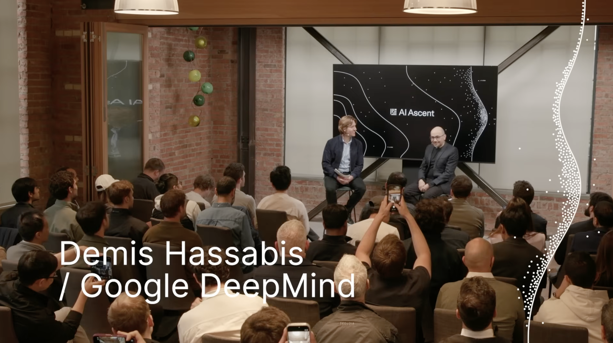
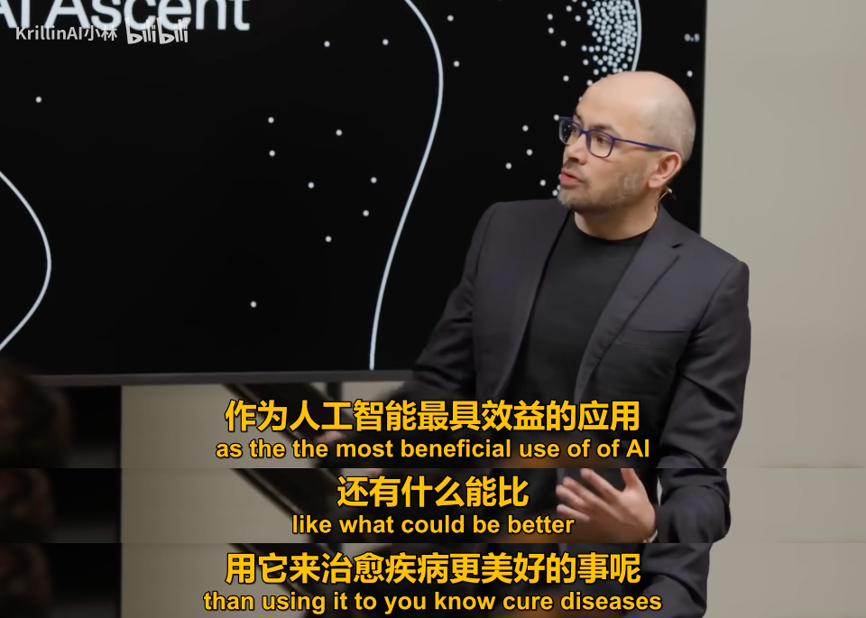
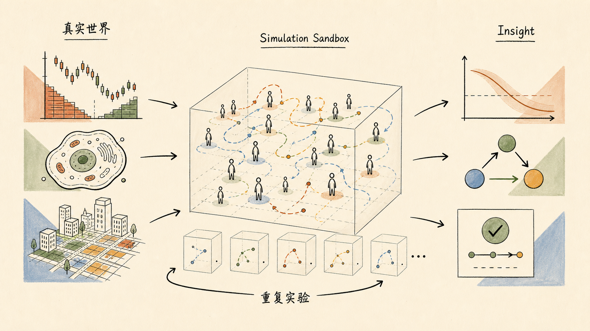
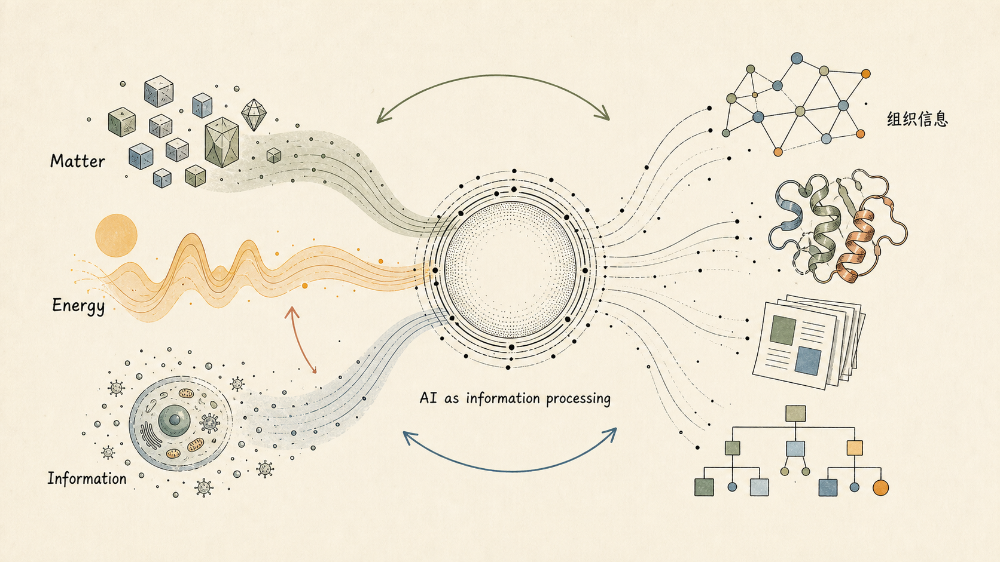
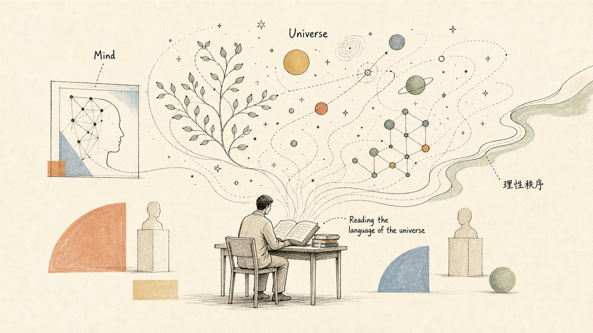

# When AI Becomes a Way of Understanding the World: Notes on a Demis Hassabis Interview

> Originally published on Xiaohongshu / the Zhihu column [Scaling Thoughts](https://www.zhihu.com/column/c_1869800540143226880) on 2026-05-10. A few personal notes on Demis Hassabis, written mostly on the spur of the moment; please forgive any lack of rigor.

<i>Demis Hassabis at Sequoia AI Ascent 2026</i>

> *"Doing AI is like reading the language of the universe."*
>
> — Demis Hassabis

Personally, I have always been a fan of long-form interviews. Starting in 2025, I've watched most of the sessions from Sequoia's AI Ascent, and the overall quality is very high. For me, the most valuable part of this kind of interview is not just getting information, but briefly stepping into the vision and insights of top figures in the industry (I get to engage with and absorb their firsthand thinking directly).

Without intending to put down any other guests, interviews with Demis Hassabis (CEO of Google DeepMind) feel quite different to me from those of many others. They combine depth and breadth, while carrying a humanistic touch and philosophical undertones. Anyone who has watched his interviews has probably felt something similar.

Of course, some people complain that interviews with Demis always spend a lot of time repeating his personal background: games, his entrepreneurial history, AlphaGo, AlphaFold. But compared with many AI interviews that lean more toward product, engineering, or organizational evolution, such as figures around Claude Code, Andrej Karpathy, and others, Demis gives me a more "expansive" feeling.

That is not to say other interviews aren't important. They are extremely valuable, and my insights on Agent Engineering draw nourishment from them: on the future of agent products and organizational forms, on the capability boundaries of agentic coding, and on which human capabilities will matter more as agents grow stronger. But Demis's way of expressing himself (or rather, his own way of understanding things) feels more like placing AI back into a larger coordinate system: science, medicine, life, information, and how human beings understand the world (with a touch of philosophy).

In this interview, there were roughly four points I wanted to jot down:

## 1. His Vision for How AI Should Be Used

Demis says that his personal motivation for building AI is to advance science, medicine, and our understanding of the world. His line of thinking is a bit **"Meta"**: first build a sufficiently powerful intelligent tool, and then use that tool in turn to drive scientific discovery. After AlphaFold, this vision is **no longer just a grand narrative; it already has a real-world foothold**.

<i>"What could be better than using AI to cure diseases?"</i>

> I'd been waiting for the algorithms to become powerful enough and the ideas general enough. For me, mastering Go was that moment. At that point we felt: okay, now we're ready to apply these ideas to important real-world problems, especially major scientific challenges.
>
> We've always believed that this is the most beneficial use of AI. What could be better than using AI to cure diseases, help people live healthier and longer lives, and advance medicine? And of course, after that there are other critically important fields, such as materials science, the environment, energy, and so on. I think AI will play a huge role in those areas over the next few years as well.

## 2. His Understanding of Simulation

He said he has always loved simulation, and was already building simulation systems back in his early game-making days. And in the future, AI for simulation may open up new kinds of science. Hearing this struck a chord with me all of a sudden, because the project I worked on during my MSRA internship was called **MarS (Large Market Model for Market Simulation)**, with the hope of using it for backtesting, risk control, and so on. Before, I probably thought of it more as a specific research project, but after listening to Demis, **I suddenly felt that simulation itself is actually fascinating**.

In the real world, many systems are very hard to subject to controlled experiments. Economic systems, market systems, social systems, and even biological systems, for example. You cannot adjust interest rates a thousand times and rerun the real world from scratch each time; nor can you arbitrarily alter a complex market environment just to observe the effect of a single variable.

What AI simulation offers, however, is another layer of capability: it does not necessarily require us to write down complete, exact equations first, but can instead learn an implicit simulator from data, allowing complex systems that originally could not be strictly experimentalized to be repeatedly sampled, compared, and tested inside a simulated world. In a sense, it is building a runnable shadow sandbox for a complex world (World Model || World Sandbox).

<i>From the real world to a simulation sandbox: repeated sampling in an implicit simulator to gain insight</i>

One scenario I've been thinking about myself is having a sizable number of agents play investors of different styles, simulating the transmission path after certain orders or pieces of news enter the market. It also suddenly reminded me of the virtual fly project that Janelia and Google DeepMind collaborated on. Here is what Demis mentioned in the interview:

> We're working on something I call a "virtual cell." A cell is an extremely dynamic, emergent system. I think machine learning is the perfect language for describing biology, just as mathematics is the language for describing physics.
>
> In biology and many natural systems, you have lots of weak signals, weak correlations, and massive amounts of data, far beyond the scale that the human mind can analyze. Yet within that data, there really are connections, correlations, and interesting causal relationships.
>
> So I've always felt that machine learning happens to be the perfect tool for describing systems like this. And up to today, mathematics hasn't been able to do that. The reason may be that these systems are too complex even for top mathematicians, or it may be that mathematics lacks the expressive power needed to understand such highly emergent, dynamic systems.

## 3. His Understanding of the Relationship Between Information and AI

Demis mentioned that energy and matter are of course important, but he tends to think that **information may be a more fundamental lens for understanding the world** (Demis has talked about a theory that the basic building block of everything in the universe may be information). Biological systems in particular can essentially be viewed as information-processing systems that push back against increasing entropy. Seen from this angle, the significance of AI is not just that of an automation tool, but of a system for organizing, understanding, and constructing information. It also reminded me of what Ilya said earlier: "Compression is intelligence." I'll include the translated passage of Demis's remarks directly here, as I find it very insightful:

<i>Matter / Energy / Information — AI as information processing</i>

> Einstein's E=mc² and his work on energy and matter are famous. Energy and matter are, in a sense, equivalent.
>
> But I think information has a similar kind of equivalence. You can understand the way matter and structure are organized, especially living things that resist entropy, as being essentially information-processing systems.
>
> So I think these three quantities are, in a sense, interconvertible. But I have a feeling that information is the most fundamental.
>
> That's somewhat the opposite of what classical physicists in the 1920s thought. Traditionally, people would take energy and matter to be primary. But I think starting from information to understand the world and the universe is a better approach.
>
> If that's true—and I think there is a considerable amount of evidence supporting it—then the significance of AI is even deeper than we imagine. And it is already very deep to begin with. Because AI is also about organizing information, understanding information, and building informational objects.
>
> In my view, AI is essentially information processing. So if you look at it from the perspective that "information processing is the primary way of understanding the world," you find very deep connections across these different fields.

!!! note "A Contrast with Karpathy's Perspective"

    I find this part very profound, though I have to say I don't fully understand it. It also reminds me of Karpathy's discussions of Software 2.0 / 3.0: when "information" becomes something machines can directly process, generate, and organize, the form of software itself changes too. Still, Demis is talking at an even more foundational level here, not just about the form of software, but about **the relationship between AI and the way we understand the world**.

## 4. The Philosophical Part

He mentioned Kant and Spinoza. The former was concerned with how the mind organizes and interprets the reality of our experience, while the latter was closer to a kind of spirituality that understands the order of the cosmos through reason and science. Demis said that **doing AI and science is, in a sense, "reading the language of the universe."** That line is a little romantic, yet it fits the impression he gives very well: he doesn't feel like a purely commercial CEO, nor merely a technical leader; at times you come to see him as a deeply visionary thinker.

<i>Reading the language of the universe — mind, science, and cosmos</i>

So I feel that watching an interview with Demis really is a different experience from watching many other AI interviews. Other interviews may help me better understand how a product evolves, how an organization adapts to agents, or what capabilities an engineer will need in the future, and I really have learned a lot of best practices from them; but an interview with Demis briefly lifts me from "how AI changes work" to "how AI changes science, and even changes the way human beings understand the world" (I vaguely remember the first time I flipped through DeepMind's OKRs; even just reading them was thrilling), even though it doesn't immediately improve my efficiency or methodology.

Yet Demis's interviews always leave me stirred, perhaps because simply feeling, in such a direct way, that **someone is trying to widen the boundaries of humanity** is already captivating enough.

---

!!! tip "Further Watching"

    Two recent Demis-related videos I've watched and found well worth seeing:

    - [**AI Ascent 2026 Demis Hassabis: We're Three Quarters of the Way to AGI**](https://www.youtube.com/watch?v=AFpeWo1GTeg) (Sequoia Capital · YouTube)
    - [**The Day After AGI**](https://www.youtube.com/watch?v=mmKAnHz36v0) (World Economic Forum Annual Meeting 2026)
