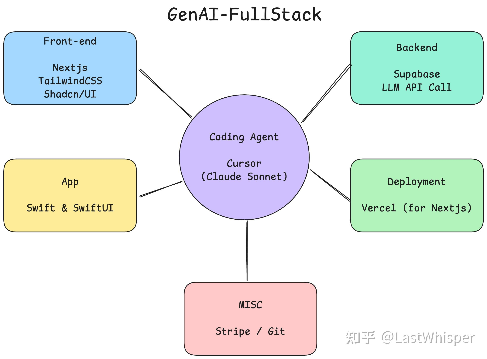

# Scaling Thoughts: Full-Stack Development in the GenAI Era

> Originally published in the Zhihu column [Scaling Thoughts](https://www.zhihu.com/column/c_1869800540143226880), 2025-02-27

I've been doing some full-stack work recently. As I mentioned in an earlier blog post, full-stack development as I understand it is going to be reshaped into a new paradigm in the GenAI era. I'd like to exchange ideas with everyone on what new productivity tools can be integrated into our workflows, along with pitfalls and tips worth noting.

To get the conversation started, here is my workflow:

**Requirements:** This is a core step that is easily overlooked. Be sure to distinguish between whether you are building something just for fun or to create economic value. It's best to start from your own needs: if you wouldn't even use the product yourself, how can you sell it to other users? Requirements dreamed up out of thin air are usually unreliable.

**Design Doc:** Although "writing documentation" is sometimes seen as a waste of time, and people (myself included) tend to jump straight into coding when inspiration strikes, I recommend cooling down first and writing a design doc. Cover things like the problem you need to solve, user personas, rough software architecture, and tech stack choices. This helps you avoid realizing too late that you've walked into an unsolvable problem, and these docs also serve as your personal knowledge base.

**Frontend:** v0 + bolt.new => Next.js + TailwindCSS + Shadcn/UI (AI is really good at writing this stack, and the aesthetics are quite solid)

**Backend:** Supabase (what I'm building right now is just that simple, lol). I haven't explored this part deeply; most tasks can be handled through API calls.

**Coding Agent:** Cursor (Claude Sonnet)

**App:** Swift (focusing on native, though it seems people recommend Flutter more often?)

**Deployment:** Vercel (paired with Next.js, I think it's top 1)

**MISC:** Stripe / Git

!!! note "Learning Advice"

    This tech stack has a relatively low barrier to entry. Simply put, you only need to grasp basic React syntax (I recommend the official tutorial), and the rest can be left to Cursor for assistance. Learning by doing is the best way to approach full-stack development.

My current mode of working and learning places more emphasis on learning the fundamentals + using more efficient, advanced tools and models. Why the fundamentals? Because they let you write more precise prompts, and when AI fails end-to-end, you can step in manually to solve the problem alongside the AI.

Prompt engineering has huge potential. For most tasks, existing models paired with high-quality prompts are more than enough. I've found that one of the factors affecting efficiency is prompt management. Even though it's essentially just text storage, maybe I could build a more efficient prompt tool?
