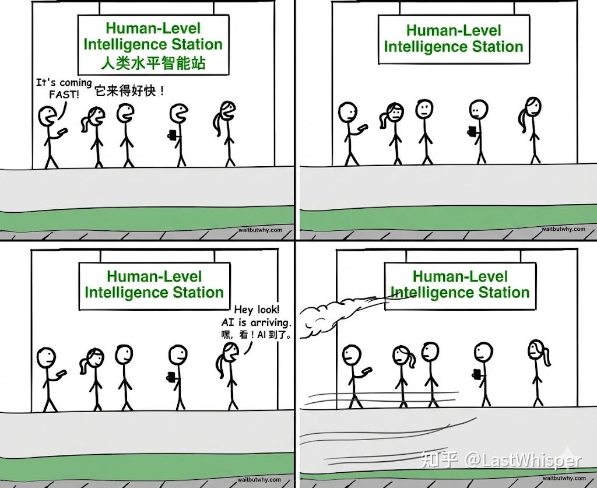
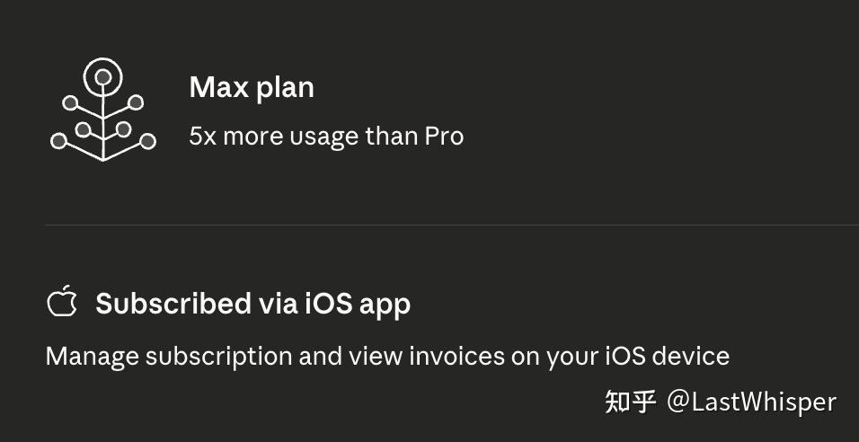
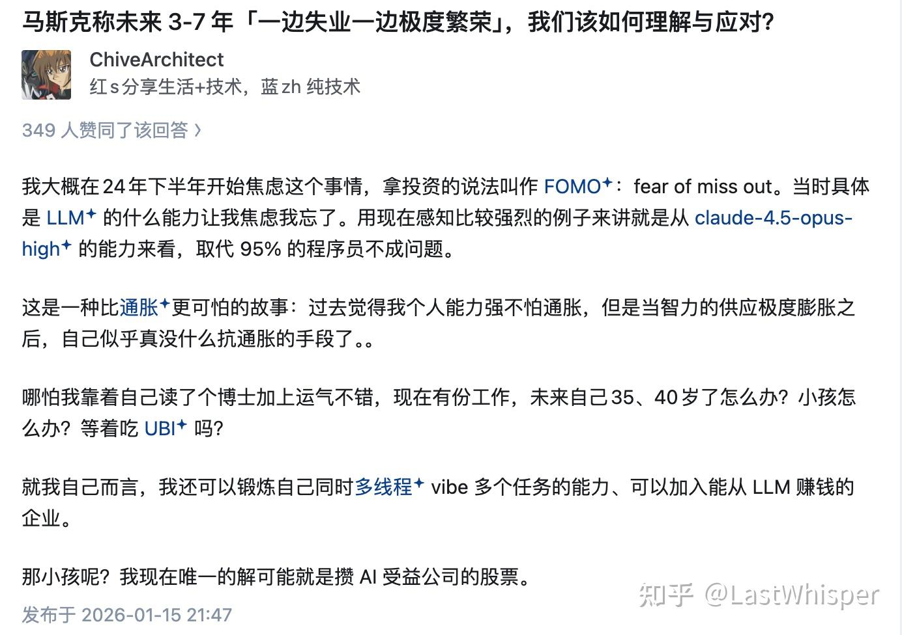
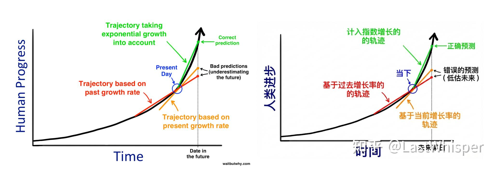
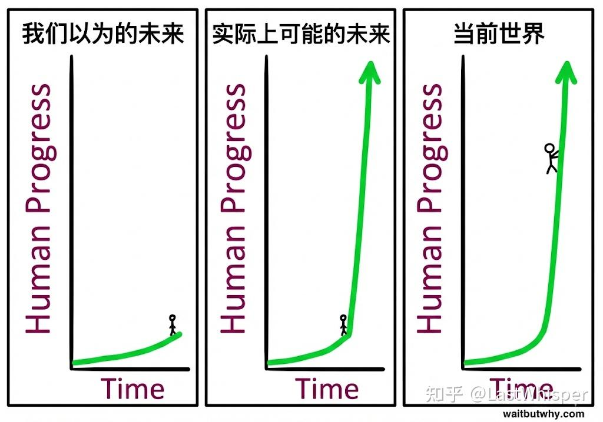

# Scaling Thoughts: When Tokens Become a New Means of Production

> Originally published in the Zhihu column [Scaling Thoughts](https://www.zhihu.com/column/c_1869800540143226880), 2026-01-17

<i>"Wait but Why" | The AI Revolution: Our Immortality or Extinction</i>

> I've started to wonder: is what limits my productivity actually my ability, or how many tokens I'm willing to burn?
>
> The intelligence-to-price ratio of tokens is rising exponentially, and they can be parallelized; human capacity is constant, and can only run serially. Once that ratio crosses a certain singularity, the bottleneck of productivity shifts from "time" to "token usage."

🥕 **Preface**

This post will refer several times to the classic blog series *The AI Revolution*. To make it easier to read, I put together a remastered bilingual PDF version (Part 1 of 2), which I highly recommend.

I'm combining a few small recent thoughts here to keep a record of them (some of this has already been posted in bits and pieces on Zhihu). There are three small topics:

1. My AI coding setup: why Claude Max?
2. My thoughts after my Claude Max account got banned, and how I was able to keep using Claude after stumbling into a strange bug.
3. Some reflections sparked by an answer I saw about how AI affects human beings.

## 1. Investing in AI Coding

First, I paid for an Ultra/Max-tier AI service for the first time: Claude Max 5x, billed through the Apple Store at 125 USD a month.

Previously, I had been using Codex, Claude Code, and Cursor together, but I found that my main driver was still Claude Code (referred to as CC below). Codex gives good results, but the wait is too long. Cursor gets routed after you use up the $20 credit, and I feel it's better suited for when I'm fine-tuning a project (taking over manually). Opus 4.5 in CC combines both quality and speed, making for a very smooth experience. The only issue is that the Pro plan allowance is too small. After hitting the 5-hour limit and waiting it out twice, I decided to subscribe to Max for a while to see whether my efficiency could scale further as my token usage scaled. If it could, this would actually be a high-certainty investment (this was my view a while back, during a period when I was trying to use AI to process all the information in my life: self-reflection, project management, fitness/diet/investing, though I later found having an API is still more convenient haha). It also coincided with the release of Claude Cowork, so I could try that out too.

Current main driver for AI coding: Opus 4.5

- For some complex problems, I'll try Codex 5.2 xhigh
- For some web dev / aesthetic styling work, I'll try Gemini 3.0 Pro
- For quick questions, I use Gemini 3 Flash (my recent experience with it has been great, very fast), and occasionally Sonnet 4.5.

Last month my Claude Code usage came to $82.80, and I built two small projects. This month I'm aiming to build an open-source project on context engineering, a few small projects, and a blog post related to Agent Skills.

??? info "About Gemini 3 Pro"

    Honestly, Gemini 3 Pro really has some issues. It might be due to a sliding context window, which makes its performance in certain scenarios even worse than 2.5 Pro. It's strongest at one-shot tasks, and the more context accumulates, the more likely it is to fall flat. If only my company would let me use Opus 4.5 TAT (I remember folks at Apple and NV can use Opus).

Right after subscribing to Claude Max, I had grand ambitions and ran three CC windows in parallel, writing code for 2 to 3 hours.

## 2. Getting Banned from Claude, and How It Felt

The next morning, I found out my account had been banned. Before subscribing, I had been using it normally for a year, and it was tied to a Gmail account I'd used for 7 or 8 years. My immediate reaction was frustration and confusion, though this was actually the second time I'd been banned. The first time was because my Apple Store balance ran out, the renewal failed, and they banned the account outright.

I immediately filed an appeal and wrote a lengthy plea, even though I knew the odds of getting unbanned were slim. Then I went to Apple to request a refund. At that point, I felt a kind of withdrawal reaction, as if my productivity had plummeted without CC (though in reality, using Cursor + Codex would probably be about the same). It was a strange feeling, like a part of my thinking ability had been downgraded, so I felt somewhat anxious and badly wanted it back. That state lasted for about an hour, during which I frantically searched for possible reasons for the ban and whether others had run into the same situation.

I had always kept a backup free Claude account ready. At the time, I just wanted to quickly test whether that account was still alive, so I logged into it on the iOS app. Then a strange bug happened: my free account directly inherited the Claude Max Plan, with a refreshed quota.

!!! note "Follow-up thought"

    Thinking about it afterward, I realized there might be some odd link between Claude and the App Store. If I had logged into the new account on the web version first, maybe this wouldn't have happened?

## 3. AI Coding and the Future

A few days ago, I happened to come across an answer by @ChiveArchitect

It suddenly set off the following train of thought (just rambling):

The capability of Opus 4.5 + CC has crossed a certain threshold. I even feel that the coding efficiency of a multi-person team isn't as good as me + CC. But taking it a step further, why does it have to be me + CC? Right now, you could say I'm needed to "supervise" and fine-tune the final result, but what about later on? Maybe only people who can achieve **Human + AI > AI** will be irreplaceable. On the other hand, Anthropic is clearly getting close to their original goal: judging from their blog posts (for example, "Collaborate with agents like Claude Code to automatically increase the performance of your tools" in "Writing effective tools for agents — with agents"), what they are pursuing is self-iteration where agents optimize agents. I feel CC has already partially achieved this effect (CC is iterating faster and faster).

A while ago, when I was writing some code, I marveled at how something that would have taken me 2 or 3 months to prototype a year ago now only takes 1 or 2 hours. In the future, human value may lie much more in **taste**. When it comes to coding, most people use AI coding, and I find it hard to believe I'm stronger than CC; when it comes to knowledge sharing, it might be processed by NotebookLM, and in terms of breadth of knowledge, I find it hard to believe I'm stronger than Gemini 3.0/3.5 Pro. Yet given the same content and the same AI, different "taste" determines the quality and popularity of the output. Aside from that, I've always felt Anthropic has great taste (which you can glimpse from their docs, blog posts, and aesthetic design).

One of the few things that might give people back a "sense of control" is investing. On one hand, as long as there are people, there will inevitably be a tradable market, so there's no need to worry too much about investing becoming a useless skill. On the other hand, investing across the whole AI supply chain gives you the comforting feeling of being "on board." Beyond that, all that's left is to "experience" it: to feel AI stride right past me and immediately vanish from sight. (This reminds me of the famous two-part blog series *The AI Revolution*, written in 2015. Highly recommended reading; I made a bilingual PDF of it.) Here's an image translated by Gemini along with a few points from the post:

1. When it comes to history, we think in straight lines. When we imagine the progress of the next 30 years, we look back to the progress of the previous 30 as an indicator of how much will likely happen.

2. The trajectory of very recent history often tells a distorted story. First, even a steep exponential curve seems linear when you only look at a tiny slice of it, the same way looking closely at a tiny segment of a huge circle looks almost like a straight line. Second, exponential growth isn't totally smooth and uniform. Kurzweil explains that progress happens in "S-curves."

3. Our own experience makes us stubborn old men about the future. We base our ideas about the world on our personal experience, and that experience has ingrained the rate of growth of the recent past in our heads as "the way things happen."

---

A long time ago, when I chatted with a lot of people (at foreign tech companies), I noticed that quite a common path to success was: job + investing (quant). I feel it's still pretty much the same now, maybe adding "fitness" (to hang in there a few more years) and "personal branding" (since AI favors super-individuals), and then waiting for the day Coding Agents replace me. And it's not just me. Most traditional SWEs I've talked to, including some Staff Engineers, share a similarly pessimistic attitude. The irreplaceability of coding skills is being deconstructed by Coding Agents; regardless of whether Coding Agents can replace senior engineers end-to-end, the value of those skills will be heavily diluted. Of course, I might be missing the forest for the trees. There is more to the world than tech, it's just that the raw shock of it can numb your very ability to think.

I use AI for self-management, financial analysis, fitness coaching, and writing code. If I had unlimited Claude && Gemini API tokens, I feel I could reach an even more absurd level of productivity. It's a bit like a question I thought about a long time ago: **"More money brings more compute, more compute brings stronger productivity, and tokens have become the new means of production"**—a positive feedback loop like that. So in the future, will the scaling of token usage determine the scaling of productivity? What I haven't quite figured out yet is: as AI develops, intelligence inflates, and technology is democratized, where will this so-called increase in productivity actually earn "money" from? Or in the future, will compute, electricity, and tokens in a broad sense become more valuable than "money"—or even become "money" themselves? (Right now I feel that without CC, my efficiency is nowhere near what it used to be; getting banned a while ago suddenly made me think about this: compared to the subscription fee I pay for CC, what I care about much more is having CC available at all times.)

## 4. The End

There's actually a lot more that could be said, and I'm sure everyone else has plenty to say too. The more AI I use, the more dazed I feel. On one hand, I feel the limitations of the individual: if you view tokens as units of intelligence, they will undoubtedly get cheaper, and they can run in parallel. Just like the capital leverage mentioned in *The Almanack of Naval Ravikant*, they follow your commands unconditionally and tirelessly (in contrast to labor leverage). On the other hand, it's easy to get ambitious and feel that with AI this powerful, an individual's capability can be amplified to a degree that was unimaginable in the past, making you want to do even more.

I remember reading a blog post a long time ago that mentioned how excessive bursts of inspiration and an excessive urge to do things are, at their core, also a form of burnout. So I think some of our approaches to self-management in the AI era may need to change. My trait in the past was strong execution: whenever I had a small idea, I was very eager to build a demo or MVP. In the AI era, building an MVP is too easy. Instead, maybe I should spend more time thinking (with the help of AI), rather than just indulging in implementation (since in the past, implementation was harder, so my brain released dopamine just from getting something built)?

Finally, I'll wrap up simply with an image. I hope to have the chance later on to keep sharing some thoughts on these blog posts, on AI coding, and on how AI affects the individual.

<i>Panels 1 and 2 of this image are from 2015; I added Panel 3</i>

## References

- The AI Revolution: The Road to Superintelligence — [https://waitbutwhy.com/2015/01/artificial-intelligence-revolution-1.html](https://waitbutwhy.com/2015/01/artificial-intelligence-revolution-1.html)
- The AI Revolution: Our Immortality or Extinction — [https://waitbutwhy.com/2015/01/artificial-intelligence-revolution-2.html](https://waitbutwhy.com/2015/01/artificial-intelligence-revolution-2.html)
