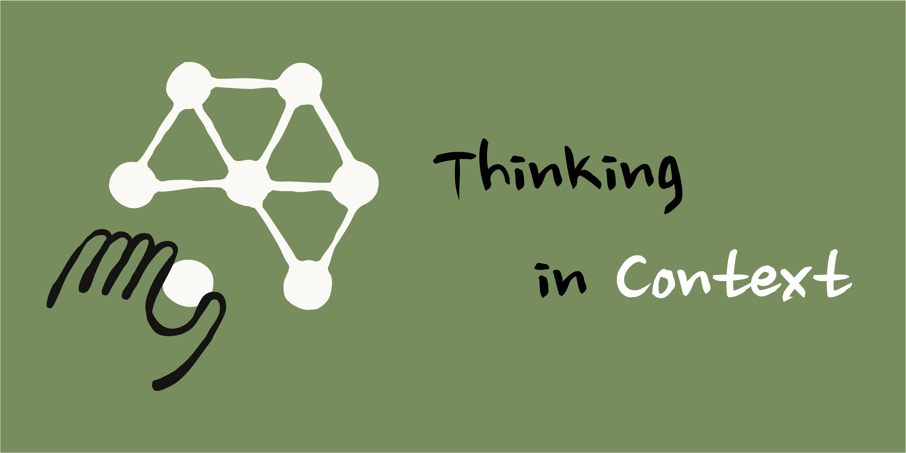
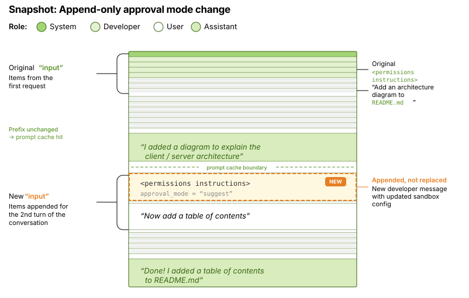
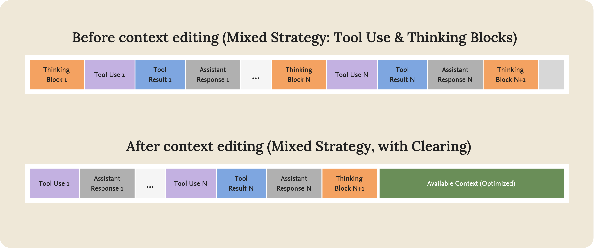
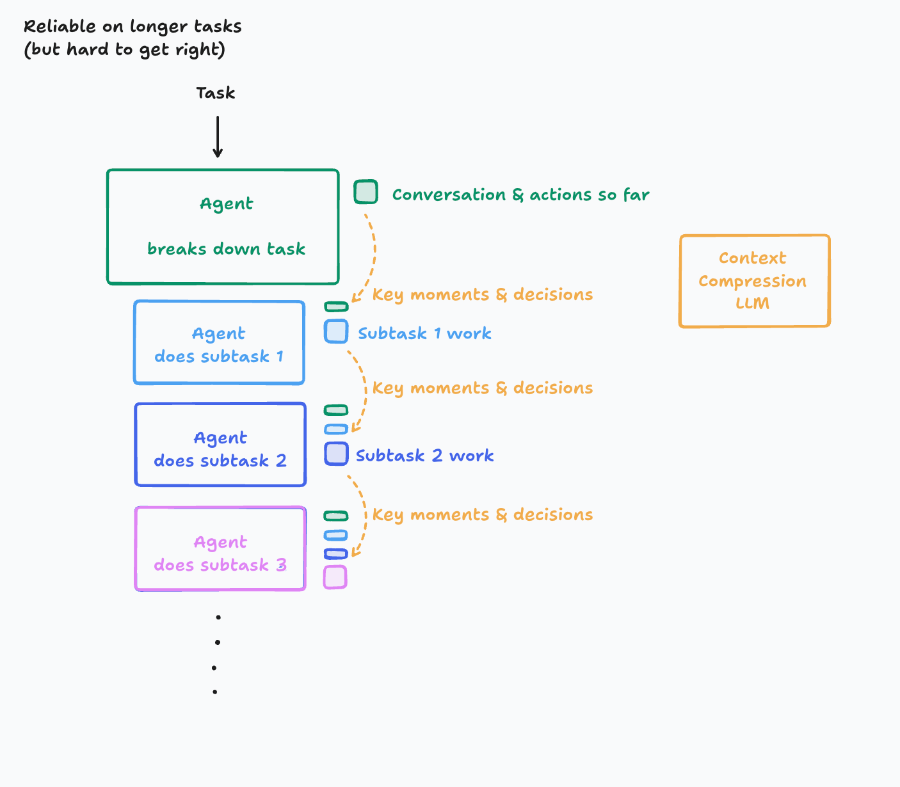

# Thinking in Context: Context Engineering in Codex

`READ⏰: 18min`

Going forward, some of my shorter essays on Context Engineering will go into the "Thinking in Context" series (a new series!). I came up with the name on a whim, and it feels pretty good. The "One Poem Suffices" series puts a lot of pressure on the "author", since I always worry that the quality of a post won't live up to the title. That includes Agent Skills recently, which I've been wanting to write about, though I keep feeling there are parts I haven't fully figured out yet. A more essay-style series like Thinking in Context will probably do a better job of freeing up my "writing productivity", haha. Hope you like it.

Let's briefly recall some of our previous material. In the first post, [One Poem Suffices: Context Engineering](../../one-poem-suffices/context-engineering/), we defined the four pillars of context engineering: **Write, Select, Compress, Isolate**; in the second post, [One Poem Suffices: Just-in-Time Context](../../one-poem-suffices/just-in-time-context/), we looked closely at the ingestion and metabolism mechanisms of JIT Context, and discussed the paradigm shift as Agents move from passively receiving context to actively acquiring it.

OpenAI's recently published engineering blog post ["Unrolling the Codex agent loop"](https://openai.com/index/unrolling-the-codex-agent-loop/) offers a rare specimen for analyzing context engineering. I have personally used the Codex CLI for quite a long time. Although its inference speed is slightly slow, when solving particularly complex problems or requirements, it can keep executing for a very long time and ultimately deliver a good result. This post is therefore a rare opportunity to peek into how a top-tier company practices context engineering.

Starting from Codex's engineering practices, this post will explore two topics:

1. **The Architecture of State**: Prompt Cache-friendly context design and Append-only context engineering practices.
2. **The Latent Space Moat**: The asymmetry in compression capabilities between the application layer and the infrastructure layer, and what this means for application developers.

## 1. The Architecture of State: Cache-Friendly Context Design

In an Agent system, an important question is: **Where is state (State / Messages) stored, and how is it managed?**

Codex's answer revolves around two tightly coupled designs: a strictly ordered Prompt layout, and an Append-only state mutation strategy. Both serve one core goal: **maximizing the Prompt Caching hit rate**.

### 1.1 Prompt Layout: A Structure Optimized for Prompt Caching.

The Codex blog post illustrates in detail how its Prompt is constructed. When the Codex CLI sends a request to the Responses API, the `input` field in the JSON payload is assembled in the following order:


Why does the composition architecture of the Prompt deserve to be singled out and described on its own? This is mainly tied to Prompt Caching. Thinking one step further, it's because a Coding Agent faces a great many complex tasks, so context window utilization is high. As a result, Prompt Caching is critical for both inference speed and cost control.


See my other blog post on Prompt Caching. The core working mechanism of Prompt Caching is this: a cache hit requires an **exact prefix match**. The cache only takes effect when the Token sequence of a new request is **completely identical to the cached sequence starting from the very first Token**. Once any position in the prefix changes, even if you only swap the order of two Tool Definitions, the cache for all subsequent Tokens is invalidated, triggering a full recomputation.

Therefore, Codex places the **least frequently changing content at the top** (System Message, Tools, Instructions) and the **most frequently changing content at the bottom** (conversation history, Tool Traces). This way, across multiple iterations of the Agent Loop, the prefix remains unchanged and can keep hitting the cache. As the original post points out, this strategy reduces Codex's sampling cost from theoretical **quadratic growth to roughly linear**.

!!! tip "Codex's Engineering Lesson"

    The Codex team mentioned in the blog post that when they first introduced MCP tool support, failing to guarantee a consistent enumeration order for tools led to cache misses. An MCP Server can also dynamically update the tool list via the [`notifications/tools/list_changed`](https://modelcontextprotocol.io/specification/2025-11-25/server/tools#list-changed-notification) notification; responding to this notification in the middle of a long conversation likewise breaks the prefix and deactivates Prompt Caching.

    As we can see, under a Prompt Caching regime, **determinism is a prerequisite for performance**. Any operation that introduces non-determinism, no matter how tiny, can bring about a significant performance regression. Prompt stability needs to be strictly maintained as an **engineering constraint**, rather than an implementation detail that can be casually tweaked. We will come right back to this point in the next section.

### 1.2 Immutable Context: Append-only State Management

Once we understand the caching logic behind the Prompt Layout, a natural follow-up question is: **What happens when state changes while the Agent is running?**

For example, when we use Claude Code or the Codex CLI, we use shift + tab to switch approval modes, say from "default mode" to "auto-edit" or "plan mode", or we switch the working directory (`cd /new/path`). At that point, how do we let the agent know about these updates? The naive approach is to directly modify the corresponding `<environment_context>` / `<permissions instructions>` message content in the Input, updating `cwd` to the new path or updating the permission instructions. This looks the "cleanest": the context always reflects the latest state, with no redundant information.

However, this kind of **in-place modification** (Context Editing) breaks the prefix cache. Because the modified message usually sits somewhere in the middle of the Input sequence, the prefix no longer matches the cache from that position onward, and the cache for all subsequent Tokens is invalidated. (This is actually a tradeoff; for details, see the [Compress](../../one-poem-suffices/just-in-time-context/#3-effective-jit-context-engineering) section in my earlier JIT Context blog post. **It feels like OpenAI and Anthropic belong to two different schools of thought in how they handle this?**)

Codex chose a different strategy: **Append-only (append only, never modify in place)**. When the environment state changes, Codex keeps all existing messages intact and appends a new message at the tail of the history to record the change:

- If the working directory changes, append a `role=user` message containing the new `<environment_context>`.
- If the sandbox configuration changes, append a `role=developer` message containing the new `<permissions instructions>`.

Here is a rough diagram (By Claude Opus):



This approach is very similar to db migrations (migration files) in Supabase, which I use often. We don't modify the Schema directly in production (which would be equivalent to mutating state in place); instead, we write and execute Migration files (equivalent to appending a state change record). The final database Schema is the result of executing all Migration files in order.

**"State is a projection of events."** Current state is a projection of the sequence of historical events. This concept is somewhat related to Event Sourcing; if you're interested, you can take a look at [MS - Event Sourcing pattern](https://learn.microsoft.com/en-us/azure/architecture/patterns/event-sourcing#pattern-advantages).

This Append-only strategy brings the following benefits:

1. **Inference speed and cost control**: The prefix never changes and only the tail grows, maximizing Prompt Cache hits.
2. **Preserving the causal chain**: If we directly "teleport" `cwd` from `/project` to `/project/tests`, the model only knows "I am now in the tests directory", but not "why I came here". An Append-only event log preserves the complete sequence of operations, making it **possible** for the model to infer intent through the causal chain. For example, it may have switched directories because it wanted to run tests.

!!! warning "A Tradeoff Worth Pondering"

    Append-only is not without cost. The continuous growth of the event log itself leads to context bloat. In a previous blog post, we mentioned the problem of [context degradation](../../one-poem-suffices/context-engineering/#31-what-is-context-degradation), where conflicting content or noise in the context affects model performance. This creates an inherent tension: a tradeoff must be made between **preserving the integrity of the causal chain** and **controlling the signal-to-noise ratio of the context**.

    I think there are two different angles to think about this (just my personal take):

    1. OpenAI did specialized model training for Append-only Context Engineering, making the model better adapted to this format so it doesn't decrease performance. When the context gets too long, that is handled through an optimized Context Compress mechanism.
    2. Append-only is a more traditional pattern that is easier to implement in engineering terms. Compared to Claude Code's more aggressive Context Editing features, OpenAI is more conservative (and somewhat weaker) in this area.

## 2. The Latent Space Moat: Asymmetry in Context Compression Capabilities

In the first two blog posts, we discussed Compress as one of the core strategies of context metabolism. At the application layer, compression usually means **model-based semantic compression (Semantic Compression)**: using an LLM to summarize conversation history, keeping key information and discarding redundant details.

However, some technical details revealed in the Codex blog post hint at a compression capability that ordinary developers **cannot access**. This capability may well be the moat of the infrastructure layer.

### 2.1 Distinguishing the Two Kinds of `encrypted_content`

In the Codex blog post, the `encrypted_content` field appears in two different data structures. Distinguishing between them is crucial to understanding Codex's context management:

**The first: `encrypted_content` in `type: "reasoning"`**

```json
{
  "type": "reasoning",
  "summary": [{"type": "summary_text", "text": "Adding an architecture diagram..."}],
  "encrypted_content": "gAAAAABpaDWNMxMeLw..."
}
```

This is the encrypted carrier of the model's reasoning process (Thinking / Chain-of-Thought). Its purpose is **privacy protection**: the model's internal reasoning chain is OpenAI's proprietary information and should not be exposed to the client in plaintext. All the client sees is the `summary` (reasoning summary), while `encrypted_content` is passed back to the server as-is as opaque encrypted data, used to restore the model's reasoning state in subsequent Turns. So this is not a compression mechanism.

**The second: `encrypted_content` in `type: "compaction"`**

When the context bloats to a certain threshold, Codex calls the `/responses/compact` endpoint. This endpoint returns a compacted Input list containing a special Item:

```json
{
  "type": "compaction",
  "encrypted_content": "..."  // preserves the model's latent understanding
}
```

> "This list includes a special `type=compaction` item with an opaque `encrypted_content` item that **preserves the model's latent understanding** of the original conversation."

This is the real compression mechanism. The original post uses the phrasing "latent understanding", hinting that what Codex preserves may be more than just a text-level summary.

### 2.2 Semantic Compression vs. Latent Compression

With this distinction in mind, we can dig deeper into the difference in compression capabilities between the application layer and the infrastructure layer. Here we will temporarily set aside **rule-based structured pruning**; although it is also a means of compression, it belongs to a different "compression philosophy" (I couldn't find a very fitting term to describe it, so I went with philosophy).



**Application Layer: Semantic Compression**

The compression we can implement as application developers is essentially a form of **semantic reconstruction**: passing the full conversation history to an LLM and asking it to generate a summary. No matter how accurately that summary is written, it is a **lossy projection** of the original information; micro-level logic in the reasoning process, ruled-out hypotheses, and the distribution pattern of the model's attention are inevitably discarded in a text summary. Moreover, as application developers, our sampling of real user scenarios is biased and nowhere near that of a model provider like OpenAI, which makes model-based semantic compression perform even worse. On top of that, the models used for compression are mostly **general-purpose models**, whose optimization objective during pre-training was not context compression.

From reading various blog posts, some teams try to push on the second dimension. For example, as we mentioned in an earlier blog post, Cognition AI (Devin) fine-tunes a dedicated compression model to optimize this process. But no matter how sophisticated the compression model is, what it operates on is still a **text representation**, a Token sequence.



**Infrastructure Layer: Latent Compression?**

OpenAI has not disclosed the internal implementation of the `/responses/compact` endpoint. When seeing the description "preserves the model's latent understanding", a natural speculation is: **Are model providers operating on representations lower-level than text**, compressing high-dimensional vectors directly in the model's latent space?

This idea has theoretical appeal because the ceiling is very high. Text (a Token sequence) is a **low-dimensional projection** of the model's internal state, whereas vector representations in latent space contain a richer information structure. Doing lossy compression in a high-dimensional space gives you more room to maneuver and a higher ceiling for preserving information structure. It's like cropping a high-resolution original image vs. cropping a thumbnail.

However, I think this path faces a very important engineering problem: **vector representations are deeply coupled to the model architecture**. The dimensionality, structure, and semantics of the latent space depend on the specific model version. Once the model is upgraded (architectural adjustments, retraining), previously saved vector representations may become invalid, and the compression/restoration mechanism would have to co-evolve with model versions. Having to re-adapt on every upgrade does not align with good engineering practice (though what if?).

**A More Likely Implementation: Semantic Compression with an Information Advantage**

So a more conservative and more reasonable speculation is that `/responses/compact` is still essentially Semantic Compression, using the model itself to generate a compressed text representation, but the provider holds **information advantages** that application developers do not have:

- **Access to the model's internal states during compression** (attention distributions, which tokens received heavy attention) to **guide** compression decisions, rather than saving those states directly.
- **Massive amounts of real user conversation data** used to optimize compression strategies, a data scale no individual application developer can match.
- Possibly fine-tuning a **dedicated compression model** like Cognition AI (Devin), but with training data whose scale and diversity far exceed the application layer.

In other words, the source of the moat may not be operating on a different level of representation (vectors), but rather **"doing a better job at the same level by leveraging information and data advantages"**. The encrypted wrapper (`encrypted_content`) then protects these proprietary compression strategies from being reverse-engineered.

!!! example "Analogy: The Asymmetry of Semantic Compression"

    For intuition only; don't read too much into it:

    - **Application-layer compression** is like taking summary notes: you finish reading a book and rewrite the key points based on your own understanding. The notes are inevitably a lossy projection of the original book.
    - **Provider-layer compression** is like "having the author take notes for you". They know which paragraphs are setup, which are the core arguments, and which foreshadowing will be used later, so their notes can preserve more of the key structure. But at bottom, they are still notes, not the original book.

    Regardless of the exact implementation, **model providers can leverage internal information that application developers cannot access to optimize compression**, and this structural advantage is very real.

### 2.3 Back to the Application Layer: What Can We Still Do?

A question that always attracts attention is: will foundation model providers gradually swallow up the value of the application layer? In the context of this blog post, that question can be made concrete: if providers have a structural information advantage in Compress (even if it is just better Semantic Compression), where is the alpha for Agent application developers?

I think the answer is: **Compress is only one of the four pillars of context engineering.** The provider's advantage is concentrated in the compression step, while Select (what to put in), Write (what to persist), and Isolate (how to divide and conquer) remain completely under the control of the application layer (everyone is using the same models).

Even within the single step of Compress, relying completely on the provider is not a good architectural choice:

- **Risk of model lock-in**: If your Agent relies completely on `/responses/compact` to manage context, you lose this capability when switching to Anthropic or open-source models. Application-layer Semantic Compression (even if slightly less effective) provides **cross-provider portability**.
- **Controllability / interpretability issues**: The provider's compression is a black box; you cannot control which information is retained and which is discarded. For critical constraints in specific business scenarios (such as "do not modify the core/ directory"), compression done by the application layer itself can explicitly specify retention policies via instructions, whereas a provider's general-purpose compression may not recognize these domain-specific signals.
- **Signal decay from recursive compression**: Regardless of who performs Semantic Compression, multiple rounds of recursive compression will lead to signal decay (for details, see the [Compress section in my previous post, "Just-in-Time Context"](../../one-poem-suffices/just-in-time-context/#3-effective-jit-context-engineering)). This is a fundamental limitation of lossy compression at the text level; a provider's information advantage can mitigate it, but cannot eliminate it.

Finally, let me add one observation of mine: **Codex is currently a single Agent Loop, with no Isolation mechanism** ([codex issue - Subagent Support](https://github.com/openai/codex/issues/2604)). All exploration, reasoning, and tool calls happen within the same context window, and Context metabolism relies completely on `/responses/compact`. Compared with Claude Code's Sub-agent architecture (dispatching subtasks to independent contexts via the Task tool), this may be an evolutionary direction in Codex's architecture worth watching: when compression is no longer enough to cover context bloat in ultra-long tasks, Isolation may be the next step.

## 3. Conclusion

This essay started from Codex's engineering blog post. Although its theme is the implementation of the Agent Loop, what I care more about is: **What frontier context engineering practices exist inside a world-class Coding Agent?**

Two observations:

1. **Determinism is a prerequisite for performance.** Codex builds an entire suite of cache-friendly designs around Prompt Caching, from the stable ordering of the Prompt Layout to Append-only state management. What these decisions have in common is a willingness to accept redundancy in order to protect prefix invariance. That said, this Append-only path forms a contrast with Anthropic's more aggressive Context Editing (though Anthropic is definitely using a hybrid strategy); I will keep watching the long-term effects of both schools of thought.
2. **Asymmetry in compression capabilities.** `encrypted_content` in Codex carries two different functions (reasoning chain protection vs. context compression). The implementation of the latter may not be as "black magic" as I imagined; it is more likely better Semantic Compression achieved by the provider through information and data advantages, rather than direct manipulation at the latent space level. But regardless of the specific implementation, this structural asymmetry is real.

Context engineering is an art, not just "writing good Prompts". As we can see from Codex's practices, it involves **systems engineering problems** such as caching strategies, state management, and compression mechanisms. Among these problems, some require collaboration between the application layer and the infrastructure layer (for instance, a Cache-friendly Prompt Layout requires application developers to actively cooperate with the infrastructure's prefix-matching mechanism), while others exhibit an asymmetry in capabilities (for instance, during compression the provider can consult internal information invisible to the application layer). Understanding this relationship between collaboration and asymmetry is very valuable for an ordinary Agent engineer like me.

## Appendix: context-kit: From Theory to Practice

Earlier work on Context Engineering gave me a lot of inspiration. To validate some of these ideas (especially Context Editing and Context Swap), I built a tiny open-source tool: [**context-kit**](https://github.com/keli-wen/context-kit).

It is not a production-grade framework, but a **teaching prototype**. `context-kit` aims to help developers build intuition for Context Engineering through minimal code, and I will gradually try to update `context-kit` with code implementations of concepts I learn about in my blog posts (such as the tools ordering mentioned in Codex). Here is what I have written so far:

- **Compress**: Experience `compress_by_rule` (structured pruning aligned with the Claude Context Editing API) and `compress_by_model` (LLM-based semantic compression), and get a direct feel for the Token cleanup process.
- **Select**: Manually implement progressive retrieval for JIT Context (`list_dir` → `grep` → `read_file`).
- **Memory**: Offload context to the filesystem to implement persistence for the Write strategy.

**Do the simplest thing that works!** 

---

## References

- [[1] OpenAI: Unrolling the Codex agent loop](https://openai.com/index/unrolling-the-codex-agent-loop/)
- [[2] Anthropic: Effective context engineering for AI agents](https://www.anthropic.com/engineering/effective-context-engineering-for-ai-agents)
- [My Blog: One Poem Suffices: Context Engineering](../../one-poem-suffices/context-engineering/)
- [My Blog: One Poem Suffices: Just-in-Time Context](../../one-poem-suffices/just-in-time-context/)
- [context-kit: GitHub Repository](https://github.com/keli-wen/context-kit)
