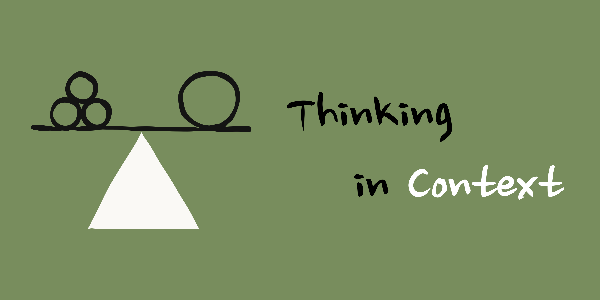
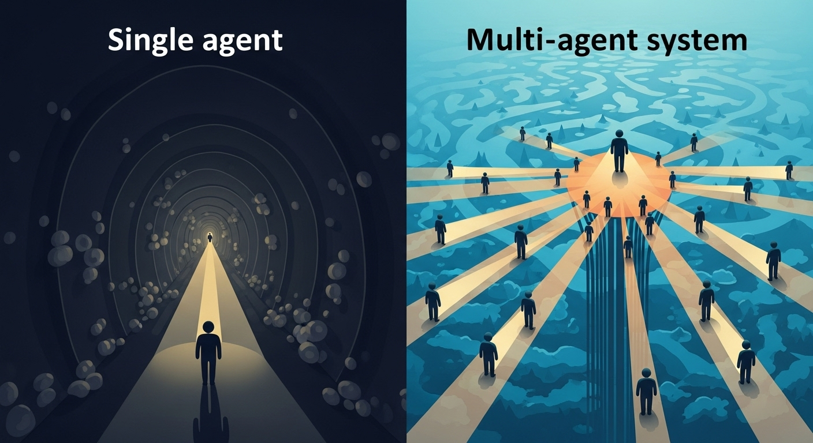
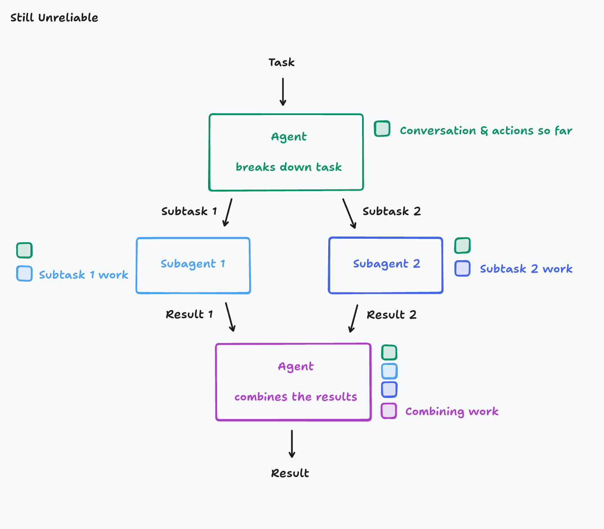
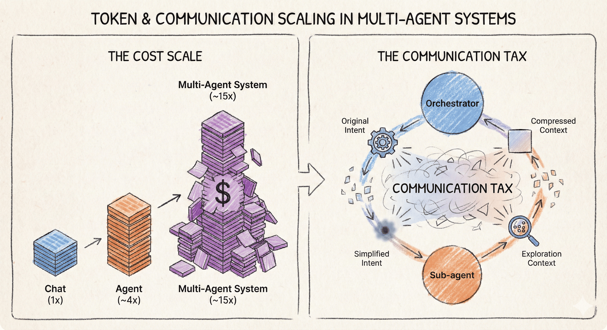
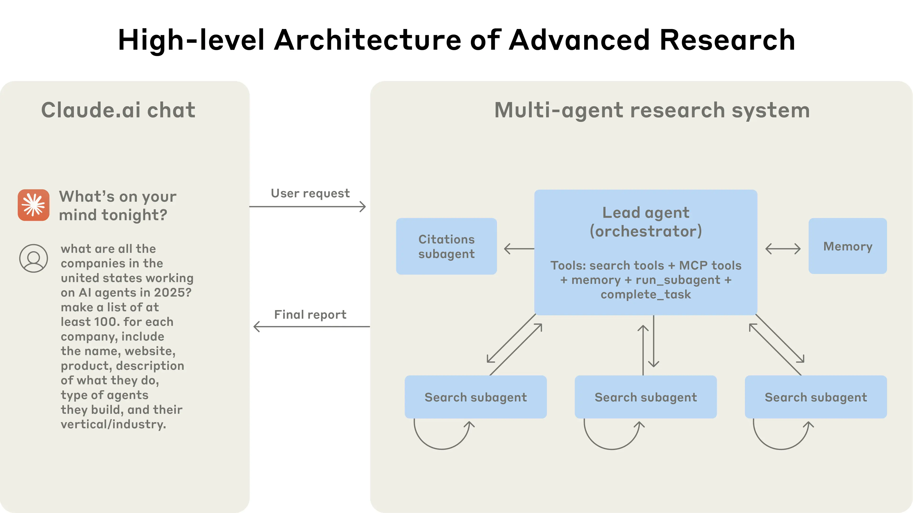
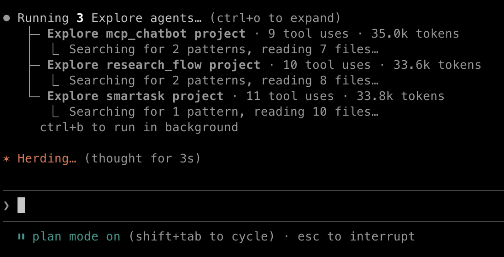

  

# Thinking in Context: When Do You Need Multi-Agent Systems?

`READ⏰: 20min`

Multi-agent architectures are moving from experiments into production. With Kimi's [Agent Swarms](https://www.kimi.com/blog/agent-swarm) and Anthropic's [Agent Teams](https://code.claude.com/docs/en/agent-teams), everyone is experimenting with more complex agent combinations.

Last July, I wrote [Multi-Agent System: One Poem Suffices](../../../one-poem-suffices/multi-agent-system/), which focused on multi-agent architectures in Deep Research scenarios and covered the What, Why, and How. However, I missed an even more fundamental prerequisite question: **When should you use a multi-agent system?**

Ignoring this question can lead to pouring massive amounts of effort into low-ROI optimizations. In their latest blog post, [Building multi-agent systems: When and how to use them](https://claude.com/blog/building-multi-agent-systems-when-and-how-to-use-them), Anthropic also candidly admits:

!!! example "Anthropic's Practical Experience"

    *"At Anthropic, we've seen teams invest months building elaborate multi-agent architectures only to discover that improved prompting on a single agent achieved equivalent results."*

So in this post, I want to seriously think through the "When". Let's do some Thinking in Context and ask: **When should we use a multi-agent architecture?**

- In [Context Engineering](../../../one-poem-suffices/context-engineering/), we defined the four pillars of context engineering: **Write, Select, Compress, Isolate**.
- In [JIT Context](../../../one-poem-suffices/just-in-time-context/), we mainly dove deep into Select and Compress/Write, while only briefly touching upon Isolate. This post is an expansion on Isolate: when optimization techniques within a single context space are exhausted, when do we need to scale out to multiple spaces?
- In the previous installment of Thinking in Context, starting from [Codex's engineering practices](../../../thinking-in-context/context-engineering-from-codex/), we looked at engineering practices within a single context space (Prompt Cache-friendly context design, Append-only state management).

**A multi-agent system is, at its core, a system of multiple context spaces.** In this post, I'll try to move from the inside out: shifting from internal optimizations within a single context to the interactions between multiple contexts. **When do you need to scale from one context space to many? What principles should guide that decision?**

AI is moving so fast that some conclusions in many blog posts may already be outdated~ I welcome your thoughts and discussions.

## 1. The Tradeoff: The Value and Cost of Multi-Agent Systems

In my previous post, we discussed the many advantages of multi-agent systems: emergence brought by parallel exploration, Inference Compute Scaling that breaks through the context window limits of a single Agent, and the information distillation capability of "search as compression." These advantages are real, but incomplete. At the time, I focused more on articulating the benefits of multi-agent systems without giving enough thought to **their costs**. Re-reading my earlier article, I seemed to be implying that "multi-agent is always superior to single-agent," **but that conclusion is not always true**. In this section, I will fill in the missing piece: their tradeoff.

### 1.1 The Value: Why Scale Out?

When is a single context window not enough?

I often run into an issue myself when using Claude Code: when a long conversation accumulates too many traces of early exploration (debugging, failed attempts, rejected plans), the quality of the Agent's subsequent decision-making and reasoning drops noticeably. Sometimes it even repeats paths that have already failed (tip: manually reconstructing a fresh context at this point can often solve the problem quickly). This is actually how [context degradation](../../../one-poem-suffices/context-engineering/#31) manifests inside a single Agent. Spinning off a Sub-agent to complete a subtask in an independent context and return only the result is a form of **active context noise isolation**.

  

Similar signals that a single context window is no longer enough include: in research tasks, sequential search by a single Agent lacks sufficient coverage, requiring parallel exploration to expand the information space. The value of parallelization often shows up first in **coverage**, though with proper orchestration, speed can also be a significant benefit (Anthropic has reported substantial reductions in query time for complex queries in their multi-agent research system). Another common signal is toolset/MCP bloat: when the number of tools exceeds 15–20 (especially when some tool definitions are ambiguous), the Agent's tool selection accuracy drops significantly. At that point, tools need to be split across specialized Sub-agents (e.g., some Sub-agents dedicated to search, others responsible for visualizing the final report, etc.).

  

To sum up, these signals share a common thread: **a single context window can no longer support the demands of the current task**. These are also the three trigger conditions for the **Isolate** mechanism in context engineering: isolating noise (preventing failed paths from polluting subsequent reasoning), isolating concerns (letting specialized toolsets each do their own job), or breaking through physical limits (scaling beyond a single Agent's Token ceiling in parallel).

### 1.2 The Cost: Why Scaling Out Requires Caution

However, scaling out is not without cost.

The most obvious cost is the **jump in Token consumption**. Anthropic's empirical data shows that a single Agent uses about 4x as many Tokens as a standard chat, while a multi-agent system uses about 15x as many (if you've used OpenClaw recently, you'll also have noticed that it burns through tokens like water). I mentioned these numbers in my previous post, but mostly as positive evidence for Inference Compute Scaling ("investing more Tokens yields better performance"), without emphasizing that it is also a very real cost, and without questioning whether the ROI of investing those costs is **necessarily high**.

A more fundamental issue is the **inevitable loss of information during transmission**. When an Orchestrator hands a task off to a Sub-agent, subtleties in the original intent may get simplified; when the Sub-agent returns its results, contextual clues from the exploration process get compressed away. Most cross-Agent handoffs are accompanied by information loss. In the terminology of my previous post: multi-agent systems scale the system's total Token budget, but every handoff carries a non-negligible "communication tax," **and under certain poorly designed multi-agent decompositions, most of the increased budget goes toward paying that "communication tax."** You spend much more money (sometimes an order of magnitude more) without getting a significant performance boost.

An even more insidious cost is the **fracturing of implicit decision chains** (from Cognition's [Don't Build Multi-Agents](https://cognition.ai/blog/dont-build-multi-agents#a-theory-of-building-long-running-agents)). Behind every code change lies implicit decision logic that is never explicitly written down; "choosing to modify this file rather than another" implies that the Agent has a certain understanding of the architecture.

In the most ideal scenario, we fork the context to guarantee that Sub-agents share the exact same starting context, which seems to eliminate context issues. However, when multiple Agents work in parallel, they cannot share this implicit logic as it evolves, which inevitably leads to context inconsistency. Moreover, because the results returned by a Sub-agent are generally **heavily summarized information**, such implicit decisions get hidden along the way and cannot be passed back to the Orchestrator.

  

For example, Sub-agent A chooses a certain data structure, while Sub-agent B unknowingly introduces an incompatible dependency. The root cause of the conflict shifts from "the code was written wrong" (model capability) to **the fragmentation of decision context** (the multi-agent architecture preventing critical context from being shared). Cognition summarizes this phenomenon as **"Actions carry implicit decisions"**: every action carries implicit decisions, so splitting up Agents means splitting up the decision chain, which easily introduces hard-to-predict problems.

!!! note "Echoing the Codex Article"

    This issue is directly related to the Append-only pattern we discussed in [Codex Context Engineering](../../../thinking-in-context/context-engineering-from-codex/). A major reason Codex chooses Append-only over in-place modification is to **preserve the causal chain**—the model needs to know not only "what the current state is," but also "why it is in this state." Splitting up Agents essentially breaks this causal chain: each Sub-agent only sees its own sequence of actions and cannot trace the decision paths of other Agents.

## 2. Context Coupling: Using Coupling as the Criterion for Decomposition

Once we understand the value and cost of scaling out context spaces, the core question becomes: **What dimension should we use to judge "when to scale out to a multi-agent architecture"?**

### 2.1 The Limitations of a One-Size-Fits-All Approach by Problem Type

A common approach is to make a blanket rule based on problem type: research tasks → use multi-agent; coding tasks → use single-agent. I implicitly followed this logic in my previous post as well; since the main case study throughout that blog was Deep Research, it may have left readers with the impression that "multi-agent = good for search."

But this categorization is too coarse. In a real-world Coding Agent scenario:

- **Code search**: Locating relevant files in a large codebase. Search paths are independent of one another and have low context coupling, making them well-suited for splitting. You can see this kind of parallel exploration approach in Claude Code's public documentation (such as Agent Teams / subagents) ([Claude Code Docs](https://code.claude.com/docs/en/agent-teams)).
- **Core coding**: Requires understanding the full code context, including function call relationships, type definitions, and design constraints. Modifying a single function may ripple across multiple files. **Context coupling is high**, making it ill-suited for splitting.
- **Parallel frontend and backend development**: In theory, you can define the API upfront and develop in parallel, but any mid-course Plan change can lead to interface inconsistencies.

Within the same "coding" project, there are subtasks that are suitable for splitting and subtasks that are not. A one-size-fits-all rule by problem type fails to capture this difference in granularity. An even more classic **anti-pattern** is splitting by work phase: one Agent writes the feature, another writes the tests, and a third reviews the code. This looks like a reasonable division of labor, but every handoff loses context:

1. The Agent writing tests doesn't know why a particular approach was chosen during implementation.

2. The Agent reviewing the code knows even less about which alternative approaches were ruled out during exploration.

We cannot arbitrarily conclude from this that "**coding tasks are unsuitable for multi-agent systems**." Rather, the issue is that splitting by functional stages happens to cut right across **the points of highest context coupling**.

### 2.2 Drawing Boundaries Along Context Boundaries

If splitting by problem type isn't granular enough, what is a better criterion?

I believe the answer is **context coupling: how much context two subtasks need to share in order for each to be completed correctly**. In their latest blog post, Anthropic calls this **Context-Centric Decomposition** and regards it as one of the key design decisions in multi-agent systems. I find this framing very accurate, and it really clicked for me.

The core idea is: **decision boundaries should be drawn along context boundaries, not along functional boundaries.**

As discussed in 2.1, splitting by functional stages (planning → coding | testing | reviewing) draws lines right where coupling is highest. Drawing boundaries at **points of highest coupling** results in a classic game of "telephone": the original design intent and considerations get simplified and misunderstood at every handoff, until by the final link they may be unrecognizable (the diagram below illustrates the communication tax effect, By 🍌).

  

This principle is similar to the choice between data parallelism and model parallelism in distributed training. Data parallelism splits by batch (each GPU processes different data with the same model) and has low communication overhead because batches are naturally independent; model parallelism splits by network layer (different GPUs handle different layers) and has high communication overhead because layers have strong dependencies—the output of each layer is the input to the next. **When you have a choice, splitting along low-coupling boundaries incurs lower communication costs**—just as data parallelism is almost always the first choice when a single GPU can fit the model. The same applies to splitting Agents: it's not that you "cannot" split at high-coupling points, but rather that the cost of splitting is higher, making it worthwhile only when truly necessary.

A great example that illustrates this principle is the **Verification Subagent**. This is perhaps the most consistently reliable multi-agent pattern. Why? Because the verification Agent **does not need to know how the main Agent constructed the output**; it only needs to black-box test the final artifact. The only context that needs to be passed is the acceptance criteria and the artifact to be verified. The amount of context transferred is minimized, and information loss is minimized along with it.

Conversely, **if a subtask needs to inherit a large amount of decision history from preceding Agents to function properly, then it probably shouldn't be split off.**

## 3. In Practice: Two Real-World Scenarios

Abstract principles need concrete scenarios to be tested against.

### 3.1 Deep Research: Naturally Low Coupling

Deep Research is the "ideal type" scenario for multi-agent architectures. Viewed through the lens of context coupling, the reason is straightforward: **research paths are naturally independent**.

Searching for "supply-side analysis of the semiconductor industry" and searching for "demand-side market trends" are two independent paths; Path A does not need to know what Path B has found. Each path generates a massive volume of raw search results (5,000–8,000 tokens of web pages, reports, and news), which is pure noise to the other paths. What ultimately converges back to the Orchestrator might be just 300–500 tokens of key findings per path. This is what I referred to in the [previous post](../../../one-poem-suffices/multi-agent-system/) as "**search as compression**."

  

In Anthropic's Claude Research implementation, this takes the form of the classic Orchestrator-Worker pattern. The Orchestrator's core job essentially consists of two context engineering operations: downward **Context Isolation** (creating an independent context space for each research path) and upward **Context Compression** (distilling key information from the outputs of sub-Agents).

### 3.2 Coding Agent: Selective Decomposition

Coding Agents are more complex because within the same project, there are **subtasks with drastically different degrees of coupling**.

Core coding (understanding requirements, designing architecture, writing implementations) requires the full code context. Modifying a single function can affect type definitions and test cases across multiple files. Choosing a certain data structure in `module_a.py` implicitly constrains how `module_b.py` can be implemented. If you split this up, you run right into the problem Cognition described: **fractured implicit decision chains, where individually reasonable outputs produce conflicts when combined.**

However, Coding involves a very diverse set of tasks: code search (where search paths are independent of each other, typically during the initial Plan mode), documentation digestion (reading an entire API doc when only a small amount of relevant information needs to be extracted to implement a feature using some 최신 library), and test verification (black-box testing the final artifact). These subtasks have low context coupling and are well-suited for splitting.

If you use Claude Code regularly, you can feel this design philosophy in action. Combining their public documentation with hands-on experience, Sub-agents mostly take on subtasks like exploration, research, and verification, which are then aggregated and integrated by the main Agent (you can think of this as "a single agent + dispatchable Agentic tools").

  

Here is a rough summary table:

| Subtask | Context Coupling | Suitable for Splitting? | Representative Practice |
|--------|------------|-----------|---------|
| Code Search / Codebase Exploration | Low | Yes | CC Explore agents |
| Documentation Digestion / API Understanding | Low | Yes | Sub-agent reads and returns summary |
| Test Verification / Linting | Low | Yes | Verification Subagent |
| Core Coding / Architecture Design | High | No | Keep within the main Agent |
| Parallel Frontend & Backend Development | Medium → High | Use Caution | Interface changes lead to frequent syncing |

!!! warning "The Trap of Parallel Development"

    An easy-to-imagine approach is: define the API Interface upfront, then have two Agents develop the frontend and backend separately. In theory, this works—if the interface remains completely unchanged throughout development. In practice, however, the initial Plan is almost never perfect, and mid-course changes lead to frequent context synchronization—causing the information attenuation effect analyzed in Section 1.2 to compound with every sync. **The difficulty of synchronization is directly proportional to the degree of coupling**.

### 3.3 Is It a Sub-agent or an Agentic Tool?

Comparing Deep Research and Coding Agents, I noticed that **among multi-agent systems that have publicly shared their architectural details, most valuable implementations adopt the Orchestrator-Worker pattern**, such as Claude Code's Explore/subagents and Claude Research's sub-agent mechanism. A Sub-agent acts more like an Agentic Tool invoked by the main Agent (invoke → execute in an independent context → return result), rather than peer-to-peer collaboration between independent Agents (A2A—though at that point you wouldn't call them Sub-agents anyway).

This might mean that "multi-agent" in practice is much more modest than the concept sounds. Of course, it also means there may be much larger room to explore in the future (it seems Grok 4.2 recently rolled out a 4-agent mode called "**Four-Brain**"). If your Agent is already calling Sub-agents to do search or verification, you may already be using a multi-agent system—you just haven't been calling it that.

## 4. The Decision Framework: When to Split

The analysis above can be distilled into a concise decision flow.

**First, exhaust the optimization space of a single Agent.** Is the Prompt clear enough? Have you implemented context compression? Are the tool descriptions accurate? Have you used the [Tool-search-tool](https://platform.claude.com/docs/en/agents-and-tools/tool-use/tool-search-tool) to optimize your toolset? Anthropic and Cognition share a consensus on this point: ==*"Start with the simplest approach that works."*== Many problems that appear to require multi-agent systems are actually just cases of poor context management within a single Agent.

**If bottlenecks remain, identify the signals.** A context window approaching its limit (manifesting as rising hallucination rates or ignoring early instructions), an overly large toolset (frequently selecting the wrong tool, with clear domain specializations within the toolset), or the need to cover a massive information space (insufficient search coverage)—these are all signals that splitting may be necessary.

**When splitting, draw lines along context coupling.** Low-coupling subtasks (search, verification, independent research paths) → Isolate as Sub-agents; high-coupling subtasks (core coding, shared state, sequential dependencies) → keep within the main Agent and manage growth with Compress. Unsure? Default to not splitting: **the cost of a bad split (information loss + inconsistent decisions) is usually greater than the cost of not splitting (slightly redundant context)**.

AI is evolving so fast that I believe **context coupling will certainly not be the only decision dimension in the future**. Latency requirements may force parallelization, and permission boundaries may require Sub-agents to execute in different security domains. However, for the decisions facing most Agent developers today, context coupling remains the criterion with the greatest explanatory power, as it directly determines **the degree of information loss** after splitting.

## 5. The End

Returning to the opening question: when do you need a multi-agent system? For now, our answer is: it comes down to **the context coupling between subtasks**.

Low coupling (search, information digestion, black-box verification) → splitting adds value; high coupling (core coding, shared state, sequential dependencies) → maintain a single context and use Context Compress to manage context growth. Within the same project, different subtasks sit at different points on the coupling spectrum; the right approach is not a blanket rule, but evaluating subtask by subtask.

From Codex's Append-only pattern (preserving causal chain integrity within a single Agent), to the four pillars of Context Engineering / JIT Context (**Write, Select, Compress, Isolate**), to this post's Context-Centric Decomposition (drawing lines along context boundaries across multiple Agents), the core principles of context engineering can be summarized across three levels: **at the micro level, protect context integrity** (Append-only preserves the causal chain); **at the meso level, optimize the signal-to-noise ratio** (Write/Select/Compress ensures every inference step receives high-density, necessary context); and **at the macro level, isolate along low-coupling boundaries** (Context-Centric Decomposition).

This article mainly explored the decision principles for multi-agent systems from the perspective of context engineering. Anthropic's original post also contains many code-level practical details (such as how to write delegation prompts, Sub-agent error handling, result validation strategies, etc.)—after all, **no context compression algorithm, however good, can ever beat reading high-SNR raw context directly**. I recommend interested readers check out the [original article](https://claude.com/blog/building-multi-agent-systems-when-and-how-to-use-them) directly.

Finally, I'll wrap up with a quote from Anthropic. This line has appeared consistently from their 2025 post [Building Effective Agents](https://www.anthropic.com/engineering/building-effective-agents) all the way to their latest blog, and I really like it:

!!! abstract "Slogan"
    **"Start with the simplest approach that works, and add complexity only when evidence supports it."**

---

## References

- [Anthropic: Building multi-agent systems: When and how to use them](https://claude.com/blog/building-multi-agent-systems-when-and-how-to-use-them) (2026.01)
- [Anthropic: How we built our multi-agent research system](https://www.anthropic.com/engineering/built-multi-agent-research-system) (2025)
- [Anthropic: Building Effective Agents](https://www.anthropic.com/engineering/building-effective-agents) (2025)
- [Claude Code Docs: Agent Teams](https://code.claude.com/docs/en/agent-teams) (2026)
- [Cognition: Don't Build Multi-Agents](https://cognition.ai/blog/dont-build-multi-agents) (2025.06)
- [My Blog: Multi-Agent System, One Poem Suffices](../../../one-poem-suffices/multi-agent-system/)
- [My Blog: Context Engineering, One Poem Suffices](../../../one-poem-suffices/context-engineering/)
- [My Blog: Just-in-Time Context, One Poem Suffices](../../../one-poem-suffices/just-in-time-context/)
- [My Blog: Thinking in Context: Context Engineering in Codex](../../../thinking-in-context/context-engineering-from-codex/)
