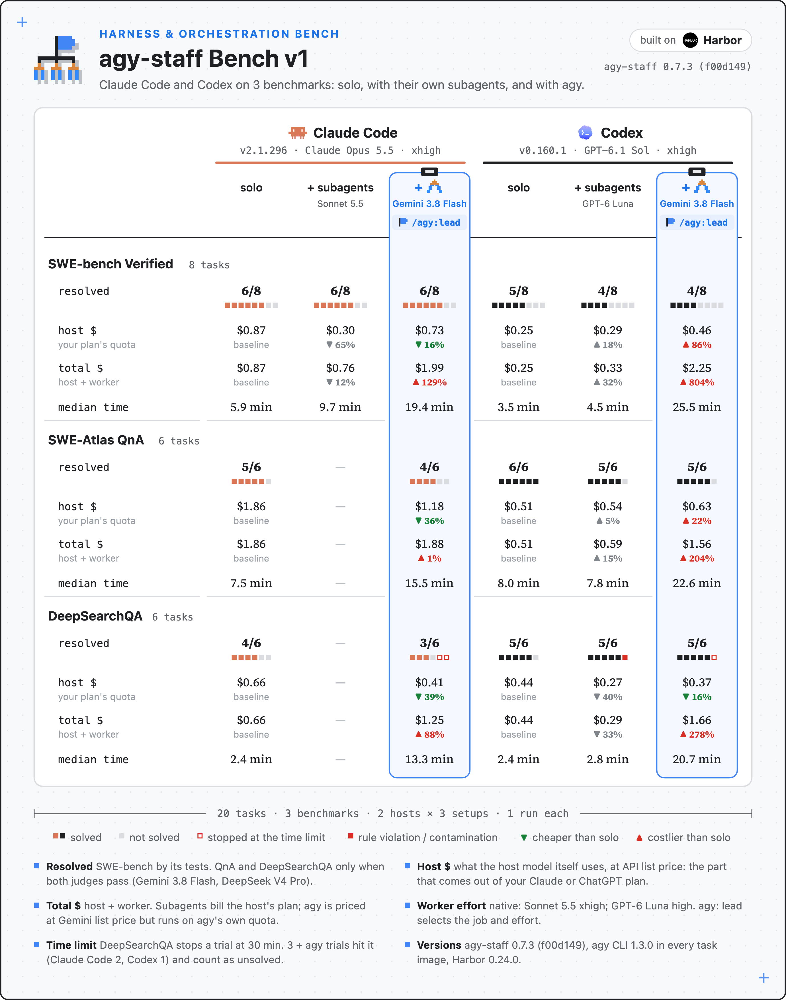
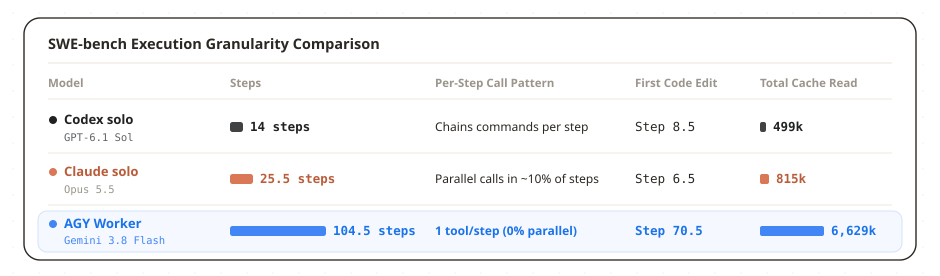
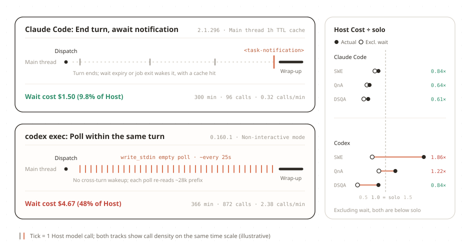
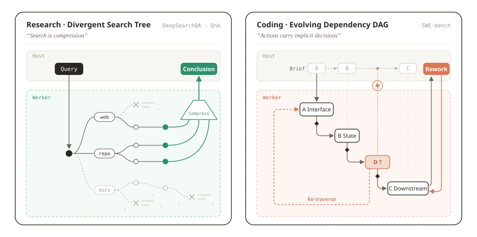
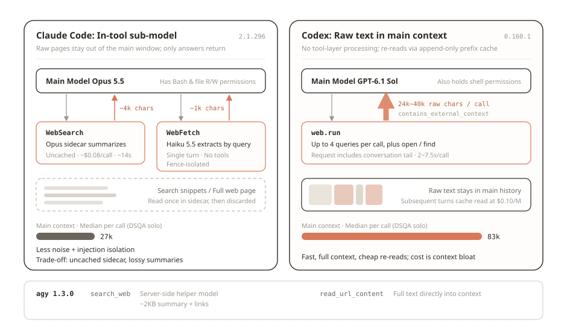

#  agy-staff Bench v1: Evaluating Agent Orchestration and Harnesses

`READ⏰: 22min`

Previously, I shared an agent plugin I built called [agy-staff](../agy-staff/) and its [iteration process](../agy-staff-iteration/): through a protocol based on Bash + Skills (`/agy:lead`), it lets Claude Code or Codex act as the host agent (Host), delegating research, review, and implementation tasks to the background `agy` CLI (models such as Gemini 3.8 Flash).

<https://github.com/keli-wen/agy-staff>

Up to this point, my assessment of this tool relied mainly on day-to-day intuition. To systematically evaluate its actual effectiveness, I recently built **agy-staff bench v1** on top of [Harbor](https://github.com/harbor-framework/harbor), selected three categories of benchmarks tailored to my evaluation goals, and ran a round of controlled experiments on Claude Code and Codex.

Building this benchmark serves two purposes: first, to provide practical **guidance on using the plugin** by clarifying what tasks are suitable for delegation and where the current capability boundaries of agy-staff lie; second, because I have always been very interested in agent execution trajectories, fixing the tasks and harnesses provides a great opportunity to use trajectories to compare the orchestration habits of different host models, as well as to compare and learn from the underlying trade-offs between the Claude Code and Codex harnesses.

Key takeaways first:

1. On localized code modifications with tightly coupled context like SWE-bench, delegation does not raise the capability ceiling; instead, it increases overhead due to **redundant code exploration and back-and-forth verification**. Right now, I think two types of scenarios are genuinely suited for delegation: first, **research tasks like DeepSearchQA and repository Q&A (QnA), where the exploration process generates massive noise while the conclusions are easy to verify** (since a major goal of delegation is to isolate context during exploration in the first place); second, **large-scale engineering projects involving multiple context-decoupled subtasks**, though tasks of this latter type are very expensive both to construct benchmarks for and to evaluate, so existing public datasets rarely cover them.
2. From a harness experience perspective, Claude Code currently supports asynchronous delegation via external plugins noticeably better than Codex (saving `16%~39%` in host model cost across the three datasets, whereas Codex became more expensive on two tests). The main reason lies in **how the two harnesses handle waiting for background tasks**. Furthermore, while analyzing trajectories, I also noticed in passing that the two took different context engineering trade-offs on their Web Search / Fetch tools: Codex leans toward keeping things raw, placing truncated (single-call limit of `10k tokens`, measured at around `6k~10k tokens`) raw search and webpage content directly into the main context; Claude Code, on the other hand, first truncates inside the tool (webpage limit of around `25k tokens`), then calls a sub-model to summarize and filter, and finally returns only about `250~1k tokens` of digested results to the main context.

## 1. Benchmark Overview

The evaluation was built on [Harbor](https://github.com/harbor-framework/harbor) (`0.24.0`), running 96 test trials in isolated containers and uniformly parsing the raw trajectories from each harness afterward (see [`bench/README.md`](https://github.com/keli-wen/agy-staff/blob/master/bench/README.md) for the full configuration). Using **Claude Code** (`Opus 5.5`) and **Codex** (`GPT-6.1 Sol`) as the two Hosts, the experiment compared three approaches across localized code repair (**SWE-bench Verified**, 8 tasks), read-only Q&A on unfamiliar repositories (**SWE-Atlas QnA**, 6 tasks), and multi-step web research (**DeepSearchQA**, 6 tasks): the host model completing the task solo, calling native subagents, and delegating to `agy` via the `/agy:lead` plugin:

Several interesting points emerge from the summary chart: task pass rates before and after orchestration are broadly similar, but after integrating AGY with Gemini 3.8 Flash, whose unit price is lower than both host models and Sonnet 5.5 (though higher than GPT-6 Luna), **total cost and average task completion time** rose across all scenarios; with the same `agy-staff` integration, Claude saved host model quota across all three scenarios, whereas Codex was more expensive than the host model working solo on both SWE and QnA; additionally, when examining DeepSearchQA trajectories, we found that Codex's median main context size when completing tasks solo was nearly three times that of Claude Code (83k vs 27k), which also reflects underlying harness design differences between the two.

## 2. Benchmark Learning: Model Behavior and Harness Support for Asynchronous Events

Looking at the cost and duration changes in the summary chart, we can analyze them at two levels: first, why total cost and total duration increased across all tasks after integrating `agy-staff`; second, why, when delegating to `agy` in the same way, Claude saved host model quota while Codex's host model spending actually increased.

### 2.1 Why Did Total Cost and Duration Increase After Integrating agy-staff?

Although the unit price of Gemini 3.8 Flash is lower than that of the two host models and Sonnet 5.5, after integrating `agy`, the model's own behavioral habits, `agy`'s harness design, and our `agy-staff` Skills likely combined to cause a sharp increase in invocation steps, driving up total cost and duration instead:

Across 4,022 tool calls in 48 `agy` task segments, the main manifestation was **over-execution**: when reading the same file, it habitually paged through it over twenty times using small windows of 30~40 lines, exploring for an average of 70 steps before starting to modify code; temporary `python` runs were also all single-step commands, rarely chaining commands together or writing reusable scripts, with a tool parallelism rate of 0% in this experiment. Combining trajectory analysis with related research, this stems mainly from three factors:

1. **Behavioral preferences of the Model Family itself (Gemini 3.8 Flash):** As I discussed in [Why Is Codex Always Auto-Compacting?](../why-codex-compacts/), different model families exhibit clear post-training differences in tool-calling granularity. Compared to GPT-6.1 Sol, which habitually chains multiple commands into a single call, Gemini Flash prefers doing just one small thing per step ([MCP-Bench](https://arxiv.org/abs/2508.20453) observed a similar phenomenon in evaluations under a unified framework: Gemini Flash's average number of tool calls was more than twice that of Gemini Pro and Claude Sonnet).
2. **Worker-side Harness issues (`agy` CLI):** Existing research shows that even with a fixed underlying model, different harness designs significantly alter step counts and overhead (see [SWE-agent](https://proceedings.neurips.cc/paper_files/paper/2024/file/5a7c947568c1b1328ccc5230172e1e7c-Paper-Conference.pdf) and [Agentless](https://lingming.cs.illinois.edu/publications/fse2025.pdf)). `agy`'s own built-in prompts and tool guidance still have plenty of room for optimization (people generally find it somewhat clunky to use). For example, although it provides `grep_search` and batch replacement tools, they were not used a single time in this experiment; searching and editing degenerated entirely into single-step commands and chunk-by-chunk replacements.
3. **Issues with our plugin itself (`agy-staff` Persona templates are overly hardcoded):** Looking back at the templates we injected in the `implement` and `research` Skills, the rules written there were probably overly rigid and defensive (for example, emphasizing `must verify specifications item by item and cite all sources`). For a highly compliant model like Gemini Flash, such overly tedious instructions actually **amplified** its tendency to repeatedly read files for confirmation and hesitate to start making changes (in our preliminary QnA experiments, we observed that `staffer` without a role template took about one-third fewer steps than `research`; a strict ablation study on this will be completed in v2).

The combined effect of all three was nearly a tenfold increase in steps. This led to a significant increase in duration and cost, meaning my original motivation of using a cheaper, higher-TPS Flash model to optimize both cost and efficiency at the same time was not realized. Therefore, at the current stage, the cost value of integrating `agy-staff` lies mainly in helping host models offload their scarce subscription quotas (using separate Google AI Pro quota to absorb token consumption during the exploration phase), or handling specific scenarios with heavy multimodal requirements.

### 2.2 Why Did Claude Save Quota While Codex Got More Expensive?

The difference in host model spending between Claude and Codex comes mainly from how the two harnesses design asynchronous background waiting; if we strip out the overhead from the waiting phase, their spending during task preparation and wrap-up is actually quite close (both ranging from `0.37×` to `0.85×` of their respective solo runs).

!!! note "Asynchronous Notification vs Polling Wait"
    When a host agent places a subtask that takes over ten minutes into the background, a harness has two ways to handle it:

    - **Asynchronous wake-up (Notification)**: After launching the background task, the host agent immediately ends the current conversation turn, consuming zero tokens in the meantime; when the background process exits, the harness automatically injects a completion notification into the host agent and spins up a new turn.
    - **Polling wait (Polling)**: The exiting background process does not automatically spin up a new turn; the host agent must keep the current turn open and actively call a tool every few dozen seconds to check status, re-reading the tens of thousands of tokens of accumulated context on every single poll.

As shown in the diagram above, Claude Code integrates its background Bash tool (`run_in_background: true`) into a unified `<task-notification>` asynchronous wake-up queue, allowing the host model to end the current turn immediately after starting a background task; paired with the **1-hour TTL Prompt Cache** under subscription accounts (write price \$8/M), even if the new turn is triggered ten-plus minutes later, the host model can still hit the \$0.20/M cache read, so the waiting phase accounts for less than 10% of total host model spending.

Checking the Codex source code (`codex-rs/core`) confirms the contrast: **Codex currently supports `<subagent_notification>` asynchronous wake-up only for native subagents (`spawn_agent`), and does not cover the background Bash tool (`unified_exec`).** Because `agy-staff` is essentially a tool invoked via background Bash, whether in `codex exec` or in everyday use on Codex Desktop, a finished background command only emits a UI event (`ExecCommandEnd`) and cannot automatically wake the host model; whenever Codex is asked to automatically wait for `agy` to finish and continue with follow-up work, it has no choice but to continuously poll via `write_stdin` within the current turn (accumulating 872 polls in this experiment), causing a marked increase in waiting-phase overhead.

??? note "The wait duration parameter of `write_stdin`"
    Inspecting Codex's tool definitions reveals that when waiting for a background process within the current turn, the `write_stdin` tool supports extending the blocking ceiling of a single wait up to 5 minutes via the `yield_time_ms` parameter. In v1, the `jobs` skill wrote only broad prompts without specifying this parameter, causing every poll to be cut off by the default 30-second cap; explicitly specifying a 4-minute block in the next version (returning just before the 5-minute cache expires) is expected to reduce waiting calls by over 85%.

## 3. Benchmark Learning: Orchestration Insights

### 3.1 The Handoff Prompt Determines Subtask Completion Quality

When delegating tasks, **the Handoff Prompt given by the Host heavily influences the completion quality of the subtask**. For instance, on one SWE-bench problem where the two performed in complete opposition (Claude: 3/3 passed; Codex: 0/3 passed), the issue discussed whether a legacy feature should "first get a deprecation warning" or "have its code deleted outright" (depending on the current repository version). Before dispatching, Claude checked the version number and explicitly requested direct deletion in the Brief; Codex did not check the version number and requested keeping the code and adding a warning in the Brief. Looking at the trajectory reveals that **`agy` clearly ran a command and saw the current version number while reading the code itself**, yet after checking the Brief, it still strictly obeyed Codex's instruction to only add a warning.

!!! tip "Should a Worker Obey Instructions or Question Them?"
    When an underlying assumption in the Handoff Prompt is flawed, a highly compliant Worker will rarely overturn upstream instructions proactively during local execution (UC Berkeley's [MAST multi-agent failure study](https://arxiv.org/abs/2503.13657) likewise lists "failing to question flawed premises in handoff instructions" as a typical failure mode; [BrokenMath](https://arxiv.org/abs/2510.04721) also found that even frontier models comply nearly 30% of the time when faced with flawed premises).

    In orchestration design, however, this is actually a natural **Tradeoff**: if you encourage the Worker to frequently question the Brief, a sub-agent with a limited view can easily reject sound architectural decisions due to lacking global context, disrupting the host agent's orchestration; yet if you require absolute compliance from the Worker, when it encounters objective facts during execution that clearly contradict the Brief, it will simply double down on the mistake. A more reasonable boundary might be: **follow upstream arrangements on the overall approach, but once a specific premise in the Brief is found to contradict facts in the codebase, at least point it out explicitly in the returned report**. How to use instructions to help models navigate this boundary is a question well worth exploring in its own right.

### 3.2 Coding vs Research: Orchestration Gains Across Domains

In my earlier post [Thinking in Context: When Do We Need Multi-Agent Systems?](../../thinking-in-context/when-multi-agent/), I discussed why we cannot simply apply a one-size-fits-all rule by task type, and must instead look at **context coupling**. Viewed from a graph-theoretic perspective combining [Context Engineering](../../one-poem-suffices/context-engineering/) with Cognition's *"Actions carry implicit decisions"*, the differences in orchestration effectiveness across domains stem largely from **differences in their underlying task graph structures**: (this also reflects my thinking on the Agent Orchestration side)

**Research and pure Exploration tasks more closely resemble a branching search tree (Search Tree).**

Whether in DeepSearchQA or unfamiliar repository Q&A (QnA), the process essentially starts from a question node and continually expands child nodes outward, sampling different sources and compressing information (i.e., "search as compression" as mentioned in [One Poem Suffices: Multi-Agent Systems](../../one-poem-suffices/multi-agent-system/)). Although implicit dependencies occasionally arise between different leads during research, because the process centers on information gathering and reasoning, even if a branch goes astray, the loss from conflicts is minimal, and the host agent can easily compare and prune during aggregation.

Delegating this search tree to a sub-agent (or dispatching a dedicated Explore Agent to write up exploration findings as a shared document prior to complex engineering work) plays directly to the strength of **Isolate** in context engineering: in this experiment, `agy` ran dozens of retrieval steps in an isolated window and filtered out millions of tokens of process noise (the QnA reports directly covered 96% of the scoring points), leaving the main window to spend just 1~2 minutes on final verification.

**Coding (code modification), by contrast, is a topological dependency structure (DAG) that evolves dynamically during execution.**

As [Cognition](https://cognition.com/blog/dont-build-multi-agents) put it, **Actions carry implicit decisions**. Modifying code is not read-only sampling; every edit alters the state of the codebase, and subsequent edits strictly depend on the topological order formed by prior decisions. More crucially, **these topological relationships are often determined dynamically only during the actual process of editing and running tests, and the initial topology statically envisioned before orchestration is frequently wrong**.

On localized, tightly coupled tasks like SWE-bench, once "upfront planning" and "concrete modification" are split across host and worker contexts, a Worker receiving a static Brief still has to spend over 60 steps re-traversing the relevant code just to figure out the actual dependencies; and once the real topology exposed during editing conflicts with the initial assumptions of the Brief or the original state of the codebase, changes stall or edge cases get missed. This also explains why, by the verification stage, Claude simply rewrote the production code itself on 4/8 tasks, driven partly by **model behavior** (Flash occasionally missed edge cases, while Opus tended to just fix things on the spot) and partly by **our plugin instructions** (the `lead` skill did not restrict the Host from editing code directly, whereas Codex issued `continue` 4 times to make the Worker redo the work).

!!! question "Why Did Scores Drop After Delegation on DeepSearchQA?"
    Looking closely at the failed cases shows that whenever it did not time out, the answers `agy` found were actually all correct; what pulled down the average score were **3 timeout failures hitting the 30-minute cap**. Broken down, this came from both **model habits** (when faced with a search tool that returns only brief snippets, Gemini 3.8 Flash tends to keep swapping keywords and re-searching repeatedly, which we analyze in detail in the next section) and **two gaps in our plugin itself** (first, the `research` template lacked an instruction to "stop searching snippets and fetch full text directly once candidate links are found"; second, the plugin defaulted to a 60-minute timeout and did not pass the evaluation container's 30-minute `--deadline` through to `agy`, causing tasks to be terminated by the container before they had a chance to wrap up and summarize).

??? warning "Two Issues When the Host Paraphrases Prompts"
    1. **Claude tends to drop rules when paraphrasing:** When writing Briefs, Claude habitually summarizes the task in its own words, and across 20 dispatches it omitted the requirement "do not directly search for the test set answer sheet" 7 times. As a result, on one research question, `agy` followed a search link to HuggingFace and downloaded the ground-truth CSV for the evaluation set; fortunately, Claude caught the issue during verification, discarded the report, and checked the original documentation itself.
    2. **Codex tends to mix host and worker instructions when copying verbatim:** Codex never missed a rule once, but on 3 tasks it copied the orchestration hint written for the Host at the end of the test prompt ("Please use the `/agy:lead` skill to delegate this task") verbatim into the prompt for the Worker, causing `agy` to load the `lead` skill itself and **launch a second `nested-agy` inside the exact same working directory**.

## 4. Trajectory Learning: Harness Context Engineering Through the Lens of Web Tools

Finally, let's look at a phenomenon discovered in passing while analyzing trajectories: in DeepSearchQA `solo` mode, the two achieved similar scores, but Codex's median main context footprint was nearly three times that of Claude Code (`83k` vs `27k`).

We initially spotted the anomaly while cross-checking the trajectories from this evaluation against the token statistics (`modelUsage`) in `result.json`: even though we were clearly running `Opus 5.5 solo`, whenever `WebFetch` or `WebSearch` was called, the bill included extra `Haiku 5.5` calls and separate token consumption, while the main context window grew by only a few hundred to 1k tokens each time; cross-referencing earlier leaked Claude Code source code alongside Codex's open-source code allowed us to confirm step by step that the two have consistently followed starkly different context engineering designs for their web tools:

Continuing the discussion of context **Isolate** and **Compress** from the previous section, when dealing with high-noise external webpage context, the design tradeoff between the two comes down to **whether to use an agent inside the tool to filter (compress) the raw webpage text first**:

- **Codex places truncated raw search and webpage snippets directly into the main context.** The tool layer performs no secondary processing on webpage content; the upside is fast retrieval and low cost, with the host model seeing raw details directly; the downside is that the main window grows rapidly, and leaving large amounts of irrelevant webpage fragments in the history degrades the signal-to-noise ratio of the context.
- **Claude Code first calls a sub-model inside the tool for isolation and compression.** Every time `WebSearch` or `WebFetch` is called, the underlying implementation spins up a separate tool-less sub-model call that reads the raw webpage first and returns only distilled, brief conclusions to the main window. This preserves the signal-to-noise ratio of the main window while keeping the **Prompt Injection** risk of external webpages out of the main context (essentially a one-shot subagent call). The downside, however, is slower individual searches, an inability to reuse the main conversation cache, and the risk that the sub-model misses details like long tables. Interestingly, we can see in the trajectories that when Haiku inside `WebFetch` replies "the page content does not contain the required list", Opus immediately bypasses `WebFetch` on the next turn and **uses Bash `curl` directly to pull the raw data locally for parsing**.

This also explains the lingering question from the previous section: **why did `agy` search repeatedly until timing out on DeepSearchQA?** Claude Code's `WebSearch` likewise returns only brief snippets, but once Opus gets candidate links, it immediately fetches the full webpage text; Gemini 3.8 Flash, lacking guidance, keeps swapping keywords and re-searching in place whenever it sees no ready-made answer in the snippets. At the same time, this section and the comparison in 2.2 reinforce a broader fact: **internal engineering details of a harness have an immense impact on model performance; what any Agent Benchmark actually measures is the coupled result of "Model × Harness", and discussing evaluation scores in isolation from the specific harness is often incomplete.**

## Conclusion

Completing this round of the agy-staff V1 Benchmark and trajectory retrospective not only helped me clarify and validate (building on my earlier blog analyses and thoughts) the boundaries of orchestration across different tasks (localized coding tasks with tight context coupling do not need splitting, whereas high-noise research and decoupled subtasks are well suited for splitting), but more importantly allowed me to untangle previously mixed benchmark observations along the dimensions of **model behavior, harness, plugin, and evaluation design**.

As a result, this post holds substantial value for my next steps across Agent Tools / Harness / Orchestration and even RSI, and I will move quickly to optimize and implement V2.

Based on these analytical angles and conclusions, there are several very clear optimization directions for `agy-staff` and the evaluation framework going forward:

1. **Replace rigid rules with heuristic principles:** [When Anthropic shared their multi-agent research system](https://www.anthropic.com/engineering/multi-agent-research-system), they offered a very practical piece of advice: prompts written for agents should teach heuristics for thinking and judgment rather than piling on rigid if-else rules. Next, I will streamline the `implement` and `research` templates, stripping out overly defensive constraints (for instance, changing them to nudge the model to "fetch full text directly once candidate links are obtained", and extending single-wait intervals under polling-constrained harnesses).
2. **Complete the evaluation harness to reduce score losses unrelated to model/harness capabilities:** Wire up the `--deadline` time budget between the evaluation container and the plugin so the Worker proactively wraps up and summarizes before timing out (DDL Aware), preventing correct conclusions that have already been found from being zeroed out by forced container termination.

Looking back at the existing v1 bench data, `agy`'s answer recall on non-timeout research tasks is actually very high, and after stripping out waiting polls, host model overhead on both sides was `15%~60%` lower than `solo`. Once these engineering and instruction gaps are fixed, the plugin's actual effectiveness and cost-performance ratio in applicable scenarios should be quite solid. Given my own limitations, the analysis above is based on this round of experiments and source code review. Feedback and corrections are very welcome. I will roll out V2 as soon as possible.

## References

**Previous Posts**

- [agy-staff: Making Gemini a Staff Member for Codex / Claude Code](../agy-staff/) · Original motivation and basic design of the plugin
- [Harness Optimization in Practice: Agent Tool Optimization | Notes on Iterating agy-staff](../agy-staff-iteration/) · Asynchronous observation and orchestration iterations from 0.4 to 0.7
- [Why Is Codex Always Auto-Compacting?](../why-codex-compacts/) · Context truncation and subagent isolation experiments
- [One Poem Suffices: Context Engineering](../../one-poem-suffices/context-engineering/) · The four-pillar framework: Write / Select / Compress / Isolate
- [Thinking in Context: Context Engineering in Codex](../../thinking-in-context/context-engineering-from-codex/) · Append-only design and prefix cache reuse
- [Thinking in Context: When Do We Need Multi-Agent Systems](../../thinking-in-context/when-multi-agent/) · Context coupling and broken decision chains
- [One Poem Suffices: Multi-Agent Systems](../../one-poem-suffices/multi-agent-system/) · Context isolation and core paradigms of multi-agent systems

**Experimental Data and External Research**

- [agy-staff Bench v1 Full Data and Methodology](https://github.com/keli-wen/agy-staff/tree/master/bench) · Data, charts, and errata for 96 trials
- [Harbor Framework](https://github.com/harbor-framework/harbor) · Containerized agent evaluation framework
- [Cognition: Don't Build Multi-Agents](https://cognition.ai/blog/dont-build-multi-agents) · Single-context integrity and the cost of multi-agent splitting
- [SWE-agent: Agent-Computer Interfaces Enable Automated Software Engineering (NeurIPS 2024)](https://proceedings.neurips.cc/paper_files/paper/2024/file/5a7c947568c1b1328ccc5230172e1e7c-Paper-Conference.pdf) · Impact of tool interfaces and file viewing windows on agent performance with a fixed model
- [Agentless: Demystifying LLM-based Software Engineering Agents (FSE 2025)](https://lingming.cs.illinois.edu/publications/fse2025.pdf) · Comparison of token overhead and pass rates of the same model across different harness structures
- [MCP-Bench: Benchmarking Tool-Using LLM Agents (2025)](https://arxiv.org/abs/2508.20453) · Differences in tool-calling step counts across model families under a unified framework
- [Why Do Multi-Agent LLM Systems Fail? (MAST, 2025)](https://arxiv.org/abs/2503.13657) · Flawed premise propagation and failure taxonomy in multi-agent handoffs
- [BrokenMath: A Benchmark for Sycophancy in Theorem Proving with LLMs (2025)](https://arxiv.org/abs/2510.04721) · Compliance behavior in frontier models when faced with flawed premise assumptions
