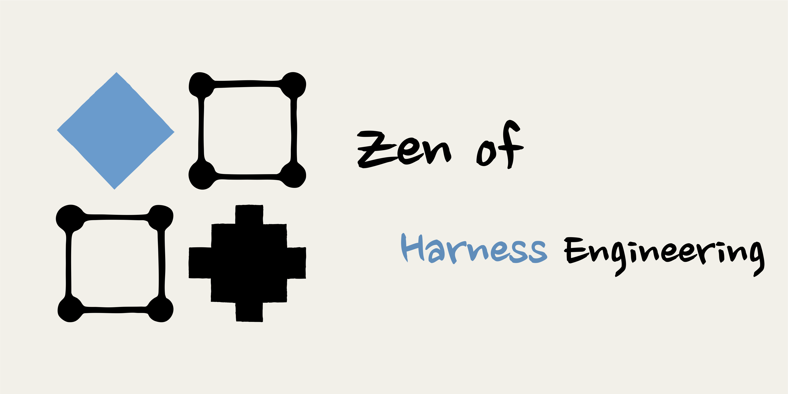
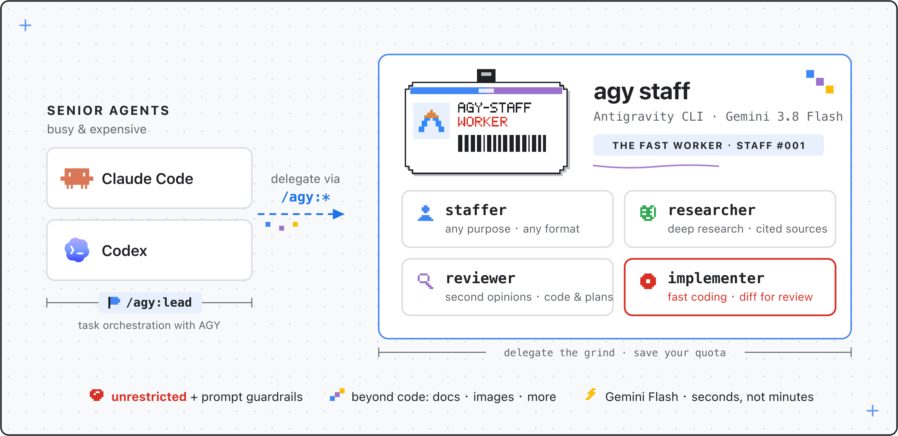
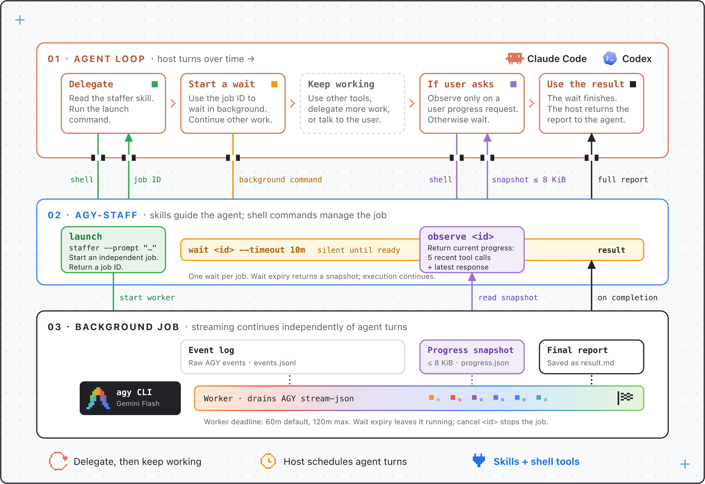
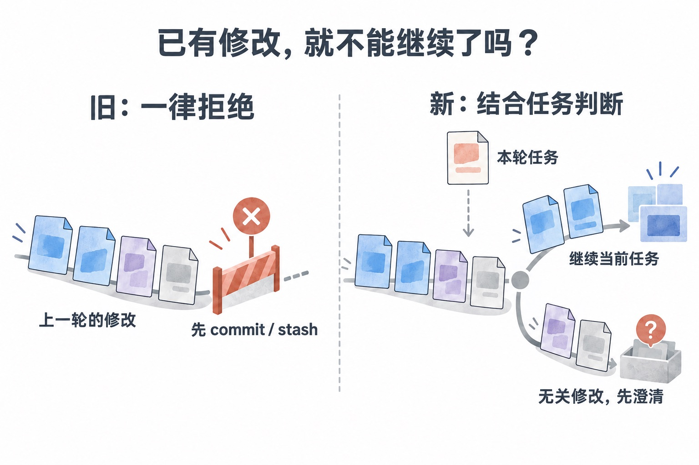
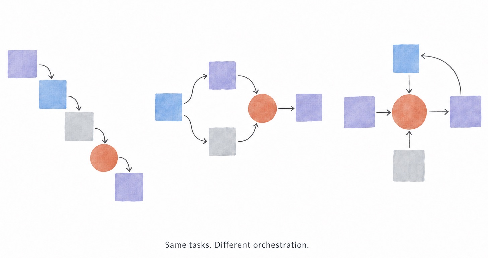

# Harness Optimization in Practice: Agent Tool Optimization | Notes on Iterating agy-staff

`READ⏰: 8min`

## The Iteration Process

A while ago, I shared [agy-staff](../agy-staff/)

*agy-staff architecture diagram*

a plugin that puts Gemini to work for Codex / Claude Code. At the time, I said I was planning to use it normally for a while and then come back to share my experience. Lately, as I've been using and tweaking it side by side, I've also accumulated some new thoughts. Here is a diagram showing how it works after the updates:

*Timeline of a background task: the main Agent dispatches, waits, or observes, while the worker continuously saves output and finally delivers the complete report*

**Back in the 0.4 days, features were mainly organized around a few persona skills**: research, review, implementation, and a general-purpose staffer. It was mostly about doing some Prompt Engineering so that Codex / Claude wouldn't have to repeatedly set up specific Agent Roles.

At that point, Gemini could already run tasks in the background and have the main Agent collect the results once finished, though it was still fairly "rough." In practice, I usually had to explicitly pick the corresponding role myself, for example, "Please use `/agy:staffer`." At this stage, what I cared more about was how to make it convenient for Codex / Claude to invoke Gemini, while keeping it **user-friendly**. With a simple `/agy:staffer` or `/agy:reviewer`, a lot of repetitive typing could be avoided.

The subsequent updates came about as I ran into pain points while plugging it into a general Harness during actual use, and started optimizing from there.

**From late 0.4 to 0.5, I updated the default model and also patched up a number of integration and usability issues.** The default model was switched to Gemini 3.8 Flash, and during this period Pi support was also added (from a community [contribution](https://github.com/keli-wen/agy-staff/pull/6), thanks~).

One of the more interesting changes was to the implementer.

Previously, the implementer had a pre-execution check requiring a clean working tree before starting a task. The purpose of this design was mainly out of concern that the Agent would mix existing changes with new ones, making review and rollback inconvenient. So as long as there were uncommitted changes, it would require a commit or stash first.

Later, though, I ran into a problem in actual use: when you wanted to continue making changes, this check would refuse to let the implementer proceed because the working tree already had changes left over from the previous round. **The work it had just finished became an obstacle to continuing the work.** This showed that the previous design really wasn't reasonable enough.

So I reflected on my design and realized it wasn't quite agent-friendly enough. At the tool layer, it pre-injected an assumption: "As long as uncommitted changes exist, it's not suitable to continue execution." But this condition couldn't distinguish which changes were the user's other work and which happened to be the exact content the current task needed to keep working on.

This reminded me of primitive RAG Systems, or rather, the question I discussed earlier in [One Poem Suffices: Just-in-Time Context](../../one-poem-suffices/just-in-time-context/): **Who decides the next step? Push vs Pull Mode** Some judgments can indeed be fixed in advance, but others need to be made in conjunction with the task context. Making these judgments for the Agent too early can restrict situations it would otherwise be capable of handling (which goes against the bitter lesson).

So in 0.4.4, I removed this blanket rejection check, allowing the implementer to run tasks on a dirty working tree while passing the existing changes as context to the executing Agent. Changes clearly belonging to the task can continue to be worked on; if unrelated work is involved, ownership is unclear, or the user's changes might be overwritten, it is required to check and clarify first.

*implementer continuing a task on a dirty working tree*

This also reminds me of the auto-approve mode in various Harnesses.

!!! note "Agent-native tools and Just-in-Time Context"

    In fact, I increasingly feel that my understanding of **Agent-native tools** here is closely connected to Just-in-Time Context. A very important point is **agent-driven progressive disclosure**, allowing it to fetch information when needed and then decide the next step based on that information.

    Right now, I'm very inclined to design long-horizon agent tools/orchestration along this direction. At least for the kind of tools I'm building, it's a very useful starting point for design.

    To borrow [Anthropic's definition of an Agent](https://www.anthropic.com/engineering/effective-context-engineering-for-ai-agents): **"LLMs autonomously using tools in a loop."**

    From the Agent's perspective, I want tools to support keeping the entire loop moving forward. For blockers that can be handled in light of context, they should offer the opportunity to continue judging/deciding, rather than handing decision-making power over to so-called rules or systems. At the same time, tools need to provide **necessary, bounded, and progressively disclosable context**.

    Part of this is the responsibility of the tools, and the other part is the responsibility of the general Harness, which is why the Harness is so important.

    Here I recommend two blog posts that I also drew inspiration from:

    - [Anthropic: Writing effective tools for agents — with agents](https://www.anthropic.com/engineering/writing-tools-for-agents)
    - [OpenAI: Shell + Skills + Compaction: Tips for long-running agents that do real work](https://developers.openai.com/blog/skills-shell-tips)

**The focus of the 0.6 series was making the tool execution process boundedly observable and improving the mechanism for re-deciding after a timeout.**

One scenario that prompted this round of updates was that some research tasks would exceed the default ten-minute execution time limit, often getting cut off before they were finished. Although there was already a separate `wait` interface at the time, where an expired wait wouldn't stop the background task, it could mainly just tell the caller "still running." Once actual execution timed out, the progress and recovery information handed back to the main Agent was also fairly limited.

And the core issue here is: **what we are building is not a native tool inside the Harness, but an external plugin.** The main Agent cannot natively know what specifically happened. Merely telling it "timed out" isn't enough to help it judge whether it should continue, adjust the task, or stop and inspect next.

This brings us right back to what I said earlier: a tool needs to **provide necessary, bounded context capable of supporting the next judgment**.

From this perspective, agy-staff was already an asynchronous subagent plugin implemented via Bash + Skills. Version 0.6 made its form more concrete: **an external subagent tool that plugs into a general Harness via Bash + Skills, supporting asynchronous execution and streaming progress observation.**

So this round added streaming progress collection and `observe`. When you need to check on progress, you first get a small snapshot: containing up to five recent tool activities, along with an excerpt of the latest response text.

The core here is "bounded," for which you can refer to my blog post [Why Is Codex Always Auto-Compacting?](../why-codex-compacts/). Context resources are precious, and dumping a huge amount of intermediate process in all at once may affect the main Agent's judgment of the task. (Although most Harnesses set an output cap on the Bash Tool, this also reminded me that a good tool should consider this issue on its own.) When more information is needed, details can be expanded; the full report is collected separately.

*A bounded progress snapshot returned by observe*

This also made me sort out for myself once again the distinction between "how long to wait" and "how long execution is allowed" in an agent tool.

I understand the former as an **attention lease**: after the main Agent waits for a period of time, it can re-fetch the current status and then decide whether to keep waiting. It is a bounded waiting window, not the expiration of the background task's execution permission (this part is very easy to understand in conjunction with the diagram at the beginning). When the actual execution cap is reached, the task will still stop, but the plugin needs to preserve progress, the session, and a recovery entry point as much as possible so that subsequent handling has something to go on.

!!! note "Observability does not mean observing all the time"

    In fact, after implementing observe, I ran into another problem: in some of my own Codex invocations, if not explicitly guided, it would repeatedly observe.

    This felt like putting the cart before the horse. When we use a subagent, we usually also want context isolation. If the main Agent keeps reading its intermediate process, it brings part of the exploration process right back into its own Context. Observability is a capability, but it doesn't mean you need to observe constantly.

    By comparison, I rarely ran into this situation when using Claude Code. Whether this difference comes down to the Harness or the model, or the guidance in the Skill, is something I will analyze further in a detailed follow-up blog post.

    So, based on the guidance in the updated Skill, the default now is still to wait quietly for the result, and only check when the user asks about progress; when there is a failure or the result requires intervention, diagnostic information is read on demand.

**Version 0.7 added orchestration capability: `/agy:lead`.**

Once enabled, the current main Agent is responsible for organizing the work, selecting tasks suitable for delegation, reviewing the results, and then continuing collaboration based on feedback. This approach isn't limited to coding either; research, writing, and analysis can all move forward along the same division of labor.

What I built here is fairly thin and simple, but I find it quite valuable. Previously it relied more on the user explicitly specifying tasks, whereas with the orchestration Skill, you can use `/agy:lead <task instruction>` to have the main Agent organize AGY's work in the course of driving the task forward. In other words, it explicitly switches on an "orchestration mode" for the current task~

The current orchestration is still very simple. Drawing on my earlier [Thinking in Context: When Do We Need Multi-Agent Systems?](../../thinking-in-context/when-multi-agent/) and my personal dev-skills, I only defined the basic rules: consider context boundaries to fan-out subtasks, run independent work in parallel, advance dependent work sequentially, and keep key judgments and final acceptance with the main Agent. Very small tasks are handled directly, without orchestrating just for the sake of orchestrating.

## Reflections and Next Steps

Having gotten this far, I'm starting to understand **Agent-native tools** more concretely.

For a **long-horizon** tool like agy-staff, I want the Agent calling it to be able to put work into the background, get enough information when needed, and decide the next step accordingly. The tool's usage instructions, return content, and execution state all need to be designed around this process. This also connects back to the question I focused on when writing about progressive disclosure: at this current step, just how much Context do we need to give the Agent?

What's quite interesting is that agy-staff plugs into the host through Skills and ordinary Shell calls. Under such constraints, how to make the collaborative experience of an external Agent feel closer to a native subagent is something I've been mulling over repeatedly during this time.

!!! ambition "Orchestration capability is very important"

    My experience in use is that for the exact same task, orchestrating it differently can sometimes make a world of difference in completion efficiency. Which work the orchestrator does directly, which is handed off to other Agents, along what boundaries subtasks are split to build the orchestration Graph, when to pull things back for review—all of these choices heavily affect the outcome.

    I expect models will get better and better at some classic orchestration patterns as training progresses, but there is a time lag here. Especially for problems where the division of labor isn't so obvious and that carry personal preferences and specific context, being able to design the orchestration yourself can still make a very practical difference. (Recently I saw that OpenAI scheduled nearly 10k agents to solve the NS problem, which must have involved quite complex orchestration patterns, definitely not a simple orchestrator-worker setup—for instance, hierarchical orchestration or A2A decentralized society orchestration?)

    So my interest lies more in Harness and Orchestration: I feel these are areas that, at least for now, complement model capabilities~ On orchestration, I'm also planning to write a standalone piece later, *One Poem Suffices: Agent Orchestration*. (Digging all kinds of holes for myself to fill later)

*`/agy:lead` orchestration mode*

Next, I plan to use agy-staff as an example to write a post titled *How to Understand and Design Better Agent Tools*, thinking through the trade-offs behind these designs from the perspectives of the Agent loop / Harness / long-horizon tasks.

For this time, just a quick update. The project and usage instructions are on [GitHub](https://github.com/keli-wen/agy-staff). Feel free to share your experience using it~
