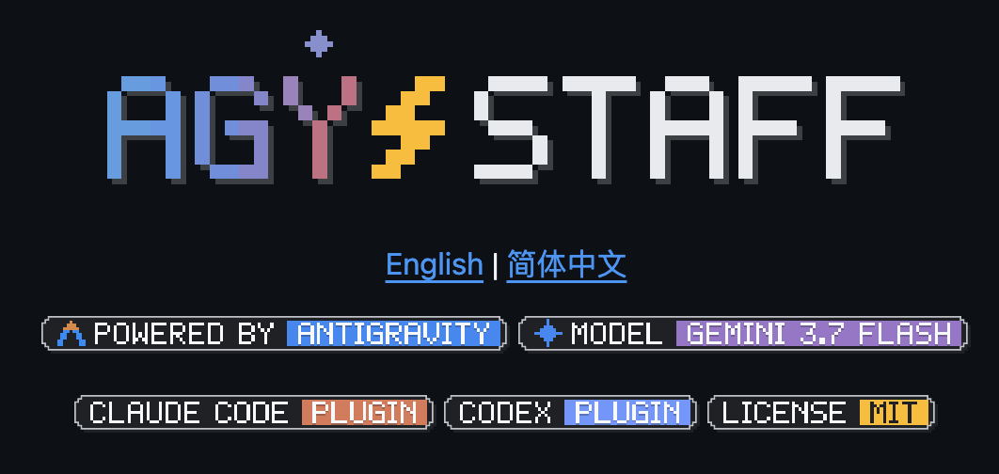
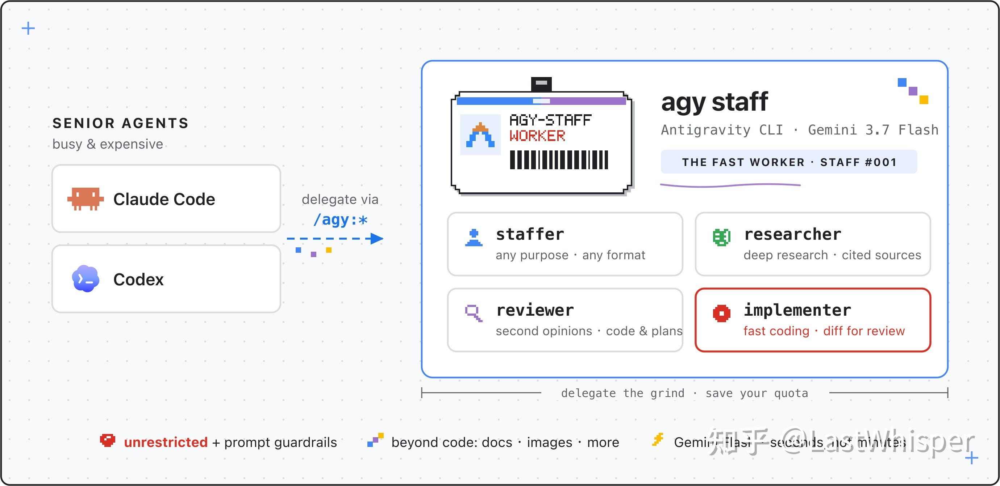
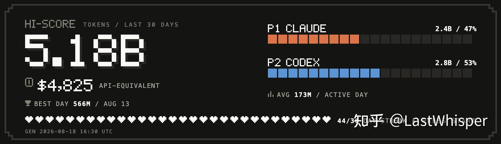
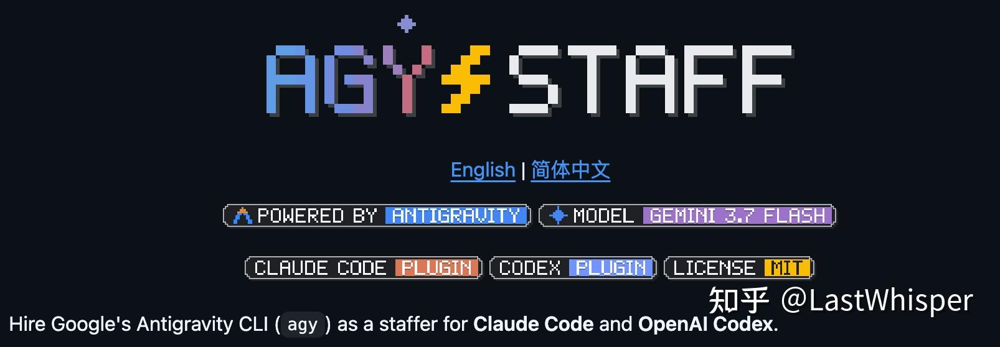
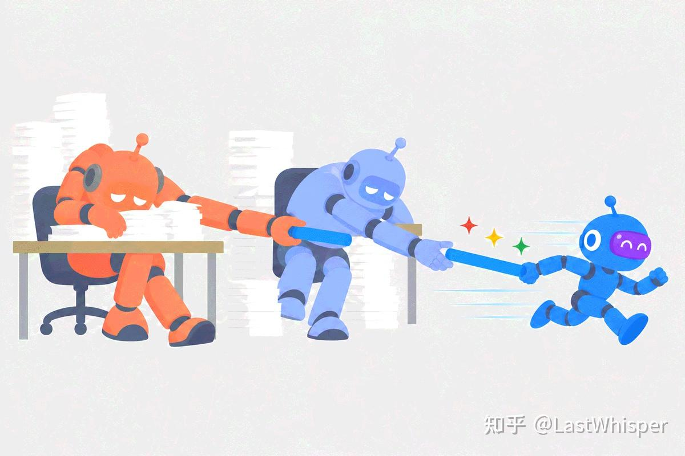
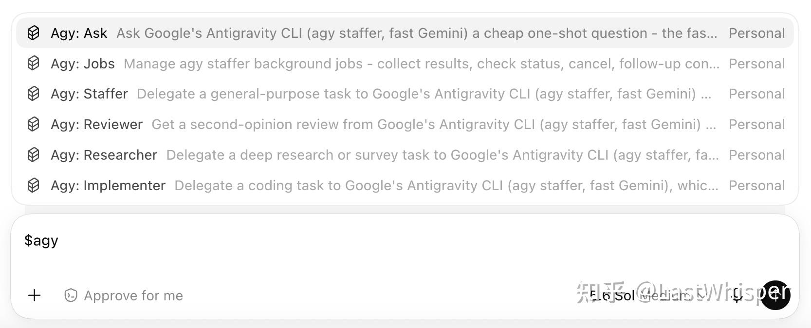

# agy-staff: Making Gemini a Staff Member for Codex / Claude Code

What I actually did was turn Antigravity into a [subagent plugin](https://github.com/keli-wen/agy-staff/tree/master) called `agy-staff` for Codex / Claude. It puts Gemini to work for other models.

*agy-staff: Architecture Diagram*

Why did I want to build this? Mostly because of a few pain points I've run into in my agentic engineering workflow:

1.  **Right now**, fast models usually deliver poor results, while more capable models tend to have slower inference speeds (**calling out GPT 5.6 Sol here**) and tight usage quotas.
2.  A Gemini subscription is relatively cheap to get, but how do you actually make efficient use of its quota? Its current capabilities still aren't suited for acting as an orchestrator.

Ever since Gemini 3.5 Flash, Gemini Flash has actually had a potential niche (as an efficient executor). Back then, though, its capabilities were still too weak, so users (like me) couldn't really trust it. With the iteration up to Gemini 3.7 Flash, however, it has made a real leap compared to its old self and is noticeably more reliable. So having the top-tier models in Codex or Claude Code arrive at problem-solving specs / insights through grilling and reviewing, and then having Gemini act as the staff member dispatched by them to finish the concrete work, seems like an effective way to solve the two pain points I mentioned above. **Plus, the Antigravity CLI can natively call Nano Banana, and combined with the Gemini family's strengths in multimodal and frontend work, it can also serve as a powerful assistant to Codex / Claude in areas less focused on strict code execution (marketing, analysis, design, especially since Claude cannot natively generate images).**

So I built the corresponding plugin. Right now, this plugin is designed mainly around my own common needs, such as code implementation, Deep Research, and independent Review (both general Review and Code Review). To make it feel more like a native Subagent provided by the harness, I also iterated through several versions of the orchestration (interaction details like task dispatch and wake-up, background execution, result collection, and follow-ups).

Some of these designs borrowed best practices from Anthropic's blog posts. That said, it's still in a relatively early stage, and many of the design calls come more from my personal usage habits (along with things I picked up while writing my blog).

Next, I plan to just use it normally for a week or two, **to see whether Gemini as a staff member can actually complete tasks efficiently and with high quality**. Once I've accumulated some real-world experience, I'll come back and share the more interesting insights.

I've put my original Zhihu answer below. If you're interested, feel free to keep reading~ I'll also do my best this week to post an essay on my recent thoughts about Agentic Engineering.

[https://www.zhihu.com/question/2071408739723302257/answer/2073214784749703642](https://www.zhihu.com/question/2071408739723302257/answer/2073214784749703642)

------------------------------------------------------------------------

*day to day tokens*

I try out various models in my day-to-day work, and my assessment of Gemini 3.7 Flash is that **it can serve as an implementation / research subagent for Codex and Claude in certain scenarios, pushing task progress forward efficiently.** Another highly upvoted respondent on that thread actually mentioned this exact angle too.

To that end, I specifically built a small GitHub tool (a plugin for Codex and Claude), `agy-staff`. The idea behind the name is hiring a fast-working Gemini staff member for Codex and Claude. My main motivation was to make use of my Gemini AI Pro subscription quota.

agy-staff - [​https://github.com/keli-wen/agy-staff/tree/master](https://github.com/keli-wen/agy-staff/tree/master)

*Gemini Staff*

## Background

Folks who regularly use the GPT-5.6 series models have probably noticed something: GPT-5.6, especially Sol, is very slow, both in inference speed and in overall task completion speed. I feel it's **not even suitable to be an executor**. In fact, I'm currently writing a blog post about GPT-5.6 Sol's **"BFS dilemma"** during execution: while executing a task, it tends to drift off the main track, and even when the spec is already clearly laid out, it still leans toward analyzing every possible detail (which makes it pretty good at design and analysis, aside from being very slow).

By contrast, GPT-5.5 (specifically GPT 5.5 xhigh here) is very well-suited as an implementation subagent. For a medium-difficulty task, I used to be able to hand it over to GPT 5.5 xhigh along with the corresponding project skills, walk away, and just come back for a quick acceptance check. GPT 5.6 Sol, on the other hand, can easily run for 60+ minutes~ So later on I mostly used Sol for design, while on the execution side I defined GPT 5.5 Worker and GPT Luna Worker agents (xhigh and max).

> This is because before the recent Codex MultiAgent V2 Mode update, you couldn't orchestrate models other than sol and terra through natural language; you had to configure custom agents globally for Codex: [​https://learn.chatgpt.com/docs/agent-configuration/subagents?surface=app#app-custom-agents](https://learn.chatgpt.com/docs/agent-configuration/subagents?surface=app#app-custom-agents)

Fable goes without saying; the main problem there is running out of quota. So my workflow is to use Fable as the orchestrator, Opus5 for implementation, and Sonnet5 for checks and basic research (lately I've also been optimizing my own [​dev-skills](https://github.com/keli-wen/dev-skills), where the core focus is executing long-horizon autonomous tasks. If anyone's interested, I'd love your suggestions; it's mainly built on top of some reflections from my blog post *Thinking in Context: When Do We Need Multi-Agents*).

[https://zhuanlan.zhihu.com/p/2010163501814010621](https://zhuanlan.zhihu.com/p/2010163501814010621)

For a while after GPT 5.6 Sol came out, I felt my efficiency was terribly low. There was one time in particular where I spent roughly a whole afternoon wrestling with it: because Sol kept going off on tangents and my Claude Code quota was exhausted, I hit cognitive overload with zero actual progress made. After that, I gave up on using Sol as an executor~ I'll cover the specific thoughts behind this in a dedicated blog post later. If you're interested in some of Codex's behaviors, I recommend giving this a read (they finally coughed up a 1M context window~)

[https://zhuanlan.zhihu.com/p/2058727424167241456](https://zhuanlan.zhihu.com/p/2058727424167241456)

## About Gemini

I've found that fast models are still really valuable; being able to push small tasks forward quickly makes it much easier to get into a flow state. Right now, neither Codex nor Claude models can really be called fast. Both my internal usage and the benchmarks from my own work reflect that 3.7 Flash is a huge improvement over 3.6 Flash (at least in the agentic domain), crossing the threshold of being genuinely usable. As shown in the diagram, that's where its value shines: taking the baton from Codex and Claude to handle lighter-weight tasks.

*Gemini takes the baton!*

Because it has gone from being **fast and nothing but fast** to being **fast and "good"**, it at least has a potential ecological niche of its own now. So I designed several common working modes for it to be dispatched by the two senior agents. Next, I'll be optimizing the user experience of this plugin~ Let's see if it can become a qualified subagent under Codex/Claude, and I'll share an updated review here later.

*Posting this one again*

*codex desktop*

## Reference

- agy-staff - [​https://github.com/keli-wen/agy-staff/](https://github.com/keli-wen/agy-staff/)
- dev-skills - [​https://github.com/keli-wen/dev-skills](https://github.com/keli-wen/dev-skills)
- If you're interested in tracking and visualizing your own token usage: [​https://github.com/keli-wen/token-history](https://github.com/keli-wen/token-history)
