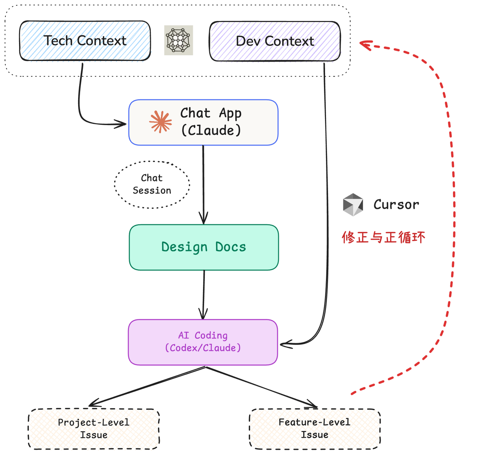
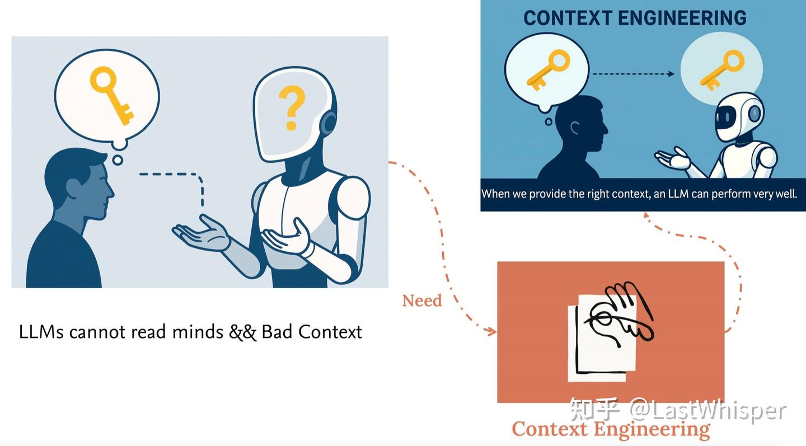
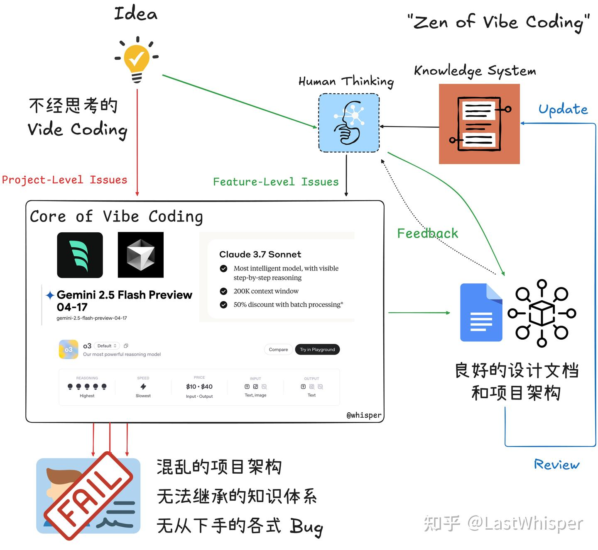

# Zen of Harness Engineering: Best Practices I

> Originally published on [Zhihu Column](https://zhuanlan.zhihu.com/p/78314710899), 2025-10-20

I'd like to share some of my practices in AI Coding. As for my broader thoughts on AI Coding, I plan to write a few dedicated posts later on.

Here, I'll briefly share some of the "best practices" I regularly use, mainly covering how I approach AI Coding from scratch, how to build "technical compounding" (which insights to maintain), and a brief comparison between Codex and Claude Code.



## 1. Maintaining Tech Context

At this stage of AI Coding's development, the bottleneck is no longer the model, but whether human guidance is well-established. That is, in most cases, the problem is that the code generated by AI Coding does not align with your "true" intentions.

Since AI cannot read minds, we need to provide the corresponding context to resolve these issues.



After manually typing out the same prompts repeatedly, I started maintaining a simple Tech Context stored on my iCloud, making it easy to copy and paste in any situation. Below is a simple Tech Context Example that you can modify however you like based on your needs, including adding your own minor preferences.

??? example "Tech Context Example"

    ```yaml
    ## Tech Context
    Frontend:
      Framework: React and Next.js
      UI Library: Tailwind CSS and shadcn/ui
    Backend:
      Framework: FastAPI
    Database:
      Primary Database: Supabase (PostgreSQL)
      Vector Database:
        Demo/Development Environment: ChromaDB
        Production Environment: Use PostgreSQL with the pgvector extension enabled
    Agent:
      Development Framework: Google Agent Development Kit (ADK)
    LLMs and Embeddings:
      Model Invocation: Use OpenAI Python SDK, supporting various OpenAI-compatible model services by modifying the base URL
      Embedding Models:
        General: OpenAI's text-embedding-3-small
        Domestic Alternative: Qwen's text-embedding-v4
    Demo Tool: Streamlit
    Deployment and Hosting:
      Frontend: Vercel
      Backend Services: Supabase (implementing service logic via Edge Functions)
    ```

With this Context, you can easily align the AI with your overarching development direction at any subsequent step. In other words, you are manually maintaining personal memory.

Besides Tech Context, I also like to maintain a Dev Context, such as code style and system design preferences (which are now more commonly placed in an `AGENTS.md` file). However, Dev Context is tied to the project's domain; the Dev Context for full-stack development is different from that for an AI Agent. Since I don't want to introduce irrelevant context, I currently choose to maintain it manually in my Obsidian, pasting it on demand or placing it in the repository's `AGENTS.md`.

## 2. Talk to Design Docs

Once model capabilities cross "that threshold" (I believe both `Claude Sonnet 4` and `GPT5-Codex-High` meet this criterion), the programming paradigm is gradually shifting toward "natural language programming." For instance, the recently popular repo [spec-kit](https://github.com/github/spec-kit) teaches you how to write comprehensive documentation for AI Coding, though since I haven't used this project myself, I can't offer detailed insights.

For me personally, however, this paradigm of coding via natural language has made tremendous use of my fragmented time. Its biggest advantage over traditional coding paradigms is how extremely simple and fast it is to get started. Traditional coding is a cold-start process that requires some warm-up, such as opening your computer, launching the IDE, conceptualizing, and writing code in a specific language. In contrast, the natural language programming paradigm lets you start coding at any time. You just need to write down your thoughts, goals, and other prompts in a text editor like a notes app, and let the AI do the coding for you when you have free time.

Of course, natural language programming will inevitably run into various corner cases, and we need to be somewhat tolerant of this. Just as you used to encounter plenty of bugs when coding in a programming language, it is equally unavoidable when coding with prompts. But this is also a process of accumulation, which is why Context is so important. Beyond the growth of the model's own capabilities, a large part of your advantage over others comes from the context you distill and accumulate.

So, right now, the most important question for me is: how do I build an accurate design document that follows AI Coding Best Practices? My current practice is to converse with an LLM and, after multiple rounds of dialogue, have the LLM generate a standardized design document to serve as the cornerstone for subsequent AI Coding. My general workflow is as follows:

1. Open the Claude app, paste the Tech Context, briefly describe my design goals, and discuss the system architecture and details with it step by step, while also asking it to point out potential issues as well as any vague or ambiguous areas in the current design.
2. You can easily dive into any detail or resolve any confusion within a single chat session. Once you feel the design is sufficiently complete, you can ask Claude to generate the final design docs based on the current session's chat history.
3. During the conversation with the LLM, any takeaways and reflections can be manually updated into your Tech / Dev Context. This is the key to generating technical compounding: maintaining a well-crafted Tech / Dev Context can save a massive amount of time in subsequent project development.

!!! quote "On the Value of Context"
    Quite a few people might think that distilling and maintaining one's own Context isn't actually important, because advances in model capabilities will render these Contexts worthless. I cannot predict the future development of models either, and I have thought seriously about this question. Here is a brief explanation of my understanding:

    Much of the time, we maintain personal Context not to help the model improve its performance, but to help the model align with us. Both now and in the future, a model's capabilities will certainly exceed those of the vast majority of individuals. Context exists so that the model can give answers in a way you can understand. Therefore, **building Context is necessary** (to align the model with your capabilities), and **reflecting on and updating Context is also necessary** (to align yourself with the model's capabilities). Neither is dispensable.

## 3. Project Level && Feature Level

A long time ago, I divided Vibe Coding into two categories (refer to the previous post [Zen of Harness Engineering: Introduction and Problem Taxonomy](../intro/), though the specific content is probably quite outdated now, as Coding Agent capabilities back then were nowhere near what they are today):

- **Project-Level**: Related to the overall project, involving multiple, complex, and coupled issues. It is characterized by relatively vague requirements that can be further broken down and discussed, such as "design a plugin/application with a certain feature."
- **Feature-Level**: Related to specific features, involving single, few, and independent issues. It is characterized by relatively clear requirements, similar to most GitHub issues, such as "fix a bug caused by XX."



Let me briefly introduce how I handle these two types of problems respectively:

### 3.1 Feature Level Issue

My approach to solving feature-level issues has always been consistent. This is also what I consider a very important part of AI Coding: when you are needed to solve detailed problems, you had better actually be able to solve them. This is the most critical link in the last mile of AI Coding and in going from Demo to Production.

!!! warning "Avoid Over-relying on AI"
    Because we learn by doing, and AI Coding now skips the vast majority of the "doing" steps, if you rely entirely on AI even for feature-level problems, it will be very hard for you to make any progress. On the contrary, most of your skills will regress.

Early on, there was a period when I relied entirely on AI to build the whole project. The consequence was that I also relied entirely on AI during debugging, which led me to waste a tremendous amount of time on issues that were actually quite simple (sometimes AI just gets stuck and cannot solve certain problems). At the same time, it put me in a terrible mindset (because solving problems felt like pulling gacha: you can't predict whether you'll be able to solve the problem, or when). Moreover, in the long run, it made me very restless and left me with no long-tail value.

So for me personally, I make sure I understand the full context of the problem, and I try to come up with the solution myself. I use AI to solve the problem following my train of thought, rather than having it solve the problem for me. Because of this, I use Cursor's chat feature to resolve feature-level issues to ensure I maintain maximum grasp over these details.

At the same time, these kinds of issues often surface during actual execution after the AI has finished writing the code for the entire project. This likely indicates that your initial design did not cover this part. This is precisely the part worth learning from, and you can reflect on it and update your Context:

- Was something missing in your design?
- Was there ambiguity in your description (Prompt)?
- Do you need to add heuristic guidance? If so, do you need to maintain your own `AGENTS.md`?

This is the most important stage for revising your Tech / Dev Context and Design Docs.

### 3.2 Project Level Issue

The scope of project-level issues is a bit too broad. Currently, my practice, as mentioned earlier, mainly follows this loop: Maintain Context → Converse to generate Design Docs → AI Coding implementation → Reflect and update Context & Design.

More specifically:

- If it's FullStack, I use `bolt.new` for MVP development, tune it for a few rounds in the chatbot, and then download it locally to resolve feature-level issues using Cursor.
- If it's more oriented toward Research & Open Source, I choose to have Codex review the Design Docs and generate a concrete development Plan, have Claude Code develop based on the Plan, and finally have Codex perform the Review (see the end of the post for a comparison between Codex and Claude Code).

## 4. Summary

These points cover the vast majority of my AI Coding practices. Beyond this, there isn't much else that's special. For the research phase, I launch DeepResearch across Gemini, OpenAI, and Claude simultaneously; right now, I prefer Claude Research.

??? info "Codex vs Claude Code Comparison"

    Here I can only compare claude sonnet4.5 / gpt5-codex-high.

    - **cc** is very well done in terms of agent architecture and executes very quickly, but its default style tends toward over-engineering and over-design. Even if you provide a very detailed design document, cc will still over-engineer the details you haven't fully defined, requiring you to set up many rules in advance.
    - **codex** has a very strong pure model. It has a sense of "great skill appears effortless"; its implementation is very restrained and appropriate. It's hard to describe this feeling concretely, but roughly speaking, its usability is extremely high and it doesn't over-design. It is well-suited for implementation and refactoring (if you let cc refactor, it will most likely get weirder the more it does).

    Therefore, I recommend using them in combination:

    - If starting from scratch, I first draft a very detailed design document, which is crucial for both codex and cc. Then I let codex refine it & generate `Plan.md` -> cc for implementation (writes fast) --> codex for review (if I find major issues with what cc wrote, I just wipe it and let codex write it).
    - If it's just feature-level, I'll use Cursor hahaha, to ensure I have a complete grasp of the feature-level issue; otherwise, it's easy to fall into the common vibe coding trap of spinning in circles.

    cc's deep optimizations in agent architecture & context engineering will definitely have their own ecological niche in the future. Take, for example, Anthropic's currently beta memory tool and [context editing](https://www.anthropic.com/news/context-management). If these features are rolled out to the official version of cc, it will pull far ahead of codex in certain specialized scenarios.
