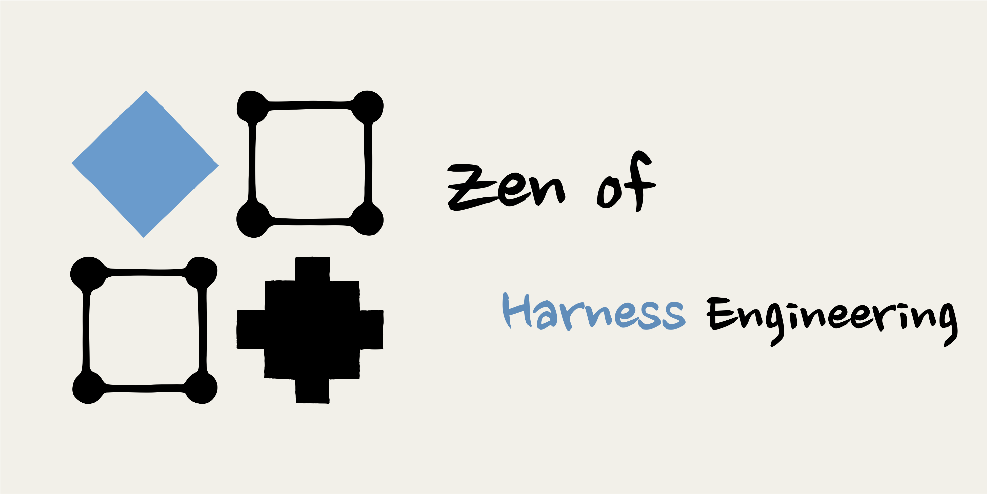
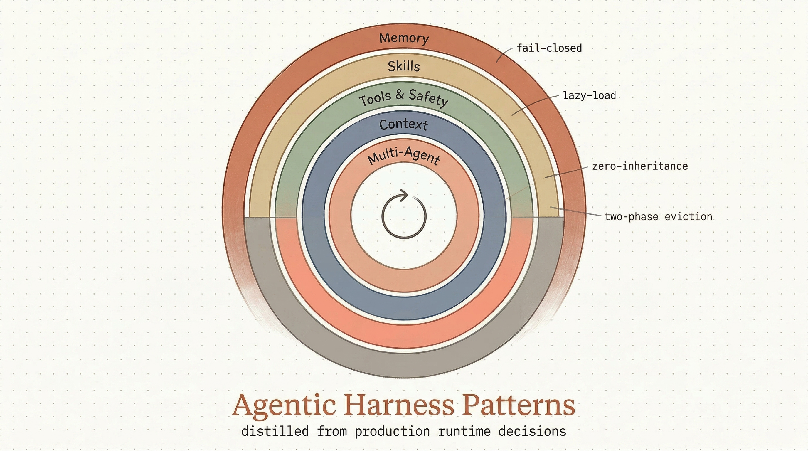
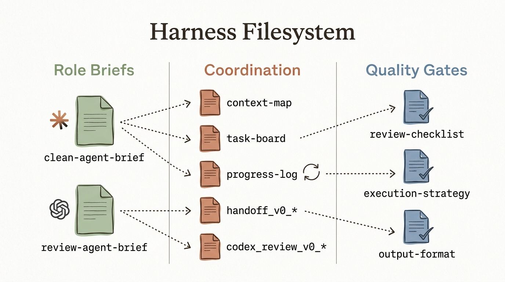
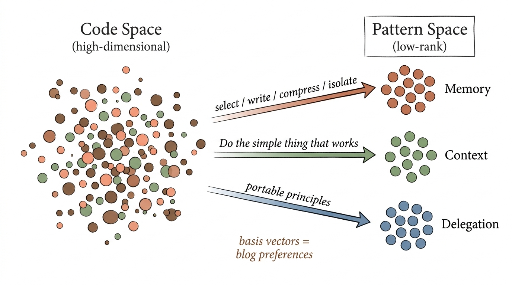
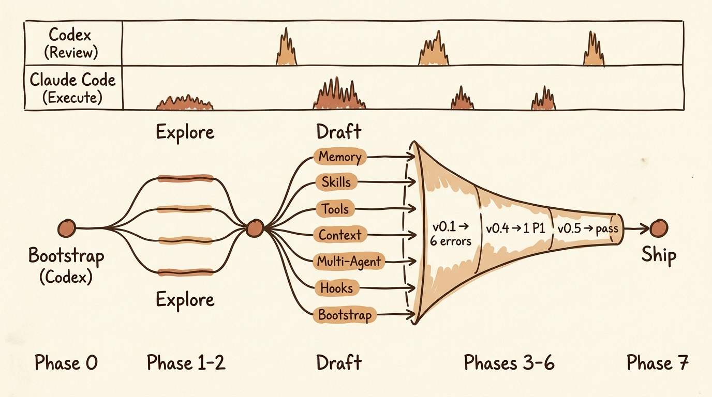

# Distilling Claude Code Source into an Agent Skill — A Harness Engineering Practice

`READ⏰: 25min`

A while back, the Claude Code source code leaked: 512,000 lines of TypeScript. My first reaction upon seeing the news was to strike while the iron was hot and systematically "distill" the design patterns of its harness layer — this is probably the most mature production-grade agent harness implementation one can get their hands on right now. I never expected that one day I would have Claude Code distill itself, turning sizzling-hot code into a cold, crisp Skill.

The end result is an Agent Skill that can be installed directly with `npx skills add` — [agentic-harness-patterns-skill](https://github.com/keli-wen/agentic-harness-patterns-skill). It distills six harness-layer design principles from Claude Code's implementation: covering everything from how agents manage memory and context, to how multi-agents coordinate division of labor, all the way to how tool permissions and lifecycles are designed. It focuses on the why behind the decisions rather than Claude Code's how, in hopes of being directly portable to other agent frameworks, or serving as a guide for best practices in one's own agent harness development and design.



Yet 512,000 lines of code are clearly not something a single agent can tackle within a single session. The distillation process itself thus turned into an exercise in Harness Engineering — I designed a multi-agent coordination workflow where Codex (GPT 5.4 xhigh) handled review and Claude Code (Opus 4.6 max) handled execution, with each round of review & action taking place in a fresh session and coordinating via the filesystem. My design principles drew primarily from several classic lab blog posts:

- [Anthropic - Effective harnesses for long-running agents](https://www.anthropic.com/engineering/effective-harnesses-for-long-running-agents)
- [OpenAI - Harness engineering: leveraging Codex in an agent-first world](https://openai.com/index/harness-engineering/)
- [OpenAI - How we used Codex to build Sora for Android in 28 days](https://openai.com/index/shipping-sora-for-android-with-codex/)

If I were to summarize the most valuable insights conveyed by these blog posts:

- **Anthropic**, in my personal view, boils down to: maintaining multi-agent roles and leveraging the filesystem effectively as context. (Anthropic has deep insights into multi-agent systems~, and Filesystem-first and Just-in-Time Context are clearly their favorites as well.)
- **OpenAI**, throughout the continuous iteration of Codex, has gradually aligned with the concept of "filesystem as context." Another interesting point is that OpenAI's blog posts feel like they place a strong emphasis on injecting human taste into Harness Engineering (more on this later).

Looking back, the distillation process felt a bit like performing PCA (Principal Component Analysis)-style dimensionality reduction. By injecting my own blog posts and preferences, I constructed a set of "basis vectors," and then had the agents project out of the complex code space to extract a few primary principles. **Code is high-dimensional, but valuable design patterns are actually low-rank; the essence of my distillation was finding these principal components.** (Ancient memories of mathematical modeling competitions hit me.)

This post unfolds across three dimensions: the Harness collaborative architecture design, what I did along the way (Human-in-the-loop), and reflections from the practice.

## 1. Harness Design: Split by Role, Coordinate via Filesystem

The core idea is separating review and execution across two distinct model families, with each round of the review-action loop occurring in a completely fresh session. (The reason for this design is that in my daily use, GPT 5.4 xhigh never cuts corners when it comes to review and design.)

| Role | Agent | Responsibilities |
|---|---|---|
| Review & Architecture | Codex (GPT 5.4 xhigh) | Check facts against the source code, judge direction and abstraction levels, review usability from a user perspective |
| Build & Execution | Claude Code (Opus 4.6 max) | Read source code, draft reference docs, coordinate sub-agents for parallel work, execute changes |

As for why separate agent roles? For the exact same reason you don't let the implementer review their own code. Codex reviews against the source code with fresh eyes; Claude Code executes modifications carrying a full understanding of prior decisions. Neither agent can see the other's session. (Anthropic mentioned a similar concept in [Building multi-agent systems: When and how to use them](https://claude.com/blog/building-multi-agent-systems-when-and-how-to-use-them): *One multi-agent pattern that consistently works well across domains is the **verification subagent**. This is a dedicated agent whose sole responsibility is testing or validating the main agent's work.*)

So what do they coordinate through? The filesystem. Using filenames plus simple Read Tools is low-cost and loses zero information. (This design echoes Anthropic's principle in [How we built our multi-agent research system](https://www.anthropic.com/engineering/multi-agent-research-system): **Subagent output to a filesystem to minimize the 'game of telephone.'** If interested, check out: [Multi-Agent Systems: One Poem Suffices.](https://keli-wen.github.io/One-Poem-Suffices/one-poem-suffices/multi-agent-system/)). Since this was a documentation-oriented task rather than a coding task, top-level orchestration (getting the two agents to interact) was still controlled by me.

Before officially starting work, I had Codex generate the entire harness infrastructure in one go. The design goal for this set of files was: enable a clean agent with no context from the current conversation to step in directly, knowing where to read, what to do first, where to write upon completion, and how to conduct reviews.



The files are divided into three groups by function:

**Role Briefs**, telling the agent "who you are, and what the rules are":

| File | Purpose |
|---|---|
| `clean-agent-brief.md` | Builder Agent orientation: operating rules, minimum output requirements, and when to pause and ask a human |
| `review-agent-brief.md` | Reviewer Agent orientation: review priorities, output templates, and severity grading criteria for issues |

**Coordination** — shared state between agents:

| File | Purpose |
|---|---|
| `context-map.md` | Source code context map: 50+ source files grouped by harness layer, annotating why each file matters |
| `pattern-notes.md` | Exploration notes: key findings from initial scanning rounds, for subsequent agents to read directly rather than re-exploring |
| `task-board.md` | Shared task queue: 35 tasks, including dependencies and exit criteria |
| `progress-log.md` | Append-only activity log + decision log (ultimately logged 13 key decisions) |
| `handoff_v0_*.md` | Action briefs between review and execution |
| `codex_review_v0_*.md` | Codex review output: including severity ratings, source code citations, and recommended fix directions |

**Quality Gates** — defining "what counts as done":

| File | Purpose |
|---|---|
| `review-checklist.md` | Blocking issues (factual errors, unsourced claims) vs. quality checks (cross-runtime portability, trigger phrase accuracy) |
| `execution-strategy.md` | Multi-agent execution strategy: who does what, concurrency levels, and brief templates for sub-agents |
| `output-format.md` | Output format specifications: file structure, metadata fields, and length constraints |

This set of files in itself embodies a core tenet of harness engineering: **build coordination mechanisms first, start working second**. If you simply let agents start extracting patterns without a task board to track progress or a review checklist to define quality standards, the subsequent multi-agent collaboration falls apart with nothing to coordinate around.

Handoff documents are the API between agents. Each handoff contains precisely the information needed for the next agent's execution (generally an index, pointing a new agent to the general vicinity of the required contexts). The recipient boots up in a brand-new session, reads the latest handoff (e.g., `@xxx_handoff_xx.md`), and executes.

Therefore, for each review or execution, **the agent has three types of contexts**:

- agent role
- agent task handoff (task specific) (for Codex, this is the diff in `progress-log.md`)
- repo filesystem (some insights from OpenAI's blog: *We made repository knowledge the system of record, ... **give Codex a map, not a 1,000-page instruction manual.***)

(This shares the exact same philosophy as progressive disclosure in [JIT Context](https://keli-wen.github.io/One-Poem-Suffices/one-poem-suffices/just-in-time-context/) — the handoff acts as a coarse index, giving the agent just enough context precisely when needed.)

The design inspiration here comes primarily from: [Anthropic - Effective harnesses for long-running agents](https://www.anthropic.com/engineering/effective-harnesses-for-long-running-agents) **using two different agents**, where in their blog post each coding agent picks a feature to implement inside a fresh, blank session. I took it a step further: having **both** reviewer (Codex) and executor (Claude) operate in fresh sessions, receiving a full token budget every round without being polluted by earlier session context (token usage scaling), aiming for superior results (when well-designed, my experience shows this works remarkably well and scales to products of substantial size).

To add a further note: since this was a documentation-generation task, the quality of Harness engineering may not have an obvious impact on performance (because evaluating text is difficult), but on coding tasks, a good Harness design can easily keep an agent running for 30 to 60 minutes while producing exceptionally high-quality output.

## 2. Human-in-the-Loop: Taste Injection

The design goal of this workflow was to complete large-scale distillation with minimal human effort. But minimal does not mean zero. In practice, I found that the human role was indispensable in certain links.

### 2.1 Taste Injection: Blog Posts as Instruction

!!! quote "OpenAI — [Harness engineering](https://openai.com/index/harness-engineering/)"

    *Enforcing architecture and taste* — Enforcing architecture and taste; agents are most effective in environments with rigid boundaries and predictable structures.

This was probably the most interesting part of the whole process. I fed several blog posts I had previously written on Context Engineering to Claude Code as instruction / taste, directing it to reference my own analytical framework when extracting patterns.

As a result, the agent was not extracting **agent best practices** from scratch: it carried my understanding of the four-axis select / write / compress / isolate Context Engineering framework, my preference for "Do the simple thing that works," and my evaluation criteria for levels of abstraction. What was distilled was not an "objective mapping" of Claude Code source code (which was what came out initially), but the result projected onto my preference basis vectors.

Returning to the PCA-style dimensionality reduction analogy: the blog posts are that set of basis vectors. They define "**what directions are important**," and the agents then project along those directions. Without these basis vectors, the agents might extract completely different principal components — perhaps leaning more toward implementation details, or more toward API design — but not necessarily the harness design principles I wanted. (The stuff extracted initially was frankly unwatchable.)



!!! tip

    This is actually how I feel about agents completing tasks, and this point is likewise reflected in OpenAI's blog post. If you give an agent a virtually infinite action space, it will fail outright. You need to start by laying the foundation by hand (from another interesting post: [OpenAI - How we used Codex to build Sora for Android in 28 days](https://openai.com/index/shipping-sora-for-android-with-codex/)) to help reduce its action space; once you personally determine the direction, the agent will do "better" and "better" (or at least match your needs).

### 2.2 Architectural Decisions: Several Key Moments

Although the concrete reviews and edits were carried out by agents, there were several nodes where I stepped in proactively:

**Positioning choice.** Codex's first round of review pointed out that the skill was answering the wrong question: "What subsystems does Claude Code have?" rather than "What problems are builders solving?". This repositioning decision was suggested by Codex, but choosing to accept it and having Claude Code execute accordingly was my call. (Shifting it from explaining code to extracting best practices.)

**Abstraction boundary.** "If you strip away the name Claude Code, does this principle still hold value?" — this criterion solidified gradually over multiple review rounds. Initially, Codex and Claude Code held inconsistent understandings of "what counts as a portable principle"; it was I who clarified this rule in the handoff.

**Filling in the user perspective.** After five rounds of review focused on content accuracy, I realized a **user-perspective review** was still missing. Drawing from my blogging experience, where I always think from the reader/user standpoint in the end, I hardcoded this rule requiring both of them to bring in this angle of thought (in theory I should crystallize this into a skill haha).

## 3. Process Overview



### Phase 0: Scaffolding

Before any agent lifted a finger, I aligned on project scope and naming with Codex, then had it generate the full suite of harness files from §1. The prompt I gave was roughly:

!!! example "Prompt to Codex"

    "We need a harness with complete guidance (for a clean agent to pick up tasks and quickly understand contexts) and corresponding progress tracking (to make it easy for a clean agent to understand what has already been done). Could you help generate this necessary harness set?"

Compared to coding tasks, harness design for documentation tasks of this sort can be much lighter weight.

### Phase 1-2: Exploration and Parallel Drafting

Four parallel Explore Agents each covered distinct source areas, scanning roughly 1,900 files to produce a context map. Then, seven parallel sub-agents each took one harness layer to write a corresponding in-depth analysis (`references/*.md` in the final deliverable).

### Phase 3-4: Verification → Correction → Pivot

Codex's first round of review caught six factual errors (uncovered memory systems, wrong fields for concurrency classification, miscounted permission sources, etc.). Claude Code corrected them in a new session. Codex then pointed out that the direction was flawed — it should extract design principles rather than explain code.

### Phase 5: Template Standardization — 8 Agents Rewriting in Parallel

Once "principles first" was established, eight sub-agents simultaneously rewrote all documents according to a unified template (basically originating from my human feedback..):

```
Problem (Universal) → Golden Rule (Portable) → Applicable Scenarios → Trade-offs → Implementation Patterns (No-code) → Pitfall Guide → Claude Code Empirical Evidence
```

The final section described Claude Code's implementation decisions in natural language, omitting source paths, function names, and code snippets entirely.

### Phase 6: Review Convergence

(P1 = errors that must be fixed before release, P3 = phrasing-level polish.)

| Review Round | Findings | Key Issues |
|---|---|---|
| v0.4 | 1P1 + 6P2 + 1P3 | Memory model still incorrectly described |
| v0.5 | 3P3 (Passed) | Only phrasing-level adjustments |
| UX Audit | 1P1 + 2P2 + 2P3 | Skill runtime skill list has a 250-character hard limit; meticulously tuned trigger words were completely truncated |

Severities were dropping, indicating that convergence was happening. Yet the UX audit introduced a new P1 — while the content level had converged, there was still a critical issue on the presentation level that no one had caught.

### Phase 7: Final Polish

Shortened the skill description (248 → 116 characters), bringing trigger words back into view on the list. Added "Start Here" action guides to every chapter and declared the target audience.

## 4. Reflection

The preceding sections have covered most of the concrete experiences; here I only add a few more general reflections.

### 4.1 On "Objective" Extraction

§2.1 touched on the PCA analogy; let me briefly add one point here: an **objective** pattern extraction might actually turn out to be the most useless, because having no perspective means having no priorities (and thus failing to reduce the agent action space). A good "distillation" demands an explicit stance, followed by honestly labeling what that stance is (somehow this feels quite close to concepts in *Principles*; highly recommend Ray Dalio's book, I've recently been building a personal Principle Skill based on it too lol).

### 4.2 On the Roadmap

Subsequent analyses of Codex CLI and Gemini CLI will use the same set of basis vectors. If a pattern emerges along the same direction across three independent implementations, it most likely reflects not just a particular team's design preferences (nor merely my own), but the inherent laws of building agents. That might be the thing most worth pursuing going forward.

I haven't posted in a long time; next, I will likely do my best to update blog posts related to Agent Skills first~

## References

- [Agentic Harness Patterns Skill](https://github.com/keli-wen/agentic-harness-patterns-skill) — Distillation artifact
- [Context Engineering: One Poem Suffices](../../../one-poem-suffices/context-engineering/) — Basis vector 1
- [Just-in-Time Context: One Poem Suffices](../../../one-poem-suffices/just-in-time-context/) — Basis vector 2
- [Thinking in Context: Context Engineering in Codex](../../../thinking-in-context/context-engineering-from-codex/) — Basis vector 3
- [Anthropic: Effective harnesses for long-running agents](https://www.anthropic.com/engineering/effective-harnesses-for-long-running-agents)
- [OpenAI: Harness engineering](https://openai.com/index/harness-engineering/)
- [OpenAI: How we used Codex to build Sora for Android](https://openai.com/index/shipping-sora-for-android-with-codex/)
