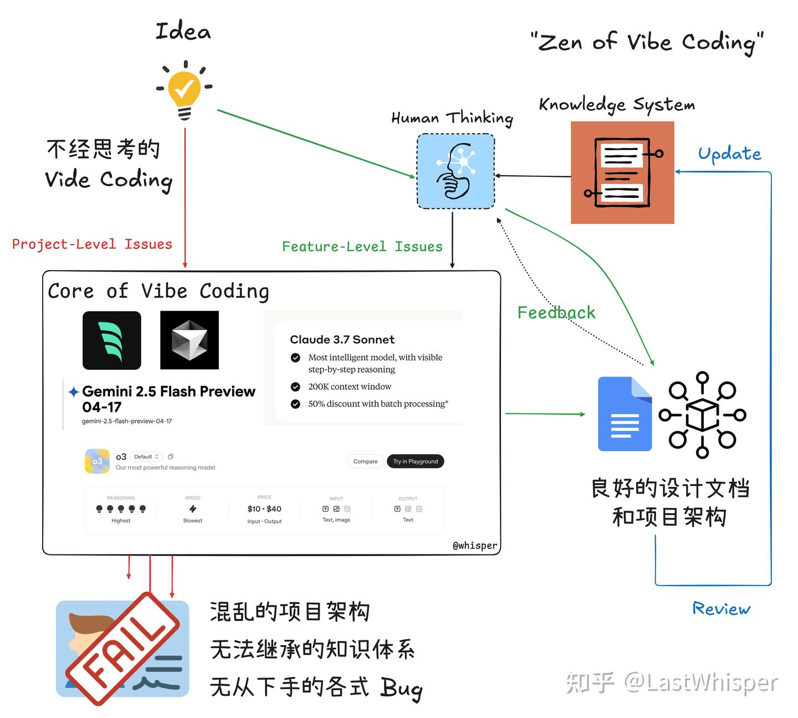
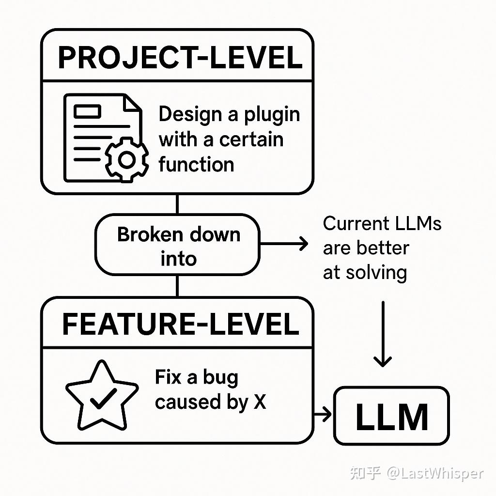

# Zen of Harness Engineering: Introduction and Problem Breakdown

> Originally published in my [Zhihu Column](https://zhuanlan.zhihu.com/p/1903296419898556976) on 2025-05-22

On a sudden impulse, I decided to write this down. I originally planned to distill my experience into a "Vibe Coding Best Practice" (which is essentially a summary of methodologies and workflows). Whenever I tried writing it, though, it felt incomplete, and once I refined it, it felt too rigid, so I kept putting it on hold. Along the way, I realized these lessons are actually well suited to answering a question that has bothered me for a long time: "In the era of LLMs, which engineering skills are truly valuable?" That question can be expanded in many directions, and I will explore it in another blog series.

Tonight's Vibe Coding session was a complete failure. Even though I had thought through the right path beforehand, I somehow spent over two hours producing a pile of shit. So I'm writing this down, partly as a wake-up call for myself, and partly as a reference for everyone else.

Since this is the opening post of the series, let me briefly share some background. I enjoy tinkering with all kinds of LLM tools, and after reading *The Almanack of Naval Ravikant*, I came to believe that creating content and building products are the best forms of leverage in our era. I believe "independent" value creation is viable today.

## The Dilemma of Vibe Coding

Next, let me walk through the diagram I made. Anyone who has tried Vibe Coding has likely had a similar experience: you get from 0 to 0.7 in a few hours, but after that, you might run into the following:

1. Spending several days getting from 0.7 to 0.8 (non-linear progress)
2. Spending several days going backward from 0.7 to 0.5 (investing time with counterproductive results)
3. Ending up with several 0.7-ish versions without knowing which one to choose (a tooling disaster)

## Problem Breakdown

After reflecting on problems 1 and 2, I came to a few small realizations. We can divide problems into two categories:

- **Project-Level**: related to the project as a whole, involving multiple, complex, and coupled issues. Their defining trait is that the requirements are relatively vague and open to further breakdown and discussion, such as "design a plugin or application with a certain feature."
- **Feature-Level**: related to specific features, involving a single, a few, or independent issues. Their defining trait is that the requirements are relatively clear, much like most GitHub issues, such as "fix a bug caused by XX."

Project-Level problems can be broken down into multiple Feature-Level problems ➡️ Feature-Level tasks are what traditionally belonged to Junior engineers ➡️ current LLMs are much better at solving Feature-Level problems.

## Conclusion

!!! tip "Core Takeaway"
    Project-Level problems require humans to think proactively and plan carefully, breaking them down into multiple Feature-Level problems before handing them over to Vibe Coding. This is far more efficient.

This post is just an introduction. I will go into more detail in the next one.
