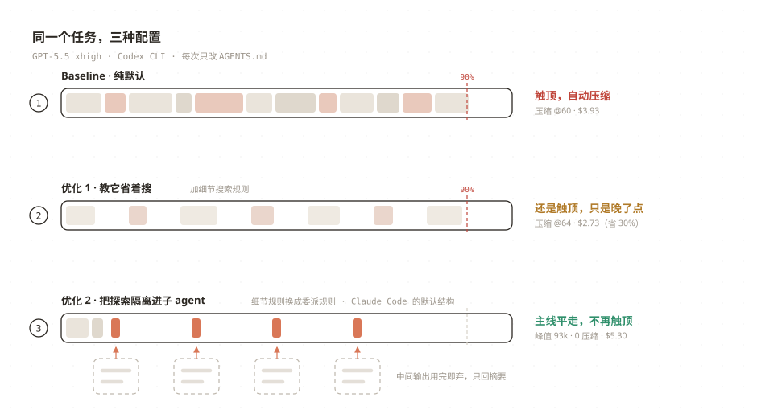
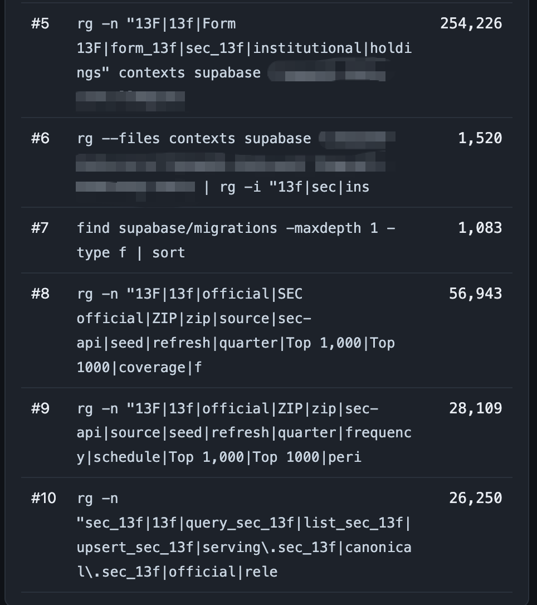
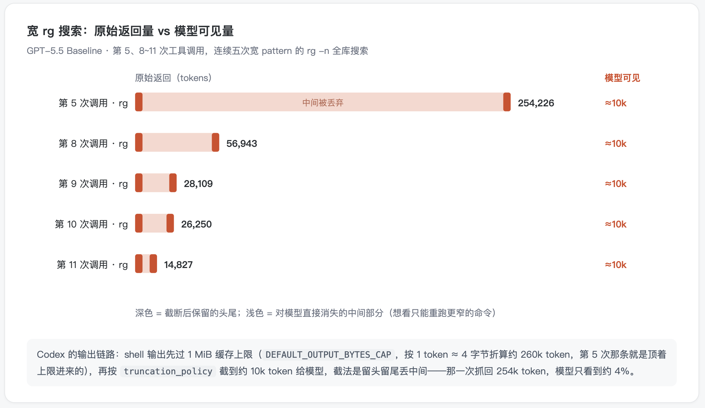
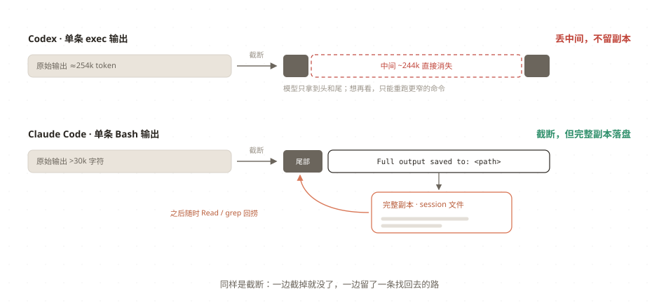
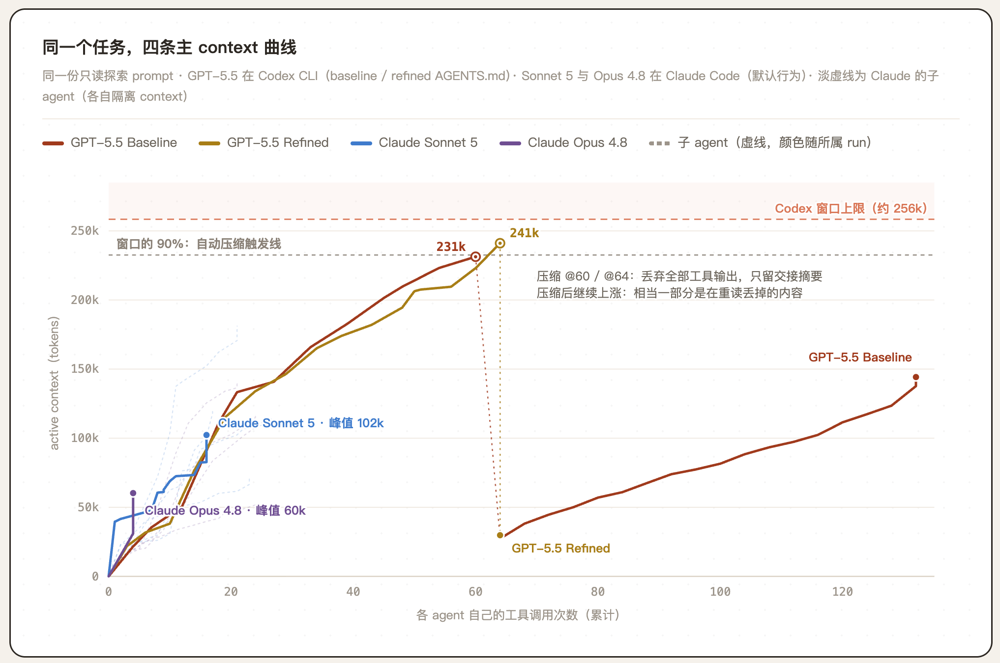
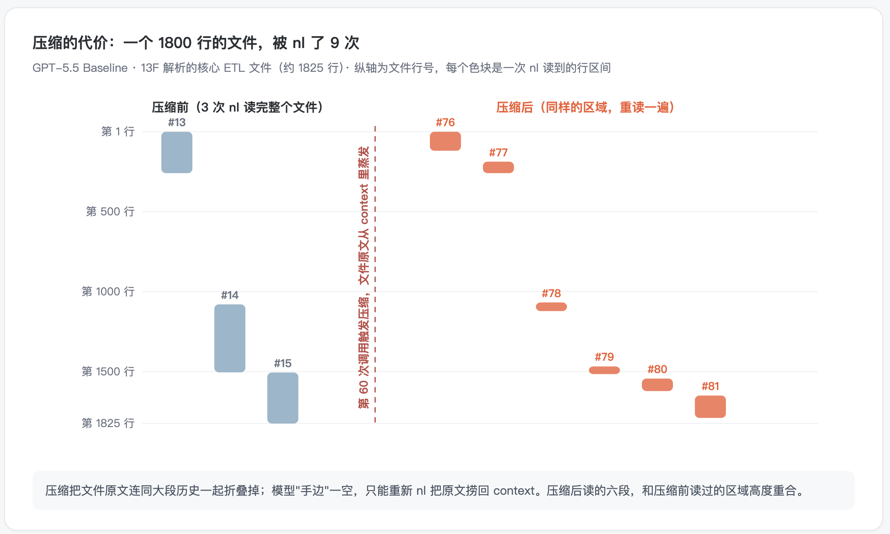
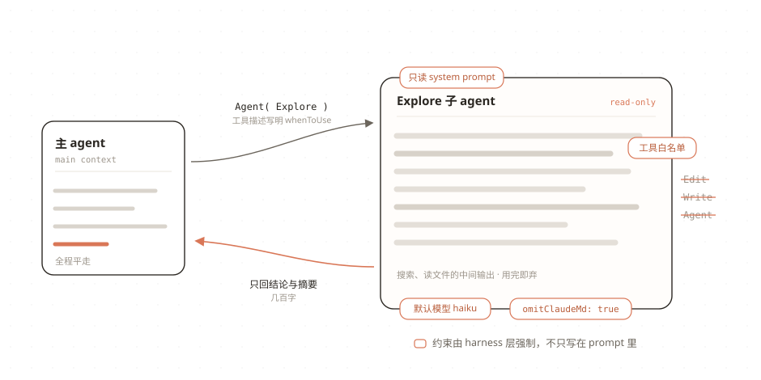
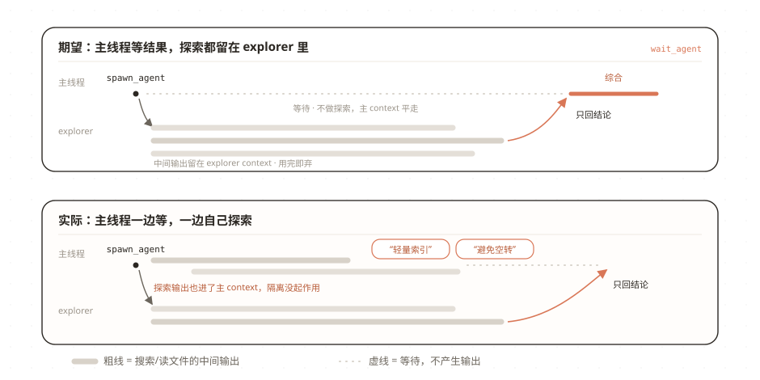
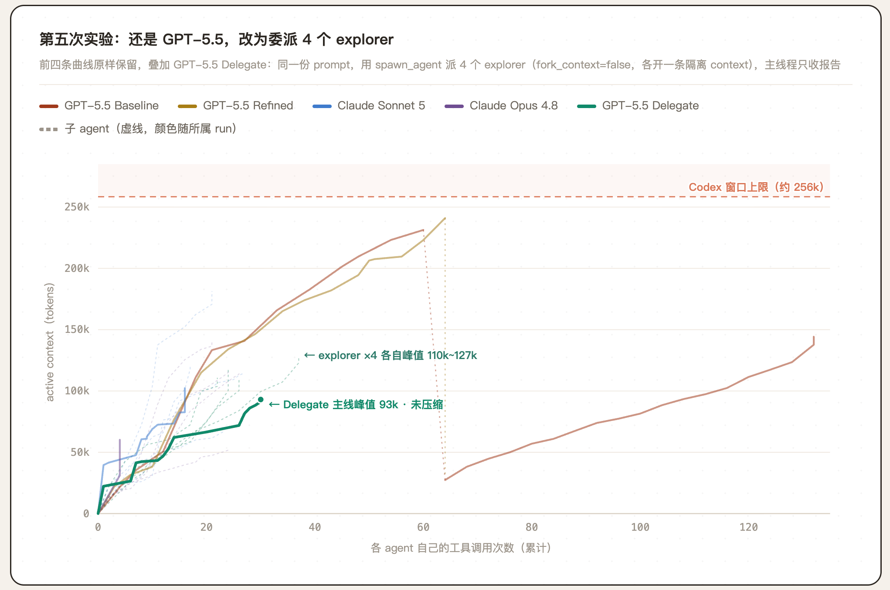
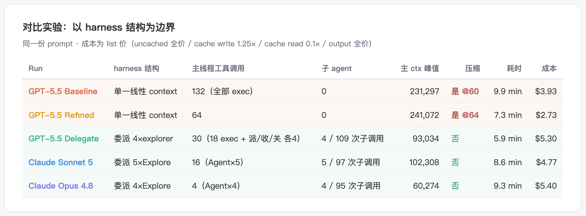

# Why Is Codex Always Auto-Compacting?

`READ⏰: 18min`

I have a financial data monorepo with roughly several hundred thousand lines of code and context (a monorepo means all code and context live in a single repo). I asked Codex a question along the lines of: `Based on the repo, what does the end-to-end pipeline look like for the SEC 13F (institutional holdings report) data pipeline, from raw data sources to preprocessing, database, MCP, and Web?` Just from asking that single question, the 256k context window that the subscription version of Codex gives GPT-5.5 was already nearly full, and it had already **auto-compacted** once along the way. At that point, asking any follow-up at all required it to compact once more before continuing, and after compaction a lot of information had to be re-read.



The same question in Claude Code didn't run into this at all. **Is this a difference between the models, or a difference between the harnesses?** Part of the reason is that Claude's context window is simply larger (1M), but as we'll see later, if you use the exact same GPT-5.5 with a different harness structure, auto-compaction disappears. **The bigger reason lies in how the harness orchestrates tool calls and subagents (context engineering)**.

Why did I do this analysis? I've been using both tools for a long time, usually Codex for backend-related work and Claude for frontend-related work; recently I felt like GPT-5.5 xhigh got a bit dumber, and with Fable back, I switched my daily driver to Claude. When you switch back and forth a lot, the difference above becomes very noticeable in day-to-day use, so I decided to analyze it seriously, and this essay is a record of that analysis. I approached the analysis from two angles:

1. First, looking at the trajectory (the agent's complete execution log, stored locally: `~/.codex/sessions` for Codex, `~/.claude/projects` for Claude Code. The formats differ slightly, though that doesn't matter since you can toss either to a coding agent and it can read them effortlessly) to figure out where all the context went;

2. Second, reading the source code of both tools to understand the concrete behavior of their harnesses (Codex is open source at [openai/codex](https://github.com/openai/codex); Claude Code has no official source repository, so I used the community mirror codeaashu/claude-code, an outdated version leaked via npm package sourcemaps, which means for any cited details that exist in the [official documentation](https://code.claude.com/docs/en/tools-reference), the documentation takes precedence).

Conclusion first: based on the analysis of the execution logs, I ran two small experiments, both modifying only `AGENTS.md` (the project instruction file Codex reads on every session, equivalent to Claude Code's CLAUDE.md). The first experiment optimized Codex's tool-calling preferences, dropping the cost from \$3.93 to \$2.73, a 30% savings; the second experiment authorized Codex to delegate exploration tasks to subagents (leaving whether to delegate up to its own judgment based on task complexity), which cost 35% more than the baseline (\$5.30), but brought the peak usage of the main context window down from 241k to 93k, requiring zero compaction from start to finish.

!!! note "What Is a Harness"
    In this post, "harness" refers to the runtime layer outside the model: how context is assembled, how tools are defined, how outputs are truncated, how subagents are dispatched, and when compaction happens are all harness-layer decisions. Claude Code and Codex CLI are two harnesses; GPT-5.5 and Opus 4.8 are the models running inside them. Put the same model into different harnesses, and its behavior and performance can differ drastically.

## 1. Where Did the 256k Go?

### 1.1 Baseline: Overly Broad Searches and Truncation

After running into the issue above, the natural first step was to look at the concrete usage trajectory for this case. I call this the baseline: GPT-5.5, reasoning effort set to xhigh, no extra instructions added, the run produced purely with default settings.

In the baseline's specific tool call log, there is a very obvious string of `rg -n` calls. When Codex uses `rg -n`, the patterns it writes are very broad, looking roughly like this:



!!! note "Quick Primer on rg: The Difference Between `-n`, `-l`, and `--files`"
    `rg` ([ripgrep](https://github.com/BurntSushi/ripgrep)) is a command-line search tool that does the same job as traditional `grep`: finding matching lines across a bunch of files by pattern (regular expression). It is much faster than grep and skips files in `.gitignore` by default, which has made it the go-to choice for coding agents searching through codebases. Codex's model prompt explicitly states *"prefer using `rg` ... because `rg` is much faster than alternatives like `grep`"* ([`base_instructions`](https://github.com/openai/codex/blob/cca16a10878202cb2f6e9666b6b4330329ea7e65/codex-rs/models-manager/models.json#L56), a line present in the prompts across model generations).

    Three ways of using it will come up repeatedly in this post:

    - `-n` (`--line-number`): returns the **full content of matching lines**, along with line numbers;
    - `-l` (`--files-with-matches`): searches file contents, but only returns **which files contain a match**, without returning the matching lines;
    - `--files`: does not search file contents at all, only listing the file paths that `rg` considers in scope for searching. It recursively traverses directories and respects `.gitignore` by default, so agents often use it to first see what candidate files exist in a project; if written as `rg --files | rg 'prompt'`, the second `rg` is filtering those path strings for filenames containing `prompt`.

    For the same goal, `--files`, `-l`, and `-n` write completely different orders of magnitude into the context: `--files` exposes only the file list, `-l` exposes only the file paths with content hits, and `-n` brings back the content of every single matching line. When a pattern is written broadly, the output of `-l` is often one to two orders of magnitude smaller than `-n`; which one the agent picks directly determines how much content a single search writes into the context.

You can see that in Codex's searches, casing, aliases, and abbreviations are all chained together into a single pattern, trying to find everything in one shot. The raw return of this kind of search easily runs from tens of thousands to over two hundred thousand tokens, and the trajectory shows that every single one of them got truncated down to around 10,000 tokens: the largest raw return was **254k tokens**, of which only 10k made it into the model's hands. For the five most intense overly broad searches, the comparison between raw returned tokens and tokens actually visible to the model looks like this:



While doing this analysis, I got curious about Codex's truncation and dug into the source code, where there are two layers of relevant handling:

- **The first layer is the buffer cap on shell output.** The code sets `DEFAULT_OUTPUT_BYTES_CAP = 1024 * 1024`, keeping at most 1 MiB of output for a single command; converted at roughly 1 token ≈ 4 bytes, that's about 260k tokens. In other words, **the raw output retained from a single shell command can be as large as the entire 256k window.** This layer is coarse pruning for performance; the truncation meant for the context window happens at the second layer. (See [`codex-rs/utils/pty/src/lib.rs:12`](https://github.com/openai/codex/blob/main/codex-rs/utils/pty/src/lib.rs#L12))
- **The second layer is truncation right before showing the output to the model.** Every model's configuration carries a truncation budget, and GPT-5.5 is configured with **10,000 tokens**. The truncation strategy is **keep the head, keep the tail, drop the middle**. (See [`models-manager/models.json`](https://github.com/openai/codex/blob/main/codex-rs/models-manager/models.json#L14-L17))

At this point, the truncation logic on the Codex side is pretty clear. Its impact on the agent is also straightforward: if the truncated information is still needed later, it has to spend another call to fetch it; when the model searches and gets back 250k tokens, it can only see the 4% at the head and tail, and has no idea what was dropped in the middle. Those back-to-back `rg` calls in the baseline that tweak the pattern and search again mostly come from this: **what it was looking for happened not to be at the head or tail, so it had no choice but to rewrite the query and search another batch**. The 10k left over after each round of truncation stays in the context, and the window keeps climbing.

**Claude Code's harness has a great reputation in the community.** So I also looked at Claude Code's implementation to compare how it handles this class of problem:

- **The Grep tool returns only filenames by default** (equivalent to `rg -l`); seeing matching lines requires an explicit request, and results default to taking only the first 250 entries;
- **The Read tool takes `offset`/`limit` parameters**, so when reading large files it can read just a slice, defaulting to at most 2000 lines at a time. When the whole file exceeds the token cap, it returns a partial view and **prompts** the model to continue reading the rest using `offset`/`limit`;
- **Bash output over 30k characters isn't thrown away**: the full content is written to a session file, returning `Full output saved to: <path>` to the model, so when needed the model can go Read/grep inside that file itself.

(The figures of 250 entries, 2000 lines, and 30k characters come from the mirror source code; Read's partial view behavior is also documented in the [official documentation](https://code.claude.com/docs/en/tools-reference).)

From a **tool design** perspective, both sides are controlling the number of tokens entering the context, but from different directions. Codex leans toward post-hoc damage control: if the output goes over, truncate it. Claude Code steps in earlier and prefers **progressive disclosure**: defaults keep the volume small upfront (Grep returns only filenames), and when a limit is exceeded, it doesn't just block the output, it tells the model what to do next. For instance, when Read tries to read an oversized file and gets blocked by the token cap, the error message directly offers alternatives: *"File content (...) exceeds maximum allowed tokens... Use offset and limit parameters to read specific portions of the file, or search for specific content instead of reading the whole file."* If you can't read it whole, it tells you to switch to reading in chunks with `offset`/`limit`, or switch to searching.

Codex's truncation also has some harness optimization: the first line reads *"Warning: truncated output (original token count: N)"*, and where the middle section is cut out there is a line reading *"…N tokens truncated…"*. The model knows it was truncated, and knows how much was cut.

But knowing it was truncated and being able to recover it are two different things. When Claude Code truncates, it saves the full output to a file and leaves the model a path, so it can Read/grep it back anytime later; Codex doesn't keep a copy of the truncated portion, so if the model wants it, the only option is to re-run a more precise command. **Truncation itself is unavoidable; the difference between the two sides lies in whether the truncated content can still be re-accessed**.

In fact, this idea already showed up earlier when Claude built its experimental [Context Editing Tools](https://platform.claude.com/docs/en/build-with-claude/context-editing), which I explained in another post, [One Poem Suffices: JIT Context](../../../one-poem-suffices/just-in-time-context/#31-compress), though **the price of reclaiming context window space is invalidating the prompt cache, which is a tough tradeoff**, so I rarely see Context editing applied in practice.



At this point, we've found the surface-level reason why Codex kept auto-compacting on my task: **searches are overly broad, outputs aren't pruned, and truncated content is effectively lost**. The first two look like things we can optimize via instructions. If we fix them, does the problem go away?

### 1.2 Optimizing Search Tool Calls

So I added a section titled "Search and Output Discipline" to AGENTS.md, summarizing the issues seen above into rules (excerpt below, with specific keywords and paths replaced by placeholders):

```markdown
## Search and Output Discipline

- Identify candidate files first: use `rg -l '<keyword>' <paths>` to search body text while outputting only filenames, and restrict paths first for high-frequency broad terms; once the scope is narrowed, use `rg -n` on the handful of candidate files to locate line numbers
- Write broad search results to a /tmp file first, then use `wc -l` to check the scale and `sed -n 'start,endp'` to read selectively
- Once line numbers are found, use `sed -n '120,180p' file` to read only the relevant line range, avoiding expanding large files all at once
- Use pipes to prune upfront: `rg -n '<keyword>' <paths> | head -80`, `tail -80 log`, inspect a small sample and scale first before deciding whether to expand the read
```

Then I ran four experiments with the exact same prompt: GPT-5.5 baseline and refined (modifying only AGENTS.md), plus Claude Code's Sonnet 5 and Opus 4.8 (both with default behavior). **The experiments were fairly rough, with only one sample per configuration**. The specific experiments are shown below:



After this simple optimization, tool calls on Codex's main thread dropped from 132 to 64, chained truncations basically disappeared, and the cost dropped from **\$3.93 to \$2.73**, saving 30%.

Tallying up the tool calls across the four experiments (the stats on the Claude side include calls inside subagents), we can see:

| Run | File Reads | Searches | Avg. OR Branches per Search Pattern | Share of Filename-Only (`-l`) |
|---|---|---|---|---|
| Codex Baseline | `nl` full file read ×111 | `rg` ×16 | 9.0 | 0% (0/16) |
| Codex Refined | `nl` ×47 | `rg` ×14 | 13.3 | 21% (3/14) |
| Claude Sonnet 5 | `Read` tool ×51 | Bash `grep` ×40 | 2.5 | 8% (3/40) |
| Claude Opus 4.8 | `Read` tool ×48 | Bash `grep` ×40 | 6.3 | 3% (1/40) |

First, look at pattern width: a single Codex pattern carries an average of 9 to 13 OR branches, cramming every spelling it can think of into the same search; Claude averages only 2 to 6. Next, look at the share of `-l`, where it turns out nobody naturally uses it much: out of 16 `rg` calls in the baseline, not a single one used `-l`, all 3 in refined came from the first rule taught in `AGENTS.md`, and both Claude runs had only a handful. Claude saves context much more by writing precise patterns, restricting file types with `--include` (avoiding truncated search results), and reading files via the Read tool rather than `rg -n`.

Claude also has another habit: using `| head` to cap search output. Out of the 40 grep calls each in Sonnet and Opus, 24 had `| head -N` (with N ranging from 10 to 100) appended at the end. Across the 132 commands in Codex baseline, there wasn't a single `| head` or `| tail` (refined had 13, but those too were taught by AGENTS.md). I didn't find any mechanism forcing `| head` in the Claude Code mirror source, so **this habit looks more like something the model learned during training**.

Still, this didn't solve the root problem. Refined still triggered compaction: the search rules slowed down how fast the context window grew, but it was a drop in the bucket.

!!! note "What Codex's Auto-Compaction Actually Does"
    It triggers once active context reaches **90%** of the context window (the threshold is configurable). Compaction means having the LLM write a handoff summary for the LLM taking over: after compaction, the history retains only up to the most recent 20k tokens of raw user messages, plus this summary; assistant messages and tool outputs are **discarded entirely** ([`compact.rs`](https://github.com/openai/codex/blob/main/codex-rs/core/src/compact.rs)). The "re-reading after compaction" mentioned later stems directly from this rule of discarding all tool outputs.

Compaction itself comes at a cost. Anthropic wrote in [Effective context engineering](https://www.anthropic.com/engineering/effective-context-engineering-for-ai-agents): *"overly aggressive compaction can result in the loss of subtle but critical context whose importance only becomes apparent later."* What gets lost is often the stuff that didn't look important at the time and only turns out to be critical later. What concretely happens after compaction? There's a segment in the baseline trajectory where you can see it directly:



This isn't unique to my repo. [Issue #16839](https://github.com/openai/codex/issues/16839) in `openai/codex` has a more extreme example: *"a single 610 KB file was re-read 53 times in one session because it was needed after every compaction."* A single 610 KB file was re-read 53 times in one session because it had to be read all over again after every compaction. Similar feedback appears in [issue #26889](https://github.com/openai/codex/issues/26889).

The fundamental limitation lies in the task orchestration structure: as long as all intermediate outputs live in the same context window, make the task slightly more complex or the repo a bit larger and the window will still fill up. As you can see from the line chart above, in Claude Code, whether Sonnet or Opus, the main context curve has a completely different shape.

## 2. Isolating Exploration

### 2.1 Claude Code's Explore Agent

From Claude's trajectory, we can see: **the main Agent does not do exploration**. In the Opus experiment, the main Agent made 4 tool calls in total, all of them `Agent`, handing the actual file-reading and code-searching work off to 4 read-only Explore subagents running in parallel. The main thread received only a few hundred words of summary from each subagent, then synthesized them into the final answer.

I touched on this mechanism in [One Poem Suffices: Multi-Agent System](../../../one-poem-suffices/multi-agent-system/): subagents act as **intelligent filters**. They digest massive amounts of raw information in parallel inside their own separate contexts and hand only the most critical insights back to the main agent; the main agent doesn't have to read every raw document itself, staying focused on synthesis and decision-making. In this experiment, exploration inevitably produces tons of one-off intermediate output (wrongly guessed search patterns, files read that turned out to be irrelevant); isolating that inside the subagents' contexts preserves the signal-to-noise ratio in the main agent. At the same time, by breaking a large task down into multiple subtasks and assigning them to multiple subagents with independent context windows, a multi-agent system **is in essence an architecture for scaling total token usage with high efficiency**, letting you pour more effective compute (tokens) into the problem.

> If you use Claude Code regularly, you'll notice that when you open a fresh session and ask your first question, it very naturally invokes the Explore Agent.

I looked up how the Explore Agent is implemented in the source code (mirror source [`src/tools/AgentTool/built-in/exploreAgent.ts`](https://github.com/codeaashu/claude-code/blob/main/src/tools/AgentTool/built-in/exploreAgent.ts)) and found that Claude Code has a complete set of specialized designs tailored for information-exploration tasks like Explore. A picture is worth a thousand words:



Specifically, Claude Code designed the Explore Agent with the following:

- **A dedicated read-only system prompt**, giving the Agent a concrete identity and execution boundary:

    > *"You are a file search specialist... This is a READ-ONLY exploration task. You are STRICTLY PROHIBITED from: Creating new files... Modifying existing files..."*

- **A tool allowlist**: modification tools like Edit / Write / Agent are disabled directly from the toolset, enforcing read-only behavior at both the prompt layer and the harness layer;

- In the main agent's `Agent` tool description, there is a `whenToUse` field telling the model when to invoke it:

    > *"Fast agent specialized for exploring codebases. Use this when you need to quickly find files by patterns, search code for keywords, or answer questions about the codebase..."*

(If you use Claude Code: there's nothing to configure in this section, as this behavior is there by default; the parts in the next two sections that involve editing AGENTS.md are for Codex users.)

So the question turns into a different one: dispatching subagents for exploration is practically out-of-the-box default behavior in Claude Code; Codex also has a full subagent mechanism (`spawn_agent` / `wait_agent` / `close_agent`, enabled by default), yet **unless I explicitly ask for it, I have never seen Codex proactively use a subagent**. Why?

### 2.2 Why Codex Doesn't Like Using Subagents

Codex also has an `explorer` role, but its built-in definition file [`explorer.toml`](https://github.com/openai/codex/blob/main/codex-rs/core/src/agent/builtins/explorer.toml) is an empty file. The entire difference between explorer and the main agent is a single usage note hardcoded in `role.rs` (*"Use `explorer` for specific codebase questions… Explorers are fast and authoritative…"*). There is no dedicated system prompt, and no tool constraints.

!!! note "Role Files and Custom Explorers"
    Role files are a configuration layer applied on top of subagents ([`agent/role.rs`](https://github.com/openai/codex/blob/main/codex-rs/core/src/agent/role.rs)), allowing parameters like `model` and `model_reasoning_effort` to be locked individually for a given class of subagent. Users can place a TOML file of the same name under `~/.codex/agents/` or the project's `.codex/agents/` to override a built-in role ([official documentation](https://developers.openai.com/codex/subagents): *"If a custom agent name matches a built-in agent such as `explorer`, your custom agent takes precedence."*).

Under the default configuration, the tool description for `spawn_agent` carries a restriction ([`multi_agents_spec.rs`](https://github.com/openai/codex/blob/main/codex-rs/core/src/tools/handlers/multi_agents_spec.rs)):

> *"Do not spawn sub-agents unless the user or applicable AGENTS.md/skill instructions explicitly ask for sub-agents, delegation, or parallel agent work."*

The very next sentence narrows the scope even further: user requests for "depth, thoroughness, research, investigation, or detailed codebase analysis" **do not count as authorization** (*"Requests for depth, thoroughness, research, investigation, or detailed codebase analysis do not count as permission to spawn."*). By that definition, even if the user says "dig thoroughly into this repo", the model shouldn't spawn a subagent.

Codex does have a set of instructions for proactive delegation written in another file ([`multi_agent_mode_instructions.rs`](https://github.com/openai/codex/blob/main/codex-rs/core/src/context/multi_agent_mode_instructions.rs)): *"Use sub-agents when parallel work would materially improve speed or quality"*, telling it to proactively use subagents whenever parallel work would noticeably improve speed or quality. This tier is called Proactive, but it doesn't take effect under the default configuration.

!!! ambition "Conditions for Proactive Mode to Take Effect"

    I checked the source code to see what it takes for Proactive mode to kick in. Right now there's no way to activate it, because of two prerequisites ([`session/multi_agents.rs`](https://github.com/openai/codex/blob/main/codex-rs/core/src/session/multi_agents.rs)). The first is a feature flag: the Proactive check only runs under multi-agent v2, and `multi_agent_v2` is marked `UnderDevelopment` in the feature table (commented "not ready for external use") and disabled by default. The second is the reasoning tier: Proactive isn't a config option, it's derived from reasoning effort, and only switches over when set to `ultra`. So proactive delegation currently corresponds to a tier that hasn't been released yet. Probably only internal employees get to enjoy it (having ultra + 1M context must feel great).

    I haven't quite figured out the rationale behind Codex's harness design for subagents. Codex subscription users only get a 256k window, which compared to other mainstream harnesses means they **need subagents even more to isolate context**, yet it doesn't dispatch subagents by default, and proactive delegation is still under internal development. Maybe they worry subagents would cause token consumption to spiral out of control for newcomers, or maybe the multi-agent path hasn't been polished enough to turn on by default? (Judging from my experiments below, Codex's subagent orchestration did exhibit some behaviors that surprised me.)

So right now, the way to enable proactive subagents in Codex is to explicitly authorize them in `AGENTS.md`. When I actually tried this in practice, though, I ran into two problems:

### 2.3 Problems Encountered with Codex Subagents in Practice

**Problem 1: The wording of the authorization.** What I initially wrote in AGENTS.md was **"Please choose for yourself whether to use subagents based on the complexity of the exploration task"**. That phrasing looked completely fine, but the agent's output was:

> "Per the current tool instructions, subagents can only be started when explicitly requested by the user; here I will not start an explorer, and instead have the main agent perform pruned searches with small outputs, filenames first and snippets second."

I tried several times to strengthen the tone, but it still wouldn't start a subagent. Its justification cited the restriction in the `spawn_agent` tool description above: what it wants is an *explicit request*, and "use your own judgment" literally does not constitute an explicit request. Later, when I changed the requirement in `AGENTS.md` to **"The user grants standing open authorization for subagents / delegation in this repo"**, it finally started dispatching subagents.

This problem wasn't complicated in itself, because the failure mode was obvious (no subagent was called), and changing the instruction fixed it. The next problem carried a much bigger hidden risk.

**Problem 2: Subagents get dispatched, but the main thread doesn't wait for the results.** I assumed it would behave like Claude Code / Antigravity CLI: dispatch the subagents, enter a wait state, and analyze/summarize once the subagents' results come back. Instead, its actual output was:

> "The subtasks are already running in the background. I'll do lightweight indexing and confirm key open questions on the main thread first to avoid idling while waiting for results; I'll only read relevant line ranges from a handful of matching files."



This behavior directly conflicts with the goal of isolation. **The whole point of dispatching subagents is to keep the main context clean, so if the main agent waits on subagents while simultaneously reading files in the main window on its own, the context isolation was for nothing**. You can see where this tendency comes from in the source code. The design of `wait_agent` allows the main agent to set a timeout, and if a subagent hasn't finished when time is up, it doesn't error out, it just returns the current progress. Combined with guidance in the tool description to "avoid waiting idly", the model naturally leans toward continuing to explore while waiting. In scenarios optimizing for speed, that might be the right call, but I'm using subagents to isolate context, not to go fast. My fix was to state explicitly in the instructions: **while subagents are running, the main thread only synthesizes and does not explore**.

??? note "Subagent Delegation Rules Ultimately Added to AGENTS.md (Excerpt)"
    ```markdown
    - The user grants standing open authorization for subagents / delegation in this repo: if available tools require "the user to explicitly request subagents / delegation / parallel agent work", this section satisfies that requirement without needing re-confirmation on every task
    - explorers are read-only and do not modify the repo; fresh context (fork_context=false); use a lower reasoning effort than the main agent when supported by the tool
    - explorers return only conclusions and an evidence table (claim | file:line | confidence), without passing back raw outputs, long diffs, or unrelated logs
    - After dispatching explorers, the default action of the main thread is to wait for results via wait_agent with a long timeout; during the wait, do not touch repo search or file reading; calling it "lightweight indexing", "confirming doubts ahead of time", or "avoiding idling" is no exception
    ```
​    Only the four rules directly corresponding to the two problems above are kept here; see the Appendix at the end of the post for the full version.

### 2.4 One Model, Two Behaviors

The fifth experiment: still GPT-5.5, still Codex CLI, but with a different `AGENTS.md`. I deleted the entire "Search and Output Discipline" section added in 1.2 and replaced it with the subagent delegation rules (the exact content is the version in the Appendix at the end, which can be verified against the raw text injected in the rollout).

I deleted the specific search rules because of [The Bitter Lesson](http://www.incompleteideas.net/IncIdeas/BitterLesson.html). Instructing the model to "run `rg -l` first, then `sed`" is, in my view, **using human-written detailed instructions to patch a model's habits**. Those instructions depend on my observations of this generation of models; once the model is upgraded or the tools change, they will very likely become obsolete, and that 30% gain might well turn into interference by then. Subagent delegation relies on structure: no matter how the model reads files, as long as exploration happens inside isolated contexts, the main thread won't blow past its limit. So for this experiment I deleted all hardcoded instructions and kept only heuristic ones.

This time, GPT-5.5 dispatched 4 explorers, dividing up the exploration across module boundaries.



The main context peaked at **93k, with zero compaction from start to finish**. All four explorers peaked higher than the main thread, between 110k and 127k, adding up to roughly 467k—nearly twice a single window. The amount of content that needed to be read during exploration didn't shrink; it was simply spread across four mutually isolated contexts, none of which came close to the ceiling.



Grouping the five experiments by harness structure:

| Harness Structure | Experiment | Main Ctx Peak | Compaction | Cost |
|---|---|---|---|---|
| Single linear context | GPT-5.5 Baseline / Refined | 231k / 241k | Yes @60 / Yes @64 | \$3.93 / \$2.73 |
| Subagent isolation | **GPT-5.5 Delegate** / Sonnet 5 / Opus 4.8 | 93k / 102k / 60k | No / No / No | \$5.30 / \$4.77 / \$5.40 |

**The dividing line between the groups is the harness structure, and GPT-5.5 straddles both groups.** At this point we have an answer to the question from the opening. There are certainly differences between models: as the table in 1.2 showed, Claude naturally writes narrower patterns and prunes more often with `| head`, habits that genuinely help it save context. But the phenomenon of "always compacting" seems to be driven much more by harness design: the exact same GPT-5.5, given a different harness design, behaves basically the same as Claude's two models.

Subagent delegation didn't change GPT-5.5's tool-use habits: if you analyze the explorers' sub-trajectories, they still use `nl` to read whole files and their search patterns are still broad. All that changed was task orchestration and context engineering.

The tradeoff is higher cost. It rose from \$2.73 to \$5.30, nearly doubling, putting it on the same level as the two Claude experiments (\$4.77–\$5.40). As I mentioned in an earlier blog post, the reason is that multi-agent setups consume close to 15x the tokens of chat. Because of the parallel design, though, wall-clock time was actually shorter: delegate took 5.9 minutes, compared to 7.3 minutes for refined.

This experiment was very rough, with only one run per setting. And there is one more setting I didn't test: keeping both the hardcoded search rules and multi-agent delegation at the same time, which might make delegation a bit cheaper—I'll leave that to interested readers~

Some simple tasks don't need a multi-agent architecture at all; see [When Do You Need Multi-Agent Systems?](../../thinking-in-context/when-multi-agent/). For more on multi-agent architecture itself, see [One Poem Suffices: Multi-Agent System](../../../one-poem-suffices/multi-agent-system/).

## Conclusion

So, why is Codex always auto-compacting? For my task, the answer is: it records the entire exploration process and all its outputs onto a single 256k context window; overly broad searches lead to oversized outputs that get truncated, forcing the model to repeatedly re-search and re-read files; and the only mechanism capable of isolating exploration out of the main thread (subagents) is turned off by default. All three issues have much more to do with harness design than with the model itself.

The model matters, of course, but the shape of tasks has changed. In the past, using a model mostly meant a few turns of conversation, and a human was choosing what went into the context: which snippet of code to paste, which error message to include. Now a single task involves over a hundred tool calls, the model spends most of its time interacting with the repo and the command line, and the human only shows up at the two ends: setting the direction and exercising taste at the start, then reviewing at the end. Selecting what goes into context now relies largely on the harness; for long-horizon tasks, the orchestration quality of the harness determines a huge part of the final performance. There is also a trend toward models and harnesses co-evolving. If that continues, the question "is this a difference between the models or a difference between the harnesses?" may become harder and harder to even ask, because the two will be much more tightly coupled.

There is one more question I'm still mulling over. At the model layer, it's getting harder and harder to tell them apart; at the harness layer, best practices for harnesses will also converge. What will be left in the end? What will differentiate one product from another?

My perspective is limited, and all the attributions above are based on five experiments in my own repo and a rough reading of two codebases; key citations on the Codex side were verified against the main branch (2026-07), while on the Claude Code side I used an unverified community mirror and deferred to official documentation wherever numbers were documented. The sample size is tiny, so corrections are very welcome~

## Appendix: Full Version of the AGENTS.md Delegation Rules

Section 2.3 only excerpted four rules; below is the full version. It isn't just a "final version polished up after the experiments": when the fifth experiment ran, this exact text was in AGENTS.md, matching what was injected in the rollout (a few full-width em dashes were swapped for colons/semicolons to match the punctuation style of this post; everything else is verbatim):

```markdown
## Search, Output, and Exploration Delegation Discipline

Principle: The main agent's context is a scarce resource, meant to hold only conclusions and key evidence, not raw search outputs: large outputs will be truncated, and truncated outputs both burn context and mislead conclusions. This section states only goals and authorization; which specific commands to use, how many explorers to dispatch, and how to divide the work are up to the agent's own judgment based on the task.

- Decide whether to delegate based on information economics: when the expected "raw content dug up by searching" is far larger than the "final conclusions needed" (open-ended investigation, cross-module work, unclear entry points), delegate early rather than waiting until half the context is burned; when the entry point is clear and reading directly is faster, do it yourself. State the choice and reasoning in one or two sentences at the start
- The user grants standing open authorization for subagents / delegation in this repo: if available tools require "the user to explicitly request subagents / delegation / parallel agent work", this section satisfies that requirement without needing re-confirmation on every task. Authorization does not mean mandatory use
- Write prompts for explorers like a handoff to a newly joined teammate: goal, motivation, in-scope and out-of-scope boundaries, known leads, expected output; explain the problem and boundaries without micromanaging rigid steps. Divide work across multiple explorers along natural boundaries without overlap
- explorers are read-only and do not modify the repo; fresh context (fork_context=false); use a lower reasoning effort than the main agent when supported by the tool; when you yourself are an explorer, complete the task directly without delegating further
- explorers return only conclusions and an evidence table (claim | file:line | confidence), without passing back raw outputs, long diffs, or unrelated logs
- After dispatching explorers, the default action of the main thread is to wait for results via wait_agent with a long timeout: waiting consumes zero resources, subagents are working in parallel, and wall-clock time is unaffected; "exploring on the side" on the main thread burns the exact context delegation is meant to protect, while duplicating the explorers' work. During the wait, do not touch repo search or file reading; calling it "lightweight indexing", "confirming doubts ahead of time", or "avoiding idling" is no exception. The sole exception: a new task explicitly assigned by the user during the wait period
- Tool descriptions for spawn/explorer may encourage "continuing local work immediately after delegating" or "reading code yourself to fill in context"; in this repo, the user explicitly requires this section to take precedence: once exploration is delegated, wait for the results and do not jump in yourself
- Synthesize after explorer results come back: do not repeat searches they have already covered, performing only minimal spot-checks on key open questions
- Apply the same prune-first principle when the main agent searches on its own: gauge candidate scope and content scale first before deciding how much to expand; avoid pulling large files, long diffs, or minified content wholesale into context
- If the environment lacks explorer/subagent tools, note it briefly and fall back to the main agent's own narrow-query pruned search
```

## References

**Previous Posts**

- [One Poem Suffices: Context Engineering](../../../one-poem-suffices/context-engineering/) · The four-pillar framework; this post is a field validation of Isolate
- [Thinking in Context: Context Engineering in Codex](../../../thinking-in-context/context-engineering-from-codex/) · The append-only and compaction school of thought
- [Thinking in Context: When Do You Need Multi-Agent Systems?](../../thinking-in-context/when-multi-agent/) · A decision framework based on context coupling
- [Distilling Claude Code Source Code into an Agent Skill](../claudecode-distillation-practice/) · Previous installment on harness engineering in practice

**External Resources**

- [Anthropic: How we built our multi-agent research system](https://www.anthropic.com/engineering/multi-agent-research-system)
- [Anthropic: Effective context engineering for AI agents](https://www.anthropic.com/engineering/effective-context-engineering-for-ai-agents)
- [OpenAI: Harness engineering](https://openai.com/index/harness-engineering/)
- [OpenAI: Codex Subagents Documentation](https://developers.openai.com/codex/subagents)
- [openai/codex issue #16839: Compaction-aware context retention](https://github.com/openai/codex/issues/16839)
- [Addy Osmani: Agent harness engineering](https://addyosmani.com/blog/agent-harness-engineering/)
- [Rich Sutton: The Bitter Lesson](http://www.incompleteideas.net/IncIdeas/BitterLesson.html)
- Source code: `openai/codex` @ `f6e251c` (`main` as of 2026-07-07; early analysis based on `129ea2a`); `codeaashu/claude-code` @ `6a25909` (unofficial mirror, reportedly from a sourcemap leak)
