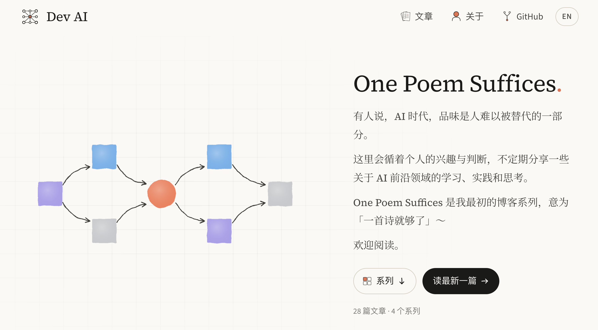
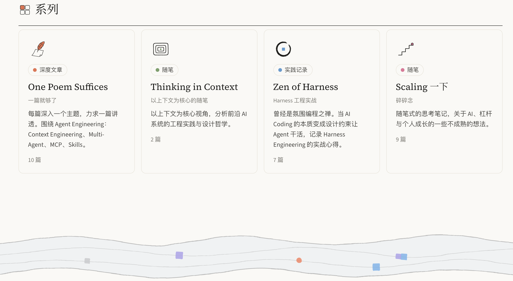
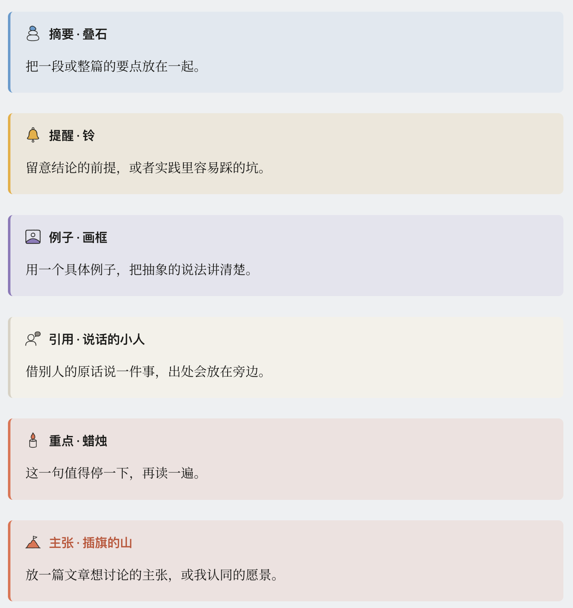

# Scaling 一下：博客、美学与品味

最近搭了自己的博客站：[lastwhisper.dev](https://lastwhisper.dev)。感谢 Astra 和 Fable，整个网站都是自己喜欢的风格。首页上我写了一句 “有人说，AI 时代，品味是人难以被替代的一部分”。正好借此机会聊聊：博客、美学与品味。

*四个系列各配一个手绘风的 icon，页脚是一条缓缓流动的河。*

*便签、新芽、云朵：正文里的提示块，icon 都是重新设计的。*

*叠石、铃、画框、说话的小人、蜡烛、插旗的山。*

## 博客

没想到最后还是搭了自己的博客站，一个展示品味的地方。也算是感激这个时代。我最早的博客写在博客园里，很多人可能会觉得 “博客园” 已经是一个非常古老的词了。那时候受限于水平，自己想要的、能 DIY 的平台不全开放，自己建站的技能又不够。

很多朋友跟我说过，在如今这个世界，尤其是 AI 更加普及之后，更多人会偏向视频，然后是播客，最后才是所谓的纸媒体。而博客、随笔，还得排在更碎片化的文字之后。总之，写博客的优先级很低，也很少人会看。

小时候家里有几本书，我不记得是新概念作文还是新概念散文。“散文” 这个词就是在小学时闯入我脑海的，那时候散文对我来说意味着高级。后来，打过 ACM（一个大学生信息学竞赛）的人应该都对写博客不陌生。在没有 AI 的时代，你需要不断反思，写题解，就像做错题本一样。遇到不会的题需要找题解，但大部分题解我也不太能看懂。那些介于半懂不懂之间的题，最适合写成题解博客。所以我早期的博客记录了非常多 Codeforces 一场一场的题解。可能就是因为这样，我才有了最开始写博客的习惯。

“凡事预则立，不预则废。” 写文字、做记录，总会让我内心的充实感多一点。这种感觉是形而上的，更多是一种自我意识的满足。但就是这两件事让我有了记录的习惯。学生时代我会规划每天的 To-Do，看过我其他博客的朋友知道，我完整做了大概两三年的计划。那时候用的是 Microsoft To-Do，它设计得不是很好，但我每天晚上都会把第二天的事情计划好。

???+ note "题外话：并行与狂热型倦怠"
    后来发现，学生时代比较容易计划，是因为不太有突发事件。研究生阶段我问过在 AWS AI 实习时的 manager（他是我很重要的一位人生导师）：“人是不是工作之后、越长大之后，需要并行的事情就越少？” 那时候我还不太喜欢并行，因为并行了就很难做规划。没想到现在已经变成了一个重度的并行患者。为什么说患者？因为很多时候我会莫名地想多做几件事，只有一件事时反而效率低下。Agent 时代对这个能力既有放大，也有不良影响。更标准的说法可能是：狂热型倦怠（Frenetic Burnout）。

总之，我就开始断断续续写博客了。写博客对我来说是一件挺有意思的事，它的正反馈回路很快，只要写完我就会满足。写博客也让我学会了记录，没想到记录在 Agent 时代变成了宝贵的 context。

!!! info "Ego：关于我自己的 context"
    我之前说过，我有一个关于自己人生的 context，取名叫 Ego。周记、屏幕使用时间、睡眠时间，我都会或自动化或手动地记录在上面。有 iCloud，我在手机和 Mac 上都能随时记录；我还 host 了一台 Mac Mini，可以远程让上面的 Codex 或 Claude 做一些即时的思考和探索，或者留下任务让它帮我分析，也会安排一些 automation，比如每天结合 Ego 生成早报。

我的第一篇《一篇就够了》是 2020 年写的。当时在学树状数组（一类数据结构），心血来潮画了点图（那时候可喜欢用 AxGlyph 画图），写了一个详细教程。现在我都有点忘了树状数组的代码了 笑。而我第一篇 AI 相关的博客，是一篇讲 [ZeRO（DeepSpeed）](../../one-poem-suffices/zero/) 的文章。那是我去微软亚洲研究院实习面试时的一个 take-home 小考试。因为写得不错，当时的 mentor 说不如发成博客，说不定有人会喜欢（感谢我的 mentor）。我还顺带给 DeepSpeed 提交合并了一个 [PR](https://github.com/deepspeedai/DeepSpeedExamples/pull/843)。现在回头看，我可能更适合做 AI Infra。毕竟我刚从一个做 AI framework 的实习，跳到一个带训练带推理的实习（2023 年底，魔改 vLLM）。不过这都是后话了。总之，写博客促使我不断去学习，有点费曼学习法的感觉。

## 美学

在写博客之前，我就发现自己对设计有一定量的热爱。我喜欢去优化一些 “可视化” 的内容，把它们设计得美一些，或者说符合我自认为的美。本科的时候我就爱捣鼓自己的 LaTeX 简历。我拿过数学建模的国奖，也喜欢做一些比较好看的图。做一张图、优化一个设计细节，我可以沉浸式地做三四个小时。虽然我不是这个专业的，但至少可以说我对它有一定量的热情。大家可以看一下我博客中的插图，博客网站上的可视化，以及我设计的产品。

不提产品本身如何，所有页面细节是我设计的。我觉得它和 AI 直接生成的还是有一点区别的，某些细节我会反复雕琢。

所以我发现，对美学的追求和写博客有点相像。我的博客系列叫《一篇就够了》，英文名 One Poem Suffices。我希望我的博客是自包含的、自我解释的。读者在读的过程中遇到的困惑，都能被立刻回答，或者被引导：要么我告诉你它之后会讲到，要么我现在不能回答，但提醒你去别的地方寻找。这也是因为我作为读者，尤其在 AI 时代之前，搜索过、阅读过很多博客，读到好博客的时候是很开心的。一篇好的博客对人的意义是重大的。

!!! ambition "价值的放大器"
    如果一篇好博客花了我五个小时，能给每个读者省十分钟，我有一万个读者，那就省了十万分钟。

所以我愿意雕琢自己的博客，就如同我愿意雕琢那些美学上的设计一样。做可视化也是同一件事。早期没有 AI 的时候，做可视化更累一些，但更有成就感。所谓一图胜千言，一张图带来的信息密度远高于文字，这也是为什么大家更喜欢看视频，当然，我这说的是那种精良的视频。写博客和做图都是在不断打磨。打磨的过程中你会不断反问自己，至少我会：**从读者的角度看，这里的逻辑是否通畅，这里能否给大家带来一些思考，这里是否会让人感到困惑**。

## 品味

AI 时代难免让人浮躁，我中间也度过一段阵痛期。有段时间我很迷茫，因为过于借助 AI 了。我甚至不知道这些文章到底是我的思考，还是我只不过借自己的手，把 AI 的思考告诉大家。随着 Agent 能力越来越强，我反而没有那么焦虑了，因为它已经接近一个许愿机。但我发现，我的博客应该是我想问的问题，我应该打磨的也是我想问的问题，而这些问题也应该是大家想问的问题。通过这个视角能不能把一些故事讲清楚，或者至少让我自己理解。就像做产品一样，你自己至少要喜欢这个产品。

!!! important "我对自己的要求"
    至少我自己要喜欢这篇博客，至少它对我自己有价值，而不是纯粹的搬运、纯粹的翻译，或者连其中的一些细节、一些论断，我自己都无法肯定。

这也许就是我写博客的原则，它也应该贯穿我做事的风格。当然，这也是我在持续学习的，因为 Agent 的时代难免浮躁。

这也是个幸福的时代。以前我很难说去做设计，但现在在我看来，对于我这种外行，和 AI 协同做设计就是从一个隐空间转移到另一个隐空间。我脑子里更多是抽象的想法，我把抽象的想法尽量描绘出来，转移到另一个隐空间，再由模型生成，然后我来做筛选。也许再早几年，我根本做不出我想要的博客。但至少目前来讲，我对这个博客还是挺满意的，大部分细节我都挺喜欢。

*从高维的 Code Space 投影到低秩的 Pattern Space，图取自 [Claude Code 蒸馏实践](../../zen-of-harness-engineering/claudecode-distillation-practice/)。*

打磨的过程恰巧也在锤炼品味。至少现在绝大部分人都说，**品味是 AI 时代最重要的能力**。但，关于 “品味” 我从最开始的确信，到现在的有点释然。因为在 AGI 之下，你所谓的执行能力、思考能力，都比不过它。于是你就不得不变得 “哲学” 一些：抛出了一个本身就不太好评价的东西，所谓的品味。我反复提过一个概念，一个开放的问题有非常大的 action space，良好的品味可以优化这条路径。这是我之前确信的，但我渐渐觉得这里的优化是对个人而言的，本质上你只是希望它对齐你。如果在 RSI（递归自我改进）之后，人的品味也许本质上是一种限制。人无法想象自己没有经历过的事情，就像 The Bitter Lesson 里讲的，这些先验知识本质上是对 AI 的一种限制。

!!! question "所以在明日之后"
    品味或许也只是人自己的一种特质。它相对来说，至少是最后被吞噬的那一个。
