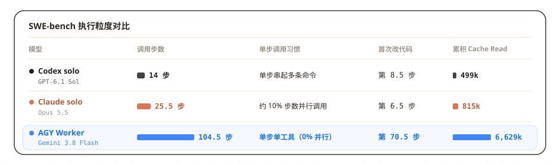
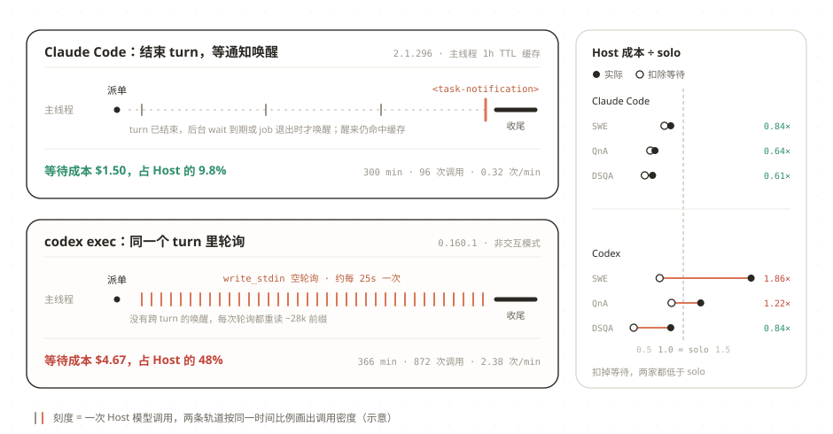
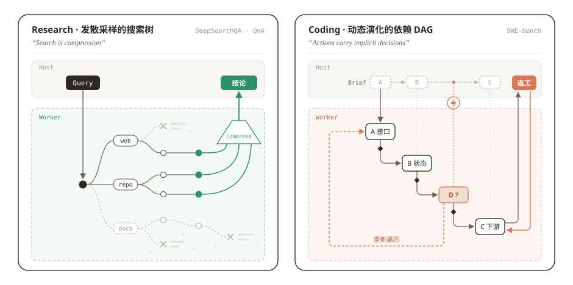
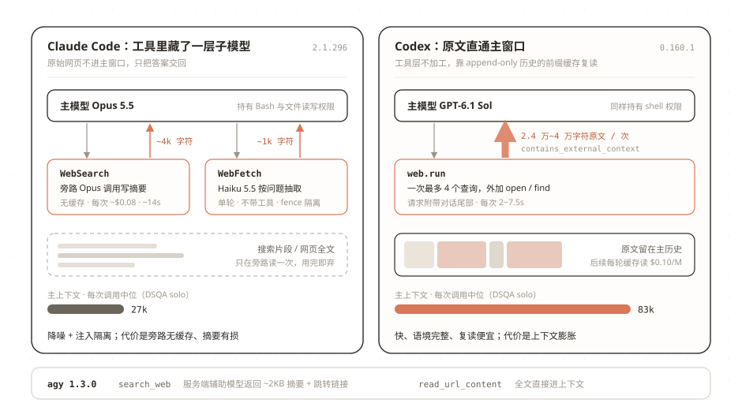

#  agy-staff bench v1: Agent Orchestration 与 Harness 评测分析

`READ⏰: 22min`

之前分享过我构建了一个 [agy-staff](../agy-staff/) 的 Agent 插件及其 [迭代过程](../agy-staff-iteration/)：通过一套基于 Bash + Skills 的协议（`/agy:lead`），让 Claude Code 或 Codex 作为主 Agent（Host），把调研、审查和实现任务委派给后台的 `agy` CLI（Gemini 3.8 Flash 等模型）。

<https://github.com/keli-wen/agy-staff>

在此之前，我对这套工具的判断主要依赖日常体感。为了系统地评估它的实际效果，最近我基于 [Harbor](https://github.com/harbor-framework/harbor) 搭建了 **agy-staff bench v1**，根据评估目的挑选了三类 Benchmark，在 Claude Code 和 Codex 上做了一轮对照实验。

做这个 Benchmark 有两层目的：一是给出一份真实的**插件使用指南（Best Practice Guidance）**，弄清楚什么任务适合委派、当前 agy-staff 的能力边界；二是因为我一直对 Agent 的运行轨迹（trajectory）很感兴趣，当任务和 Harness 固定后，刚好可以借 trajectory 对比不同主模型的编排习惯，以及比较并学习 Claude Code 和 Codex 两个 Harness 在底层机制上的取舍。

结论先行：

1. 在 SWE-bench 这类上下文高度耦合的单点代码修改上，委派不会提高上限，反而因为**重复探索代码与来回验收**增加开销。目前我认为真正适合委派的有两类场景：一是像 DeepSearchQA 和代码库问答（QnA）这样**探索过程产生大量噪音、而结论易于核实的调研任务**（因为委派一大目的本身就是为了隔离探索过程中的上下文）；二是**包含多个上下文解耦子任务的大规模真实工程（Real Engineering）**，只是后者这类任务无论构建 Benchmark 还是跑评测的开销都很大，现有公开数据集很少覆盖。
2. 从 Harness 体验看，目前 Claude Code 对外部插件异步委派的支持明显好于 Codex（三个数据集省下 `16%~39%` 的主模型成本，而 Codex 在两项测试上变贵），主要原因在于**两个 Harness 处理后台任务等待的方式不同**。此外，在分析 Trajectory 时还顺带发现，两家在 Web Search / Fetch 工具上做了不同的上下文工程取舍：Codex 更偏原汁原味，将截断后（单次上限 `10k tokens`，实测约 `6k~10k tokens`）的原始搜索与网页内容直接放进主上下文；而 Claude Code 则在工具内部先做截断（网页上限约 `25k tokens`），再调用一次子模型做摘要过滤，最终只把约 `250~1k tokens` 的整理结果返回给主上下文。

## 1. Benchmark Overview

评测基于 [Harbor](https://github.com/harbor-framework/harbor)（`0.24.0`）搭建，在独立容器中跑了 96 组测试，结束后统一解析各 Harness 原始 trajectories（完整配置见 [`bench/README.md`](https://github.com/keli-wen/agy-staff/blob/master/bench/README.md)）。实验以 **Claude Code**（`Opus 5.5`）和 **Codex**（`GPT-6.1 Sol`）作为两个 Host，分别在单点代码修复（**SWE-bench Verified**，8 题）、陌生仓库只读问答（**SWE-Atlas QnA**，6 题）和多步联网调研（**DeepSearchQA**，6 题）上，对比主模型独立完成、调用原生子智能体和通过插件 `/agy:lead` 委派给 `agy` 三种方式：

从结果图可以发现几个有意思的点：编排前后的任务通过率大体一致，但接入单价低于主模型与 Sonnet 5.5（不过高于 GPT-6 Luna）的 AGY with Gemini 3.8 Flash 后，所有场景的**总开销和平均任务完成时间**都是上升的；同样接入 `agy-staff`，Claude 在三个场景下均能节省主模型额度，Codex 却在 SWE 和 QnA 上比主模型单独完成任务更贵；另外在看 DeepSearchQA 的 trajectory 时我们还发现，Codex 独立完成任务时的主上下文中位数接近 Claude Code 的三倍（83k vs 27k），这其实也反映了两边底层 Harness 的设计差异。

## 2. Benchmark Learning: 模型行为与 Harness 对异步事件的支持

围绕汇总图中的开销与耗时变化，可以从两个层面来分析：一是为什么接入 `agy-staff` 后所有任务的总开销与总时长都上升了；二是为什么同样委派给 `agy`，Claude 能省下主模型额度，而 Codex 的主模型花费反而增加。

### 2.1 为什么接入 agy-staff 后总开销与耗时反而上升？

Gemini 3.8 Flash 的单价虽然低于两个主模型和 Sonnet 5.5，但接入 `agy` 后，模型自身的行为习惯、`agy` 的 Harness 设计以及我们 `agy-staff` 的 Skills 可能共同导致了调用步数大幅上升，反而推高了总开销与耗时：

在 48 段 `agy` 任务的 4,022 次工具调用中，主要表现是**过度执行**：读同一个文件习惯用 30~40 行的小窗口反复翻看二十几次，平均探索到第 70 步才开始改代码；跑 `python` 临时脚本也全是单步命令，很少把命令串起来或写成脚本复用，本次实验中工具并行率为 0%。结合 trajectories 与相关研究分析，这主要来自三方面原因：

1. **Model Family 自身的行为偏好（Gemini 3.8 Flash）：** 就像我在[《为什么 Codex 总在自动压缩？》](../why-codex-compacts/)中讨论过的，不同 model family 在工具调用粒度上有明显的后训练差异。相比于习惯在一次调用里把多段命令串起来的 GPT-6.1 Sol，Gemini Flash 更倾向于一步只做一件小事（[MCP-Bench](https://arxiv.org/abs/2508.20453) 在统一框架下的评测也观察到类似现象：Gemini Flash 的平均工具调用次数约为 Gemini Pro 与 Claude Sonnet 的两倍以上）。
2. **Worker 侧的 Harness 问题（`agy` CLI）：** 已有研究表明，即便固定底层模型，不同的 Harness 设计也会显著改变模型的步数与开销（见 [SWE-agent](https://proceedings.neurips.cc/paper_files/paper/2024/file/5a7c947568c1b1328ccc5230172e1e7c-Paper-Conference.pdf) 与 [Agentless](https://lingming.cs.illinois.edu/publications/fse2025.pdf)）。`agy` 自身的内置提示词和工具引导还有不少优化空间（大家都说不太好用），例如它虽然提供了 `grep_search` 和批量替换工具，但在本次实验中一次都没被使用，搜索和修改全部退化成了单步命令与逐块替换。
3. **我们插件自身的问题（`agy-staff` Persona 模板过于 hardcode）：** 回看我们在 `implement` 和 `research` Skill 中注入的模板，里面写的规范可能过于刻板和防御了（例如强调 `必须逐条核对规范并标注所有来源`）。对于顺从度很高的 Gemini Flash，这种过于繁琐的指令反而**放大**了它反复读文件确认、迟迟不动手的倾向（我们在 QnA 的初步实验中观察到，使用无角色模板的 `staffer` 步数比 `research` 少约三分之一，这部分的严格消融实验会在 v2 中补全）。

三者共同作用的结果是近十倍的 Steps。这导致耗时和开销显著增长，我最开始想用更便宜、TPS 更高的 Flash 来同时优化开销和效率的动机并没有实现。因此在当前阶段，接入 `agy-staff` 在成本上的价值主要在于帮助主模型分担它们稀缺的订阅额度（用独立的 Google AI Pro 额度分担探索阶段的 token 消耗），或是处理一些对多模态有较高需求的特定场景。

### 2.2 为什么 Claude 省额度而 Codex 变贵？

Claude 与 Codex 在主模型花费上的差异，主要来自两个 Harness 对后台异步等待的设计不同；如果把等待阶段的开销剔除，两者在任务准备与收尾阶段的花费其实很接近（均为各自独立完成时的 `0.37×`~`0.85×`）。

!!! note "异步唤醒 vs 轮询等待"
    当主 Agent 把耗时十几分钟的子任务放到后台执行时，Harness 有两种处理方式：

    - **异步唤醒（Notification）**：主 Agent 启动后台任务后直接结束当前对话轮次，期间不消耗任何 token；等后台进程退出时，由 Harness 自动向主 Agent 注入一条完成通知并拉起新 turn。
    - **轮询等待（Polling）**：后台进程退出不会自动拉起新 turn，主 Agent 必须保持当前 turn 不结束，每隔几十秒主动调用一次工具查看状态，每次轮询都会把当前累积的几万 token 上下文重读一遍。

如上图所示，Claude Code 将后台 Bash 工具（`run_in_background: true`）也纳入了统一的 `<task-notification>` 异步唤醒队列，主模型启动后台任务后可以直接结束当前 turn；配合订阅账号下 **1 小时 TTL 的 Prompt Cache**（写入单价 \$8/M），即便十来分钟后才触发新 turn，主模型依然能命中 \$0.20/M 的缓存读，等待阶段只占主模型总花费的不到 10%。

而对照 Codex 源码（`codex-rs/core`）可以确认：**Codex 目前仅对原生子智能体（`spawn_agent`）支持 `<subagent_notification>` 异步唤醒，并未覆盖后台 Bash 工具（`unified_exec`）。** 因为 `agy-staff` 本质上是一个通过后台 Bash 调用的工具，所以无论是在 `codex exec` 还是日常使用的 Codex Desktop 中，后台命令跑完都只会发出界面事件（`ExecCommandEnd`），无法自动唤醒主模型；只要让 Codex 自动等待 `agy` 执行完毕并继续后续工作，它就只能在当前 turn 内通过 `write_stdin` 持续轮询（本次实验中累计轮询了 872 次），导致等待阶段的开销明显增加。

??? note "`write_stdin` 的等待时长参数"
    检查 Codex 的工具定义发现，当需要在当前 turn 内等待后台进程时，`write_stdin` 工具支持通过 `yield_time_ms` 参数将单次等待的阻塞上限拉长到 5 分钟。v1 的 `jobs` skill 只写了宽泛的 prompts 而未指明该参数，导致轮询全部被默认的 30 秒上限截断；下一版显式指定 4 分钟阻塞（赶在 5 分钟缓存过期前返回），预计能减少 85% 以上的等待调用。

## 3. Benchmark Learning: Orchestration Insights

### 3.1 Handoff Prompt 决定了子任务的完成质量

在委派任务时，**Host 给出的 Handoff Prompt 会很大程度影响子任务的完成质量**。比如在 SWE-bench 一道两家表现完全相反的题目中（Claude 3/3 全过，Codex 0/3 全挂），Issue 讨论某个旧功能是该 “先加废弃警告” 还是 “直接删掉代码”（取决于当前仓库版本）。Claude 在派发前查了版本号，在 Brief 里明确要求直接删除；Codex 没查版本号，在 Brief 里要求保留代码并加警告。看 trajectory 会发现，**`agy` 自己在读代码时明明跑命令看到了当前版本号**，但在核对 Brief 后依然严格服从了 Codex 的指令只加警告。

!!! tip "Worker 该顺从指令还是提出质疑？"
    当 Handoff Prompt 中的前提假设有误时，顺从度高的 Worker 很少会在局部执行中主动推翻上游指令（UC Berkeley 的 [MAST 多智能体失效研究](https://arxiv.org/abs/2503.13657) 也将“未能质疑交接指令中的错误前提”列为典型失效模式；[BrokenMath](https://arxiv.org/abs/2510.04721) 也发现即便前沿模型面对错误前提也有近三成概率顺从）。

    但这在编排设计上其实是一个天然的 **Tradeoff**：如果鼓励 Worker 频繁质疑 Brief，视野受限的子 Agent 很容易因为缺乏全局背景而否定正确的架构决策，打乱主 Agent 的编排；可如果要求 Worker 绝对顺从，当执行中遇到与 Brief 明显矛盾的客观事实时，它又会将错就错。更合理的边界或许是：**在整体改法上听从上游安排，但一旦发现 Brief 里的具体前提与代码库事实不符，至少要在返回报告里明确指出来**。如何通过指令让模型把握好这条边界，本身就是个值得深究的问题。

### 3.2 Coding vs Research：不同领域的编排收益

在之前的 [《Thinking in Context: 何时需要多智能体》](../../thinking-in-context/when-multi-agent/) 中，我曾讨论过为什么不能简单按任务类型一刀切，而要看**上下文耦合度**。如果从图论的视角结合 [《Context Engineering》](../../one-poem-suffices/context-engineering/) 与 Cognition 的 *"Actions carry implicit decisions"* 来看，不同领域的编排效果差异，很大程度上源于它们底层**任务图结构的不同**：（其实这里也是我在 Agent Orchestration 侧的思考）

**Research 与纯 Exploration 任务更接近一棵发散采样的搜索树（Search Tree）。** 

无论是 DeepSearchQA 还是陌生代码库问答（QnA），本质上都是从一个问题节点出发，不断向外展开子节点、采样不同信源并做信息压缩（即[《Multi-Agent System，一篇就够了》](../../one-poem-suffices/multi-agent-system/)中提到的“搜索即压缩”）。虽然调研过程中不同线索之间偶尔也有隐式依赖，但因为过程偏重信息收集与思考，即便某条分支走偏，冲突带来的损失也很小，主 Agent 在汇总时很容易比对剪枝。

把这棵搜索树委派给子 Agent（或者在复杂工程前专门派一个 Explore Agent 把探索结果写成文档共享），正好能发挥上下文工程中 **Isolate** 的价值：本次实验中 `agy` 在独立窗口里跑完了几十步检索、过滤掉几百万 token 的过程噪音（QnA 报告直接覆盖了 96% 的采分点），主窗口只需花 1~2 分钟做最终核对。

**Coding（代码修改）则是一个在执行中动态演化的拓扑依赖结构（DAG）。** 

正如 [Cognition](https://cognition.com/blog/dont-build-multi-agents) 所说，**每个行动都暗含决策（Actions carry implicit decisions）**。改代码不是只读采样，每一步修改都在改变代码库状态，后续修改严格依赖前序决策形成的拓扑顺序。更关键的是，**这种拓扑关系往往是在实际修改和运行测试的过程中才动态确定的，编排前静态设想的初始拓扑甚至经常是错的**。

在 SWE-bench 这种单点高耦合任务上，把“前期规划”和“具体修改”拆到主从两个上下文后，Worker 拿到静态 Brief 后为了摸清实际依赖，依然要花 60 多步重新遍历相关代码；而一旦修改过程中暴露出的真实拓扑与 Brief 的初始设想或原代码库状态发生冲突，就会导致改动卡壳或漏掉边界情况。这也解释了为什么到了验收阶段，Claude 有 4/8 道题干脆自己重改了一遍生产代码，这既有 **模型行为** 的原因（Flash 偶尔漏边界情况，而 Opus 倾向于顺手改完），也有 **我们插件指令** 的原因（`lead` skill 未限制 Host 直接改代码，相比之下 Codex 则发了 4 次 `continue` 让 Worker 返工）。

!!! question "为什么 DeepSearchQA 委派后得分反而降了？"
    具体看失败的 case 会发现，只要没超时，`agy` 找到的答案其实都是对的；拉低平均分的是 **3 次达到 30 分钟上限的超时失败**。拆分来看，这既来自 **模型的习惯**（Gemini 3.8 Flash 面对只返回简短摘要的搜索工具时，容易一直换关键词反复重搜，下一节具体分析），也来自 **我们插件自身的两个缺口**（一是 `research` 模板缺少“拿到候选链接后停止搜摘要、直接抓全文”的指令；二是插件默认设了 60 分钟超时，没有把评测容器 30 分钟的 `--deadline` 传给 `agy`，导致任务还没来得及收尾汇总就被容器终止了）。

??? warning "Host 转述 Prompt 时的两个问题"
    1. **Claude 改写时容易漏掉规则：** Claude 写 Brief 时习惯用自己的话归纳任务，20 次派发里漏了 7 次“禁止直接搜索测试集答案表”的要求。结果在一道调研题中，`agy` 顺着搜索链接去 HuggingFace 下载了该评测集的标准答案 CSV；好在 Claude 验收时发现了问题，丢弃报告并自己重新查了一遍原始文档。
    2. **Codex 照抄时容易把主从指令混在一起：** Codex 一次没漏规则，却在 3 道题里把测试 Prompt 末尾写给 Host 的调度提示（“请使用 `/agy:lead` 技能委派本任务”）也原样抄进了给 Worker 的 Prompt 中，导致 `agy` 自己加载了 `lead` 技能，**在同一个工作目录里又启动了第二个 `nested-agy`**。

## 4. Trajectory Learning: 从 Web Tools 看 Harness 的上下文工程

最后来看一个分析 trajectory 时顺带发现的现象：在 DeepSearchQA `solo` 模式下，两边得分相近，但 Codex 主上下文占用的中位数接近 Claude Code 的三倍（`83k` vs `27k`）。

我们最初是在核对本次评测的 trajectory 和 `result.json` 里的 token 统计（`modelUsage`）时发现了异常：明明跑的是 `Opus 5.5 solo`，但只要调用了 `WebFetch` 或 `WebSearch`，账单里就会额外多出 `Haiku 5.5` 的调用和独立的 token 消耗，而主上下文窗口每次只增加几百到 1k tokens；回头对照早期泄露的 Claude Code 源码以及 Codex 的开源代码，可以逐步确认两家在联网工具上一直沿用了截然不同的上下文工程设计：

延续上一节对上下文 **Isolate（隔离）** 与 **Compress（压缩）** 的讨论，面对外部网页这种高噪音上下文，两家的设计 tradeoff 在于**要不要在工具内部用 agent 先把网页原文过滤（compress）一遍**：

- **Codex 直接把截断后的原始搜索与网页片段放进主上下文。** 工具层不对网页内容做二次加工，好处是检索快、花费低，主模型能直接看到原始细节；代价则是主窗口增长很快，大量无关网页片段留在历史中会拉低上下文的信噪比。
- **Claude Code 则在工具内部先调一次子模型做隔离与压缩。** 每次调用 `WebSearch` 或 `WebFetch`，底层都会另起一次无工具权限的子模型调用，先读完原始网页，只把提炼后的简短结论交回主窗口。这样既保住了主窗口的信噪比，又把外部网页的 **Prompt Injection** 风险挡在了主上下文之外（其实就是一次 one shot 的 subagent call）。但代价是单次搜索更慢、无法复用主对话缓存，且子模型容易漏掉长表格等细节。有意思的是，在 trajectory 中可以看到，当 `WebFetch` 里的 Haiku 回复“页面内容未包含所需列表”时，Opus 下一轮会立刻绕开 `WebFetch`，**直接用 Bash `curl` 把原始数据拉到本地解析**。

这也顺带解释了上一节遗留的问题：**为什么 `agy` 在 DeepSearchQA 上会反复搜索直到超时？** Claude Code 的 `WebSearch` 同样只返回简短摘要，但 Opus 拿到候选链接后会立刻去抓网页原文；而 Gemini 3.8 Flash 在缺少引导时，只要发现摘要里没有现成答案，就会一直换关键词原地重搜。同时，这一节和 2.2 的对比也印证了一个事实：**Harness 内部的工程细节对模型表现的影响极大，任何 Agent Benchmark 测出来的其实都是“Model × Harness”的耦合结果，脱离具体的 Harness 去谈评测得分往往是不完整的～**

## 总结

做完这轮 agy-staff V1 Benchmark 和 trajectory 复盘，除了帮我厘清/验证（我之前博客的分析与思考）了不同任务下的编排边界（单点高上下文耦合的 Coding 任务不必拆，高噪音的 Research 与解耦子任务适合拆），更多是把原本混在一起的 Benchmark 观测基于 **模型行为、Harness、插件与评测设计** 去做分析。

因此这篇博客对我接下来的 Agent Tools / Harness / Orchestration 乃至 RSI 方向都有足够的价值，我会加快优化并实现 V2。

基于这些分析角度和结论，接下来在 `agy-staff` 和评测框架上有几个很明确的优化方向：

1. **把死板的规则改成启发式（Heuristics）原则：** [Anthropic 在分享多智能体研究系统时](https://www.anthropic.com/engineering/multi-agent-research-system)提过一个很实在的经验：给 Agent 写 Prompt 应该教它思考和判断的启发式原则，而不是堆砌 if-else 式的死规矩。接下来我会精简 `implement` 和 `research` 的模板，删掉那些过度防御的条框（比如改为提示它“拿到候选链接后直接去抓原文”，以及在轮询受限的 Harness 下拉长单次等待间隔）。
2. **补齐评测 Harness，减少非模型/Harness 能力问题的失分：** 在评测容器与插件之间打通 `--deadline` 时间预算，让 Worker 在超时前主动收尾汇总（DDL Aware），避免因容器强行终止而把已经查到的正确结论归零。

回看现有 v1 bench 的数据，其实在未超时的调研题上 `agy` 的答案召回率很高，扣掉等待轮询后两边的主模型开销也都比 `solo` 低了 `15%~60%`。因此把上面这几个工程与指令缺口修好之后，插件在适用场景下的实际效果和性价比应该会相当不错。水平有限，以上分析基于本次实验与源码梳理，欢迎大家交流指正～ 我会尽快推出 V2 的。

## References

**前篇**

- [agy-staff: 让 Gemini 成为 Codex / Claude Code 的员工](../agy-staff/) · 插件初衷与基本设计
- [Harness 优化实践：Agent 工具优化｜agy-staff 迭代随笔](../agy-staff-iteration/) · 0.4 到 0.7 的异步观察与编排迭代
- [为什么 Codex 总在自动压缩？](../why-codex-compacts/) · 上下文截断与 subagent 隔离实验
- [Context Engineering，一篇就够了](../../one-poem-suffices/context-engineering/) · Write / Select / Compress / Isolate 四支柱框架
- [Thinking in Context: Codex 中的上下文工程](../../thinking-in-context/context-engineering-from-codex/) · Append-only 与前缀缓存复用
- [Thinking in Context: 何时需要多智能体](../../thinking-in-context/when-multi-agent/) · 上下文耦合度与决策链断裂
- [Multi-Agent System，一篇就够了](../../one-poem-suffices/multi-agent-system/) · 多智能体系统的上下文隔离与基本范式

**实验数据与外部研究**

- [agy-staff Bench v1 完整数据与方法说明](https://github.com/keli-wen/agy-staff/tree/master/bench) · 96 条 Trial 数据、图表与勘误记录
- [Harbor Framework](https://github.com/harbor-framework/harbor) · 容器化 Agent 评测框架
- [Cognition: Don't Build Multi-Agents](https://cognition.ai/blog/dont-build-multi-agents) · 单上下文完整性与多智能体拆分的代价
- [SWE-agent: Agent-Computer Interfaces Enable Automated Software Engineering (NeurIPS 2024)](https://proceedings.neurips.cc/paper_files/paper/2024/file/5a7c947568c1b1328ccc5230172e1e7c-Paper-Conference.pdf) · 固定模型下工具界面与文件查看窗口对 Agent 表现的影响
- [Agentless: Demystifying LLM-based Software Engineering Agents (FSE 2025)](https://lingming.cs.illinois.edu/publications/fse2025.pdf) · 同一模型在不同 Harness 结构下的 Token 开销与通过率对比
- [MCP-Bench: Benchmarking Tool-Using LLM Agents (2025)](https://arxiv.org/abs/2508.20453) · 统一框架下不同模型家族的工具调用步数差异
- [Why Do Multi-Agent LLM Systems Fail? (MAST, 2025)](https://arxiv.org/abs/2503.13657) · 多智能体交接中的错误前提传播与失效分类
- [BrokenMath: A Benchmark for Sycophancy in Theorem Proving with LLMs (2025)](https://arxiv.org/abs/2510.04721) · 前沿模型面对错误前提假设时的顺从现象
