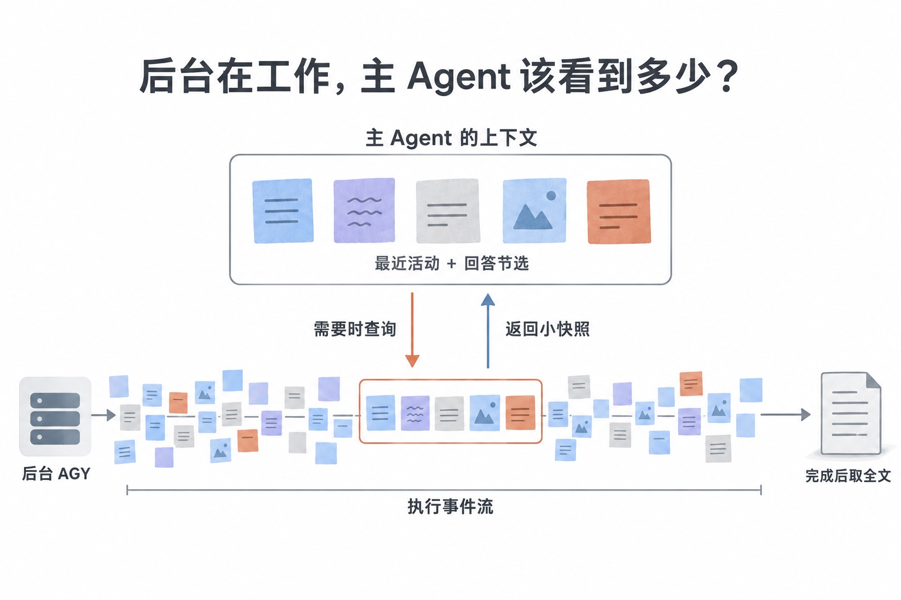

# Harness 优化实践：Agent 工具优化｜agy-staff 迭代随笔

`READ⏰: 8min`

## 迭代过程

前段时间分享过 [agy-staff](../agy-staff/)

*agy-staff 架构图*

一个让 Gemini 给 Codex / Claude Code 打工的插件。当时说准备正常使用一段时间，再回来分享体验。最近边用边改，也积累了一些新的思考。这里给出更新之后的一个原理图：

*后台任务的时间线：主 Agent 派发、等待或观察，worker 持续保存输出并最终交付完整报告*

**0.4 那会儿，主要围绕几个 persona skills 组织功能**：调研、审查、实现，以及通用的 staffer。主要是在做一些 Prompt Engineering，避免 Codex / Claude 需要反复设置特定的 Agent Role。

此时已经可以让 Gemini 在后台执行任务，完成后再由主 Agent 收取结果，只不过比较“粗糙”。使用时通常由我显式选择对应的角色，例如“请你使用 `/agy:staffer`”。这个阶段更关心的是：如何让 Codex / Claude 很方便地调用 Gemini，并且**用户友好**。通过简单的 `/agy:staffer` 或 `/agy:reviewer`，就可以避免很多重复输入。

后面的更新，则是我在使用过程中发现接入通用 Harness 时的一些痛点，从而开始进行优化。

**从 0.4 后期到 0.5，更新了默认模型，也补了接入和使用上的一些问题。** 默认模型换到了 Gemini 3.8 Flash，期间也加入了 Pi 支持（来自网友的 [contribution](https://github.com/keli-wen/agy-staff/pull/6)，感谢～）。

其中一个比较有意思的改动是 implementer。

之前的 implementer 有一个执行前的检查，要求开始任务时是干净的工作区。这个设计的目的，主要是担心 Agent 把已有修改和新修改混在一起，不方便审查和回退。所以只要存在未提交改动，就会要求先 commit 或 stash。

但后来在实际使用时遇到了一个问题：当你希望继续修改时，这个检查会拒绝 implementer 继续，因为工作区里已经有上一轮留下的修改了。**自己刚做完的工作，反而成了继续工作的障碍。** 这说明之前的设计确实不够合理。

因此，我反思了自己的设计，发现它有点不够 agent-friendly。它在 tool 层面提前注入了一个预设：“只要存在未提交修改，就不适合继续执行。” 但这个条件并不能区分，哪些修改是用户的其他工作，哪些恰好就是当前任务要继续处理的内容。

这里让我想到原始的 RAG System，或者说，我之前在[《Just-in-Time Context，一篇就够了》](../../one-poem-suffices/just-in-time-context/)中讨论过的那个问题：**谁在决定下一步？ Push vs Pull Mode** 有些判断确实可以提前固定，但有些需要结合任务上下文。过早替 Agent 做掉这些判断，可能会限制它本来能够处理的情况（不符合 the bitter lesson）。

所以在 0.4.4，我移除了这个统一拒绝的检查，允许 implementer 在脏工作区上执行任务，同时把已有改动作为上下文传给执行 Agent。任务明确包含的修改可以继续处理；如果涉及无关工作、归属不清，或者可能覆盖用户的修改，则要求先检查和澄清。

*implementer 在脏工作区上继续任务*

这也让我想到各个 Harness 中的 auto-approve mode。

!!! note "Agent-native tools 与 Just-in-Time Context"

    其实越来越觉得，我这里对 **Agent-native tools** 的理解，和 Just-in-Time Context 是相通的。很重要的一点是：**由 Agent 决策的渐进式披露**，让它可以在需要时获取信息，再根据这些信息决定下一步。

    我目前很倾向于沿着这个方向设计 long-horizon agent tools/orchestration。至少对于我正在做的这类工具，它是一个很有用的设计出发点。

    借用 [Anthropic 对 Agent 的定义](https://www.anthropic.com/engineering/effective-context-engineering-for-ai-agents)：**“LLMs autonomously using tools in a loop.”**

    从 Agent 的视角来说，我希望工具能够支持整个 loop 持续推进。对于那些可以结合上下文处理的阻塞，提供继续判断/决策的机会，而不是把决策权交给所谓的规则或系统。同时，工具要提供**必要的、有限制的、可以渐进式披露的上下文**。

    其中一部分由 tools 负责，另一部分由 general Harness 负责，这也是 Harness 为什么如此重要。

    这里推荐两篇博客，我也从中汲取了灵感：

    - [Anthropic：Writing effective tools for agents — with agents](https://www.anthropic.com/engineering/writing-tools-for-agents)
    - [OpenAI：Shell + Skills + Compaction: Tips for long-running agents that do real work](https://developers.openai.com/blog/skills-shell-tips)

**0.6 系列的重点，是让工具执行过程可以有限度地观测，并完善超时之后重新决策的机制。**

催生这轮更新的一个场景，是原来一些研究任务会超过默认的十分钟执行时限，往往还没完成就中断了。虽然当时已经有独立的 `wait` 接口，等待到期不会停止后台任务，但它主要能告诉调用方“还在运行”。真正执行超时之后，交给主 Agent 的进展和恢复信息也比较有限。

而这里的核心问题是：**我们做的并不是 Harness 内的原生工具，而是一个外部 plugin。** 主 Agent 并不能原生知道具体发生了什么。仅仅告诉它“超时了”，也不足以帮助它判断，接下来应该继续、调整任务，还是停下来检查。

这就又回到了前面说的：工具需要**提供必要的、有限制的、能够支持下一步判断的上下文**。

从这个角度看，agy-staff 原本已经是一个由 Bash + Skills 实现的异步 subagent 插件。0.6 则让它的形态更具体了：**一个通过 Bash + Skills 接入通用 Harness，支持异步执行和流式进展观察的外部 subagent 工具。**

所以这一轮补上了流式进展收集和 `observe`。需要了解进展时，先取得一个小快照：包含最多五次最近工具活动，以及最近的回答文本节选。

这里的核心是“有限制”，可以参考我的[《为什么 Codex 总在自动压缩？》](../why-codex-compacts/)这篇博客。上下文资源是宝贵的，一股脑输入大量中间过程，可能会影响主 Agent 对任务的判断。（虽然大部分 Harness 都会设置 Bash Tool 的 output 上限，但这也提醒我，一个好的 tool 自己就应该考虑这个问题。）需要更多信息时，再展开细节；完整报告则单独收取。

*observe 返回的有限进展快照*

这里也让我自己重新梳理了 agent tool 中“等待多久”和“允许执行多久”的区别。

我把前者理解为一次 **attention lease**：主 Agent 等待一段时间后，可以重新取得当前状态，再决定是否继续等待。它是一个有限的等待窗口，不等于后台任务的执行权限到期（这部分结合开头的图就很容易理解了）。真正达到执行上限时，任务仍然会停止，但插件需要尽可能保留进展、会话和恢复入口，让后续处理有依据。

!!! note "可观测不等于一直观测"

    其实实现 observe 后，我又发现了另一个问题：在自己的一些 Codex 调用中，如果不显式指导，它会反复 observe。

    这让我感觉有点本末倒置了。我们用 subagent，通常也是希望做上下文隔离。如果主 Agent 不断读取它的中间过程，就又把一部分探索过程带回了自己的 Context。可观测是一种能力，但不意味着需要一直观测。

    相比之下，我使用 Claude Code 时较少遇到这种情况。具体是 Harness 或者模型的问题，还是 Skill 的引导造成了区别，这个我会在下一篇详细博客中继续分析。

    所以，基于更新后的 Skill 的指导，现在默认仍然是安静等待结果，用户询问进展时再去看；失败或结果需要介入时，再按需读取诊断信息。

**0.7 则是增加了编排的能力：`/agy:lead`。**

启用后，由当前主 Agent 负责组织工作、选择适合委派的任务、审查结果，再根据反馈继续协作。这个方式也不限于编码，调研、写作和分析都可以沿着同一套分工推进。

我这里做得比较薄和简单，但我觉得挺有价值。原来更多依靠用户显式指定任务，而有了编排 Skill 后，可以通过 `/agy:lead <任务指令>`，让主 Agent 在推进任务的过程中组织 AGY 的工作。换句话说，就是给当前任务显式打开了一个“编排模式”～

目前的编排仍然很简单。我参考了之前[《Thinking in Context：何时需要多智能体》](../../thinking-in-context/when-multi-agent/)和个人的 dev-skills，只做了基础规则的定义：考虑上下文边界来 fan-out 子任务，独立的工作并行，有依赖的工作顺序推进，关键判断和最终验收留在主 Agent。很小的任务则直接处理，不必为了编排而编排。

## 思考与下一步

做到这里，我开始更具体地理解 **Agent-native tools**。

对于 agy-staff 这样的**长程**工具，我希望调用它的 Agent 可以把工作放到后台，在需要时拿到足够的信息，并据此决定下一步。工具的使用说明、返回内容和执行状态，都需要围绕这个过程设计。这也和之前写渐进式披露时关注的问题连了起来：当前这一步，究竟需要给 Agent 多少 Context？

比较有意思的是，agy-staff 通过 Skills 和普通 Shell 调用接入宿主。怎样在这样的约束下，让一个外部 Agent 的协作体验更接近原生 subagent，是这段时间反复琢磨的事情。

!!! ambition "编排的能力很重要"

    我的使用感受是，相同的任务，做不同的编排，完成任务的效率有时真的会天差地别。哪些工作直接 orchestrator 做，哪些交给其他 Agent，按什么边界拆分子任务构建编排 Graph，什么时候收回来 review，这些选择都很影响结果。

    我预期模型会随着训练越来越擅长一些经典编排，但这里是有时间差的。尤其对于一些分工不那么显然、又带有个人偏好和特定上下文的问题，能自己设计编排，仍然可以做出很实际的区分。（最近我看 OpenAI 解决 NS 问题调度了接近 1w 个 agents，应该涉及了挺复杂的编排模式，肯定不是简单的 orchestrator-worker，例如是层级编排或者是 A2A 的 society 去中心化编排？）

    所以我的兴趣更多在 Harness 和 Orchestration：我觉得这是至少目前和模型能力互补的一些领域吧～ 关于编排，之后也准备单独写一篇《Agent Orchestration，一篇就够了》。（各种挖坑）

*`/agy:lead` 编排模式*

后面准备以 agy-staff 为例，写一篇《如何理解与设计更好的 Agent Tool》，从 Agent loop / Harness / long-horizon tasks 的角度，思考这些设计背后的取舍。

这次先简单更新一下，项目和使用说明放在 [GitHub](https://github.com/keli-wen/agy-staff)。欢迎交流使用体验～
